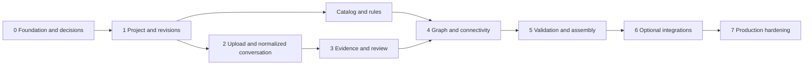

# Schemora — Backend & Database Implementation Plan

**Document status:** Engineering execution baseline  
**Version:** 1.0  
**Last reviewed:** 13 October 2026  
**Product requirements:** PRD.md  
**Technical design:** TRD.md  
**System design:** System-Design.md  
**Source context:** context.md

## Document control

| Field               | Value                                                                            |
| ------------------- | -------------------------------------------------------------------------------- |
| Owner               | Backend engineering owner (to be assigned)                                       |
| Status              | Engineering execution baseline; infrastructure choices remain gated where marked |
| Review cadence      | At phase exits, schema changes, and release readiness review                     |
| Product authority   | PRD.md                                                                           |
| Technical authority | TRD.md                                                                           |
| Change rule         | Record data, API, migration, security, and operations impact                     |

## Contents

1. [Purpose](#1-purpose)
2. [Workstream map](#2-workstream-map)
3. [Phase sequence](#3-phase-sequence)
4. [Phase 0 — Foundation and decisions](#4-phase-0--foundation-and-decisions)
5. [Phase 1 — Project ownership, lifecycle, and revisions](#5-phase-1--project-ownership-lifecycle-and-revisions)
6. [Phase 2 — Upload, parsing, and normalized conversation](#6-phase-2--upload-parsing-and-normalized-conversation)
7. [Phase 3 — Extraction, evidence, and review](#7-phase-3--extraction-evidence-and-review)
8. [Phase 4 — Catalog, graph, and connectivity](#8-phase-4--catalog-graph-and-connectivity)
9. [Phase 5 — Validation and assembly planning](#9-phase-5--validation-and-assembly-planning)
10. [Phase 6 — Optional provider and simulator integrations](#10-phase-6--optional-provider-and-simulator-integrations)
11. [Phase 7 — Security, deletion, and production operations](#11-phase-7--security-deletion-and-production-operations)
12. [Database migration protocol](#12-database-migration-protocol)
13. [API and repository implementation standards](#13-api-and-repository-implementation-standards)
14. [CI, testing, and delivery evidence](#14-ci-testing-and-delivery-evidence)
15. [Change management and definition of done](#15-change-management-and-definition-of-done)
16. [Decision register](#16-decision-register)
17. [Implementation acceptance matrix](#17-implementation-acceptance-matrix)
18. [Handoff](#18-handoff)

## 1. Purpose

**Phase 1 product delivery:** The repository's first implemented product phase covers foundation, ownership, upload/normalization, extraction, and review, corresponding to this plan's tranches 0–3. The initial durable transport is PostgreSQL outbox/jobs, private development storage is filesystem-backed, production storage uses the S3 port, and identity uses GitHub OAuth through the web/API boundary. These concrete choices are recorded in [Phase-1-Implementation.md](Phase-1-Implementation.md); the later catalog, graph, validation, assembly, and operations tranches retain their own exit criteria.

This plan turns the approved product and technical boundaries into a backend and database delivery sequence. It is intended to be used for engineering breakdown, migration review, release planning, and operational handoff. It is not a second PRD or a generic list of backend best practices.

The work is organized around one central invariant: every saved or derived result must be traceable to a project revision and the exact hardware, rules, and processing versions that shaped it. The implementation starts with the smallest user-visible workflow that can prove the product: import an existing conversation, review what was extracted, represent a supported circuit, demonstrate its assembly, and report what is known or still uncertain.

### 1.1 Planning assumptions

The implementation follows the technology baseline recorded in TRD.md and the scaling strategy in System-Design.md: a TypeScript modular monolith deployed as stateless web/API and independently scalable worker roles, PostgreSQL with Drizzle, a Next.js/React desktop web client, private object storage, a transactional outbox, and adapters for queues and external providers. Vendors for identity, object storage, queue, and simulation remain open until their decision gates are satisfied. The implementation must not turn those open choices into hidden dependencies.

The first catalog is intentionally limited. Product and hardware reviewers must select the exact ESP32 development board, breadboard, LED, resistor, and wire set. “ESP32” is not sufficiently precise to implement pin anchors or electrical constraints. The first reference conversation and circuit are versioned fixtures, not implicit defaults.

### 1.2 Delivery rules

Each phase produces an integrated, reviewable capability. A table existing without its lifecycle, authorization, migration, and verification behavior does not constitute a completed phase. Schema and API contracts are designed before route implementation. Long-running or external work is asynchronous. Project writes use optimistic concurrency. Jobs and events are safe under duplicate delivery. External model output remains a candidate until validated and reviewed.

## 2. Workstream map

| Workstream             | Accountable area            | Primary output                                                                    | Depends on                 |
| ---------------------- | --------------------------- | --------------------------------------------------------------------------------- | -------------------------- |
| Application foundation | Backend platform            | Typed domain packages, API/worker entry points, configuration, migration baseline | Stack and vendor decisions |
| Project persistence    | Project domain              | Authorization, project lifecycle, immutable revisions                             | Identity mapping           |
| Import pipeline        | Source/ingestion            | Private upload, parser adapters, normalized messages, durable jobs                | Storage and queue adapters |
| Evidence workflow      | Design domain               | Candidate facts, provenance, human review, conflict handling                      | Normalized messages        |
| Hardware truth         | Catalog and hardware review | Versioned catalog, exact pins, topology, assets, citations                        | Selected MVP hardware      |
| Circuit state          | Graph domain                | Typed graph commands, connectivity, versioned snapshots                           | Catalog release            |
| Readiness and guidance | Validation/planning         | Immutable findings, readiness, assembly plan, progress                            | Graph and ruleset          |
| Production operations  | Operations/security         | Release process, recovery, deletion, monitoring, incident readiness               | All canonical data paths   |

A workstream may proceed in parallel only after its shared contract has an owner and a reviewed version. For example, the workbench can prototype against a fixture graph while the parser is being built, but both must converge on the same versioned project schema before integration.

## 3. Phase sequence

### Phase summary

| Phase                      | Outcome                                                                                | Exit evidence                                                       |
| -------------------------- | -------------------------------------------------------------------------------------- | ------------------------------------------------------------------- |
| 0. Foundation              | Reproducible repository, configuration, migrations, local services, decision ownership | Clean CI bootstrap and approved dependency decisions                |
| 1. Project and revisions   | Authorized project lifecycle and concurrency-safe revision history                     | Cross-project tests, concurrent write test, revision reconstruction |
| 2. Import                  | Private upload, safe parsing, normalized conversation and job lifecycle                | Format fixtures, hostile archive tests, retry and deletion checks   |
| 3. Evidence                | Provenance-backed candidates and explicit user review                                  | Extraction benchmark, review audit, conflict and unknown scenarios  |
| 4. Catalog and graph       | Exact supported hardware and canonical connectivity                                    | Catalog review, pin-anchor check, deterministic graph fixtures      |
| 5. Validation and assembly | Version-bound readiness and step-by-step guide                                         | Golden rule suite, plan predicates, stale-state tests, novice study |
| 6. Optional integrations   | Individually gated tutor, simulation, photo recognition                                | Per-capability quality, legal, privacy, and operational approval    |
| 7. Production              | Recoverable, monitored, secure release                                                 | Backup/restore rehearsal, release scorecard, on-call handoff        |

## 4. Phase 0 — Foundation and decisions

### Objective

Make the development and deployment shape reproducible before persistent interfaces are depended upon. Close decisions that affect foundational APIs or data, and isolate decisions that can safely remain open.

### Work

Create the pnpm workspace with packages for domain types, contracts, persistence, catalog, graph, validation, provider adapters, API, worker, and test fixtures. Enforce dependency direction: domain packages do not import Next.js, route modules, or ORM models; routes do not call provider SDKs; workers use the same application services and contracts as synchronous operations.

Establish Node and TypeScript versions, lockfile policy, formatter, type checks, lint rules, and CI. Add PostgreSQL migration tooling through Drizzle, but keep generated migrations reviewable and test them from an empty schema. Define environment configuration with typed validation and redacted diagnostics. Local and CI provider adapters are fakes by default.

Close the exact relational database engine/version, migration invocation, and baseline service identities before shared schema development. Select the first hardware scenario and have its facts reviewed before pin-specific work begins. Record the queue, object-store, identity, and external-model decisions as open until their criteria are met.

### Exit criteria

A new developer can reproduce local startup and clean database initialization. CI applies every migration from baseline. Production configuration rejects local adapters. No real credentials or source files are required for normal tests. Architecture decisions name an owner, evidence, consequences, and review date.

## 5. Phase 1 — Project ownership, lifecycle, and revisions

### Objective

Provide durable project state with server-side access control and reliable concurrent editing.

### Schema and service work

Implement principal mapping from the selected identity provider. Store issuer plus provider subject as a unique pair; do not store authentication credentials in the application database. Implement project ownership and a membership table, but expose collaboration only if the product approves its role model.

Create the project root with lifecycle state, owner, title, current revision reference, and catalog release pin. Create immutable project revisions with project-local sequence, parent revision, schema version, actor, change kind, canonical payload reference, and digest. The project head and revision insert must commit in one transaction.

Implement a shared project-scope resolver. Every nested read includes project ID in the query. Opaque IDs are not authorization. Reads and writes distinguish unauthorized access safely; they do not reveal whether another user’s project exists.

### API work

Implement project creation, paginated project listing, project summary, metadata update, revision history, revision retrieval, archive, and deletion request. Mutations carry expected revision and idempotency behavior where required. Project creation atomically establishes owner and initial revision. Deletion first marks the project deleting and revokes normal access; physical cleanup comes in the retention phase.

### Verification and exit

Test owner and non-owner access for project, revision, and guessed nested IDs. Race two edits from the same expected revision and prove one receives a conflict without partial state. Reconstruct a project snapshot from revision and immutable artifact references. Prove that a database rollback cannot leave the project head pointing to a missing revision.

## 6. Phase 2 — Upload, parsing, and normalized conversation

### Objective

Turn a private user upload into a durable, ordered, source-linked conversation representation while containing parser risk.

### Persistence and upload lifecycle

Create source metadata before issuing an upload capability. The record contains project scope, uploader, opaque storage key, declared and detected media types, expected and verified size, digest, retention class, and lifecycle state. The browser never receives a raw storage key. Upload completion verifies actual bytes, size, and digest through a trusted path before source state becomes accepted.

Store conversation output separately from source bytes. Each parse version records source digest, parser version, normalization schema, status, warnings, and output digest. Messages have stable order, role when recoverable, source locator, timestamps when trustworthy, normalized body, and bounded attachment references.

### Processing

Use a transactional outbox to publish inspection and parse jobs. The job record is the lifecycle authority; the queue is transport. A parser worker claims a bounded lease, verifies source is accepted and retained, processes in an isolated temporary directory, and persists output idempotently. Format adapters are separate and fixture-backed. Archive handling enforces path, nesting, entry-count, and expanded-size limits. HTML is inert. Parser workers have bounded CPU, memory, disk, and time and no general network access.

Initial format support is a product decision. Candidates in context.md include HTML, Markdown, plain text, PDF, JSON exports, and restricted ZIP bundles. Implement formats according to actual user demand and parser reliability; do not label a format supported merely because a library can open it.

### Verification and exit

Fixtures cover reordered or missing metadata, code blocks, timestamps, multiple conversation turns, superseded design choices, malformed files, partial parsing, archive traversal, decompression bombs, and cancellation. Verify message order and source locators. Verify duplicate queue delivery produces one normalized output. Verify deletion or retention expiry prevents later worker reads.

## 7. Phase 3 — Extraction, evidence, and review

### Objective

Convert normalized content into a reviewable design candidate while preserving provenance and uncertainty.

### Candidate model

Define typed candidate entities for board, component, quantity, terminal connection, firmware, dependency, missing fact, and contradiction. Each candidate stores its origin, source message/span, extraction run, schema version, and review state. Candidate values and review decisions are separate records: accepting a candidate creates an auditable action and project revision rather than overwriting the model output.

The extraction adapter receives only the relevant source messages and task context. It returns schema-constrained data. The application validates every source reference, unit, enum, catalog identity, payload size, and connection endpoint. Unknown board revision, resistor value, or terminal assignment stays unknown. Confidence is a ranking signal for review and is never treated as confirmation.

### Review experience and persistence

Provide a design overview that separates confirmed facts, candidates, unknowns, and conflicts. The user can accept, reject, correct, or request clarification. Resolution records the actor, time, reason, evidence, and resulting revision. A confirmed fact cannot be silently replaced by a later extraction run. Previous decisions remain inspectable.

### Verification and exit

Build a synthetic benchmark with varied conversation structures and expected components, connections, final decisions, and source spans. Report precision and recall by fact class, not just one aggregate score. Test prompt injection, contradictory prior assistant answers, ambiguous board family, wrong source IDs, invalid units, and provider outage. Require human review for facts that affect exact assembly or safety.

## 8. Phase 4 — Catalog, graph, and connectivity

### Objective

Create a reviewed source of hardware truth and the canonical graph that both the renderer and validator consume.

### Catalog work

Select the exact first board and component set with product and hardware reviewers. For each release, store stable component IDs, versioned facts, physical pin index, logical signal, electrical capability, terminal identity, dimensions, asset reference, local anchor coordinate, source citation, license state, and review record. Breadboard holes map to explicit electrical nodes, including rail segmentation.

The catalog build pipeline validates schema, units, ranges, references, pin uniqueness, anchor bounds, package scale, assets, source provenance, and licenses. Published packages are immutable and content-addressed. Project migration to a new catalog release creates a new revision, reports all changed mappings, and re-runs affected checks.

### Graph work

Store project component instances, semantic terminal instances, connection edges, placement data, graph revisions, and canonical digests. Rendering coordinates and wire appearance are not electrical identifiers. Derive net membership from graph edges and catalog breadboard topology in deterministic order. Client commands are typed and include expected project and graph revisions.

### Verification and exit

Hardware reviewer signs off exact facts and citations. Compare 3D pin anchors against physical measurements. Run golden connectivity cases, including disconnected breadboard rails and connected rows. Property-test connectivity against shuffled edge order. Race graph mutations and confirm stale commands conflict. Prove that rendering failure does not alter graph state.

## 9. Phase 5 — Validation and assembly planning

### Validation implementation

Publish immutable ruleset packages with rule IDs, input requirements, severity, unknown behavior, compatibility, and digest. A validation run records graph digest, catalog digest, ruleset release, validator build, and profile. Findings use pass, fail, unknown, not applicable, and execution error. Store affected entities and evidence references; do not accept client-authored findings.

Use a deterministic cache key containing every semantic input. Cached reports are reused only for identical inputs and according to retention policy. A report remains immutable when a project changes and is presented as stale against current state.

### Assembly implementation

Generate typed, immutable steps from the validated graph and selected procedure version. Each step has stable identity, operation, target components/terminals, prerequisites, camera/highlight targets, safety note, and completion predicate. Reject cycles and unresolved target IDs. The server evaluates progress from current graph state or explicit user evidence. A “Next” click is not completion. On graph changes, invalidate only the progress whose predicates depend on affected inputs and retain its history.

### Phase 8 design intent persistence

The current implementation adds append-only `circuit_design_intent_versions` rows that reference immutable `circuit_graph_snapshots`; `project_circuit_design_intents` selects the active confirmed target. Confirmation is an expected-revision, idempotent project mutation and can reference only the graph snapshot current at that revision. Re-confirmation appends a new version and advances the pointer. Comparison is computed from immutable intent/current graph identities and is versioned at the API boundary. Checklist acknowledgements remain browser-local and are not represented as an auditable server record; adding cross-device audit requires a product retention and consent decision.

### Verification and exit

Use known-good circuits and deliberately faulty variants as golden fixtures. Test every rule’s input requirements and unknown handling. Verify stable report ordering for identical inputs and stale marking after graph change. Validate assembly prerequisite ordering, predicate evaluation, undo, skip, and invalidation. Conduct a novice task session before calling the assembly flow ready.

## 10. Phase 6 — Optional provider and simulator integrations

Each capability is implemented behind an adapter and enabled independently. Do not make a shared “AI enabled” flag that couples extraction, tutoring, vision, and simulation.

| Capability | Required proof before enablement                                                                          | Safe behavior before proof                                  |
| ---------- | --------------------------------------------------------------------------------------------------------- | ----------------------------------------------------------- |
| Extraction | Benchmark quality, evidence localization, schema reliability, retention and privacy review, quota control | Fake adapter in tests; manual review or unavailable state   |
| Tutor      | Context minimization, grounding quality, privacy review, output policy                                    | Curated explanations remain available                       |
| Vision     | Representative image benchmark, exact-model confirmation, consent and metadata handling                   | Manual catalog selection                                    |
| Simulation | API/engine access, commercial rights, supported components, sandbox, repeatable outputs                   | Mark unsupported/unavailable; preserve circuit and firmware |

Firmware and simulator workloads execute outside the web process under explicit CPU, memory, wall-clock, and output-size budgets. Provider URLs are configuration-controlled, never client-supplied. All provider output is untrusted and validated before persistence.

## 11. Phase 7 — Security, deletion, and production operations

### Security and privacy

Complete a data inventory for conversation source, normalized text, photos, firmware, derived facts, reports, logs, and backups. For each class, document purpose, access scope, provider movement, retention, deletion, backup expiry, and support access. Store secrets in a managed secret system. Separate runtime, migration, worker, and provider identities. Keep project and object authorization server-side.

### Deletion

Deletion transitions the project to a state that blocks ordinary reads and writes before cleanup begins. Cancel or invalidate pending work. Enumerate objects through metadata relationships, not bucket-wide search. Delete source bytes, normalized text, derived files, projections, and retained artifacts under policy. Retry idempotently and expose completion status. Keep only approved audit metadata. Restore procedures reapply deletion records before exposing recovered data.

### Observability and recovery

Instrument save success, revision conflicts, import stage outcomes, queue age, provider failures, validator state counts, object integrity, and deletion backlog. Logs and metrics do not carry source text or secret values. Every critical alert has an owner and runbook. Approve recovery objectives before launch; rehearse database and object restore together in isolation and verify project, graph, catalog, and source digests.

### Release

Build one immutable artifact per source revision and promote that same digest. Apply additive migrations before application promotion. Use expand/backfill/verify/contract for incompatible data transitions. Run a canary with project save, import, graph mutation, validation, and deletion signals. Stop rollout on authorization defects, false save success, catalog mismatch, stale-result application, or critical data-integrity errors.

## 12. Database migration protocol

Every migration is append-only once applied to a shared environment and carries an ID, checksum, owner, reviewer, compatibility statement, expected runtime, and verification evidence. The production application identity cannot execute DDL; a separate migration identity runs reviewed migrations.

For additive changes, add the new schema first and keep old and new application versions compatible. For a representation change, deploy compatible code, backfill in bounded batches using a stable cursor, compare old and new digests, switch reads, observe, and remove old schema in a later contract release. Large indexes use online creation where supported. Constraints on existing data are preflighted and validated in stages. No migration uses an unbounded rewrite without measured lock and recovery analysis.

A data migration is not assumed reversible. Before production, rehearse it on a clean baseline and representative data volume, interrupt and resume batch jobs, measure locks and runtime, and test forward recovery or restore. Never edit migration history by hand to bypass a checksum or failed migration.

### 12.1 Migration tranches

Migration work should be split so that each tranche has one domain owner and a focused compatibility review. The identifiers below are proposed planning labels; the repository migration tool assigns the final immutable IDs when work is scheduled.

| Tranche | Schema change                               | Compatibility approach                                       | Verification focus                                         |
| ------- | ------------------------------------------- | ------------------------------------------------------------ | ---------------------------------------------------------- |
| M0      | Migration ledger and principal mapping      | Additive; no project data yet                                | Empty database bootstrap and checksum verification         |
| M1      | Projects, memberships, revisions            | Create project root before revision pointer becomes required | Owner integrity, revision ordering, concurrent head update |
| M2      | Upload intent and source object metadata    | Add lifecycle columns before enabling upload                 | Type, digest, expiry, and cleanup behavior                 |
| M3      | Conversation, message, parser-run records   | New tables; parser output is versioned                       | Stable ordering, source locator, deletion propagation      |
| M4      | Evidence, facts, issues, review actions     | Append-only review history                                   | Candidate/confirmed separation and provenance constraints  |
| M5      | Catalog release and component records       | Published release is immutable                               | Digest, source, unit, and pin uniqueness checks            |
| M6      | Graph revision, instances, terminals, edges | Add graph head before enabling graph commands                | Same-project references and deterministic digest           |
| M7      | Rulesets, validation runs, findings         | Immutable output tables                                      | Exact input binding and result-state vocabulary            |
| M8      | Plans, steps, progress events               | Progress separated from immutable plan                       | Predicate reference and projection rebuild                 |
| M9      | Jobs, attempts, outbox, idempotency         | Required before async work is accepted                       | Duplicate publish, lease recovery, key uniqueness          |
| M10     | Audit, deletion, retention, export metadata | Add before production source retention                       | Deletion coverage and restore ledger                       |

The migration owner maintains the final IDs, ordering, and checksum in repository history. A migration label in this plan is not a database identity and must not be used by runtime code.

### 12.2 Migration rehearsal record

For each production migration, record the starting schema, artifact versions allowed during the change, migration digest, expected row volume, measured runtime, maximum lock wait, and temporary storage requirement. For backfills, include the cursor key, batch size, retry behavior, and expected number of rows. After execution, record processed, skipped, retried, and failed counts; verify foreign keys and domain invariants; and compare representative content digests.

If the migration changes ownership or retention fields, security and privacy owners review it. If it changes catalog, graph, or ruleset semantics, the relevant hardware or electrical reviewer signs the data interpretation. If the application must be rolled back, the migration owner states whether the old artifact remains compatible with the expanded schema; they do not assume that reverting DDL restores user data.

## 13. API and repository implementation standards

Routes parse HTTP concerns and delegate to application services. Application services enforce authorization, revision checks, idempotency, and domain transitions. Repositories take explicit project scope and transaction context and return domain values rather than ORM entities. Serializers emit stable public contracts. Provider SDKs remain behind adapters.

| Concern        | Implementation rule                                                                              |
| -------------- | ------------------------------------------------------------------------------------------------ |
| Authentication | Principal derives from trusted session or identity assertion                                     |
| Authorization  | Project scope is checked before nested record retrieval                                          |
| Concurrency    | Mutations compare expected revision atomically                                                   |
| Idempotency    | Stable keys are scoped by principal, project, and operation; payload digest mismatch is rejected |
| Errors         | Stable code, retryability, correlation ID, and safe message                                      |
| Pagination     | Bounded cursor with deterministic tie-breaker                                                    |
| Jobs           | Durable job ID and status returned for asynchronous work                                         |
| Freshness      | Derived resources expose input version and stale state                                           |
| Serialization  | ORM models and internal object keys never cross the API boundary                                 |

### 13.1 Route-to-record mapping

Every route is reviewed against its canonical tables, transaction boundary, and invalidation behavior. This mapping prevents a route from writing a second copy of a fact owned by another domain.

| Operation               | Canonical reads                             | Canonical writes                                      | Derived or async effect                |
| ----------------------- | ------------------------------------------- | ----------------------------------------------------- | -------------------------------------- |
| Create project          | Principal, published catalog release        | Project, initial revision, owner membership, audit    | Optional initialization outbox event   |
| Update project metadata | Project head, current revision              | New revision, project summary projection, audit       | Read projection refresh if used        |
| Create import           | Project scope, quota policy                 | Pending source intent                                 | Scoped upload capability               |
| Complete import         | Source intent, object metadata              | Accepted/rejected source state, audit                 | Inspection outbox event                |
| Review extracted fact   | Candidate, evidence, current revision       | Review action, fact state, issue transition, revision | Validation/plan invalidation event     |
| Search catalog          | Published release and search projection     | None for ordinary user                                | Optional cache keyed by release digest |
| Graph command           | Project, graph head, catalog terminal facts | Graph revision, project revision, audit               | Invalidation outbox event              |
| Request validation      | Graph, catalog, ruleset, project scope      | Validation run and job intent                         | Worker evaluation and immutable report |
| Submit assembly action  | Plan, step predicate, current graph         | Progress event and projection                         | No external provider call              |
| Delete project          | Owner scope and lifecycle                   | Deleting state, audit, deletion job                   | Object and derived-data cleanup        |

Routes must load a nested resource using both its identifier and project identifier. Authorization is checked before source bytes or sensitive details are fetched. If the route creates a revision, that fact is stated in the API contract and response.

### 13.2 Mutation transaction template

The route validates the session and request schema, then calls an application service. The service resolves project scope, checks lifecycle, compares the expected revision, and validates domain references. Within a bounded transaction it writes the canonical state transition, immutable revision or event, audit record, and outbox intent. After commit, it serializes the committed revision and returns it. If a database constraint rejects the operation, the service maps the constraint to a stable domain error; it does not expose SQL text.

Long-running work is never executed inside this transaction. The transaction records a durable intent and returns a job or run identifier. Workers recheck lifecycle and input freshness before persisting output.

## 14. CI, testing, and delivery evidence

CI checks types, formatting, package boundaries, runtime schemas, unit tests, repository constraints, API contracts, migrations, security scans, and artifact construction. Integration tests use isolated databases, fake storage/queue/provider adapters, and synthetic fixtures. Provider live calls are not part of normal CI.

Release evidence records source revision, artifact digest, schema version, job/event payload versions, catalog release, ruleset release, environment, and pass/fail/skip counts. Skipped checks have an owner and reason. The evidence contains no user source content.

### 14.1 Worker registry for the first release

Every worker type has one registered payload schema, lease policy, retry class, resource limit, output record, and deletion interaction. New types are added through review rather than arbitrary queue dispatch.

| Job type                | Input reference                                         | Durable output                           | Retry posture                                               | Stop condition                                         |
| ----------------------- | ------------------------------------------------------- | ---------------------------------------- | ----------------------------------------------------------- | ------------------------------------------------------ |
| InspectSource           | Accepted source asset ID and digest                     | Inspection result and parser eligibility | Retry transient storage failure; do not retry invalid bytes | Source deleted, quarantined, or expired                |
| NormalizeConversation   | Source asset ID and parser profile                      | Conversation and ordered message set     | Retry transient worker failure idempotently                 | Source no longer accepted                              |
| ExtractDesignCandidates | Conversation ID, task profile, approved provider policy | Candidate set and provider run metadata  | Bounded retry under quota policy                            | Consent withdrawn, source deleted, or project deleting |
| RunValidation           | Graph digest, catalog, ruleset, profile                 | Immutable run, findings, aggregate       | Retry deterministic execution fault only within budget      | Run cancelled or inputs unavailable                    |
| GenerateExport          | Project revision and selected data classes              | Expiring export object and manifest      | Retry object/transient failure                              | Project deleted or authorization revoked               |
| DeleteProjectData       | Project ID and deletion scope                           | Per-class cleanup completion             | Idempotent bounded retry                                    | Permission/integrity anomaly requiring review          |

### 14.2 Verification dataset

The team maintains a versioned synthetic dataset rather than relying on ad hoc developer examples. The dataset has one canonical ESP32 LED conversation, variants with changed pin assignments, a superseded instruction, missing board revision, missing resistor value, contradictory assistant advice, malformed export, and unsafe archive. Each fixture declares expected messages, extracted candidates, provenance locations, unresolved issues, graph state, validation outcomes, and assembly step dependencies.

Every catalog or validator change runs the compatible golden fixtures. Every parser change runs its format-specific fixtures. Extraction quality is measured by fact class and evidence localization; a passing schema check alone is not accepted as quality evidence.

The end-to-end reference scenario starts with a synthetic AI conversation for a supported ESP32 LED build. It verifies upload, parsing, provenance, review, exact catalog mapping, graph mutation, deterministic validation, assembly predicate, one injected wiring error, safe retry, and project deletion. A second principal must be unable to access any project resource or object.

## 15. Change management and definition of done

A work item is ready when its user or operational outcome, canonical data owner, API/job contract, authorization, lifecycle, migration impact, and verification method are known. It is done when the implementation and migration satisfy those contracts; failure, retry, stale, and deletion behavior are tested; telemetry is content-safe; documentation and operational procedures are updated; and evidence names the exact tested versions.

Changes to product outcome go to PRD.md. Changes to system boundary, versioning, or security contract go to TRD.md. Changes to execution sequence, schema migration procedure, or operational handoff go here. Requirement IDs are stable; removed work retains a disposition.

## 16. Decision register

| ID    | Decision                                | Owner                           | Closure evidence                                                | Blocks                       |
| ----- | --------------------------------------- | ------------------------------- | --------------------------------------------------------------- | ---------------------------- |
| BD-01 | Exact first board and LED circuit       | Product + hardware reviewer     | Approved source facts, physical measurements, pin anchor review | Catalog and graph release    |
| BD-02 | Identity provider and account lifecycle | Product + security              | Subject mapping, revocation and deletion proof                  | Production account workflows |
| BD-03 | Object storage service and region       | Operations + privacy            | Private access, digest, lifecycle, restore, regional review     | Production uploads           |
| BD-04 | Durable queue                           | Backend + operations            | Duplicate delivery, leases, replay, dead-letter proof           | Production async work        |
| BD-05 | Extraction provider                     | Product + privacy + engineering | Benchmark, retention terms, region, cost, safe fallback         | Live extraction              |
| BD-06 | Simulation integration                  | Engineering + legal             | Rights, API proof, coverage, sandbox, reference run             | Simulation claim             |
| BD-07 | Sharing roles                           | Product + security              | Approved role matrix and access tests                           | Collaboration                |
| BD-08 | Numeric SLOs                            | Product + operations            | Baseline load and user-device measurement                       | Production acceptance        |

## 17. Implementation acceptance matrix

| Capability                       | Minimum evidence before release                                                            |
| -------------------------------- | ------------------------------------------------------------------------------------------ |
| Project and revision persistence | Atomic creation, authorization, stale-write conflict, digest reconstruction                |
| Upload and parsing               | Private verified upload, safe parser isolation, format fixtures, deletion behavior         |
| Extraction and evidence          | Provenance, review action, conflict/unknown handling, benchmark                            |
| Catalog and graph                | Reviewed exact hardware, anchor verification, deterministic connectivity, concurrency test |
| Validation and assembly          | Immutable versioned results, unknown state, predicates, invalidation behavior              |
| Optional integrations            | Independent decision evidence, bounded execution, safe unavailable behavior                |
| Production operations            | Migration rehearsal, backup/restore, deletion, monitoring, runbooks, accountable on-call   |

A release is blocked by a critical authorization failure, silent data loss, false save success, incorrect exact-pin mapping, unknown-to-pass conversion, stale worker mutation, or unreviewed catalog fact. Any noncritical exception records impact, mitigation, owner, and expiry.

## 18. Handoff

This plan is ready to be decomposed into engineering work after its named infrastructure and hardware decisions are assigned and closed. Completion is based on verified product behavior and release evidence, not on the number of tables, routes, or sections produced.
