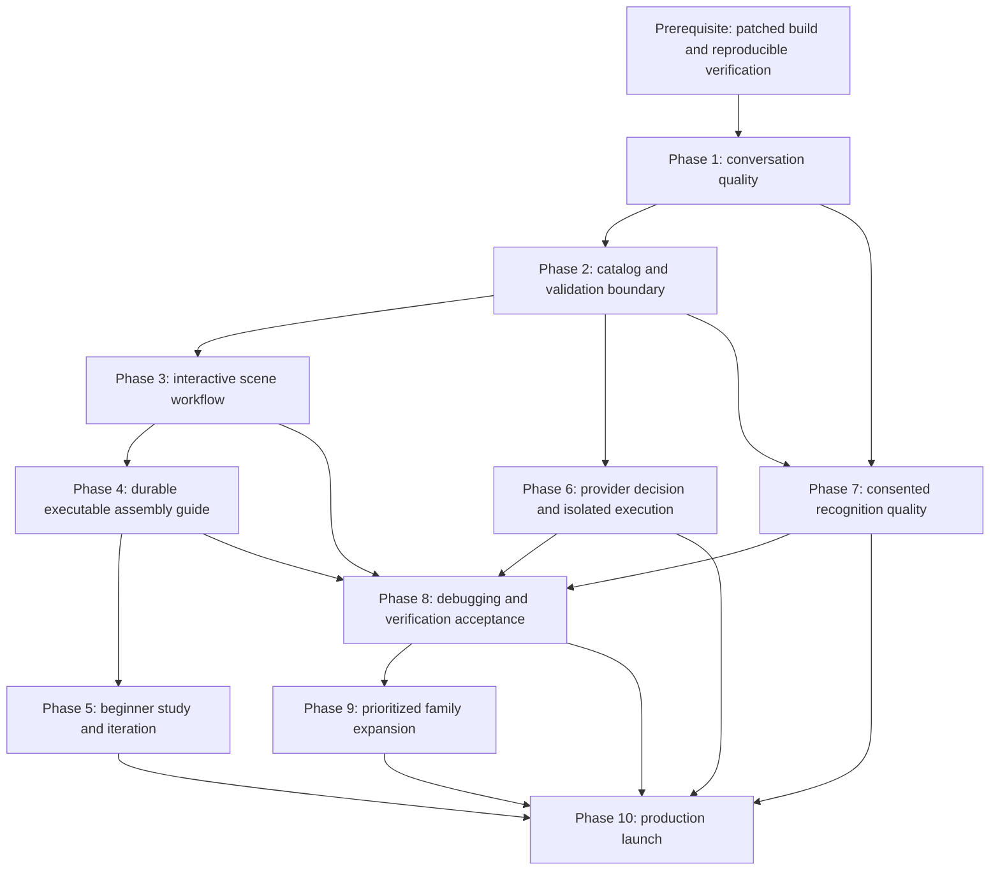

# Schemora Full-Product Implementation and Completion Plan

**Document status:** Living implementation and completion record; Gate 0 execution evidence is recorded in §5.5.
**Planning date:** 14 November 2026  
**Branch baseline reviewed:** `dev` at `1913b7a`  
**Roadmap authority:** [`context.md`](./context.md), ten product phases  
**Purpose:** Define the work, dependencies, and evidence required to complete the open scope across all ten product phases.

---

## 1. Executive intent

Schemora turns an existing hardware conversation into a reviewable design and, for supported catalog identities, a visual and instructional build workflow. The repository already contains substantial foundations: conversation import and review, a narrow source-backed catalog, graph validation, an illustrative 3D scene, assembly and teaching slices, firmware and recognition contracts, bounded diagnostics, project persistence, and deployment packaging.

The repository is **not a completed or production-ready product**. Several phases are intentionally narrow or partially implemented, external acceptance evidence is missing, no production environment is provisioned, and the latest audit found that the current web production build stops at a Next.js security gate. This plan defines a truthful path from that baseline to a supported release. It does not imply that all theoretical hardware families, physical effects, or universal electrical safety analysis will be implemented.

The product is complete for a release only when all of the following are true:

1. Every promised release workflow works from its supported input through its user-visible result and recovery paths.
2. Every supported behavior is bounded by exact catalog identities, versioned data, explicit uncertainty, and documented exclusions.
3. Automated tests cover the behavior at the appropriate layer, and external acceptance criteria have recorded evidence.
4. Security controls are active in the selected deployment, not merely represented by configuration or code.
5. Deployment, monitoring, retention, deletion, backup, recovery, and incident procedures have been exercised against real services.
6. All enabled capabilities have an owner, an operational boundary, measurable acceptance criteria, and user-facing limitations.

“100%” therefore means all agreed release requirements have evidence and no unowned release blocker remains. It does not mean every component on the market is supported or that a digital tool can certify a physical circuit as safe.

---

## 2. Planning scope and current baseline

### 2.1 Included work

This plan covers the remaining work in the existing ten phases, plus a prerequisite build/security gate discovered during the last audit:

- Stabilize the current dependency and verification baseline.
- Close Phase 1 benchmark quality evidence and Phase 2 catalog/versioning gates.
- Complete the promised Phase 3 interactive scene workflow for the supported starter design.
- Complete the Phase 4 durable, executable assembly-guide workflow.
- Collect Phase 5 beginner usability evidence and iterate on observed problems.
- Make an explicit Phase 6 product decision and, if enabled, connect an approved isolated compile/simulation service end to end.
- Close Phase 7 provider, benchmark, privacy, and lifecycle-testing gates.
- Close Phase 8 review, accessibility, checklist-state, and usability gates.
- Keep Phase 9 family expansion bounded, sourced, tested, and explicitly prioritized.
- Close Phase 10 product policy, upload security, production operations, deployment, and recovery gates.

### 2.2 Out of scope unless product scope is explicitly changed

- Universal recognition of any photograph or arbitrary hardware part.
- Universal circuit simulation or analog/thermal/mechanical simulation without a validated provider/model.
- Automatic generation of facts, pin mappings, or component placements unsupported by source evidence.
- Claiming physical fit, actual wiring correctness, or physical safety from a digital scene, checklist, model output, or a green result.
- Implementing every advanced hardware family in one release. Each family is a separately scoped vertical slice.
- Implementing project sharing implicitly. Sharing remains a product decision with authorization and privacy consequences.
- Enabling a remote provider merely because code can call it. Provider terms, consent, budget, benchmark, and operational readiness must pass first.

### 2.3 Repository baseline and caveats

The audit baseline is the repository state at commit `1913b7a` on `dev`; at that point `main` contains only `README.md` and the worktree is clean. The earlier full test and browser runs passed after the development database was migrated. In the current audit environment, PostgreSQL and Docker Desktop were unavailable, so database integration and browser E2E tests could not be rerun. The standalone workspace tests ran with database-dependent tests skipped. These historical and current results must not be conflated.

The current web app pins Next.js 16.4.0. The production build compiled and generated routes but terminated at Next.js’s security fatal gate. Next.js release notes show 16.4.5 included security fixes published on 3 November 2026 and 16.4.6 was subsequently released on 9 November 2026. The implementation work must verify the current patched stable release and the exact applicable advisories at the time of upgrade; do not pin a canary or treat a successful build retry as a security fix. See the [Next.js 16.4.5 security release](https://github.com/vercel/next.js/releases/tag/v16.4.5), [Next.js 16.4.6 release](https://github.com/vercel/next.js/releases/tag/v16.4.6), and [Next.js security advisories](https://github.com/vercel/next.js/security/advisories).

### 2.4 Existing foundations that should be preserved

- `dev` is the implementation branch; `main` is README-only.
- The product roadmap has ten phases; no Phase 11 is introduced by this plan.
- The browser is not authoritative for user identity, project ownership, graph validity, or current validation state.
- Immutable catalog releases, graph snapshots, review history, source digests, and explicit unknown states are core data contracts.
- User uploads and code remain private, bounded, and untrusted.
- Remote extraction and vision remain server-side, explicitly consented/configured, and fail closed.
- A compile/simulation request is not evidence that code was compiled or simulated; only validated execution output may drive a scene.
- The scene is illustrative until dimensioned asset provenance, placement anchors, and fit evidence are independently reviewed.

---

## 3. Completion model and evidence rules

Every work item in this plan must have four records before it is marked complete:

| Record         | Required content                                                                                                     |
| -------------- | -------------------------------------------------------------------------------------------------------------------- |
| Implementation | Commit(s), files or deployed service/configuration changed, and the owning phase.                                    |
| Verification   | Exact command or manual protocol, environment, result, and date. Failed and skipped checks are recorded, not hidden. |
| Acceptance     | Observable pass/fail criteria and the data or participant set used.                                                  |
| Limitations    | Unsupported identities, unknown behaviors, privacy/retention boundaries, and operational owner.                      |

Evidence categories:

- **Automated code evidence:** unit, property, integration, contract, security, and browser tests against controlled fixtures.
- **Reference-project evidence:** a versioned, fixed, independently labeled input and expected output reviewed by an appropriate domain owner.
- **Human evidence:** moderated usability or comprehension sessions with participant characteristics, consent, protocol, findings, and remediation.
- **Hardware evidence:** documented physical part identity, datasheet/source provenance, model inspection, and actual bench observation when physical fit/contact claims are made.
- **Provider evidence:** current terms, account settings, region, retention, endpoint/model, cost limits, credentials handling, and a consented test.
- **Operations evidence:** deployed service configuration, access/network controls, live metrics, restore rehearsal, incident record, and measured objectives.

No one evidence type substitutes for another. A test double does not establish provider behavior; a provider’s HTTP 200 does not establish accuracy; a unit test does not establish usability; a container build does not establish production isolation; and a completed checklist does not establish physical correctness.

---

## 4. Dependency and delivery sequence

The original intent is to move through the phases in order. The phases remain sequential for acceptance: a dependent phase cannot be declared complete while its inputs are untrustworthy. Preparatory documentation and test design may be developed ahead of the phase, but release gates are not waived.



### 4.1 Mandatory order

1. **Gate 0 — Release and verification recovery.** Fix the Next.js security build block, restore a supported test database path, and establish a reproducible green baseline.
2. **Phase 1 — Realistic conversation quality.** Keep parser safety separate from semantic extraction quality.
3. **Phase 2 — Supported hardware source of truth.** Preserve exact release identity and validation limitations before widening user-facing promises.
4. **Phase 3 — Scene editing.** Build interactive hole/wire behavior from the canonical graph and exact topology.
5. **Phase 4 — Actionable assembly guide.** Persist a plan tied to exact graph/report identity and make progress robust across sessions.
6. **Phase 5 — Beginner evidence.** Observe first-time users following the supported workflow; make measured corrections.
7. **Phase 6 — Explicit simulator/compiler decision.** If no acceptable provider and isolated runtime can be approved, ship with the feature unavailable and label the phase open; do not fabricate execution.
8. **Phase 7 — Recognition evidence.** Keep provider processing disabled until specific consent, benchmark, account policy, and lifecycle controls pass.
9. **Phase 8 — Debugging review.** Validate bounded digital fault guidance with hardware owners and users; state what remains physically unobservable.
10. **Phase 9 — Scoped family expansion.** Select the next family only after a product decision; repeat the evidence-based vertical-slice gate.
11. **Phase 10 — Deploy and operate.** Production acceptance incorporates the final supported behavior and security state of all previous phases.

### 4.2 Stop conditions

Stop progression for the affected capability when any of these conditions occur:

- The exact board, component, topology, source passage, or provider output cannot be established.
- A current graph, report, firmware artifact, photo, or account lifecycle state cannot be verified.
- An upload scanner, private storage, identity, or deletion service is unavailable where policy requires it.
- A simulation/recognition provider returns an unsupported, malformed, stale, or out-of-catalog result.
- A test depends on a database or browser environment that was unavailable; record it as blocked/skipped and restore the environment before using the result for acceptance.
- A human or physical acceptance threshold has not been chosen before evaluation.
- A production service has no named operator, alert route, recovery procedure, or data retention/deletion policy.

---

## 5. Gate 0 — Restore a trustworthy build and verification baseline

### 5.1 Objective

Remove the current release blocker before changing feature behavior. Provide a known-good dependency version, lockfile, install, typecheck, tests, production build, and browser workflow on the intended `dev` branch.

### 5.2 Work items

**G0.1 — Upgrade the framework security baseline**

- Confirm the currently supported stable Next.js 16 patch and all advisories applicable to 16.4.0 using official release/advisory records.
- Upgrade `next` and any coupled `@next/*` packages to the selected patched stable patch. Keep React/React DOM versions compatible with the supported Next release.
- Update the lockfile from the repository’s pinned package manager version using a reproducible, frozen install afterward.
- Inspect the project’s runtime routes, authentication cookies, image usage, response proxying, caching, and custom server behavior against advisory impact conditions. Record whether each advisory is applicable, fixed by the version, or not applicable based on code evidence.
- Do not use the framework’s “retry build” behavior as a mitigation; the resulting build must be on a patched stable package.

**G0.2 — Re-establish test environment setup**

- Make the supported local path explicit: Docker Compose PostgreSQL 17 or an approved compatible local database.
- Start the database, verify readiness, apply migrations, and confirm `DATABASE_URL` and `TEST_DATABASE_URL` point to distinct databases on the intended local/CI host and role.
- Confirm the test harness creates only a database whose name ends in `_test`; do not point tests at user or production databases.
- Record tests skipped when the test database is absent as an environment failure, and make CI require the database-backed suite rather than silently accepting skips.
- Run the browser harness only after migrations and API/web/worker readiness are confirmed. Capture artifacts on failure.

**G0.3 — Full baseline verification**

Run in order on the final dependency tree:

1. `pnpm install --frozen-lockfile`
2. `pnpm format:check`
3. `pnpm typecheck`
4. `pnpm db:migrate` against the disposable local development DB
5. `pnpm test` with the separate migrated test DB
6. `pnpm build`
7. Docker builds for web/API/worker, if Docker engine is available
8. `pnpm test:e2e` in Chromium with isolated test data
9. `git diff --check`
10. Confirm `dev` is clean after any generated output and `main` remains README-only.

### 5.3 Acceptance gate

- Production build finishes with exit code 0 on patched stable dependencies.
- Full unit and database integration suite executes with no unexpected skips.
- Browser tests run against the migrated schema and pass; API, worker, and web readiness are evidenced.
- CI is green for the exact commit and the lockfile resolves the intended patched versions.
- No new security gate is bypassed, suppressed, or retried without a documented resolution.

### 5.4 Deliverables

- Dependency/advisory disposition record.
- Green verification record including environment and test counts.
- Committed lockfile and any package manifests changed.
- Updated baseline version and verification instructions in the appropriate runbook.

### 5.5 Gate 0 execution record

**Status:** All local acceptance checks passed on `dev`. Hosted CI is blocked by an account-level billing restriction; Gate 0 remains open until GitHub Actions can start and pass the workflow for the implementation commit.

#### Dependency and advisory disposition

- Upgraded the web framework from Next.js `16.4.0` to stable `16.4.6`. The official `16.4.5` release includes the November security fixes; `16.4.6` is the latest stable `16.4.x` release verified on 14 November 2026. The release branch was used rather than a canary. See the [Next.js 16.4.5 security release](https://github.com/vercel/next.js/releases/tag/v16.4.5), [Next.js 16.4.6 release](https://github.com/vercel/next.js/releases/tag/v16.4.6), and [Next.js security advisories](https://github.com/vercel/next.js/security/advisories).
- Updated PDF.js to `6.5.438`, Zod to `4.6.7` across workspace consumers, and Vitest to `4.1.12` across workspace test packages. The test runner update also resolves the affected TinyPool dependency.
- Added explicit workspace overrides for DOMPurify `3.4.17`, esbuild `0.28.2`, undici `7.30.2`, and fast-uri `3.1.9`/`4.2.3` for dependency ranges still selecting vulnerable transitive versions. These are pinned in `pnpm-workspace.yaml`, represented in the lockfile, and validated through the full test and build matrix.
- `pnpm audit --prod` and the full `pnpm audit` both report **no known vulnerabilities**. No audit finding is suppressed.

#### Verification evidence

| Gate 0 check                   | Result  | Environment/evidence                                                                                                                                                                                                                                                                |
| ------------------------------ | ------- | ----------------------------------------------------------------------------------------------------------------------------------------------------------------------------------------------------------------------------------------------------------------------------------- |
| Frozen dependency install      | Pass    | Node `24.16.0`, pnpm `11.5.2`; `pnpm install --frozen-lockfile`.                                                                                                                                                                                                                    |
| Formatting                     | Pass    | `pnpm format:check`.                                                                                                                                                                                                                                                                |
| Type checking                  | Pass    | `pnpm typecheck`; all workspace projects completed.                                                                                                                                                                                                                                 |
| Development database migration | Pass    | `pnpm db:migrate` against the Compose PostgreSQL 17 service.                                                                                                                                                                                                                        |
| Full workspace suite           | Pass    | `pnpm test`; 246 tests passed, no failures or skipped tests. The test harness uses the separate `schemora_test` database.                                                                                                                                                           |
| Production build               | Pass    | `pnpm build`; Next.js `16.4.6` compiled and generated all routes.                                                                                                                                                                                                                   |
| Production dependency audit    | Pass    | `pnpm audit --prod`; no known vulnerabilities.                                                                                                                                                                                                                                      |
| Full dependency audit          | Pass    | `pnpm audit`; no known vulnerabilities.                                                                                                                                                                                                                                             |
| Container builds               | Pass    | `Dockerfile.web`, `Dockerfile.api`, and `Dockerfile.worker` built successfully from the final lockfile.                                                                                                                                                                             |
| Chromium browser workflow      | Pass    | `pnpm test:e2e`; all 4 Playwright tests passed.                                                                                                                                                                                                                                     |
| Repository hygiene             | Pass    | `git diff --check` passed; committed `dev` worktree is clean; `origin/main` contains only `README.md`.                                                                                                                                                                              |
| Hosted CI                      | Blocked | [Run #84](https://github.com/choksi2212/schemora-lab/actions/runs/43572847908) could not start: GitHub reports the account is locked due to a billing issue. No runner steps executed. Clear the account restriction, then rerun `Verify development` on the implementation commit. |

The browser run emitted existing Three.js deprecation warnings for `THREE.Clock` and `PCFSoftShadowMap`; these did not fail the workflow and are recorded for a later rendering maintenance pass. The hosted workflow failure is an account billing block, not a code result, so local verification is not substituted for remote CI acceptance.

---

## 6. Phase 1 — Conversation ingestion and intelligence quality

### 6.1 Current baseline

The parser supports bounded text, Markdown, static HTML, selected JSON exports, text PDFs, and restricted ZIP inputs. It preserves message/source references and uncertainty, supports thread selection, and provides conservative deterministic extraction with an optional server-configured provider boundary. The current benchmark is a small synthetic corpus; its metrics do not establish quality on arbitrary user exports or a live model. Image-only PDF OCR and universal export compatibility remain unsupported.

### 6.2 Workstream P1-A — Define a versioned quality corpus

- Write a labeling guide for boards, components, quantities, connection endpoints, firmware, dependencies, conflict/supersession status, uncertainty, and source evidence.
- Define what counts as a correct prediction separately for parser recovery, normalized transcript fidelity, evidence-span exactness, semantic fact classification, revision resolution, and unknown detection.
- Build a rights-cleared corpus from representative supported conversation exports and controlled authored cases. Keep source permissions and provenance with each sample.
- Cover at least: simple one-circuit conversations; multiple simultaneous circuits; changed board revision; contradictory earlier/later pins; explicit correction; implicit change; branches/alternatives; missing endpoint; ambiguous component; unit variation; code-only content; long conversations; unsupported export fields; malformed or hostile files; and no-hardware conversations.
- Split by conversation/project lineage into development and held-out sets so near-duplicate threads cannot leak across sets.
- Keep personally identifying details and real credentials out of fixtures. If real user examples are ever approved, minimize and redact them before storage and record explicit consent and deletion policy.
- Have two annotators independently label a subset, resolve disagreements, and record inter-annotator agreement and unresolved label categories before scoring.

### 6.3 Workstream P1-B — Measure pipeline layers independently

- Parser: format acceptance, message count/order, speaker attribution, code retention, truncation/warnings, source locators, and malformed-file rejection.
- Evidence: exact span/message correspondence and no unsupported evidence fabrication.
- Extraction: per-kind precision/recall, quantity/unit normalization, endpoint completeness, exact-board identity, and false positive rate.
- Change resolution: superseded versus current claim precision/recall, explicit and implicit correction cases, and sibling branch exclusion.
- Missing-information behavior: measure whether unprovided pins, board variants, and power details remain unknown rather than guessed.
- Provider mode, if retained: evaluate separately from local rules, with the provider/model/prompt/config pinned and request data minimized.
- Report sample sizes, confidence intervals or uncertainty where appropriate, confusion cases, and limitations. Do not publish perfect-looking synthetic numbers as production accuracy.

### 6.4 Workstream P1-C — Close correctness and abuse gaps

- Convert every discovered corpus failure into a minimized regression fixture with expected source evidence and decision status.
- Ensure output caps and truncation warnings never discard original user source content from the review view.
- Test hostile archive structure, compressed-size expansion, PDF edge cases, HTML non-execution, ZIP path/link behavior, malformed encodings, oversized messages, conflicting metadata, and provider failure/timeout.
- Verify redacted provider-bound text cannot shift evidence offsets or allow provider claims to cite removed/changed spans.
- Test replay/idempotency and cancellation races for import jobs where the existing APIs permit them.
- Preserve no-provider deterministic behavior as a separately tested path.

### 6.5 Acceptance gate and deliverables

- Versioned labeling guide, corpus manifest, rights record, and held-out split exist.
- Parser fidelity and extraction quality have separate scorecards and declared release thresholds.
- Every threshold is chosen before scoring held-out examples; failures are reviewed and either fixed or documented as unsupported.
- Unknown/ambiguous input is not silently converted into a precise board, pin, or connection.
- All corpus failures accepted as supported behavior become regression tests.
- Deliver a benchmark report with counts, metrics, error taxonomy, limitations, and an explicit release decision.

---

## 7. Phase 2 — Hardware catalog, graph, and validation boundary

### 7.1 Current baseline

The repository has immutable catalog releases, a narrow ESP32 DevKitC V4/WROOM-32E identity, BB400 topology, LED/resistor/switch parts, a versioned circuit graph, deterministic connectivity derivation, and limited rules. Unknown electrical facts remain explicit. The 2026-11-14 Phase 2 increment adds a shared API/UI guard that permits release carry-forward only when all graph-referenced parts, topology, claims, and sources are unchanged. This remains a vertical slice, not universal hardware coverage or comprehensive electrical safety analysis.

### 7.2 Workstream P2-A — Catalog governance and provenance

- Declare a source hierarchy: manufacturer datasheet/manual first, documented revision and measured observation where needed, secondary sources only as corroboration.
- For each claim used by UI, graph, validation, assembly, or teaching, record exact source, version/date, page/table/figure locator, applicable part/revision, and reviewer.
- Maintain immutable catalog release files and content digests; never alter an already released meaning in place.
- Add a release validation command that checks unique IDs, required claims, valid source references, terminal/contact groups, topology partition/connectivity invariants, and backwards-readable schema versions.
- Add catalog change classification: additive part, corrected claim, deprecated identity, topology change, migration-required change, or display-only change.
- Establish a catalog support status per identity: supported, candidate, deprecated, unknown, or unsupported. Only supported identities may feed exact pin or assembly instructions.
- Document that visually similar models, clones, variants, or board revisions are not interchangeable absent evidence.

### 7.3 Workstream P2-B — Version upgrade and historical replay

- Verify existing graphs remain bound to their exact catalog release and can still be read after a new release is added.
- Add fixture coverage for historical release resolution, unknown release rejection, catalog digest mismatch, and old graph/report reads.
- Define explicit upgrade mapping for each changed identity. If no unambiguous mapping exists, block upgrade and explain the mismatch.
- Make catalog upgrade a user-confirmed project mutation with expected revision/idempotency and a fresh validation report.
- Preserve audit of prior release, mapped part identities, and upgrade outcome in immutable project history.
- Test rollback of application code while additive catalog data remains present; catalog data itself is not destructively downgraded.
- **Implemented 2026-11-14:** exact-reference compatibility check protects both browser affordance and API writes. The additive 2026.10 → 2026.10.1 release is accepted only because referenced records remain equivalent; tests prove changed parts, topology, claims, and sources are blocked.
- **Implemented 2026-11-14:** strict catalog schemas now reject non-HTTPS sources, duplicate source/claim IDs, and duplicated physical board-pin locations. `pnpm catalog:validate` verifies chronological immutable release fingerprints and exact source/claim/part/topology delta records. The command passes structural checks and reports independent review as pending for both releases.
- **Still open:** explicit reviewed migration records for changed identities, a catalog publication/reviewer workflow, rollback rehearsal, and real hardware reviewer signoff. The compatibility check is a fail-closed carry-forward path, not permission to rewrite an existing released record.

### 7.4 Workstream P2-C — Rule scope and deterministic validation

- Build a traceability table mapping each rule to input facts, algorithm, affected graph IDs, severity, and explicit non-claims.
- Ensure every output distinguishes `pass`, `fail`, `warning`, and `unknown`; missing facts must never be converted to `pass`.
- Expand only rules whose inputs are source-backed and whose false-positive/false-negative behavior can be fixture-tested.
- Add table-driven fault cases for wrong terminal, unknown component/terminal/hole, duplicate or invalid edges, topology/rail variants, short paths, polarity, and resistor-bypass path where applicable.
- Test canonical digests and rule/catalog/validator versions across ordering changes and historical records.
- Require user-visible language to avoid “safe,” “correct,” or “verified” unless the exact claim and evidence support those words.

### 7.5 Acceptance gate and deliverables

- Every supported exact identity and connectivity fact traces to reviewed source material.
- Historical designs load without silently substituting the latest release.
- Upgrade and validation behavior is deterministic, tested, and reversible through a new revision.
- Rule fixtures assert exact findings and affected entities; unknown conditions remain unknown.
- Catalog release notes name supported identities, removed/deprecated items, migrations, and limitations.

---

## 8. Phase 3 — Interactive 3D workbench

### 8.1 Current baseline

The browser renders a graph-derived illustrative scene with camera controls, selectable catalog terminals and catalog-derived BB400 hole targets, confirmed graph wire creation between terminal/hole endpoint combinations, wire removal, keyboard-based component arrangement, graph persistence, and a semantic alternative. The scene explicitly does not promise physical fit or dimension-accurate CAD. Terminal placement remains available in a separate editor; direct scene part dragging and scene placement editing remain open.

### 8.2 Workstream P3-A — Exact graph-to-scene projection

- Define a pure, testable scene view model derived from graph snapshot, exact catalog release, visual asset metadata, and saved presentation layout.
- Every rendered object/target must carry the exact graph entity ID and catalog identity that produced it.
- Replace scattered identity assumptions with reviewed mappings for supported board terminals, component terminals, breadboard instances, and hole IDs.
- Derive breadboard hole targets from catalog topology metadata rather than labels guessed from screen position. **Implemented locally:** current exact BB400 topology IDs are enumerated from the graph’s pinned release and only those IDs receive scene anchors; coordinate coverage tests cover all 400 declared holes.
- Add deterministic coordinate conversion tests for all 400 BB400 terminal/rail holes and edge cases; unknown hole IDs return no scene target and remain visible as unavailable in the semantic list.
- Separate view-model/controller logic into testable modules so graph interpretation is not buried in a large React scene component.

### 8.3 Workstream P3-B — Scene-based hole and wire operations

- Implement selectable hole targets with stable `{breadboardInstanceId, holeId}` identities. **Implemented locally:** scene and keyboard selection use the same catalog-derived targets.
- Support the exact endpoint combinations allowed by the graph schema: terminal-to-terminal, terminal-to-hole, hole-to-terminal, and hole-to-hole. **Implemented locally:** endpoints are selected semantically, reviewed, and confirmed before graph mutation.
- Provide a clear wiring mode: select source, select destination, review the proposed edge, confirm or cancel. Do not commit graph mutations on a single ambiguous click.
- For overlapping targets, show an explicit disambiguation list; never snap to the nearest endpoint without identifying it.
- Render existing wire endpoints from canonical graph endpoint types, including breadboard holes and component placements.
- Remove wires by graph edge ID from both scene and semantic list; use the same command path and undo/redo history.
- Keep topology-derived electrical connectivity in the circuit model; scene overlap, wire route, color, or visual proximity must not create graph connectivity.
- Add pointer/keyboard parity: semantic hole search/select controls must expose the same actions as raycast selection.

### 8.4 Workstream P3-C — Component arrangement and placement semantics

- Decide whether Phase 3 supports presentation-only scene movement or physically meaningful insertion placement for each exact part. Never mix these semantics.
- Preserve current presentation layout as a separate bounded schema unless reviewed dimensional assets and anchors justify a new placement model.
- Add drag-to-arrange only with a visible draft state, cancel/commit path, bounded coordinates, and no implicit change to electrical graph connectivity.
- If physical placement is added, require exact part/asset revision, insertion orientation, component anchors, breadboard coordinates, and verified geometric rules for that part.
- Add collision/fit feedback only where reviewed geometry and tolerances exist. Otherwise label the placement illustrative and do not prevent or approve assembly based on guessed geometry.
- Persist accepted layout against expected project revision; test undo/redo, stale revision conflicts, graph identity changes, and restore behavior.

### 8.5 Workstream P3-D — Visual assets and interaction quality

- Create an asset manifest with catalog identity, asset hash, source/author, license/attribution, coordinate origin, scale basis, terminal anchors, and reviewer.
- Use explicit placeholders when no licensed/verified asset exists. Keep semantic operations available when a visual model is absent.
- Review pin anchors against the exact selected board revision and manufacturer pin labels; do not infer anchors from illustrative mesh bounds.
- Test scene load failure, WebGL disabled, context loss, reduced motion, browser zoom, small supported desktop viewport, and semantic fallback.
- Measure object count, draw calls, scene load time, frame stability, and memory cleanup on the chosen baseline computer in Phase 10. Phase 3 should supply reproducible scene fixtures for those measurements.

### 8.6 Verification and acceptance

- Unit tests for topology-to-hole mapping, terminal anchors, component transforms, edge creation, edge removal, invalid endpoint rejection, and serialization.
- API integration tests for saved hole-based edges, ownership, expected revision, validation after save, and idempotent replay.
- Browser tests for selecting an actual rendered BB400 hole, creating a terminal-to-hole wire, saving/reloading, seeing the same semantic edge, and handling an invalid/stale operation.
- Keyboard-only acceptance for all primary scene operations and semantic fallback.
- Phase 3 completion requires the agreed starter project to be inspected and edited through the scene and equivalent semantic controls; physical-fit evidence is a distinct gate before any physical-fit claim.

---

## 9. Phase 4 — Automatic assembly generation

### 9.1 Current baseline

The API generates deterministic versioned plans from a saved graph, pinned catalog, and current validation report. The browser presents ordered instructions and keeps completion/skip progress locally. The current guide is a semantic checklist; camera targeting, animation, in-scene execution, and server-side durable progress remain open.

### 9.2 Workstream P4-A — Plan provenance and durable history

- Persist the immutable plan snapshot or canonical plan reference with project ID, graph ID/revision/digest, catalog release/digest, report ID/digest, planner version, generated timestamp, and plan digest.
- Generate only from owner-scoped current saved inputs; ignore client-provided graph/report/“current” assertions.
- Define plan retention relative to project history and project/account deletion. Plan records must not preserve private source content unnecessarily.
- Add append-only progress events for explicitly completed, skipped, reopened, and acknowledged steps; include actor, plan digest, step ID, event time, and idempotency identity.
- Use uniqueness/idempotency constraints to prevent duplicate retries from duplicating progress events.
- Provide current progress state as a projection of the immutable events; do not rewrite the plan or historical events when users revisit a step.
- Ensure project copy, revision restore, archive, deletion, and account closure have defined plan/progress behavior.

### 9.3 Workstream P4-B — Actionable scene walkthrough

- Resolve each step's semantic anchors against the exact saved graph and catalog release; if any anchor is unavailable, show the explicit semantic action and reason.
- Add a “focus target” action that moves/highlights the camera target only when a reviewed target coordinate exists.
- Provide a clear non-animated fallback that identifies the same exact components, terminals, holes, and wire endpoints.
- Add an animation only for an explicit, tested animation key and only as a visual demonstration. Animation must not mutate the graph or count as physical action evidence.
- Distinguish `navigation`, `skip`, and `user confirmed complete` states in UI and persistence. Navigation alone never completes a step.
- Where completion predicates can be checked against graph state, evaluate them against the current saved graph; do not infer user completion from a visual animation.
- Gate dependent steps on prerequisite events and re-check on every mutation.

### 9.4 Workstream P4-C — Staleness, offline, and recovery

- Invalidate the active plan when graph digest, catalog digest, report identity, or planner version changes.
- On stale plan, preserve historical progress as history but prevent it from being presented as completion of the new plan.
- Handle network retry, duplicate progress submission, cross-device concurrent edits, revision conflict, and account/project closure.
- Make print/export reflect exact plan provenance and clearly label manual confirmation as self-reported.
- Provide an audit/export view only if privacy/product policy wants those records; do not expose another user's progress.

### 9.5 Acceptance gate

- Valid current plan API happy path and stale/failed report paths are covered in DB-backed tests.
- A user can start, navigate, skip, complete prerequisites, resume on another supported session/device, and recover after network errors.
- Graph edits, restore, catalog upgrade, and report refresh trigger correct plan staleness behavior.
- Browser tests cover focus/semantic fallback, keyboard use, and no implicit completion.
- The guide remains an instruction and does not claim physical assembly or safety was measured.

---

## 10. Phase 5 — Beginner teaching engine

### 10.1 Current baseline

The product has a deterministic, curated, source-linked teaching panel with Quick, Beginner, and Detailed explanations for the current narrow catalog and guide. Automated tests establish content contracts and selection logic, but no participant study proves that novices understand or reproduce the instructions.

### 10.2 Workstream P5-A — Study protocol

- Recruit participants who self-report little or no electronics experience; record relevant prior exposure without collecting unnecessary personal data.
- Obtain informed consent for observation/recording, explain that the study does not certify electrical safety, and provide a safe, unpowered physical setup.
- Use the exact supported reference build and a consistent facilitator script. The facilitator should not teach the solution before a participant encounters the product’s own explanation.
- Measure task completion, time, wrong turns, wire/pin errors, hint use, outside help, misunderstood terms, confidence calibration, and physical reproduction differences.
- Include a task requiring the user to explain what the product has not checked; detect overconfidence separately from task success.
- Define stop rules for unsafe behavior and never energize a circuit during observation unless the approved physical protocol explicitly permits it.
- Record observations with participant IDs, not names, and follow the approved retention/deletion policy.

### 10.3 Workstream P5-B — Iterate on evidence

- Convert every repeated or safety-relevant misunderstanding into a content or interaction defect with severity and affected step.
- Prefer a concrete visual explanation, terminology definition, or source link over adding ungrounded generic tutoring.
- Ensure lesson content resolves against the exact catalog claim/source of the active project; stale graph/report context must not produce current-sounding explanations.
- Add unit regressions for each corrected content applicability case and browser regressions for the affected flow.
- Re-test the changed tasks with new or appropriately controlled participants; do not count the same participant’s second attempt as independent evidence without recording it.
- Maintain separate results for novice and experienced users so detail does not overwhelm beginners or impede experienced users.

### 10.4 Acceptance gate

- Study protocol, consent language, participant profile, measures, raw anonymized notes, issue register, and resulting revisions are recorded.
- Pre-agreed completion and comprehension thresholds are met for the supported reference task, or remaining failures are explicitly blocking and the phase stays open.
- Participants can distinguish proposed facts, confirmed catalog identity, rule checks, unknown physical state, and teaching explanation.
- No lesson presents an unmodeled pin mode, electrical limit, simulator result, or safety claim as known.

---

## 11. Phase 6 — Firmware, compiler, and simulation

### 11.1 Current baseline

The repository contains firmware source/bundle persistence, review, run request contracts, deterministic coverage checks, a sandbox-runner boundary, compiler result and attestation contracts, callback harnesses, a narrow graph-derived LED mapper, and a scene consumer that fails closed on stale identities. The worker deliberately returns provider unavailable; it does not compile or execute a user artifact, and no actual run result drives the browser scene. Existing emulator/fork work is an internal reference POC, not a commercial or production approval.

### 11.2 Workstream P6-A — Make the product and legal decision

- Write the supported reference circuit/firmware contract: exact board, graph path, firmware target, peripherals, observable outputs, serial behavior, and unsupported cases.
- Select a simulator/compiler provider only after confirming exact board/peripheral support, API/transport behavior, product/commercial rights, data handling, version pinning, source distribution obligations, and operating cost.
- Complete source and binary SBOM, license notices, dependency provenance, update/CVE policy, and legal review for any selected fork/runtime/container.
- Name a maintainer responsible for simulator/provider version updates and compatibility testing.
- If no suitable provider is approved, explicitly defer live simulation and preserve clear unavailable status. Do not enable the internal harness as a substitute for production execution.

### 11.3 Workstream P6-B — Isolated runner deployment

- Deploy runner/compiler on a dedicated Linux execution boundary separate from web, API, and ordinary worker processes.
- Enforce no network egress, read-only base filesystem, ephemeral scratch, non-root execution, dropped capabilities, seccomp/AppArmor/SELinux or equivalent, and hard CPU/memory/process/disk/wall-clock/output limits.
- Prove kernel/cgroup/LSM controls are active at startup; fail closed if any required control is unavailable. Rootful Docker Desktop is not acceptable isolation evidence.
- Pin runner image digest, toolchain, simulator, compiler, and trusted profile. Record reproducible build metadata and SBOM.
- Use short-lived authenticated requests and signed, replay-protected responses bound to immutable source manifest, graph/catalog/report identity, profile digest, output manifest, and run attempt.
- Keep signing private keys in the isolated runner’s secret boundary. Install public keys in worker before allowing signed responses; rotate by key ID without reusing IDs.
- Ensure stdout/stderr and structured events have strict size and count caps; escape outputs as text and reject HTML/script/event types not in the schema.
- Clean the entire execution workspace/container/VM after success, timeout, cancellation, lease loss, retry, worker shutdown, and crash recovery. Cleanup failure remains observable and capacity is not released until reconciled.

### 11.4 Workstream P6-C — Wire compile and run lifecycle to durable jobs

- Worker dispatch must load exact owner-scoped frozen inputs, accepted firmware review, exact artifact bytes/digests, graph snapshot, current report, and approved profile from persistence; never trust authority fields supplied by browser.
- Perform pure eligibility preflight before runner dispatch. Reject unsupported boards, components, topology, language, build system, target, dependency declarations, or graph paths with a stable user-visible reason.
- Implement authenticated transport, request timeout, duplicate delivery idempotency, run/attempt leases, response signature verification, replay claim, result persistence, and retry classification.
- Connect compiler output to immutable build records and artifact manifests. Verify each binary digest/length before staging and recheck current review/project state before commit.
- Deliver active cancellation to the runner; cancellation is complete only after execution is stopped and cleanup is acknowledged. Record stop-requested, stopping, cancelled, and terminal outcome distinctly.
- Fence late results from expired leases, canceled/deleted/archived projects, superseded attempts, or changed identities.
- Test provider outages, invalid signatures, replayed responses, wrong source/profile digest, oversized outputs, hostile diagnostics, cleanup failure, cancellation races, and persistence ambiguity.

### 11.5 Workstream P6-D — Real simulation result to scene

- Implement one provider adapter for the agreed reference profile; it must account for every graph element, state mapping, firmware input, and unsupported behavior.
- Validate provider output against the exact run binding and normalized event schema before persistence or UI delivery.
- Map only supported output events to exact component instance IDs. Unmatched events and unknown component IDs fail closed.
- Deliver live updates to the browser through a versioned, authenticated status/poll/subscription mechanism; reconnect must recover persisted current state and not replay stale attempt events as current.
- Scene displays output only for a completed/current run whose graph digest, firmware digest, provider/profile, and catalog identity match the visible design.
- Make the UI distinguish live simulated output, visual-only model state, unsupported behavior, and no data. Never drive a “simulation” from fixed timers or captured fixture values in normal product flow.
- Add a real runner-to-persisted-result-to-browser-scene end-to-end acceptance fixture with expected logs, output trace, duration/resource evidence, and failure behavior.

### 11.6 Acceptance gate

- Independent deployment/security evidence demonstrates isolation and cleanup under hostile tests.
- Legal, provider, and maintenance approvals are recorded for the chosen execution stack.
- Exact user firmware (not only reference firmware) passes the controlled build/run lifecycle for the approved profile.
- Browser scene changes are driven by verified output from an actual run and are rejected when stale, malformed, or mismatched.
- Unsupported behavior remains explicit; simulation is not presented as electrical or physical safety evidence.

### 11.7 Current execution record

**Phase status:** Open. Product execution remains unavailable; no provider or isolated runner has been approved.

**P6-A reference contract:** The [Phase 6 reference profile](Phase-6-Reference-Profile.md) now pins the internal proof-of-concept contract to catalog `schemora-hw-2026.10.1`, the ESP32-DevKitC V4 / ESP32-WROOM-32E original ESP32 profile, ESP-IDF target `esp32`, and the exact GPIO19 → 220 Ω resistor → WP7113ID LED → board ground graph. It distinguishes fixture UART requests, host-observed GPIO callbacks, ideal graph-derived LED events, and simulated time (unavailable from the callback ABI). It enumerates unsupported behavior and records the no-provider-selection disposition. Current unit coverage exercises trace normalization and graph mapping; it is contract evidence, not production execution evidence.

**Provider decision:** No production provider is selected. The pinned PICSimLab QEMU fork remains an internal engineering POC pending source/binary inventory, legal review, rights, maintenance ownership, and operational approval. Espressif's current `esp-emulator` target list does not include the original ESP32; official ESP-IDF QEMU documentation establishes emulation capabilities generally but does not close the required graph-to-external-LED behavior. Research is recorded in the profile and the detailed [Phase 6 implementation record](Phase-6-Implementation.md).

**Still blocked on external capability/evidence:** Dedicated Linux isolation and hostile cleanup evidence; approved profile/image and signer; live worker-to-runner dispatch and cancellation; execution of accepted user firmware; persisted provider output; and a current-run browser scene update from actual output. Keep the feature unavailable until these dependencies pass their gates. Local CI remains disabled per the user's repository instruction; no hosted CI result is claimed.

---

## 12. Phase 7 — Photo recognition and confirmed inventory

### 12.1 Current baseline

The app stores normalized private photo evidence and has a separately consented, disabled-by-default Vultr recognition request/worker/proposal/confirmation path. A proposal can be user-confirmed into an exact catalog inventory item. The hardware-specific benchmark and provider/account acceptance have not been completed. The recognized inventory must remain separate from the circuit graph until the user makes a deliberate graph-edit action.

### 12.2 Workstream P7-A — Rights-cleared benchmark and acceptance threshold

- Freeze the identities eligible for exact recognition in the current catalog; do not evaluate identities the catalog cannot distinguish.
- Gather a rights-cleared photo set for every target identity: board top/back, pin labels, product markings, realistic crop, rotation, lighting, focus, distance, background, clones, revisions, and unknown/out-of-catalog examples.
- Keep all photos and labels under an explicit data-use/license record; separate training/development examples from the held-out test set by physical sample and source lineage.
- Establish ground truth from exact manufacturer marking/revision and reviewer-confirmed catalog mapping. Visually similar candidates must have separate labels where their electrical mappings differ.
- Define minimum per-class precision/recall, unknown/unsupported detection, and maximum false exact-match rate before running the held-out evaluation. Set stricter criteria for board identity used to resolve pin locations than for broad category suggestions.
- Report sample counts, failure classes, calibration limitations, confidence intervals where justified, and reviewer disagreements. If the threshold cannot be met, restrict to manual confirmation without automatic exact-match claims.

### 12.3 Workstream P7-B — Provider privacy and runtime controls

- Verify current account-specific provider terms, processing region, retention/deletion behavior, operational logging, training policy, rate limits, and applicable privacy notice. A vendor-wide statement alone is not account-level assurance.
- Confirm exact endpoint/model is pinned and fixed; endpoint redirects, user-controlled hosts, arbitrary model IDs, and browser-held API credentials remain forbidden.
- Revoke the credential previously shared in chat and install a new key only in the private worker secret store. Do not place it in docs, source, CI logs, browser, or commit history.
- Set per-user/project request quotas, concurrency limits, timeout/body/image bounds, and owner-configured spend ceilings/alerts before enabling production requests.
- Keep recognition capability off unless API and worker approval/configuration agree; API readiness should expose whether disabled/unavailable, not leak credentials.
- Require explicit per-photo recognition consent that names provider, purpose, model, notice revision, and data handling; storage consent is not recognition consent.
- Test that consent cannot be replayed to a different provider/model/purpose, and that photo deletion, project deletion, or account closure fences queued/running work and rejects late provider results.

### 12.4 Workstream P7-C — Lifecycle and user workflow coverage

- Add provider adapter unit tests for request format, content type, image byte bounds, fixed endpoint, timeout, redirect refusal, response bounds, schema validation, invalid JSON, provider errors, truncated completion, duplicate/unknown catalog IDs, and unknown outcome.
- Add API integration tests for capability disabled/enabled, owner access, explicit consent, idempotent request, duplicate active request, quota, model/notice mismatch, proposal retrieval, exact catalog confirmation, out-of-proposal confirmation rejection, and inventory deletion.
- Add worker tests for storage digest mismatch, missing photo, photo deletion during provider call, project purge during provider call, stale lease, provider timeout, retry/failure classification, late result suppression, and job payload cleanup.
- Add browser tests for per-photo consent wording, refusing recognition without consent, request/poll/retry/error states, reviewing visible markings/limitations, confirming exact identity, and separate inventory-to-graph action.
- Do not make a live provider request in CI. Keep it an explicit manually approved acceptance exercise with an approved photo and rotated secret.

### 12.5 Acceptance gate

- Benchmark thresholds pass on held-out, rights-cleared examples or product scope remains manual review only.
- Provider/account terms and budget controls are reviewed and dated.
- Full photo/recognition/inventory API, worker, and browser lifecycles have regression coverage.
- A live consented request is tested only after user/provider approval and does not modify graph or pin mapping without a second explicit user action.
- Retention/deletion semantics for source photo, proposal, inventory, logs, and backups are documented and tested.

---

## 13. Phase 8 — Debugging and real-world verification

### 13.1 Current baseline

The product compares an explicitly confirmed intended graph with the saved virtual graph, has version-pinned fixtures for a bounded set of digital faults, shows rule-specific corrective guidance, and provides a pre-power checklist. It does not observe a physical circuit. The checklist is browser-local, and hardware-owner, accessibility, and beginner review remain outstanding.

### 13.2 Workstream P8-A — Fault-corpus and rule review

- Create a fault matrix for each supported circuit with one fault per fixture and selected compound faults: missing wire, wrong board terminal, wrong hole/row, short, reversed LED, bypassed resistor, disconnected return, wrong topology/release, and unknown physical-only fault.
- Identify which faults are detectable from graph/catalog/rules alone, which require user-entered intended design, which require simulator output, and which cannot be observed digitally.
- Have a hardware reviewer validate expected findings and corrective language for each supported fixture.
- Measure false positives, false negatives, and unknown rates against predeclared thresholds; do not claim “detects shorts” without specifying the modeled graph classes and exclusions.
- Keep deterministic validation separate from self-reported intended design, simulator evidence, and physical inspection.

### 13.3 Workstream P8-B — Checklist persistence decision

- Decide whether checklist progress is a personal browser convenience, project-shared collaboration state, or auditable project history. Each has different privacy, retention, and authorization consequences.
- If local convenience remains: define storage versioning, cross-browser limitations, reset behavior, stale-plan invalidation, and data-loss message.
- If server persistence is selected: add owner-scoped append-only events, project revision/plan digest binding, conflict behavior, consent/retention, deletion integration, and tests for unauthorized reads/writes.
- Regardless of persistence, label a checked item as “you confirmed” rather than a sensor-observed condition.

### 13.4 Workstream P8-C — Accessibility and user study

- Conduct keyboard-only and screen-reader review for fault discovery, affected component identification, corrective steps, current/unknown report state, and pre-power checklist.
- Test zoom/reflow, focus management, reduced motion, color-independent states, canvas failure, and semantic-list parity.
- Run novice sessions using an intentionally faulty supported reference design; measure whether users find, understand, and correct the fault and explain the digital/physical boundary.
- Test that users do not infer “safe to power” from green checks or checked checklist items.
- Fix critical comprehension/accessibility failures and rerun targeted sessions.

### 13.5 Acceptance gate

- Every supported fault rule has source/logic documentation, exact fixtures, known false-positive/negative scope, and hardware-owner signoff.
- Intended graph is explicitly confirmed and never represented as an as-built physical graph.
- Checklist and progress semantics are documented, authorized, stale-safe, and user-understandable.
- User testing demonstrates that users can interpret the result and its limitations, or the affected feature remains unreleased.

---

## 14. Phase 9 — Advanced hardware expansion

### 14.1 Current baseline

Phase 9 is complete only for its documented Tier 1 OMRON B3F-1000 tactile switch slice. It does not mean motors, servos, sensors, robotics, multiple boards, custom PCBs, or advanced physical models are implemented. No next family has been selected in the current repository audit.

### 14.2 Workstream P9-A — Select a bounded family

- Product owner chooses one next user-relevant family and a reference project; candidate families include sensor modules, servos, motor drivers, or another explicit target.
- Define exact manufacturer/model/revision, supported boards, circuit topologies, firmware target, assembly task, and expected observable behavior.
- State excluded variants and physical effects before implementation.
- Do not choose a family solely because a generic model or 3D asset is available; verify evidence, catalog source, software path, and user value.

### 14.3 Workstream P9-B — Family vertical slice checklist

For the selected family, repeat all of the following:

1. Manufacturer-source and claim review, exact identity and revision, limitations, and license/asset provenance.
2. Immutable catalog release addition and historical release-read tests.
3. Terminal/contact/model representation and graph invariants.
4. Validation rules with unknown states for missing electrical/mechanical data.
5. Scene asset and exact terminal anchors, or a labeled placeholder.
6. Assembly-plan actions/prerequisites and contextual teaching cards with source references.
7. Simulation mapping only if a real approved model/provider supports it; otherwise explicit unsupported behavior.
8. Fault fixtures, API/browser tests, regression reference project, and applicable hardware-owner review.
9. Usability check for novice terminology and workflow fit.
10. Documentation and release notes describing exact support and non-claims.

### 14.4 Optional family additions

- Motors/servos require driver, supply, current, load, motion, and thermal limitations to be explicit; a visual rotation is not physical motor simulation.
- Sensors require exact interface, voltage, address/pin configuration, calibration and deterministic input/model semantics; a sample reading must not be invented.
- Robotics/mechanical assembly requires geometry provenance, collision/clearance/tolerance decisions, and physical fit review; electronics graph validity is not mechanical fit.
- Multi-board systems require cross-board identity, ground/reference/power boundaries, connector mapping, and supported protocol scope.
- Custom PCBs require a separately scoped board/net/footprint model and manufacturing-source workflow; this cannot be implied by breadboard support.

### 14.5 Acceptance gate

- Each new family is complete only for its declared vertical slice and exact release.
- Family contract prevents unsafe partial support; unsupported neighboring identities fail clearly.
- Catalog, graph, validator, scene, assembly, teaching, and simulation behavior are covered by the same versioned reference project.
- Phase-level status must state exactly which family is delivered; broad roadmap examples remain unimplemented until their own slices pass.

---

## 15. Phase 10 — Production readiness, privacy, and operations

### 15.1 Current baseline

The repository has OAuth/BFF foundations, owner-scoped persistence, immutable revisions, project export/duplicate/restore, upload bounds, ClamD integration, credential-pattern redaction before configured remote text extraction, container images, health endpoints, CI, and runbooks. These are deployable foundations, not evidence of live production, ongoing scanner signatures, parser OS isolation, centralized observability, performance, or recovery. Phase 10’s current status is explicitly in progress.

### 15.2 Workstream P10-A — Product and identity policies

- Decide first-release account model, support path, account recovery, provider linking, duplicate identity handling, and account closure support process.
- Decide whether the numeric GitHub provider subject may be retained indefinitely as a tombstone. If not, design an internal opaque principal mapping and foreign-key strategy, migration/backfill, deletion semantics, uniqueness constraints, and rollback plan before changing production data.
- Define sharing scope: no sharing, owner-only export, or invited reader/editor roles. If sharing is selected, specify invite identity, expiry, revocation, ownership transfer policy, every nested endpoint/binary route, and testing matrix before implementation.
- Publish an explicit upload/data retention policy for conversation source, normalized transcript, firmware, photos, recognition proposal, builds, logs, and backups.
- Define data export, deletion completion, protected-backup expiry, provider processing, support access, and incident notification commitments in user-facing terms.
- Define whether remote conversation extraction and remote photo recognition are available at launch. Approval for one purpose/provider does not extend to another.

### 15.3 Workstream P10-B — Upload and parser defense

- Maintain per-file-type allowlists, independent server-side decoding, content and expanded-size limits, archive entry/depth limits, decompression guards, and private server-generated object keys.
- Keep ClamD fail-closed in production for every enabled upload type; deploy it on a private authenticated network boundary or private subnet, never publicly exposed. Configure freshness, stream-size, file-size, archive-depth, liveness/readiness, and alerts.
- Add a retention scheduler and a durable purge reconciler if the selected policy requires automatic expiry; test race behavior with uploads, deletion jobs, account closure, provider work, and backups.
- Add a supported OS sandbox for untrusted parsers with CPU, memory, process, disk, wall-clock, and network-egress controls. Child-process JavaScript heap limits alone are insufficient evidence of OS isolation.
- Extend secret detection/redaction to a documented upload lifecycle. Define where redaction occurs, what is kept locally, provider-bound data, review warnings, false positive handling, and which binary/photo formats cannot be inspected.
- Treat scanning and secret detection as controls with explicit coverage limits; never call them a complete safety guarantee.
- Verify S3 bucket private access, public-access blocking, encryption, IAM least privilege, version deletion, lifecycle/retention, checksum handling, and no object-lock policy that prevents required deletion.
- Add abuse controls: per-account/IP request throttles, upload byte/count quotas, processing concurrency, queue depth/age limits, and safe overload responses.

### 15.4 Workstream P10-C — Security and supply chain

- Patch Next.js to a current stable security release and scan all direct/transitive dependencies, base images, and generated artifacts.
- Pin workflow actions and image bases; produce image SBOM and vulnerability scan reports for release candidates.
- Add secret scanning on working tree/history and CI without echoing secrets. Rotate the prior vision provider credential; inspect history exposure and revoke any affected credential.
- Verify auth cookie flags, OAuth state/PKCE, callback origin allowlist, CORS/origin checks, session/token audiences, key rotation, CSRF, owner checks, and cross-project non-disclosure.
- Test authorization for every nested resource: imports, revisions, photos/content, recognition proposals/inventory, firmware bundles, compiler outputs, simulation runs, exports, duplicate/restore, account closure, and future share roles.
- Add security regression cases for malformed JSON/base64, request size exhaustion, traversal/archive bombs, image decoder abuse, output injection, guessed IDs, idempotency misuse, and rate limits.
- Commission independent security review or penetration test for launch-sensitive trust boundaries; triage and close high/critical findings before public launch.

### 15.5 Workstream P10-D — Observability and incident ownership

- Emit structured logs with request ID, operation/job type, duration, outcome, bounded error code, and non-sensitive identifiers. Never log uploaded source text, image bytes, tokens, provider keys, or object keys.
- Add metrics for API latency/error by route class, database pool saturation, migration drift, queue age/depth, job retries/leases, scanner health/signature age, object-store failures, deletion backlog, provider latency/errors/cost/quotas, and run resource consumption.
- Add distributed trace correlation from browser request through BFF, API, outbox/job, worker, provider/runner, persistence, and browser result where feasible; redact sensitive attributes.
- Define dashboards and actionable alert rules with threshold, severity, dedupe behavior, runbook link, and a named on-call/owner.
- Exercise incidents for compromised provider key, scanner unavailable, stuck purge, worker queue backlog, object deletion failure, database failover, suspected data disclosure, and bad migration.
- Record incident timelines, containment, recovery evidence, customer notification decision, and follow-up tasks.

### 15.6 Workstream P10-E — Performance and capacity

- Select and document a representative baseline computer, OS/browser/GPU, network conditions, screen size, and test dataset.
- Set budgets before measurement for first meaningful render, scene asset load, frame stability during interaction, memory, project import, API response, queue wait, and large supported project size.
- Benchmark small, expected, and maximum supported projects; include WebGL-disabled and low-memory fallback behavior.
- Add repeatable performance smoke/regression checks to CI or scheduled performance pipeline where measurements are stable; retain raw samples and environment metadata.
- Profile the scene and parser/provider flows; optimize only against measured bottlenecks without altering graph semantics or limits silently.
- Define capacity/scale assumptions: API replicas, worker concurrency, DB pool budget, object throughput, queue-age SLO, and provider request ceilings. Validate combined connection counts before horizontal scaling.

### 15.7 Workstream P10-F — Deployment, release, and migration

- Select hosting, domain/TLS, managed PostgreSQL, private object storage, ClamD, secrets manager, metrics/logging/alert service, and backup providers. Record region, cost, access owners, and service dependencies.
- Provision isolated staging first; production accounts must be distinct and least privileged.
- Build signed/immutable web/API/worker image artifacts from the same commit and produce SBOM/security scan record.
- Apply additive database migration once using a restricted migration identity; verify migration checksums and compatibility with the currently deployed version.
- Deploy API/worker privately, verify database/scanner/storage readiness, then serve web behind HTTPS. Confirm OAuth callback and origin configuration.
- Run release acceptance for login/logout, create/resume/save/restore/export, upload/scan, recognition only if enabled, deletion, queue processing, stale job fencing, and unsupported simulator behavior.
- Define canary/rollback and forward-fix procedures for schema changes. Do not restore old backups over newer writes without an explicit data-loss decision.
- Keep `dev` and `main` branch roles intact and attach CI/release evidence to the exact commit/tag.

### 15.8 Workstream P10-G — Backup, deletion, and recovery

- Choose and approve RPO/RTO targets; the current runbook proposes RPO ≤24 hours and RTO ≤8 hours, but these are not measured and are not automatically approved by this plan.
- Configure managed PostgreSQL PITR/encrypted backups and object storage version/replication policy with protected retention compatible with user deletion.
- Ensure database and object recovery are coordinated. A DB restore without object versions or an object restore without DB references is not accepted recovery.
- Define account/project deletion behavior for live objects, object versions, queues, tombstones, idempotency, provider proposals, protected backups, and legal retention.
- Rehearse isolated restoration using no production credentials; verify migration ledger, checksums, representative project/artifact reads, deleted data behavior, and access isolation.
- Record actual data-loss boundary, restore duration, operator, errors, corrective actions, and whether declared RPO/RTO were met.
- Schedule recurring recovery drills and alert on backup age, replication lag, and failed restore jobs.

### 15.9 Workstream P10-H — Full product regression and release scope

- Maintain a versioned set of supported reference projects across the phases: conversation import/review, catalog/graph, 3D edit, assembly, teaching, validation/debugging, recognition only if approved, family expansion, and simulation only if approved.
- For each project, pin source/export, catalog release, expected graph, expected findings, assembly plan, intended explanation cards, and expected provider/runner behavior where applicable.
- Run unit, DB integration, API security, browser, accessibility, image/upload, migration, container, and compatibility tests in the CI/release matrix.
- Mark integration suites skipped only when explicitly optional; release CI must not silently skip required database or migration tests.
- Run browser tests with graphics acceleration where available and a fallback environment; capture screenshots/traces and triage browser-specific issues.
- Maintain a supported-browser/OS matrix and test the minimum supported viewport and keyboard/screen-reader workflows.
- Run release checklist including privacy copy, provider capability flags, no-secret checks, deletion check, backup state, alert route, incident owner, and exact artifact digests.

### 15.10 Production acceptance gate

Phase 10 is complete only when:

- The deployed system matches the approved trust and data-flow design.
- Identity and sharing scope are explicit and tested at every route boundary.
- Every upload type enabled in production has bounded parsing, private storage, scanner/redaction treatment, retention, deletion, and incident handling.
- No unsupported simulator or recognition feature is accidentally enabled.
- The supported end-to-end workflows pass release regression on the target environment.
- Performance budgets and availability/queue objectives are measured on named infrastructure and accepted by the owner.
- Central logs, metrics, traces, alerts, and runbooks are operational and exercised.
- Database and object recovery drills meet approved RPO/RTO; deletion and backup retention reconcile correctly.
- Security/dependency scan findings are reviewed; critical/high launch blockers are resolved or formally accepted with owner and expiry.
- A named operations owner accepts ongoing upgrade, restore, security, privacy, and incident duties.

---

## 16. Cross-phase test and evidence matrix

| Layer                | Required coverage                                                                                                                     | Ownering phase(s) | Release use                                         |
| -------------------- | ------------------------------------------------------------------------------------------------------------------------------------- | ----------------- | --------------------------------------------------- |
| Unit                 | Schemas, parser boundaries, extraction rules, catalog, graph, validation, scene mapping, planner, teaching, provider/runner contracts | 1–9               | Every commit; deterministic and fast.               |
| Database integration | Ownership, revisions, migrations, idempotency, queue/lease, cancellation, deletion, export/restore, recognition, build/run lifecycle  | 1–10              | Required CI; separate `_test` DB.                   |
| API security         | Authentication, authorization, origin/CSRF, quotas, malformed inputs, nested resource access, binary streaming                        | 1, 2, 6–10        | CI plus security review.                            |
| Browser E2E          | User journey, scene/hole editing, stale behavior, guide persistence, errors/retries, consent, account flows, semantic fallback        | 1, 3–8, 10        | CI and release candidate.                           |
| Accessibility        | Keyboard, screen reader, focus, zoom/reflow, contrast/non-color states, reduced motion, WebGL fallback                                | 3–5, 8, 10        | Manual evidence plus automated tooling.             |
| Reference projects   | Fixed inputs and exact expected extraction, graph, findings, plan, output mapping                                                     | 1–9               | Regression gate for behavior changes.               |
| Performance          | Baseline machine, project sizes, scene/parser/API/queue behavior                                                                      | 3, 6, 10          | Repeatable trend and release budgets.               |
| Provider acceptance  | Current terms, consent, payload/response, cost cap, retention, outage and deletion races                                              | 1, 6, 7, 10       | Manual controlled acceptance; no credentials in CI. |
| Hardware review      | Exact identities, mappings, geometry/anchors, physical instructions, fault expectations                                               | 2–5, 7–9          | Reviewer signoff per catalog/family.                |
| Operations           | Deployment, scanner, restore, alert routing, incident response, migration/rollback                                                    | 10                | Staging then production evidence.                   |

Every check should publish exact command, commit, environment, output count, pass/fail/skip status, and retained artifacts. Tests that did not run must not be reported as passing. On 2026-11-14, at the user's direction, the repository's GitHub Actions setting was changed to `enabled: false` and the sole checked-in workflow was moved to `.github/workflows-disabled/ci.yml`. Local verification is the active delivery policy. No hosted CI pass is claimed; the prior Gate 0 run remains blocked as recorded above. Repository Actions must be deliberately enabled again before a hosted run can occur.

---

## 17. Cross-phase risks and controls

| Risk                                             | Consequence                               | Required control                                                                       | Evidence that closes the risk                                          |
| ------------------------------------------------ | ----------------------------------------- | -------------------------------------------------------------------------------------- | ---------------------------------------------------------------------- |
| Conversation AI invents or merges instructions   | Wrong build or misleading graph           | Exact source evidence, explicit conflict states, unknown preservation, held-out corpus | Benchmark and regression report with false-positive/negative analysis. |
| Catalog identity is too broad                    | Wrong pin mapping or physical instruction | Exact revision IDs, source-backed claims, ambiguous/unsupported outcome                | Catalog audit and physical reviewer approval.                          |
| Scene presentation is mistaken for CAD           | User assumes fit or electrical connection | Graph remains authority, clear illustrative labels, reviewed anchors                   | Scene parity tests and usability comprehension results.                |
| Guide navigation implies task completion         | False progress or unsafe confidence       | Explicit complete/skip/navigation events and current-state checks                      | API/browser tests and novice study.                                    |
| Simulator fixture is mistaken for live execution | User trusts fabricated behavior           | No fixture output in product path, signed result binding, explicit unavailable state   | Actual runner-to-browser trace evidence.                               |
| Photo model overclaims exact board               | Wrong catalog/pin mapping                 | Held-out false exact-match threshold, unknown option, explicit user confirmation       | Benchmark and consented operational provider test.                     |
| Checklist implies physical verification          | User powers a faulty circuit              | Self-report wording, physical limitations, hardware review                             | Human comprehension study.                                             |
| Parser/provider sees secrets                     | Credential compromise                     | Minimized input, redaction, consent, secret store, retention and scanning              | Security tests and provider policy review.                             |
| Purge incomplete across data stores              | Residual private content                  | Durable intents/outbox, retries, version deletion, reconciliation                      | Deletion integration and recovery exercise.                            |
| Production system cannot recover                 | Extended outage or data loss              | Protected backups, coordinated object/database restore                                 | Measured restore drill meeting approved objectives.                    |
| Optional sharing leaks nested data               | Cross-user exposure                       | Invite ACL matrix and owner scoping on every route/stream                              | Authorization integration suite and security review.                   |
| Dependency upgrade bypasses a security gate      | Known exploitable version ships           | Patched stable version, advisory review, frozen lockfile, CI build                     | Current security scan and clean production build.                      |

---

## 18. Decisions required before dependent implementation

These decisions are deliberately listed in one place. They should be made before the dependent scope is coded, not inferred from a temporary implementation choice.

| Decision                        | Needed by  | Options or minimum answer                                                               | If unresolved                                                     |
| ------------------------------- | ---------- | --------------------------------------------------------------------------------------- | ----------------------------------------------------------------- |
| Next.js security target         | Gate 0     | Current patched stable 16.x release, verified against advisories on upgrade day         | Production build stays blocked.                                   |
| Phase 1 corpus rights           | Phase 1    | Owner-provided/synthetic licensed corpus; consent and allowed use for any real examples | No broad accuracy claim.                                          |
| Phase 2 catalog scope           | Phase 2/9  | Exact current supported set and policy for adding revisions                             | New models stay unsupported.                                      |
| Phase 3 asset/fit promise       | Phase 3    | Illustrative layout only or hardware-reviewed dimensioned placement for named parts     | No fit claim; keep illustrative scene.                            |
| Phase 4 progress storage        | Phase 4    | Local convenience or account-synchronized project progress                              | Cross-device/audit behavior cannot be accepted.                   |
| Phase 6 provider/runtime        | Phase 6    | Approved simulator/compiler, product rights, isolated Linux hosting and operator        | Execution stays unavailable and phase open.                       |
| Phase 7 provider/account terms  | Phase 7    | Current region/retention/contract, budget owner, rotated key in secret store            | Keep recognition disabled.                                        |
| Phase 8 checklist semantics     | Phase 8    | Local self-report or durable project audit, with privacy/retention                      | Keep local and explicitly non-auditable.                          |
| Phase 9 next family             | Phase 9    | One named family and reference project                                                  | No broad expansion; existing switch slice remains the only claim. |
| Sharing scope                   | Phase 10   | No sharing or invited reader/editor model with expiry/revocation                        | Keep projects owner-only.                                         |
| Account deletion identity       | Phase 10   | Retain disclosed pseudonymous tombstone or migrate to internal ID mapping               | Broad launch remains blocked.                                     |
| Retention policy                | Phase 10   | Per-data-class active and backup deletion windows                                       | Do not enable production uploads.                                 |
| Hosting and operations          | Phase 10   | Provider, region, domain, DB, storage, scanner, telemetry, backup, operators            | Production remains unprovisioned.                                 |
| RPO/RTO and performance budgets | Phase 10   | Owner-approved numeric targets and baseline machine/browser                             | No measurable production readiness claim.                         |
| User/hardware reviewers         | Phases 2–9 | Named reviewers/participants and access to target parts                                 | Related human/hardware acceptance remains open.                   |

---

## 19. Proposed phase exit record template

Create one completed record per phase; do not replace the current status paragraph with a simple “done” label.

```markdown
## Phase N exit record

- Scope accepted:
- Supported identities/workflows:
- Excluded behavior and user-facing disclosure:
- Commits and deployed artifacts:
- Automated checks, exact commands, environment, counts, and result:
- Reference corpus/fixture and source/license:
- Human/hardware/provider evidence and reviewer:
- Security/privacy/retention review:
- Known defects and accepted residual risk, with owner and expiry:
- Runbook/monitoring/recovery obligations:
- Exit decision: complete / partial / blocked
- Decision date and approver:
```

---

## 20. Master completion checklist

### Product quality

- [ ] Phase 1 benchmark has a held-out, rights-cleared corpus and published error analysis.
- [ ] Phase 2 exact catalog identities, sources, migrations, and rule limitations are reviewed.
- [ ] Phase 3 scene supports graph-correct hole targets and wire endpoint combinations for the declared starter design.
- [ ] Phase 3 keyboard/semantic parity and illustrative/physical limits are demonstrated.
- [ ] Phase 4 plan and progress survive supported account/device flows and stale state cannot look current.
- [ ] Phase 5 beginner study passes predeclared comprehension/task criteria or affected scope remains open.
- [ ] Phase 6 is either honestly unavailable or passes full legal, isolated execution, cancellation, cleanup, and actual browser-output acceptance.
- [ ] Phase 7 meets held-out exact identity/unknown thresholds and provider consent/privacy/runtime gates.
- [ ] Phase 8 fault corpus is hardware-reviewed and users understand digital versus physical evidence.
- [ ] Phase 9 claims only the exact catalog families with passed vertical-slice evidence.

### Engineering and security

- [ ] Current patched stable Next.js and dependency tree are reviewed; production build passes.
- [ ] Full unit/integration/browser/security checks run without unexpected skip.
- [ ] Authorization covers every nested record, stream, export, artifact, and account route.
- [ ] Upload parsers and runners have enforced OS resource/network isolation where required.
- [ ] Malware scanning is fail closed, private, monitored, and signature freshness is alertable.
- [ ] Secrets are absent from committed history and logs; previously exposed credentials are revoked.
- [ ] Abuse throttles and quotas prevent unbounded uploads, provider spend, and worker queue growth.
- [ ] Data retention, export, deletion, backup expiry, account closure, and any sharing are documented and tested.

### Operations and release

- [ ] Production provider/services, owner, region, network, identity, and secret store are selected and provisioned.
- [ ] Release builds are immutable, scanned, documented, and tied to a commit.
- [ ] Migration and rollback/forward-fix procedures pass in staging.
- [ ] Metrics, dashboards, alert thresholds, runbooks, and incident owner are active.
- [ ] Performance budgets are measured on named hardware/browser and accepted.
- [ ] Database plus object restoration meets approved RPO/RTO in an isolated drill.
- [ ] Purge behavior, protected-backup retention, and privacy language agree.
- [ ] User support, account recovery, incident handling, and release ownership are assigned.
- [ ] Every phase has a completed exit record; every deferred item has an owner, rationale, and release-scope statement.

---

## 21. Implementation governance

- Perform implementation on `dev`; preserve `main` as README-only unless the repository owner changes that rule.
- Make small commits at coherent milestones with explicit messages and no generated AI co-author attribution.
- Before a phase starts, confirm its entry criteria, dependencies, decision records, test environment, and external evidence owner.
- Do not start downstream implementation when an upstream contract is unstable; continue independent documentation or test fixture preparation only.
- Update the phase implementation record, this plan’s completion state, README product claims, and runbooks in the same phase increment where practical.
- Never describe a phase as complete because code exists. Completion requires the phase’s acceptance evidence and unresolved-risk owner.
- Never commit secrets, provider keys, private photos, real user conversations, test database data, or generated production credentials.
- If a required service, participant, provider approval, or physical part is unavailable, identify the exact blocked gate and continue only with independent work that cannot falsely imply acceptance.

---

## 22. Reference records

- [Product roadmap and original context](./context.md)
- [Phase 1 implementation and benchmark](./Phase-1-Implementation.md) · [synthetic benchmark limits](../packages/intelligence/BENCHMARK.md)
- [Phase 2 catalog and validation](./Phase-2-Implementation.md)
- [Phase 3 workbench](./Phase-3-Implementation.md)
- [Phase 4 assembly guide](./Phase-4-Implementation.md)
- [Phase 5 teaching](./Phase-5-Implementation.md)
- [Phase 6 firmware and simulation](./Phase-6-Implementation.md) · [runner operations](../apps/api/RUNBOOK.md)
- [Phase 7 recognition](./Phase-7-Implementation.md)
- [Phase 8 debugging](./Phase-8-Implementation.md)
- [Phase 9 hardware family expansion](./Phase-9-Implementation.md)
- [Phase 10 implementation and open gates](./Phase-10-Implementation.md) · [deployment and recovery runbook](./Phase-10-Deployment.md)
- [UI/UX implementation and accessibility plan](./UI-UX-Implementation-Plan.md)
- [TRD](./TRD.md) · [System Design](./System-Design.md)
