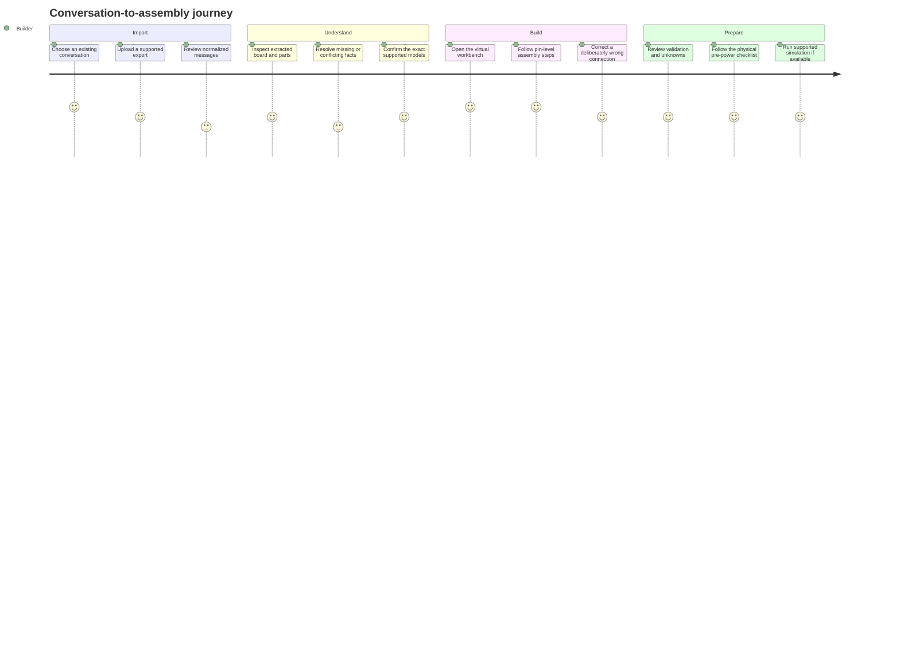

# Schemora — Product Requirements Document

**Document status:** Working baseline for product and engineering alignment  
**Version:** 1.0  
**Last reviewed:** 13 October 2026  
**Product surface:** Desktop-first web application for laptop and desktop browsers  
**Source:** context.md; engineering implications are defined separately in TRD.md

## Document control

| Field                              | Value                                                                                                                                         |
| ---------------------------------- | --------------------------------------------------------------------------------------------------------------------------------------------- |
| Product                            | Schemora                                                                                                                                      |
| Primary user                       | Beginner or intermediate builder with an existing AI-generated hardware project                                                               |
| Primary outcome                    | Convert a prior hardware conversation into a clear, reviewable, step-by-step virtual and physical assembly experience                         |
| Initial proof                      | A supported ESP32 development board and LED circuit                                                                                           |
| Product boundary                   | The platform interprets and demonstrates supported designs; it does not guarantee arbitrary hardware safety or simulate every physical system |
| Companion technical document       | TRD.md                                                                                                                                        |
| Companion delivery document        | Backend-DB-Implementation-Plan.md                                                                                                             |
| System deployment and scale design | System-Design.md                                                                                                                              |

## Contents

1. [Executive summary](#1-executive-summary)
2. [Product definition](#2-product-definition)
3. [Problem and opportunity](#3-problem-and-opportunity)
4. [Goals, measures, and non-goals](#4-goals-measures-and-non-goals)
5. [Users and primary needs](#5-users-and-primary-needs)
6. [Core user journey](#6-core-user-journey)
7. [Scope and release definition](#7-scope-and-release-definition)
8. [Functional requirements](#8-functional-requirements)
9. [Experience and interaction requirements](#9-experience-and-interaction-requirements)
10. [Trust, correctness, and safety](#10-trust-correctness-and-safety)
11. [Non-functional requirements](#11-non-functional-requirements)
12. [Acceptance strategy and launch gates](#12-acceptance-strategy-and-launch-gates)
13. [Risks, assumptions, and decisions](#13-risks-assumptions-and-decisions)
14. [Product roadmap](#14-product-roadmap)
15. [Traceability and terminology](#15-traceability-and-terminology)
16. [Product approval record](#16-product-approval-record)

This document defines the product outcome and user-visible behavior required to achieve it. It does not select implementation details that belong in the TRD, and it does not duplicate delivery sequencing in the Backend & DB Implementation Plan. Where a value remains undecided, the document labels it as an assumption or decision gate rather than presenting it as settled.

## 1. Executive summary

Schemora turns an existing AI-assisted hardware conversation into an interactive build guide. A user uploads a conversation they already had with a tool such as ChatGPT or Claude. The product reconstructs the relevant final design, identifies the board and components, extracts wiring and firmware references, and shows the user what it understood. The user confirms or corrects uncertain details before the design becomes a virtual workbench.

The workbench makes each connection concrete. It identifies the exact supported board model, the physical pin, the component terminal, and—where a breadboard is involved—the precise connected row or rail. The user can inspect the circuit in a desktop 3D scene, follow assembly steps in order, and understand why each action is required. A deterministic circuit model checks the connections for which the product has explicit rules. Missing or contradictory instructions remain visible as questions; the product must not guess in order to make a design look complete.

The first product proof is deliberately narrow: import a conversation describing an ESP32 LED circuit, review the extracted specification, confirm a supported board and component set, build the pin-level circuit, follow an assembly sequence, and see meaningful feedback when a wire is wrong. Simulation, photo-based recognition, and broader hardware support are later capabilities gated by technical feasibility, data quality, licensing, and measured user value. A visually convincing result is not a substitute for electrical correctness or physical safety.

## 2. Product definition

### 2.1 Product vision

Help people who have already planned a hardware project in a conversation turn that plan into something they can inspect, understand, and reproduce. The product bridges text instructions and physical assembly by translating them into a versioned hardware design, an interactive representation, and a guided sequence of actions.

The user should not need to understand terms such as GPIO, ground, PWM, or breadboard rail before beginning. Those concepts are explained when they matter, using the selected board and current step as context. More experienced users can inspect exact pin capabilities, source references, and validation results without being forced through beginner explanations.

### 2.2 Product promise

> Upload a supported hardware conversation and receive a reviewable, step-by-step visual guide to assembling the supported parts of that design.

“Supported” is material to the promise. The product may accept a broad range of conversations for review, but it can only generate exact physical guidance where the board, component, pin mapping, connectivity model, and required facts are present and verified. When they are not, it asks for clarification or marks the design unsupported.

### 2.3 Product category and surface

The initial product is a desktop-first web application. A wide display and precise pointer input suit the workbench, code, design review, and instruction panels. The application should run in current supported desktop browsers and provide a non-3D alternative for core tasks. Native desktop packaging may be reconsidered only if offline use or hardware integration becomes a validated product need.

## 3. Problem and opportunity

A hardware project is often planned through a long AI conversation. That conversation may contain a parts list, several revisions to the design, code, and wiring advice. The final instruction can still be difficult to act on: “connect GPIO 18 to the LED” does not tell a beginner where GPIO 18 sits on their exact board, which LED terminal to use, which breadboard row is electrically connected, or whether an earlier instruction was superseded.

Existing tools solve important adjacent problems: circuit simulation, breadboard diagrams, schematic capture, or electronics design. The opportunity described in context.md is the transition from an existing conversation to a verified, beginner-oriented physical assembly guide. That positioning is a product hypothesis, not a claim that no competitor offers overlapping features. Competitive claims must be checked before external publication.

The product therefore has two linked responsibilities: interpretation, which preserves conversation history and extracts the final intended design; and demonstration, which maps the reviewed design to exact supported hardware, shows its connections, and guides the user through assembly. The difficult work is not simply rendering a board in 3D. The system must distinguish a board family from an exact model, resolve conflicting advice, represent breadboard topology, and avoid turning a plausible model output into an asserted electrical fact.

## 4. Goals, measures, and non-goals

### 4.1 Product goals

| Goal                                | Intended user outcome                                                                  | Evidence of success                                                                              |
| ----------------------------------- | -------------------------------------------------------------------------------------- | ------------------------------------------------------------------------------------------------ |
| G1. Reduce translation effort       | The user does not have to manually convert a chat transcript into a pin-by-pin diagram | A beginner can reach the reviewable design from a supported conversation with limited correction |
| G2. Make assembly actionable        | The user can identify both ends of each connection on the exact supported hardware     | Users can complete the virtual build and reproduce the supported physical layout                 |
| G3. Teach in context                | The user understands unfamiliar terms at the moment they encounter them                | Usability sessions show successful task completion without prior electronics knowledge           |
| G4. Preserve correctness boundaries | Unsupported and uncertain details are visible and never silently passed                | Reference circuits and deliberately faulty circuits produce expected validator states            |
| G5. Build a reusable foundation     | New supported components can be added through reviewed data and models                 | Catalog additions do not require rewriting the core graph and assembly systems                   |

### 4.2 Outcome measures

Targets require a baseline study with representative conversations and novice participants. The team should not set a numerical quality claim before measuring the first reference set.

| Measure                      | Definition                                                                               | Baseline / target treatment                                                                     |
| ---------------------------- | ---------------------------------------------------------------------------------------- | ----------------------------------------------------------------------------------------------- |
| Import completion            | Share of supported files that reach a readable normalized conversation                   | Establish baseline by format; set release threshold after a representative fixture set          |
| Extraction correction burden | Number and severity of user corrections before the design is usable                      | Track per design and per fact type; distinguish wording corrections from electrical corrections |
| Provenance coverage          | Share of extracted design facts linked to a source message or an explicit user assertion | Required for any fact used in assembly guidance                                                 |
| Exact-hardware match         | Share of generated physical instructions mapped to an exact reviewed catalog model       | No inferred exact model may count as a match                                                    |
| Virtual build completion     | Share of usability participants completing a supported reference build                   | Measure novice and experienced participants separately                                          |
| Fault detection              | Detection rate for supported, deliberately injected faults                               | Report by fault class; do not imply unmodeled faults are covered                                |
| Physical reproduction        | Share of participants reproducing the supported circuit from the guide                   | Observe directly and record assistance required                                                 |
| False confidence             | Cases where the product presents unsupported or unknown state as verified                | Zero tolerance for known cases; maintain a regression suite                                     |
| Performance                  | Workbench load and interaction responsiveness on baseline desktop hardware               | Define a baseline machine and thresholds before release candidate                               |
| Reliability                  | Successful save, import, and derived-job completion under expected load                  | Set service objectives before production launch                                                 |

### 4.3 Non-goals for the initial release

The initial release is not a universal electronics simulator, automatic hardware-design generator, or substitute for expert review. It does not promise support for arbitrary boards, custom PCBs, high-voltage systems, power electronics, mechanical assemblies, or every peripheral. It does not certify that a physical build is safe. Photo recognition is not the primary input and cannot establish hidden electrical properties. A language model cannot approve a circuit or replace deterministic validation rules.

## 5. Users and primary needs

| User                         | Context                                                            | Need                                                                                    | Product response                                                                             |
| ---------------------------- | ------------------------------------------------------------------ | --------------------------------------------------------------------------------------- | -------------------------------------------------------------------------------------------- |
| First-time hardware builder  | Has an AI conversation and little electronics knowledge            | Wants to know exactly what to connect and why                                           | Plain-language review, exact pin highlighting, guided steps, and contextual explanations     |
| Hackathon or project builder | Has a design, code, and parts but needs to assemble quickly        | Wants a reliable translation from instructions to a working physical layout             | Conversation import, conflict detection, pin-specific workbench, and targeted fault feedback |
| Experienced maker            | Understands electronics but wants a faster way to inspect a design | Wants exact identities, provenance, and validation detail                               | Compact mode with source links, component facts, graph view, and rule findings               |
| Catalog reviewer             | Maintains hardware definitions and evidence                        | Needs to publish accurate, traceable board and component records                        | Versioned catalog review and publication workflow                                            |
| Product support / operator   | Helps diagnose processing and account issues                       | Needs safe status and correlation data without routine access to private source content | User-safe diagnostics and audited privileged access                                          |

The primary persona is the first-time builder. The product can expose expert detail, but it must not make beginners decode that detail to proceed.

## 6. Core user journey

### 6.1 Import and review

The user uploads an exported conversation or supported document. The product preserves message order, speaker, and source location wherever the format provides them. It presents a normalized transcript and separates the proposed final design from earlier or superseded suggestions. The extraction result includes components, board model candidates, connections, firmware references, missing facts, and conflicts.

The review screen is a required product step, not an error state. Users can correct an exact model, accept or reject candidates, and resolve ambiguity. A fact used in an exact assembly instruction must be supported by a reviewed catalog fact, explicitly asserted by the user, or blocked pending confirmation.

### 6.2 Workbench and assembly

The workbench displays supported components in a manipulable 3D scene. Selecting a pin exposes its printed label and a beginner-level explanation. Creating a wire changes the canonical circuit graph; the renderer is only a view of that graph. The assembly player focuses the camera on the relevant components, highlights source and destination, animates the action, and evaluates a defined completion condition.

Users may explore out of sequence where the dependency graph permits it. The product distinguishes completed, skipped, blocked, and stale steps. A “Next” action alone does not prove the physical action occurred.

### 6.3 Validation and real-world handoff

The validation panel reports what was checked, which rule set and hardware facts were used, and what remains unknown. A pass means the design passed the named supported checks; it does not claim that all electrical or physical conditions are safe. Before real power is applied, the product presents a project-specific checklist. Where simulation is unavailable, the product says so and does not render a fabricated working state.

### 6.4 Workflow states and user choices

The interface must distinguish progress from confidence. Import can be processing, partially readable, ready for review, or failed. A design can be incomplete even when import succeeded. Component identity can be suggested, confirmed, or unsupported. A connection can be extracted, reviewed, checked by a named rule, or unknown. A plan step can be blocked, ready, in progress, completed, skipped, or stale. These states should not be collapsed into one generic green “complete” indicator.

| Screen / state      | User question                                       | Information shown                                                                 | Available action                                   |
| ------------------- | --------------------------------------------------- | --------------------------------------------------------------------------------- | -------------------------------------------------- |
| Import setup        | What can I upload?                                  | Supported formats, size guidance, privacy summary                                 | Choose file or cancel                              |
| Import processing   | Is the conversation being read?                     | Current stage and safe warning, if any                                            | Wait, cancel, or retry when eligible               |
| Conversation review | Did the system preserve the conversation correctly? | Ordered messages, speakers, code blocks, source locators, partial-import warnings | Inspect, remove source, continue                   |
| Design review       | Did it understand the final project?                | Exact board candidate, parts, connections, firmware, conflicts, missing facts     | Confirm, correct, reject, or ask for clarification |
| Hardware selection  | Is this the board I own?                            | Candidate images/labels, model identity, pin-map coverage                         | Select exact model or mark unsupported             |
| Workbench           | Where does this wire go?                            | Active step, source pin, destination, circuit state, contextual explanation       | Place, undo, inspect, or switch to semantic list   |
| Validation review   | What has actually been checked?                     | Findings, evidence, rule-set version, unknowns, stale state                       | Resolve issue, edit design, or export report       |
| Physical handoff    | Can I build this safely?                            | Project-specific checklist and limits of virtual validation                       | Confirm checklist or stop and review               |

### 6.5 Ambiguity and recovery behavior

When a conversation contains two incompatible final-looking connections, the review screen shows both with their source locations and asks which one the user intends. When the model recognizes only a board family, the product asks for the exact board or blocks pin-accurate assembly. When a PDF is partly unreadable, the user can continue reviewing recovered content while the missing pages remain visible as a limitation. When the catalog does not support a component, the product preserves the user's design and offers a manual reference or an unsupported state; it must not silently substitute a similar part.

If the user changes a confirmed board or connection after assembly steps have been created, the application explains which validation findings and steps are stale. It preserves the prior revision and progress history. If saving fails, the interface clearly distinguishes local unsaved edits from the last durable revision and allows a safe retry without duplicating the operation.

## 7. Scope and release definition

### 7.1 Initial proof of value

The first integrated demonstration should use one specifically identified and reviewed ESP32 development board, a breadboard, jumper wires, an LED, and a resistor. It should begin with an existing conversation describing the circuit. The product extracts and reviews the design, maps it to known hardware, displays the connections, guides the user through them, and identifies at least one intentionally incorrect wire.

The exact ESP32 board and resistor value must be selected and verified during catalog authoring. “ESP32” alone is not an exact board model. If the source conversation omits a safety-relevant value, the workflow must ask or remain blocked rather than invent it.

### 7.2 Capability release sequence

| Capability                    | Initial disposition       | Gate to broader release                                                                                  |
| ----------------------------- | ------------------------- | -------------------------------------------------------------------------------------------------------- |
| Conversation import           | Core                      | Parser coverage, message order, source locators, privacy and safe archive handling                       |
| Structured extraction         | Core, review required     | Benchmark against varied conversations; every candidate retains provenance                               |
| Hardware catalog              | Core, deliberately narrow | Electrical and physical facts reviewed; model, pin anchors, source, and license checked                  |
| Circuit graph and validator   | Core for supported cases  | Known-good and fault fixtures; unknown is distinct from pass                                             |
| 3D workbench                  | Core                      | Pin-level interaction correctness and acceptable performance on baseline desktop                         |
| Assembly planner              | Core                      | Deterministic steps, dependencies, and verifiable completion predicates                                  |
| Beginner explanations         | Core, curated first       | Tested with novice participants and grounded in approved facts                                           |
| Simulation                    | Conditional               | Integration, commercial terms, supported component coverage, isolation, and repeatable reference results |
| Photo-based recognition       | Later / optional          | Measured identification quality, user confirmation, privacy and image-retention controls                 |
| Robotics and advanced physics | Later                     | Dedicated component, mechanical, electrical, and simulation models                                       |

### 7.3 Desktop support

The product is designed for laptop and desktop use. The initial layout assumes a large canvas, side panels, keyboard access, and mouse or trackpad input. Mobile browser support is not a launch requirement. The user must still have a semantic list or schematic alternative when WebGL is unavailable or the 3D scene cannot be used.

### 7.4 First release boundary

The first release demonstrates the core translation from a prior conversation to a supported assembly. It includes a narrow set of exact catalog records; import and review; an editable pin-level graph; a 3D workbench with a semantic fallback; deterministic checks for the modeled circuit; generated assembly steps with evaluated completion; and a physical pre-power checklist. Account persistence is required before production use. Project sharing, general project generation, unrestricted hardware support, advanced physics, and simulator coverage beyond a proven integration are outside this boundary.

The simulator is an independent gate. A release may prove the conversation-to-assembly workflow without claiming simulation. If simulation integration is available, it is presented only for the circuit and engine versions that have passed the simulator gate. Photo recognition is optional and cannot be a prerequisite for import or exact component selection.

### 7.5 Primary acceptance scenario

The product team maintains a synthetic conversation in which a user and an AI discuss an ESP32 LED build, revise one connection, and provide firmware. The scenario includes a known final board choice, a confirmed resistor value, and one deliberately ambiguous statement. A novice participant uploads it, verifies the normalized conversation, resolves the ambiguity, selects the exact board, builds the circuit in the workbench, follows the guide, and corrects a deliberately wrong wire. The system must show where each extracted fact came from, must not reuse the superseded connection, and must not report a completed physical build merely because the virtual steps passed.

The scenario is successful only when the participant can identify the exact board pin and breadboard row from the guide, explain at least one relevant term with contextual help, and reproduce the supported circuit physically under observation. A facilitator records confusion, assistance, corrections, and any mismatch between the guide and hardware. The result informs the next iteration; it is not replaced by a model-confidence score.

## 8. Functional requirements

| ID     | Requirement                                                    | Acceptance condition                                                                        |
| ------ | -------------------------------------------------------------- | ------------------------------------------------------------------------------------------- |
| PR-001 | The user can import supported conversation files               | Unsupported type, size, or malformed content is rejected with a clear reason                |
| PR-002 | Conversation messages retain order and source location         | A displayed fact links to the message or source locator from which it was extracted         |
| PR-003 | The system identifies revisions and conflicts                  | Superseded and contradictory instructions are not merged silently                           |
| PR-004 | Extraction returns a typed project candidate                   | Candidate conforms to schema; invalid references are rejected                               |
| PR-005 | The user can review extracted hardware facts                   | Candidate, confirmed, rejected, unknown, and conflicting states are visually distinct       |
| PR-006 | The user can confirm exact hardware models                     | Board family alone cannot be treated as an exact supported board                            |
| PR-007 | The user can inspect supported components in the workbench     | Each terminal maps to a stable catalog identity and physical anchor                         |
| PR-008 | The user can create and remove wires through the scene         | Every visible wire corresponds to a graph edge; removal updates graph and validation state  |
| PR-009 | Breadboard connections reflect selected board topology         | Holes that share a modeled node are treated as electrically connected                       |
| PR-010 | The workbench supports undo and redo                           | Reversal creates a consistent graph state and cannot erase revision history                 |
| PR-011 | The system validates supported electrical constraints          | Each finding identifies a rule, affected entity, result state, and relevant evidence        |
| PR-012 | Unknown or unsupported conditions remain explicit              | An unknown value cannot be defaulted into a passing result                                  |
| PR-013 | The user can follow ordered assembly instructions              | Each step has target components, action, prerequisite, and completion predicate             |
| PR-014 | Step progress reflects the circuit state                       | User action alone cannot mark a failed predicate complete                                   |
| PR-015 | The product explains terminology in context                    | “Why?” help references the selected component, step, or finding                             |
| PR-016 | The product supports a physical pre-power checklist            | The user sees limits of virtual validation before building the real circuit                 |
| PR-017 | Firmware can be associated with a project                      | Firmware version and source are retained; arbitrary code is not executed in the web process |
| PR-018 | Simulation is shown only for supported integrations            | Unsupported design or unavailable engine is reported accurately                             |
| PR-019 | The user can optionally identify physical hardware from photos | Recognition is a candidate and requires exact-model confirmation                            |
| PR-020 | The user can save and resume projects                          | Project state and derived artifacts preserve their version and freshness                    |
| PR-021 | The user can delete a project and its associated data          | Access is revoked immediately; cleanup status is visible and retryable                      |
| PR-022 | The user can export a project guide                            | Export identifies catalog and design versions and follows access and retention policy       |

## 9. Experience and interaction requirements

### 9.1 Progressive explanation

Each assembly instruction has a concise action, an optional beginner explanation, and an optional technical detail view. The concise action says what to do. The beginner explanation describes why the connection is needed in familiar language. The technical view can show pin capability, limits, source references, and rule results. The user should not need to open a chatbot for a known deterministic explanation.

### 9.2 Information hierarchy

The default view prioritizes the active step, exact component names, source and destination, and completion status. Secondary panels expose the component catalog, full design, code, evidence, and validation findings. Color may reinforce status but must not be the only indicator. Warnings identify the affected component or connection in text.

### 9.3 Accessibility

Core workflows must be keyboard-operable. Focus is visible and predictable. Pin selection has a searchable semantic list. A 3D-only action has a non-3D alternative. Motion respects reduced-motion preferences. Validation state is conveyed in text as well as color, and state changes are announced without repeatedly interrupting screen-reader users.

### 9.4 Desktop interaction model

The workbench reserves its central area for the circuit while keeping the active instruction and selected component details visible. The user can resize or collapse secondary panels without losing the current step. Camera movement must not change circuit state. Pin targets are larger than their visible geometry so selection is practical with a mouse or trackpad. The system provides a “focus selected pin” action and a searchable pin table so small physical labels do not become the only source of identification.

Undo and redo are available for graph edits and show which connection or placement will change. Destructive project actions require a clear confirmation and cannot be triggered by an ambiguous canvas gesture. Keyboard shortcuts are discoverable and do not conflict with browser-level behavior. Pointer-only dragging is supplemented by a command-based connection flow for keyboard and assistive-technology users.

## 10. Trust, correctness, and safety

The product processes conversations and code that may contain private information or credentials. Import must be private by default, access-controlled, bounded in size, and deletable. Imported HTML and archives are untrusted; active content must never execute in the product origin. Firmware is not executed in the web server process.

The product separates four statements that are often confused:

| State            | Meaning                                                   |
| ---------------- | --------------------------------------------------------- |
| Extracted        | A parser or model proposed this value from source content |
| User-confirmed   | A user accepted or corrected the value                    |
| Catalog-verified | A reviewed hardware record supports the fact              |
| Rule-checked     | A named deterministic rule evaluated the current design   |

A project can have a mixture of these states. A model confidence score does not equal confirmation. A visually connected wire does not prove electrical validity. A successful simulation does not prove physical safety. Every validation report states the checked scope and the inputs used.

## 11. Non-functional requirements

| Area            | Product requirement                                                                                                               |
| --------------- | --------------------------------------------------------------------------------------------------------------------------------- |
| Correctness     | Identical graph, catalog, and rule versions produce deterministic validation outcomes                                             |
| Performance     | Workbench remains usable on the agreed baseline laptop; baseline hardware and numeric budgets are approved before release testing |
| Reliability     | Save failures are visible; accepted user changes are not represented as saved until durable confirmation                          |
| Privacy         | Conversation text, firmware, and photos are excluded from routine logs and analytics                                              |
| Security        | Every project and nested resource is authorized server-side; uploaded content is isolated                                         |
| Compatibility   | Supported desktop browsers and graphics fallback behavior are published                                                           |
| Maintainability | Catalog and rules can be versioned without embedding hardware facts in rendering code                                             |
| Portability     | Project export includes schema and version references; import revalidates unsupported mappings                                    |
| Accessibility   | Keyboard and semantic alternatives cover the core assembly workflow                                                               |

## 12. Acceptance strategy and launch gates

Release acceptance combines automated reference fixtures, end-to-end workflow tests, novice usability sessions, visual verification of pin anchors, and security review. The exact fixture set is versioned. It includes a supported correct circuit and deliberate errors such as wrong pin, missing wire, incorrect breadboard row, reversed polarity where modeled, and missing required value.

A launch candidate must pass the supported conversation-to-assembly scenario and clearly surface unresolved facts. It must preserve the project across save and resume, reject cross-project access, and demonstrate deletion behavior. Optional features have separate gates and cannot be counted as complete because a screen or adapter exists.

The usability sample must include people with little or no prior electronics knowledge. The study should observe a supported build without explaining the answer in advance. Researchers record completion, wire errors, outside help, terminology confusion, and whether participants understand the boundary between virtual validation and physical certainty. The sample is not used to claim broad market fit; it tests whether the first workflow is understandable and where it fails.

| Gate               | Required evidence                                                                   |
| ------------------ | ----------------------------------------------------------------------------------- |
| Product definition | Approved initial board, component set, project scenario, and user study plan        |
| Import             | Supported format fixtures, ordering checks, malformed-file behavior, privacy review |
| Catalog            | Exact model, pin anchors, electrical facts, citations, licensing, reviewer approval |
| Circuit            | Graph invariants, breadboard topology fixtures, deterministic rule results          |
| Workbench          | Pin selection, wire update, undo/redo, low-performance fallback, accessibility path |
| Assembly           | Stable step sequence, dependencies, completion predicates, novice task observation  |
| Simulation         | Licensing and integration proof, repeatable result for named supported circuit      |
| Production         | Authorization, migration, backup/restore, deletion, monitoring, and runbooks        |

## 13. Risks, assumptions, and decisions

| Item                                               | Type     | Current position                                                                        | Closure evidence                                  |
| -------------------------------------------------- | -------- | --------------------------------------------------------------------------------------- | ------------------------------------------------- |
| Conversation exports vary by source and version    | Risk     | Use format-specific adapters and preserve source only under retention policy            | Parser fixture coverage and safe failure behavior |
| Board names are ambiguous                          | Risk     | Require exact catalog model before pin-accurate assembly                                | Catalog review and confirmation UX                |
| Prior AI responses may be wrong or contradictory   | Risk     | Extraction proposes candidates; deterministic rules and user review control acceptance  | Benchmark and conflict-resolution tests           |
| Breadboard layouts vary                            | Risk     | Model exact supported topology                                                          | Physical reference and connectivity tests         |
| Simulation provider terms may restrict integration | Decision | Do not assume API access or commercial rights                                           | Written terms and technical proof                 |
| Vision can confuse similar boards                  | Risk     | Photo match remains candidate until confirmed                                           | Measured benchmark and error analysis             |
| Desktop WebGL performance varies                   | Risk     | Provide semantic fallback and benchmark baseline devices                                | Performance and context-loss tests                |
| Exact first board and parts                        | Decision | Select from source-supported scenario before catalog publication                        | Product and hardware-owner approval               |
| Account and sharing model                          | Decision | Account persistence is required before production; sharing scope needs product decision | Approved authorization policy                     |
| Quantitative product targets                       | Decision | Establish baseline before setting claims                                                | Usability and reliability measurement             |

## 14. Product roadmap

| Phase                                | Outcome                                                                   | Dependency / exit                                         |
| ------------------------------------ | ------------------------------------------------------------------------- | --------------------------------------------------------- |
| 1. Conversation intelligence         | Supported conversation becomes a sourced, reviewable design candidate     | Parser coverage and extraction benchmark                  |
| 2. Hardware knowledge and validation | Supported facts, board pins, breadboard topology, and deterministic rules | Reviewed catalog and golden circuit fixtures              |
| 3. Interactive workbench             | Users place supported components and connect exact terminals              | Semantic anchors and graph synchronization                |
| 4. Assembly generation               | Verified design becomes ordered visual actions                            | Dependency graph and completion predicates                |
| 5. Beginner teaching                 | Explanations match current parts and steps                                | Curated knowledge and novice usability evidence           |
| 6. Firmware and simulation           | Supported firmware produces real simulator output                         | Provider licensing, isolation, and repeatable integration |
| 7. Photo recognition                 | User photographs assist component matching                                | Benchmark, consent, and exact-model confirmation          |
| 8. Debugging and verification        | Known virtual wiring faults produce actionable correction                 | Rule coverage and fault fixtures                          |
| 9. Hardware expansion                | New component families become available                                   | Family-specific model, rules, tests, and support boundary |
| 10. Production and launch            | Reliable service with persistence, support, and recovery                  | Release scorecard and operational sign-off                |

## 15. Traceability and terminology

| Term               | Product meaning                                                              |
| ------------------ | ---------------------------------------------------------------------------- |
| Conversation       | Imported source material containing discussion, code, or design instructions |
| Design candidate   | Structured interpretation awaiting required review                           |
| Confirmed fact     | A value accepted through user action or approved deterministic process       |
| Catalog release    | Immutable reviewed hardware data version                                     |
| Component instance | One placed occurrence of a catalog component in a project                    |
| Terminal           | A semantic electrical endpoint on a component                                |
| Graph edge         | A connection represented in the circuit model                                |
| Net                | A derived set of electrically connected terminals                            |
| Assembly step      | A typed action with targets, prerequisites, and completion condition         |
| Validation finding | Result of a named rule against versioned inputs                              |
| Unknown            | A deliberate state meaning the system lacks sufficient evidence              |
| Unsupported        | A condition outside the currently modeled product capability                 |

Product requirements use identifiers PR-001 through PR-022 in the functional requirements table. Technical controls and implementation tasks are linked in TRD.md and Backend-DB-Implementation-Plan.md. IDs are stable; wording may be clarified through document change control.

## 16. Product approval record

Approval should identify the exact document version and supported initial project scenario. Any change to the primary workflow, exact hardware scope, simulation promise, or physical-safety claim requires product review. Until those decisions are approved, the MVP remains the narrow conversation-to-ESP32-LED assembly proof described above.
