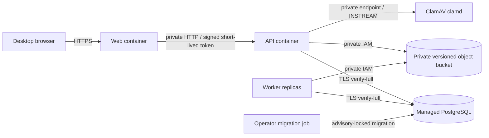

# Phase 10 deployment and recovery runbook

**Status:** Deployment artifacts are buildable; no production environment is provisioned.
**Image targets:** `Dockerfile.web`, `Dockerfile.api`, and `Dockerfile.worker`
**Runtime:** Node 24 on Debian Bookworm slim, non-root `node` user, production-only pnpm deployment output.

## Service topology



Only the HTTPS web entrypoint should be public. PostgreSQL, ClamD, and S3 must not be public application endpoints. API and worker replicas may scale horizontally against the shared PostgreSQL job queue; do not use filesystem storage in production. Configure ClamD on a private network reachable by the API only. The TCP protocol has no authentication or encryption.

## Build and run images

Build from the repository root so workspace packages and the lockfile are available:

```sh
docker build -f Dockerfile.web -t schemora-web:<release> .
docker build -f Dockerfile.api -t schemora-api:<release> .
docker build -f Dockerfile.worker -t schemora-worker:<release> .
```

Each Dockerfile uses the same digest-pinned Node base, installs from the frozen workspace lockfile, creates a filtered production deployment with pnpm 11, and copies only that deployment into a non-root runtime image. The web image contains the optimized Next build and locally served Monaco assets. API and worker use the production `tsx` runtime dependency to execute their TypeScript entrypoints. Rebuild all three images from the same commit and record their immutable digests in the release record.

The repository has smoke-built all three images and started their web and API containers locally; the worker loopback liveness endpoint also returned success. These checks establish container startup and endpoint resolution, not a production topology or database-backed health pass.

## Required secrets and service settings

Supply secrets through the target platform's secret store, never a committed env file or image layer.

| Service        | Required settings                                                                                                                                                                                                                                                                        |
| -------------- | ---------------------------------------------------------------------------------------------------------------------------------------------------------------------------------------------------------------------------------------------------------------------------------------- |
| Web            | `NODE_ENV=production`, `WEB_ORIGIN` (public HTTPS origin), `API_ORIGIN` (private API URL), independently generated `AUTH_SECRET` and `SESSION_SECRET` of at least 32 characters, GitHub OAuth client ID and secret                                                                       |
| API            | `NODE_ENV=production`, `API_HOST=0.0.0.0`, `API_PORT=4001`, `DATABASE_URL` with `sslmode=verify-full`, the same independently generated `SESSION_SECRET` used by web, `STORAGE_DRIVER=s3`, dedicated `S3_BUCKET`, `AWS_REGION`, `MALWARE_SCANNER_MODE=clamd`, `CLAMD_HOST`, `CLAMD_PORT` |
| Worker         | `NODE_ENV=production`, `DATABASE_URL` with `sslmode=verify-full`, `STORAGE_DRIVER=s3`, same bucket and region, bounded pool/concurrency settings, approved extraction/vision settings only when their separate policy is accepted                                                        |
| PostgreSQL     | Managed PostgreSQL 17-compatible service, TLS with hostname verification, encrypted automated backups and point-in-time recovery, private network access from API/worker/migration job                                                                                                   |
| Object storage | Dedicated private bucket, public access blocked, server-side encryption, versioning, restricted per-service IAM, upload checksum support, version-list and version-delete permissions for purge                                                                                          |
| ClamAV         | Private `clamd` TCP endpoint, current signatures, stream limit above 10 MiB, file/archive limits compatible with supported formats, daemon health and signature-freshness alerts                                                                                                         |

Never enable firmware execution by adding a compiler profile to the ordinary worker. The firmware runner remains a separate deployment gate and must use the isolation controls documented in [the API operations runbook](../apps/api/RUNBOOK.md).

## Release sequence

1. Build all three images from the same commit and scan the images with the organization's container vulnerability scanner.
2. Provision or verify private PostgreSQL, object storage, ClamD, service identities, network rules, secret values, alert routes, and backup policies.
3. Run the migration command once as a restricted release job using the API image and the same production database URL:

   ```sh
   docker run --rm --entrypoint node \
     --env-file /secure/runtime/api.env \
     schemora-api:<release> \
     --import tsx/esm node_modules/@schemora/persistence/src/migrate.ts
   ```

   The migration runner uses a PostgreSQL advisory lock and verifies the digest of every already applied migration. Do not edit applied migrations. Run this job before new API/worker replicas start.

4. Deploy API and worker images privately, verify `/health/ready` for API and the worker container health check, then deploy the web image behind HTTPS.
5. Verify GitHub OAuth callback origin, signed API-token flow, authorized project read/write, clean upload scanning, infected test-file rejection using the approved scanner test fixture, project deletion, and worker job processing in a non-production release environment.
6. Monitor error rates, request durations, job failures, database pool pressure, ClamD availability/signature age, object-store errors, and queue age. Stop rollout if uploads bypass scanning, ownership checks fail, migrations drift, or deletion cannot purge objects.

Database migrations are additive and have no automatic down migration. Roll back application images only when the previous version remains compatible with the expanded schema. If a migration is not backward compatible, use a forward corrective migration and the recovery process; do not restore an old database over newer writes without an approved recovery decision.

## Backup, retention, and restore target

Recommended initial operational target for a small launch is **RPO at most 24 hours** and **RTO at most 8 hours**. Use managed PostgreSQL point-in-time recovery with at least 35 days of protected backups. Enable object versioning and a protected backup/replication policy with no more than 35 days of retained deleted-object versions. Confirm exact service capabilities and costs before launch.

Active project records and private source objects remain until the owner deletes the project or the account lifecycle removes it. A completed project purge removes live object versions, associated records, and private artifact references. Protected database/object backups may retain deleted data until their configured expiry (maximum 35 days under this proposed policy); user-facing privacy disclosures and provider agreements must state that window before launch. Do not enable S3 Object Lock or a retention mode that blocks required project purge.

At least monthly, restore the database and object backup into an isolated account/network, apply no production credentials, run migration-ledger and checksum checks, restore representative projects and artifacts, and confirm deleted-project behavior against the backup retention window. Record actual achieved RPO/RTO, restore duration, data-loss boundary, operator, and corrective actions. A backup that has not been restored is not recovery evidence.

## Incident and operator response

| Signal                                                  | Immediate action                                                                                                                                                    | Recovery evidence                                                                                                |
| ------------------------------------------------------- | ------------------------------------------------------------------------------------------------------------------------------------------------------------------- | ---------------------------------------------------------------------------------------------------------------- |
| API `/health/ready` is 503                              | Check database TLS/connectivity, then ClamD `PING`; pause upload traffic if scanner is unhealthy                                                                    | Ready endpoint returns 200 and a clean/infected scanner fixture behaves as expected                              |
| Worker container unhealthy or queue age rises           | Check database reachability, worker logs and lease/job state; scale only within pool and provider concurrency limits                                                | Worker readiness is healthy and oldest eligible job age returns to target                                        |
| Object upload/delete failures                           | Keep project unavailable while deletion is pending; inspect exact job and durable upload intents; repair IAM/network then retry through controlled maintenance      | Expected object versions are absent and associated purge job is completed                                        |
| Suspected credential or source exposure                 | Disable affected provider credential, rotate it, restrict access, preserve redacted request IDs and audit records, identify affected projects and provider requests | Rotation recorded; scope and notifications handled under the operator's incident policy                          |
| Database corruption or accidental destructive migration | Freeze writes, choose a recovery point with the data-loss window explicitly understood, restore to an isolated target first                                         | Reconciled row counts, migration digests, object checksums, and accepted RPO/RTO recorded before traffic cutover |

## Current operational gaps

The repository provides image build definitions, bounded health endpoints, structured API response logs, worker job outcome logs, request IDs, and a ClamD adapter. It does not provision cloud services, alert routing, centralized metrics/traces, provider retention agreements, or backup policies. No production deploy, monthly restore drill, real-browser usability session, or representative-machine performance baseline has been completed. The RPO/RTO above are proposed launch targets, not measured results.

The ClamD adapter was exercised against the official ClamAV Debian image `clamav/clamav-debian@sha256:9a96980b265cb2b51a20bdcca921dc80aa55ed0e56cdfb076198ee27a9171927`; it returned `infected` for the standard EICAR test string. The image digest pins the scanner software image; signature freshness remains a runtime operational check. For scanner framing and deployment behavior, follow the [official ClamD protocol](https://docs.clamav.net/manual/Usage/ClamdProtocol.html) and [official ClamAV Docker image guide](https://github.com/Cisco-Talos/clamav/blob/main/README.Docker.md).
