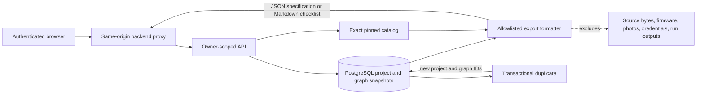

# Phase 10 — Production readiness and launch

**Branch:** `dev`  
**Status:** In progress  
**Roadmap source:** [Phase 10 in context.md](./context.md#phase-10---production-readiness-and-launch)

## 1. Phase objective and completion rule

Phase 10 turns the supported engineering workflow into a service that can be operated reliably. The roadmap covers accounts and durable projects, upload protection, end-to-end verification, ordinary-computer performance, deployment, monitoring, backups, and recovery. These requirements include deploy-time evidence; passing local tests alone cannot establish a secure or recoverable production service.

This increment closes several product-persistence gaps by adding a safe project export and a narrowly defined project duplication operation. It does not close Phase 10. The remaining security and operational gates are listed explicitly so this implementation is not confused with production approval.

## 2. Existing production foundations

The repository already contains meaningful Phase 10 infrastructure:

- GitHub OAuth uses state and PKCE; the web server issues a short-lived signed API token, and the browser does not receive the API signing secret.
- Projects, immutable revisions, circuit graphs, validation reports, imports, firmware metadata, photos, and simulation jobs are stored in PostgreSQL. Mutations use expected revisions and idempotency keys.
- Project records and nested API reads are owner-scoped. A guessed foreign project ID is returned as unavailable.
- Source objects use private storage adapters and opaque keys. Production config requires S3, a verified database TLS mode, generated secrets, and HTTPS origin.
- Upload schemas and parsers apply byte, dimension, archive entry, expansion, file type, and processing limits. Project and photo deletion use asynchronous purge jobs.
- CI runs formatting, typechecking, tests, build, and Chromium end-to-end coverage. API health routes distinguish liveness and database-backed readiness.

These are application foundations. They do not constitute live production deployment, a malware scan, a secrets review workflow, or a successful disaster-recovery exercise.

## 3. Delivered in this increment

### 3.1 Authenticated project specification export

`GET /v1/projects/:projectId/export?format=specification` returns a downloadable versioned JSON specification built from the authorized project and its saved circuit graph. It includes project metadata, graph, exact catalog identities, validation summary when available, included-data and excluded-private-data declarations, and limitations.

The specification includes persisted SHA-256 identities for the graph, catalog release, and validation report when present, so consumers can identify the exact modeled inputs represented by the export.

The export intentionally excludes conversation source bytes and transcripts, firmware source/build artifacts, hardware photo bytes, provider credentials, private storage keys, and simulation execution output. It is generated on demand and streamed through the authenticated Next.js backend proxy with `Cache-Control: no-store`. The endpoint derives its graph and catalog from persisted project state; it accepts no client-supplied export content.

### 3.2 Authenticated wiring checklist export

`GET /v1/projects/:projectId/export?format=checklist` returns Markdown with exact catalog release, component identities, saved terminal-to-hole placements, wire endpoints, and a pre-power caution. Terminal labels are resolved against the graph's pinned catalog. Markdown table values are escaped. A project without a graph receives an explicit empty-state checklist rather than invented connections.

### 3.3 Scoped project duplication

`POST /v1/projects/:projectId/duplicate` creates an idempotent project copy inside one database transaction. It copies the current saved circuit graph only, assigning a new project ID, graph ID, and revision chain. The clone starts active under the authenticated owner and is independent of the source thereafter.

The response explicitly records that imports, firmware, photos, and simulation runs were not copied. This prevents private uploads, executable content, recognition evidence, and run history from crossing into a duplicate implicitly. A project with no saved graph duplicates as a blank project. Duplicate operation is available from the project actions menu.

### 3.4 Immutable revision restoration

`POST /v1/projects/:projectId/revisions/:revision/restore` restores the earlier project's title and saved circuit graph as a new revision. It requires the current expected revision and an idempotency key. Restored graph snapshots receive fresh IDs and the new project revision; no historical row is mutated. Imports, firmware, photos, reviews, jobs, and simulation runs are deliberately left unchanged. The revision history UI asks for confirmation and describes this partial restore boundary before the operation.

### 3.5 Browser delivery

The project actions menu exposes “Duplicate design,” “Export specification,” and “Wiring checklist.” The revision history includes a confirmed restore action. The download proxy forwards only the response content type, cache policy, and safe server-provided content disposition. Existing project access control applies to exports and duplicates.

### 3.6 Production build compatibility

The workspace packages use Node-style `.js` specifiers for TypeScript source modules. Next.js 16's default Turbopack build did not resolve these local source files in this repository. The web app now uses Next's supported `--webpack` mode for local development and production builds, registers the local workspace packages for transpilation, and configures Webpack's `.js` to `.ts` extension alias. This keeps runtime import specifiers valid for Node-style ESM while allowing Next to compile the package source. The production web build now completes successfully. See the official [Next.js build CLI](https://nextjs.org/docs/app/api-reference/cli/next) and [Webpack extension alias documentation](https://webpack.js.org/configuration/resolve/#resolveextensionalias).

### 3.7 Pattern-based credential redaction before remote text extraction

Before a conversation is passed to the configured remote extraction function, the worker now creates a separate provider-bound copy and masks recognized credential forms: PEM private-key blocks, common credential assignments, bearer tokens and JWTs, AWS access-key identifiers, GitHub/GitLab/Slack/Google token prefixes, `sk-` token strings, and credential-bearing HTTP URLs. Masking preserves the JavaScript UTF-16 length of every message so offsets in unrelated source passages do not shift. If any content is masked, the locally persisted conversation receives a review warning. The original transcript remains local, and provider evidence is validated against that original transcript; evidence that depends on a masked passage is rejected and the worker falls back to conservative local extraction.

This is defense in depth, not a complete secret scanner. Detection is pattern-based and can miss proprietary token formats, unlabelled secrets, or secrets embedded in unusual encodings. This change applies to remote text extraction only; it does not scan source objects at rest or hardware-recognition images, and it does not define upload retention. Those remain Phase 10 security requirements.

### 3.8 Fail-closed malware scanning for uploads

The API now supports a ClamD-backed upload scanner. In production, startup refuses to proceed unless `MALWARE_SCANNER_MODE=clamd` and a ClamD host are configured. The API scans decoded conversation files, original hardware photos before image decoding, single-file firmware, and every file in a firmware bundle before private storage. The integration uses ClamD's `INSTREAM` command and bounded chunks. Detected content receives a generic rejection; scanner transport or protocol failures fail closed and return a retryable unavailable response. Readiness includes ClamD's `PING`/`PONG` check. Local development may use the explicit disabled mode.

ClamD's TCP protocol has no authentication or TLS, so deployments must place it on a private network and never expose its port publicly. The operator must keep signatures current and configure stream, file, and archive limits at least as high as supported application limits. A successful scan is not a safety guarantee; archive/parser limits and OS-enforced parser isolation remain separate controls. The repository now requires scanner configuration for production, but no live ClamD service or current-signature evidence is provisioned by this code change.

The adapter was also exercised against a real local `clamav/clamav-debian:1.5.4` daemon: `PING` returned `PONG`, a clean payload returned `OK`, and the standard EICAR test string returned `FOUND`. The image was pulled by digest (`sha256:9a96980b265cb2b51a20bdcca921dc80aa55ed0e56cdfb076198ee27a9171927`) and bound only to loopback for the check. This verifies protocol interoperability and detection of the scanner's included EICAR test signature at that moment. It does not establish production network isolation, signature freshness over time, or a real-world malware detection rate.

### 3.9 Production container packaging and health checks

The repository now has separate production image definitions for web, API, and worker. Each uses a digest-pinned Node 24 base, frozen workspace dependencies, a filtered production deployment, and an unprivileged runtime user. API and web expose container health checks; the worker exposes loopback liveness and database-readiness endpoints consumed by its container health check. CI builds all three images after the typecheck, test, and application-build steps. Local image builds and API/web/worker startup smoke checks pass. These are deployable artifacts, but no cloud project, registry, domain, production database, object bucket, or ClamAV service has been selected or provisioned. The packaging follows the [pnpm deploy guide](https://pnpm.io/11.x/cli/deploy).

### 3.10 Account profile, closure, and fresh-workspace recovery

The web session now carries a signed GitHub login label, stable numeric provider subject, and the time of the last OAuth authorization. The authenticated `/v1/account` resource exposes the current profile label, account state, creation date, active project count, pending project purges, and expiring upload cleanup intents without exposing other users' records. Account closure requires the exact phrase `DELETE MY ACCOUNT` and an OAuth authorization from the previous five minutes. In one database transaction, closure clears the profile label, disables further project access, stops or fences active work, marks every non-deleted project for removal, and durably enqueues its purge. The account reaches `closed` only after project records, private objects, and outstanding late-upload cleanup intents have been removed; an account with no projects or intents closes immediately.

The closed account tombstone retains the numeric GitHub subject indefinitely because the current database uses it as a foreign-key principal for project deletion records. The tombstone does not retain the GitHub login label or project content. Protected backups may retain deleted data for up to the configured 35-day operational target. A closed identity can be reauthorized within five minutes of fresh GitHub sign-in to start a new empty workspace; old project records are never restored. Account lifecycle state is checked before user-scoped API operations, and new project creation/duplication takes a shared lock on the principal so it cannot race past closure.

## 4. Data and trust boundaries

Exports are generated from an explicit allowlist, not by serializing the full project record or revision history. Project metadata, the graph reference, graph snapshot, and current report are read in one database transaction under a read lock on the project row so an export cannot mix separate project revisions. Duplicate requests hold a source project lock while reading its current revision, and source and duplicate graph rows are immutable. Neither feature introduces public links or cross-owner access.

## 5. Verification

The export formatter has unit coverage for specification shape, private-data exclusions, readable terminal labels, Markdown escaping, and the no-graph state. A database-backed API regression covers duplicate graph rebinding, copy limits, both export formats and digests, immutable restoration, idempotent replay, and rejection of another owner's request. The ClamD adapter has protocol-level tests for clean, infected, unavailable, and readiness responses, plus API regressions proving infected source and photo uploads stop before persistence and image decoding. Production acceptance still needs a real daemon with current signatures. Workspace typechecking, all three Docker image builds, local image startup smoke checks, and the optimized web build pass for the current increments.

The full workspace unit and database integration suites pass against the local migrated `schemora_test` database. The Chromium end-to-end workflow passes all four browser scenarios, including transcript import/review, thread selection, 3D wiring persistence, and import keyboard/local validation. A stale firmware-upload integration fixture was updated to include the now-required supported ESP32/LED/resistor reference set. Container builds and local startup smoke checks pass for web, API, and worker; API/web HTTP endpoints and worker loopback liveness returned success. Database-backed readiness against the disposable smoke containers was not asserted. These checks do not establish production deployment, measured performance on a representative baseline computer, moderated usability, or backup recovery objectives.

## 6. Remaining Phase 10 work

| Roadmap area                     | Status               | Required work/evidence                                                                                                                                                                                                                                                                                                                                                        |
| -------------------------------- | -------------------- | ----------------------------------------------------------------------------------------------------------------------------------------------------------------------------------------------------------------------------------------------------------------------------------------------------------------------------------------------------------------------------- |
| Accounts                         | Partial              | GitHub sign-in, profile display, account closure with queued project purges, and fresh empty-workspace recovery exist. Provider linking, live support procedures, and production identity-policy review remain open.                                                                                                                                                          |
| Project persistence              | Partial              | Save/resume, immutable history, confirmed title/circuit restoration, project copy, and exports exist. Cross-user sharing and granular ACLs remain absent.                                                                                                                                                                                                                     |
| Upload security                  | Partial              | Bounded parsing, private objects, authorization, deletion, pattern-based redaction before remote text extraction, and a fail-closed ClamD integration exist. Production scanner deployment/signature evidence, comprehensive secret detection across stored uploads and image submissions, explicit content-retention controls, and OS-enforced parser isolation remain open. |
| Complete workflow tests          | Partial              | CI and browser flow exist. Add broader reference-project coverage, abuse/security tests, representative usability sessions, and tests for the database-backed new API behavior in CI.                                                                                                                                                                                         |
| Ordinary-computer performance    | Open                 | Establish a documented baseline machine and budgets; measure first render, scene interaction, asset loading, and large-project behavior; add repeatable regression checks.                                                                                                                                                                                                    |
| Deployment and release           | Partial              | Container images, image health checks, CI image builds, and a release/migration runbook exist. Select/provision production hosting, managed PostgreSQL, private object storage, ClamAV, secret management, and deploy a release candidate.                                                                                                                                    |
| Monitoring and incident response | Partial              | API response logs, request IDs, worker job outcome logs, API/worker readiness, and incident instructions exist. Add centralized metrics/alerts/traces, error tracking, alert ownership, and exercise incident procedures against a deployed stack.                                                                                                                            |
| Backups and recovery             | Open                 | Automate database/object backup policy, define RPO/RTO, test restoration into an isolated environment, and verify deletion/retention interactions.                                                                                                                                                                                                                            |
| Firmware runner                  | Open deployment gate | No production-approved provider/isolated runner is configured. The repository has contracts and local runner boundary code, but no live execution service.                                                                                                                                                                                                                    |

Sharing is intentionally not implemented as a public bearer URL. A future design must specify invite identity, read/write roles, expiry, revocation, and owner checks across every nested endpoint and binary download before any shared access can be enabled.

## 7. Production acceptance checklist

Phase 10 may be marked complete only after all applicable items have concrete evidence:

1. A production identity and account lifecycle has a documented support and recovery policy; permissioned project sharing is implemented or explicitly removed from release scope. Account deletion retains a pseudonymous provider subject indefinitely for foreign-key integrity, so this must be disclosed or replaced by internal subject mapping before broad launch.
2. Supported users can persist, resume, export, duplicate, and recover their projects without losing immutable history.
3. Every upload type has bounded validation, private storage, appropriate scanning/redaction, access tests, and an explicit retention/deletion policy.
4. The full supported workflow passes unit, migrated-database integration, browser, security, and fixed reference-project regression suites.
5. Performance budgets are measured on the chosen baseline computer and sustained by regression checks.
6. Production deployment, migration and rollback procedures are exercised against the selected host and services.
7. Logs, metrics, alerts, request correlation, and incident procedures allow an operator to find and diagnose failures without logging sensitive source content.
8. Database and object recovery are rehearsed and meet declared RPO/RTO; deletion and backup retention behavior are verified together. Proposed initial targets are recorded in the [deployment runbook](./Phase-10-Deployment.md) but are not yet measured.
9. Any firmware execution remains disabled unless its isolated runner has independent deployment, isolation, replay, cancellation, cleanup, and hostile-output evidence.

## 8. Current completion decision

Phase 10 remains **in progress**. Delivered work now includes project export, duplication and restoration, account profile/closure/recovery, credential redaction before remote text extraction, a fail-closed ClamD integration with a local real-daemon protocol/EICAR check, production container images, health endpoints, and a release/recovery runbook. Production launch remains blocked on production identity-policy and provider-linking decisions, sharing scope, isolated parser deployment, production scanner deployment and ongoing signature-freshness evidence, representative usability and performance evidence, centralized monitoring, and actual production deployment and backup/restore rehearsal. No live service is claimed to be deployed or production-ready.
