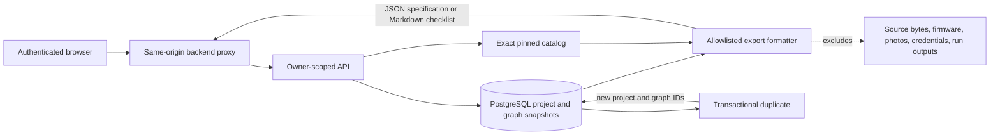

# Phase 10 — Production readiness and launch

**Branch:** `dev`  
**Status:** In progress  
**Roadmap source:** [Phase 10 in context.md](./context.md#phase-10---production-readiness-and-launch)

## 1. Phase objective and completion rule

Phase 10 turns the supported engineering workflow into a service that can be operated reliably. The roadmap covers accounts and durable projects, upload protection, end-to-end verification, ordinary-computer performance, deployment, monitoring, backups, and recovery. These requirements include deploy-time evidence; passing local tests alone cannot establish a secure or recoverable production service.

This increment closes several product-persistence gaps by adding a safe project export and a narrowly defined project duplication operation. It does not close Phase 10. The remaining security and operational gates are listed explicitly so this implementation is not confused with production approval.

## 2. Existing production foundations

The repository already contains meaningful Phase 10 infrastructure:

- GitHub OAuth uses state and PKCE; the web server issues a short-lived signed API token, and the browser does not receive the API signing secret.
- Projects, immutable revisions, circuit graphs, validation reports, imports, firmware metadata, photos, and simulation jobs are stored in PostgreSQL. Mutations use expected revisions and idempotency keys.
- Project records and nested API reads are owner-scoped. A guessed foreign project ID is returned as unavailable.
- Source objects use private storage adapters and opaque keys. Production config requires S3, a verified database TLS mode, generated secrets, and HTTPS origin.
- Upload schemas and parsers apply byte, dimension, archive entry, expansion, file type, and processing limits. Project and photo deletion use asynchronous purge jobs.
- CI runs formatting, typechecking, tests, build, and Chromium end-to-end coverage. API health routes distinguish liveness and database-backed readiness.

These are application foundations. They do not constitute live production deployment, a malware scan, a secrets review workflow, or a successful disaster-recovery exercise.

## 3. Delivered in this increment

### 3.1 Authenticated project specification export

`GET /v1/projects/:projectId/export?format=specification` returns a downloadable versioned JSON specification built from the authorized project and its saved circuit graph. It includes project metadata, graph, exact catalog identities, validation summary when available, included-data and excluded-private-data declarations, and limitations.

The specification includes persisted SHA-256 identities for the graph, catalog release, and validation report when present, so consumers can identify the exact modeled inputs represented by the export.

The export intentionally excludes conversation source bytes and transcripts, firmware source/build artifacts, hardware photo bytes, provider credentials, private storage keys, and simulation execution output. It is generated on demand and streamed through the authenticated Next.js backend proxy with `Cache-Control: no-store`. The endpoint derives its graph and catalog from persisted project state; it accepts no client-supplied export content.

### 3.2 Authenticated wiring checklist export

`GET /v1/projects/:projectId/export?format=checklist` returns Markdown with exact catalog release, component identities, saved terminal-to-hole placements, wire endpoints, and a pre-power caution. Terminal labels are resolved against the graph's pinned catalog. Markdown table values are escaped. A project without a graph receives an explicit empty-state checklist rather than invented connections.

### 3.3 Scoped project duplication

`POST /v1/projects/:projectId/duplicate` creates an idempotent project copy inside one database transaction. It copies the current saved circuit graph only, assigning a new project ID, graph ID, and revision chain. The clone starts active under the authenticated owner and is independent of the source thereafter.

The response explicitly records that imports, firmware, photos, and simulation runs were not copied. This prevents private uploads, executable content, recognition evidence, and run history from crossing into a duplicate implicitly. A project with no saved graph duplicates as a blank project. Duplicate operation is available from the project actions menu.

### 3.4 Immutable revision restoration

`POST /v1/projects/:projectId/revisions/:revision/restore` restores the earlier project's title and saved circuit graph as a new revision. It requires the current expected revision and an idempotency key. Restored graph snapshots receive fresh IDs and the new project revision; no historical row is mutated. Imports, firmware, photos, reviews, jobs, and simulation runs are deliberately left unchanged. The revision history UI asks for confirmation and describes this partial restore boundary before the operation.

### 3.5 Browser delivery

The project actions menu exposes “Duplicate design,” “Export specification,” and “Wiring checklist.” The revision history includes a confirmed restore action. The download proxy forwards only the response content type, cache policy, and safe server-provided content disposition. Existing project access control applies to exports and duplicates.

### 3.6 Production build compatibility

The workspace packages use Node-style `.js` specifiers for TypeScript source modules. Next.js 16's default Turbopack build did not resolve these local source files in this repository. The web app now uses Next's supported `--webpack` mode for local development and production builds, registers the local workspace packages for transpilation, and configures Webpack's `.js` to `.ts` extension alias. This keeps runtime import specifiers valid for Node-style ESM while allowing Next to compile the package source. The production web build now completes successfully. See the official [Next.js build CLI](https://nextjs.org/docs/app/api-reference/cli/next) and [Webpack extension alias documentation](https://webpack.js.org/configuration/resolve/#resolveextensionalias).

## 4. Data and trust boundaries

Exports are generated from an explicit allowlist, not by serializing the full project record or revision history. Project metadata, the graph reference, graph snapshot, and current report are read in one database transaction under a read lock on the project row so an export cannot mix separate project revisions. Duplicate requests hold a source project lock while reading its current revision, and source and duplicate graph rows are immutable. Neither feature introduces public links or cross-owner access.

## 5. Verification

The export formatter has unit coverage for specification shape, private-data exclusions, readable terminal labels, Markdown escaping, and the no-graph state. A database-backed API regression covers duplicate graph rebinding, copy limits, both export formats and digests, immutable restoration, idempotent replay, and rejection of another owner's request. Workspace typechecking and the optimized web production build pass for this increment.

The full workspace test command passes locally. The database-backed API regression requires `TEST_DATABASE_URL`; when it is not configured, its three circuit API cases and the 24 database integration cases are skipped. CI's database job remains the integration evidence source. Neither unit tests nor CI mocks establish production deployment, performance under target load, or recovery objectives.

## 6. Remaining Phase 10 work

| Roadmap area                     | Status               | Required work/evidence                                                                                                                                                                                |
| -------------------------------- | -------------------- | ----------------------------------------------------------------------------------------------------------------------------------------------------------------------------------------------------- |
| Accounts                         | Partial              | GitHub sign-in and stable owner identity exist. Account profile/lifecycle and provider linking are not implemented.                                                                                   |
| Project persistence              | Partial              | Save/resume, immutable history, confirmed title/circuit restoration, project copy, and exports exist. Cross-user sharing and granular ACLs remain absent.                                             |
| Upload security                  | Partial              | Bounded parsing, private objects, authorization, and deletion exist. Malware scanning, secret detection/redaction, explicit content-retention controls, and OS-enforced parser isolation remain open. |
| Complete workflow tests          | Partial              | CI and browser flow exist. Add broader reference-project coverage, abuse/security tests, representative usability sessions, and tests for the database-backed new API behavior in CI.                 |
| Ordinary-computer performance    | Open                 | Establish a documented baseline machine and budgets; measure first render, scene interaction, asset loading, and large-project behavior; add repeatable regression checks.                            |
| Deployment and release           | Open                 | Select/provision production hosting, managed PostgreSQL, private object storage, and worker runtime; define migration/rollback gates and deploy a release candidate.                                  |
| Monitoring and incident response | Open                 | Add structured redacted logs, service metrics/alerts, traces or request correlation, ownership, and operational runbooks.                                                                             |
| Backups and recovery             | Open                 | Automate database/object backup policy, define RPO/RTO, test restoration into an isolated environment, and verify deletion/retention interactions.                                                    |
| Firmware runner                  | Open deployment gate | No production-approved provider/isolated runner is configured. The repository has contracts and local runner boundary code, but no live execution service.                                            |

Sharing is intentionally not implemented as a public bearer URL. A future design must specify invite identity, read/write roles, expiry, revocation, and owner checks across every nested endpoint and binary download before any shared access can be enabled.

## 7. Production acceptance checklist

Phase 10 may be marked complete only after all applicable items have concrete evidence:

1. A production identity and account lifecycle has a documented support and recovery policy.
2. Supported users can persist, resume, export, duplicate, and recover their projects without losing immutable history.
3. Every upload type has bounded validation, private storage, appropriate scanning/redaction, access tests, and an explicit retention/deletion policy.
4. The full supported workflow passes unit, migrated-database integration, browser, security, and fixed reference-project regression suites.
5. Performance budgets are measured on the chosen baseline computer and sustained by regression checks.
6. Production deployment, migration and rollback procedures are exercised.
7. Logs, metrics, alerts, request correlation, and incident procedures allow an operator to find and diagnose failures without logging sensitive source content.
8. Database and object recovery are rehearsed and meet declared RPO/RTO; deletion and backup retention behavior are verified together.
9. Any firmware execution remains disabled unless its isolated runner has independent deployment, isolation, replay, cancellation, cleanup, and hostile-output evidence.

## 8. Current completion decision

Phase 10 remains **in progress**. This increment delivers export, duplication, and immutable title/circuit restoration within the authenticated, persistent project model. Production launch remains blocked on the concrete security, deployment, monitoring, performance, and recovery evidence in Section 6. No live service is claimed to be deployed or production-ready.
