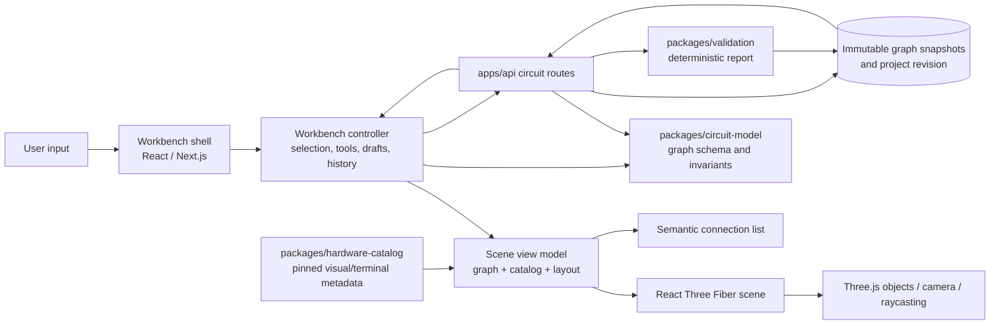
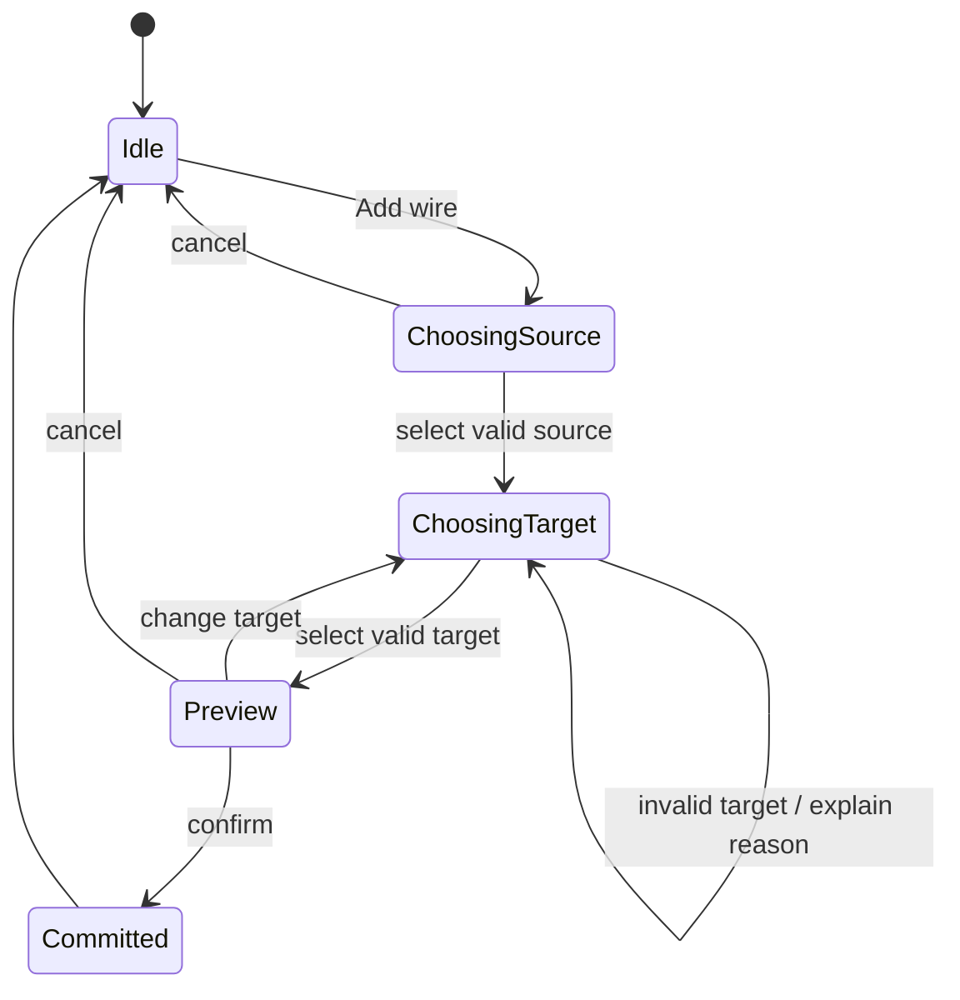

# Schemora Phase 3 — Interactive 3D Workbench Implementation Plan

- **Status:** In progress — graph-derived scene, wire editing, component arrangement, persistence, and undo/redo are implemented; physical placement and fit evidence remain open
- **Product phase:** Phase 3 — Interactive 3D Workbench
- **Baseline:** Phase 1 conversation intelligence and Phase 2 hardware knowledge/circuit validation are implemented on `dev`; Phase 3 is the work described here.
- **Primary user:** A desktop or laptop user who has a reviewed hardware design and wants to see and edit its physical arrangement without editing graph JSON.
- **Document role:** Concrete implementation contract for the first 3D workbench slice. It does not claim that Phase 3 is complete.

---

## 1. Purpose and outcome

Phase 3 makes the existing source-backed circuit graph tangible. A user opens a saved circuit, sees the supported board, breadboard, components, terminals, placements and wires in a 3D scene, and performs supported edits by interacting with those objects. The same saved graph remains the authority for connectivity, validation and persistence. The renderer is a view and input surface; it does not infer electrical connections from visual overlap.

The phase is complete when a user can use the supported starter circuit containing the ESP32 DevKitC V4 / WROOM-32E, BB400 breadboard, one LED, one resistor and jumper wires; inspect labeled terminals; move supported parts; create or remove graph connections through scene targets; undo and redo edits; save against the current project revision; and read the same graph through a semantic list when 3D rendering is unavailable.

Phase 3 implements the roadmap’s **interactive 3D workbench**. It is not the later automatic assembly planner, simulator, photo-recognition system, AI mentor, universal electronics CAD tool, or physical safety verifier.

## 2. Product baseline and phase boundary

### 2.1 Implemented baseline

Phase 1 accepts supported conversation files, extracts a structured project, preserves evidence and uncertainty, and presents a review flow. It is the upstream origin of project specifications and candidate connections. Its source and review details are described in [Phase 1 implementation](Phase-1-Implementation.md).

Phase 2 provides an immutable hardware catalog release, a versioned circuit graph, BB400 connectivity, deterministic graph validation and persisted reports. The current catalog contains a specific ESP32 DevKitC V4 / WROOM-32E board, BB400 breadboard, Kingbright WP7113ID LED and YAGEO 220-ohm resistor. The graph identifies component instances, catalog part IDs, terminal placements, wire endpoints, breadboard instances and catalog release. The graph and validation behavior are described in [Phase 2 implementation](Phase-2-Implementation.md).

The current circuit page is a semantic graph editor: it provides catalog terminal selectors, optional breadboard hole placement, graph persistence and validation. The initial 3D scene now renders that graph with orbit, zoom, and reset controls. It builds on those contracts rather than replacing them.

### 2.3 Implemented first slice

The first Phase 3 increment adds a client-side React Three Fiber scene to the circuit workspace. The scene renders the saved graph's breadboard topology, supported board and component silhouettes, and wires derived from graph endpoints. It supports camera orbit, zoom, and reset; terminal selection to add graph edges; wire removal in the scene and semantic list; selecting, moving and rotating components with keyboard-accessible workbench-step controls; versioned layout persistence in the graph snapshot; undo/redo; and visible WebGL/render failure fallback. Existing terminal selectors and hole-placement controls remain available.

This increment does **not** yet allow users to drag parts or assign terminal-to-hole placements through the scene. The layout contract stores only bounded scene X/Z coordinates and quarter-turn rotation; it carries no physical scale, fit, height, or electrical meaning. The view uses illustrative procedural geometry; it is not a dimension-accurate assembly or fit guarantee. These limits are reflected in the UI and README. Firmware simulation is Phase 6 in the product roadmap and is not part of this Phase 3 delivery.

### 2.2 Phase 3 included

- A browser 3D scene for only the catalog items with approved Phase 3 visual metadata/assets.
- A dimensionally consistent _presentation_ coordinate system, with documented nominal model dimensions where source evidence supports them. Visual scale is not a metrology or manufacturing claim.
- Scene representations of the supported board, breadboard, LED, resistor and wires. Missing visual assets use labeled placeholders.
- Board terminal and breadboard-hole picking, labels and contextual inspection.
- Supported component placement and rotation, with explicit draft/commit behavior.
- Wire creation between valid graph endpoints, wire removal, and graph-safe undo/redo.
- Visible camera orbit, pan, zoom, fit and reset controls; keyboard-accessible semantic alternatives.
- Graph save through the current revision and idempotency contract, followed by fresh validation on the saved graph.
- Failure handling, reduced-motion behavior, scene fallback, resource/performance limits and verification evidence.

### 2.3 Phase 3 excluded

- Automatic generation of ordered assembly instructions (Phase 4 roadmap).
- Firmware compilation, emulation or simulation outputs (Phase 6 in the detailed roadmap; the initial conversation called out simulation at a different ordinal, so the detailed phase names govern this implementation document).
- Computer-vision recognition of user hardware or reconstruction from a photograph (Phase 7 roadmap).
- LLM-generated scene code, free-form natural-language scene mutation, or AI-supplied coordinates.
- General component authoring, arbitrary imported 3D files, arbitrary circuit editing beyond the supported graph schema, schematic authoring, PCB layout, or multi-board compatibility claims.
- Mechanical collision/fit certification, manufacturing tolerances, exact appearance of every vendor revision, electrical simulation, or physical-safety certification.
- Mobile-first/touch-first support. The product is laptop/desktop focused; responsive fallback remains required at supported desktop widths.

## 3. User goals and observable behaviors

| User goal                                 | Observable behavior                                                                                | System result                                                                                                                                                          |
| ----------------------------------------- | -------------------------------------------------------------------------------------------------- | ---------------------------------------------------------------------------------------------------------------------------------------------------------------------- |
| Understand what the saved design contains | Open a circuit and see each supported graph entity represented or explicitly listed as unavailable | Scene and semantic list show the same graph revision and catalog identities                                                                                            |
| Locate a board pin                        | Search/select a terminal by catalog label or semantic ID                                           | Scene focuses the terminal, shows its label and role, and keeps the selected identity visible in the inspector                                                         |
| Understand breadboard placement           | Select a placed component terminal or hole                                                         | Scene highlights the exact graph placement; an inspector explains the row/hole identity and connectivity comes from the pinned topology                                |
| Create a wire                             | Choose “Add wire,” select a valid source terminal/hole, then select a valid destination            | A provisional wire is shown; only explicit confirmation creates a graph edge                                                                                           |
| Move a component                          | Select a movable component and use a visible move control or supported drag gesture                | Draft transform changes scene presentation; on confirmation the transform is saved in the Phase 3 visual-layout state, not silently encoded as electrical connectivity |
| Correct an accidental edit                | Undo/redo or cancel a draft                                                                        | The scene and semantic list return to the corresponding graph/layout state                                                                                             |
| Continue when WebGL is unavailable        | Use the scene fallback action                                                                      | Semantic list remains available for inspection and supported editing; the reason and retry action are announced                                                        |
| Know whether a change is saved            | Read the persistent save state                                                                     | Unsaved, saving, saved-at-revision, conflict, and failure states are explicit                                                                                          |

The product must not require a user to know GPIO terminology to operate the scene. Technical labels remain available because they identify real terminals; their accompanying descriptions use plain language and source-backed catalog data.

## 4. Architecture

### 4.1 Runtime boundaries

The implementation stays in the existing TypeScript monorepo and Next.js browser application. The 3D renderer is a client-only leaf of the circuit workspace. Server rendering must not import WebGL-only modules or require a GPU. The scene receives a normalized, immutable view model derived from the saved graph and the exact catalog release. React Three Fiber owns the Three.js scene lifecycle; a workbench controller translates user intents into graph/layout commands; shared circuit model and API contracts validate and persist the result.



### 4.2 Ownership and dependency rules

| Concern                              | Owner                                            | Rule                                                                                                          |
| ------------------------------------ | ------------------------------------------------ | ------------------------------------------------------------------------------------------------------------- |
| Electrical identity and connectivity | `packages/circuit-model` and saved graph         | Never derive connectivity from geometry, mesh intersection, visual proximity, color, or route shape           |
| Exact part and terminal facts        | `packages/hardware-catalog`                      | Resolve only through the graph’s pinned catalog release and exact part/terminal IDs                           |
| Scene geometry and asset anchors     | Phase 3 visual metadata package/module           | Maps known identities to display geometry; never changes graph facts                                          |
| Transient interaction                | Browser workbench controller                     | Owns selection, active tool, draft placement, provisional wire, camera pose and history cursor                |
| Durable graph state                  | Existing circuit API and persistence             | Uses expected project revision, idempotency key and immutable snapshot behavior                               |
| Durable visual layout                | Phase 3 layout contract and persistence decision | Stores presentation-only transforms separately from electrical facts, associated with graph identity/revision |
| Validation                           | Existing validation package and API              | Runs on the saved graph; does not accept client-derived nets or scene evidence                                |
| Accessible equivalent                | DOM semantic list and controls                   | Reads the same normalized view model and dispatches the same commands as the canvas                           |

### 4.3 Proposed frontend module boundaries

The phase implementation should add a small, explicit feature boundary rather than putting geometry code into the existing large circuit page component.

```text
apps/web/src/components/circuit-workspace.tsx       Existing workspace shell and save/validate flow
apps/web/src/components/workbench/                  Phase 3 UI feature boundary
  workbench-shell.tsx                               Panels, status, tool selection, fallback
  workbench-scene.tsx                               Client-only Canvas composition
  scene/                                            Camera, board, breadboard, part, wire, pin
  controller/                                       Commands, draft state, undo/redo
  semantic-connection-list.tsx                      Accessible graph-equivalent view
  layout-contract.ts                                 Versioned presentation state types
packages/hardware-catalog/                          Existing source-backed part catalog
packages/circuit-model/                             Existing graph parsing/validation/connectivity
```

Names are proposed boundaries, not a requirement to create empty folders. Keep scene primitives and interaction logic small and testable. Do not expose raw Three.js object references as application state or API payloads.

### 4.4 Technology choice and official references

The repository already selects React, TypeScript and Next.js. The project context specifies Three.js with React Three Fiber. The React Three Fiber `Canvas` establishes a scene, camera, render loop, sizing and renderer lifecycle; it supports responsive parent sizing ([R3F: Your first scene](https://r3f.docs.pmnd.rs/getting-started/your-first-scene), [R3F: Canvas API](https://r3f.docs.pmnd.rs/api/canvas)). Fiber pointer events use Three.js raycasting and expose hit data, which suits terminal/hole picking but requires explicit semantic target IDs ([R3F: Events](https://r3f.docs.pmnd.rs/api/events), [Three.js: Ray](https://threejs.org/docs/pages/Ray.html)).

Use APIs compatible with the versions installed when implementation begins. Pin package versions through the repository lockfile; do not copy version-specific snippets from documentation without checking the installed API. A WebGL context or asset load can fail, so the DOM workbench shell and semantic representation must survive independently.

## 5. Canonical data and graph-to-scene mapping

### 5.1 Inputs

The renderer input is derived from:

1. The latest saved graph snapshot from `GET /v1/projects/:projectId/circuit`.
2. The exact catalog release identified by `graph.catalogReleaseId`.
3. A separately versioned presentation layout, if present and compatible with the graph identity/revision.
4. The latest validation report only as a display overlay, with `current` state honored.

The current graph schema includes `schemaVersion`, graph/project identity and revision, `catalogReleaseId`, component instances, breadboards, terminal-to-hole placements and explicit wires. See [graph schema](../packages/circuit-model/src/schema.ts), [graph validation/connectivity](../packages/circuit-model/src/graph.ts), and [catalog release](../packages/hardware-catalog/src/release-2026-10.ts). The Phase 3 view model must never synthesize omitted catalog identities or turn an unresolved source conversation candidate into a terminal.

### 5.2 Mapping table

| Graph/catalog entity       | Scene representation                                                                | Stable binding                                   | Interaction                                                                             |
| -------------------------- | ----------------------------------------------------------------------------------- | ------------------------------------------------ | --------------------------------------------------------------------------------------- |
| Component instance         | Named scene group with model mesh or labeled placeholder                            | `componentInstanceId`; exact `catalogPartId`     | Select; inspect; move/rotate only when layout capability permits                        |
| Board terminal             | Pickable target at a catalog-defined anchor; label shown at useful zoom/selection   | `componentInstanceId + terminalId`               | Inspect; start/end a wire; focus; copy/display exact label                              |
| Breadboard instance        | Board body plus labeled row/hole target field                                       | `breadboardInstanceId + topologyId/version`      | Inspect topology; select valid hole; place a supported terminal                         |
| Terminal-to-hole placement | Visible terminal leg/contact marker at that hole; relationship exposed in inspector | placement entity identity from the graph         | Select either endpoint to reveal the other; modify only through explicit placement tool |
| Explicit wire edge         | Routed tube/line mesh with two endpoint handles                                     | `wireId` and graph source/target endpoint IDs    | Select/remove; provisional route while adding; no electrical meaning from route         |
| Validation finding         | Non-color-only outline/icon + finding label and affected entity IDs                 | Finding ID and entity IDs from current report    | Select finding to focus associated scene objects and show full explanation              |
| Catalog visual asset       | Geometry/material loaded from approved manifest                                     | Exact catalog part ID and asset manifest version | Read-only; unsupported assets get a labeled placeholder                                 |

### 5.3 Visual coordinate conventions

- Use one right-handed world coordinate convention throughout each released scene; document the mapping from model coordinates to Three.js axes in the asset manifest.
- Use meters as the internal authoring convention only when vendor dimensions and model provenance support it. A visually arranged scene may use a display normalization factor; store that factor explicitly and never infer physical fit from it.
- Define each model’s origin, orientation, terminal anchor coordinates, bounding dimensions, asset revision and source/provenance metadata together.
- Board labels and pin targets are generated from catalog terminal identity and visual anchors. A text label printed on a model is supplemental; a mismatch between mesh text and catalog identity is a release-blocking defect.
- Breadboard hole positions must map to explicit topology hole IDs. The scene may render a hole grid, but nearest-hole picking must resolve to one exact declared hole ID and return “no target” outside a bounded hit radius.
- Wires are visual splines between endpoint anchors. Their path may avoid obscuring labels and parts but has no role in net derivation. Crossing wire meshes do not connect.
- Do not use exploded views or display transforms while editing unless the interface clearly marks them as presentation mode and endpoints remain unambiguous.

### 5.4 Layout data boundary

The first implementation stores presentation placement in an optional, strictly validated `visualLayout` member of the immutable graph snapshot. It is deliberately separate from electrical entities and contains only bounded X/Z workbench coordinates and quarter-turn rotation:

```ts
type VisualLayout = {
  schemaVersion: 1;
  componentPlacements: Array<{
    componentInstanceId: string;
    x: number; // bounded illustrative workbench units
    z: number; // bounded illustrative workbench units
    rotationY: 0 | 90 | 180 | 270;
  }>;
};
```

This layout is stored and authorized with the graph snapshot using the existing owner-scoped circuit route and project revision checks. Circuit topology derivation ignores `visualLayout`; the current immutable snapshot identity still changes when layout changes, so the UI conservatively marks a previous validation report stale. Camera pose remains browser-local. The schema must not grow guessed physical dimensions, insertion fit, terminal topology, or electrical semantics.

If later requirements demand layout revisions that do not affect circuit-report currency, move presentation data to a separately revisioned artifact with an explicit graph identity and stale-layout policy. Do not make that change without preserving immutable history and owner checks.

## 6. Scene behavior and controls

### 6.1 Initial scene

The default view fits the complete supported design in frame at a readable oblique angle. The user sees the board, breadboard and positioned components, with wires visible and pin labels available on selection or zoom. Do not start with every label rendered at full density; use selection, hover, zoom threshold and the semantic list to manage clutter. Initial scene load shows a neutral loading state in the DOM and a stable empty/error state on failure.

### 6.2 Camera

Provide visible controls for orbit, pan, zoom, fit design, reset view and projection mode only if both modes are implemented and verified. Pointer gestures may supplement but cannot replace visible controls. Camera actions never mutate graph or layout. Reset view restores camera pose only. Prevent the camera from crossing through the work surface or making the design disappear; clamp zoom to a useful range and keep a clear recovery control visible.

### 6.3 Selection and inspection

- A scene target has a semantic identity independent of its Three.js object ID.
- Selecting a component, pin, hole, wire or validation finding synchronizes selection with the side panel and semantic list.
- A pin inspector includes exact catalog label, terminal ID, declared role/capabilities and relevant source references where available. Unknown facts stay marked unknown.
- Selection is communicated through outline/shape/label and text state, not color alone.
- Escape clears the current selection or cancels the active draft according to the tool state; no committed graph change is undone implicitly.

### 6.4 Component placement and rotation

The move tool starts with a supported component. The user can move it using a clearly displayed plane/axis handle or an accessible numeric position control. Rotation uses explicit axis/angle controls or fixed increments; freehand rotation is not required for the first supported slice. While dragging, the transform is provisional; the user can commit, cancel or undo. If catalog placement constraints are unavailable, do not snap to a guessed physical footprint. Any snap guide is visual assistance only and is clearly distinct from electrical placement.

Part movement changes presentation layout only. It does not change graph connectivity. Breadboard-hole placement is an electrical graph operation and must use the explicit placement editor/tool, resolve to a valid hole ID, and show the resulting terminal-to-hole relation in both scene and semantic list.

### 6.5 Wire construction and removal

Wire creation is an explicit state machine:



The preview shows source identity, target identity, a provisional route and a non-color-only status. Only confirmation dispatches an add-wire command. The command validates graph invariants and catalog endpoint identities before a durable write. Invalid endpoints explain the condition and do not create a graph edge. The user can remove a selected wire only after a confirmation or a reliable undo window; removal is represented by a graph command and persisted revision, not a mesh deletion alone.

No wire creation gesture may silently select the closest endpoint when multiple targets overlap. Provide a target chooser/list when hit testing is ambiguous. Pointer capture and event propagation must be handled so camera gestures cannot accidentally create wires; consult the [React Three Fiber events API](https://r3f.docs.pmnd.rs/api/events), especially its hit testing and pointer capture behavior.

### 6.6 Undo and redo

History stores domain commands and before/after graph or layout values, not scene object references. Commands include add/remove wire, set terminal placement, move/rotate component, and other explicitly supported edits. Undo/redo is local to the current editor session and replays validated commands. Saving creates a new immutable graph snapshot according to Phase 2 contracts; undo after save is a new edit and save, not mutation of an earlier snapshot. On revision conflict, reload/rebase is not automatic; preserve the local draft for user review and show the server revision.

## 7. State model and persistence flow

```mermaid
sequenceDiagram
  participant B as Browser workbench
  participant C as Catalog API
  participant A as Circuit API
  participant D as PostgreSQL
  participant V as Validation engine
  B->>A: GET current graph snapshot
  A->>D: owner-scoped read
  D-->>A: graph + project revision
  A-->>B: graph identity/revision
  B->>C: GET exact pinned catalog release
  C-->>B: parts, terminal anchors, topology, sources
  B->>B: derive scene view model
  Note over B: Canvas and semantic list share identities
  B->>B: User makes provisional edit
  B->>B: Validate command; update local draft only
  B->>A: PUT graph with expected revision + idempotency key
  A->>D: lock project, verify revision, insert immutable snapshot
  D-->>A: committed graph revision
  A-->>B: saved graph + updated project revision
  B->>A: POST validate latest saved graph
  A->>V: validate exact graph/catalog/rules versions
  V-->>A: deterministic report
  A->>D: persist report
  A-->>B: report with current/stale state
```

The phase should reuse existing API behavior documented in [Phase 2 §6](Phase-2-Implementation.md#6-api-and-persistence). No direct browser database access is permitted. Layout persistence, if added, follows a separately specified contract and must not change graph-save idempotency semantics.

## 8. Accessibility and non-3D equivalence

The canvas is not an accessible interaction model by itself. The DOM provides a complete semantic alternative backed by the same view model and command controller.

- Give the canvas a meaningful accessible name and concise controls/instructions.
- Expose components, terminals, terminal placements, breadboard holes, wires, selected object, current graph revision and validation findings in a searchable semantic list/table/tree.
- Every core task is possible using keyboard-only controls, including wire creation/removal, terminal selection, part movement through numeric controls, undo/redo, save and validation.
- Provide visible focus order and focus retention when scene selection changes. Do not move focus into an invisible canvas object.
- Use text, icons, outlines and status announcements in addition to color.
- Announce provisional versus committed wire state and save/conflict/failure state to assistive technology.
- Respect reduced-motion settings: disable nonessential wire-travel animations and eased camera transitions; keep essential state changes immediate and understandable.
- Allow browser zoom and high-contrast settings without clipping primary controls or the semantic list.
- If WebGL, GPU resources, context creation or asset loading fail, show the semantic workspace without losing graph access and expose a retry action.

Target WCAG 2.2 AA behavior for the supported scope, as required by the UI plan. The rendered scene is supplementary. Accessibility acceptance is task completion with keyboard and assistive technology, not only an automated scan.

## 9. Geometry, asset and rendering limits

### 9.1 First release geometry scope

Create or source only assets for the current verified starter catalog identities. Each board and breadboard asset must have stable terminal/hole anchors. The LED and resistor may use simple meshes and accurate pin anchors even if surface details are stylized. Jumper wires are generated geometry. A missing asset must render a clearly labeled placeholder with the exact part identity and preserve semantic operations where possible.

Asset format should be selected based on verified repository tooling and browser loading needs. The source context recommends glTF/GLB, but this plan does not assert that asset pipelines or production assets already exist. Any asset must have recorded source/license, attribution obligations, version, geometry budget, texture budget, coordinate convention, terminal-anchor data, and review owner before it enters the bundle.

### 9.2 No physical-scale CAD claims

“Dimensionally consistent” means the authored visual parts have a declared coordinate system and their displayed proportions are internally coherent where source dimensions are known. It does not mean:

- the mesh proves a part fits a real breadboard or enclosure;
- vendor board revisions share the same outline, pin pitch or connector dimensions;
- labels are readable at every camera angle or match all production silkscreen variants;
- placement collision results prove physical clearance;
- visual wire routing reproduces a manufacturable cable length or bend radius;
- the virtual assembly proves a real circuit is safe, electrically complete or physically realizable.

The catalog’s electrical terminal identity and topology remain authoritative. A visual model can only demonstrate those facts. Users are shown exact supported model identity and limitations in the inspector.

### 9.3 Performance budget and graceful degradation

Establish and measure a target matrix during implementation: supported desktop browsers, integrated graphics laptop baseline, common viewport sizes, device pixel ratios, scene entity counts and asset loading conditions. Do not assume a GPU tier not stated in the PRD. Start with one starter design and keep geometry/light/material complexity modest; lazy-load the scene and model assets after the workspace shell is interactive. Cap device pixel ratio to a tested range, avoid per-frame React state updates, dispose of geometries/materials on teardown and reuse repeated geometry where profiling supports it.

Release gates should record first meaningful scene display, interaction responsiveness during camera and wire actions, memory/context recovery, and behavior when assets fail. Agree numeric budgets from measured baseline before marking the phase complete; do not invent a performance claim without measurements.

## 10. Security and trust boundaries

- No AI output may execute as scene code, shader code, JavaScript or dynamic model loader configuration.
- Only the application’s vetted asset manifest can name loadable asset paths. User-provided uploads are not 3D model inputs in this phase.
- Parse all server payloads through existing strict schemas. Client-side checks improve feedback but are not trusted for persistence.
- Limit graph object counts through existing contracts and cap layout object/coordinate values if durable layout is introduced. Reject NaN, infinity, out-of-range transforms, unknown component IDs and duplicate placement records.
- Keep project ownership, authentication, expected revision and idempotency enforcement in the existing API boundary.
- External asset URLs are not accepted in user-controlled graph/layout data. Bundle assets or serve them from the controlled application asset path.
- Do not log complete circuit payloads or source conversation text as part of renderer diagnostics.
- Treat geometry as explanatory visualization. Do not use visual overlap, highlighted wire paths or a rendered validation badge to imply a physical safety conclusion.

## 11. Failure and recovery behavior

| Failure                                    | User-visible behavior                                                                             | Data behavior                                                                     |
| ------------------------------------------ | ------------------------------------------------------------------------------------------------- | --------------------------------------------------------------------------------- |
| Catalog release missing or digest mismatch | Explain that this design release cannot be rendered; offer semantic list and support details      | Do not substitute the latest catalog release                                      |
| One part asset unavailable                 | Show labeled placeholder and part identity; keep supported graph operations if anchors are known  | Graph remains unchanged                                                           |
| Terminal anchor missing                    | Explain that precise scene picking is unavailable for that part; offer semantic endpoint selector | Do not guess coordinates or endpoint identity                                     |
| WebGL unsupported/context lost             | Keep workbench shell and semantic editor; show retry/reload-scene action                          | Preserve unsaved draft in memory where possible; label if recovery is not durable |
| Save conflict                              | Show that the project changed elsewhere and offer reload plus copy/review of local draft          | Never overwrite newer revision automatically                                      |
| Network/save failure                       | Keep local draft and provide retry; keep unsaved indicator persistent                             | No “saved” state until API confirms commit                                        |
| Validation unavailable                     | Keep saved graph and show report status as unavailable/stale                                      | Do not display an older report as current                                         |
| Invalid interaction target                 | Explain target requirement and retain current valid source selection where safe                   | No graph mutation                                                                 |
| Layout stale after graph revision change   | Reset or request user review of presentation layout; explain affected component IDs               | Never silently attach old transforms to unrelated graph state                     |

## 12. Implementation sequence

### Workstream A — Visual contract and asset anchors

1. Inspect catalog records and identify which visual facts are source-backed versus presentation-only.
2. Define the versioned asset manifest and anchor schema, with strict validation and a source/license field.
3. Author starter component geometry/placeholders and board terminal/breadboard hole anchors.
4. Verify all graph terminals/holes needed by the starter example map to exactly one anchor or have an explicit unsupported state.

**Exit evidence:** asset manifest review, identity-to-anchor coverage report, license/provenance record, and a scene render capture.

### Workstream B — Scene shell and read-only projection

1. Add a client-only R3F scene under the existing circuit workspace.
2. Build a deterministic scene view-model selector from graph + exact catalog release + asset manifest.
3. Render supported entities, wire paths, selection, catalog labels and a fit/reset camera.
4. Add the semantic list and verify it exposes the same IDs and revision without WebGL.

**Exit evidence:** scene-to-graph identity review, list parity evidence, and WebGL-disabled behavior.

### Workstream C — Interaction controller

1. Add explicit selection and tool state.
2. Implement pin/hole inspection and target disambiguation.
3. Implement provisional wire creation, confirmation, cancellation and removal.
4. Implement supported component move/rotation controls and separate layout draft state.
5. Add domain-command undo/redo and keyboard equivalents.

**Exit evidence:** recorded pointer and keyboard task paths, graph invariant checks and undo/redo history cases.

### Workstream D — Persistence and revision behavior

1. Reuse existing graph save contract for graph-affecting edits.
2. Decide and implement the explicit presentation-layout persistence option, or keep layout session-only with visible unsaved state.
3. Handle optimistic conflicts, retries and idempotency.
4. Trigger validation only for saved graph state and refresh report current/stale status.

**Exit evidence:** API integration evidence for save, conflict, retry, stale report and graph/layout compatibility.

### Workstream E — Hardening and release evidence

1. Verify camera and pointer input do not conflict with wire editing.
2. Verify reduced motion, keyboard path, semantic list and screen-reader announcements.
3. Profile the supported laptop baseline and handle context loss/asset errors.
4. Review all labels, source links, visual limitations and non-safety wording.
5. Update README/roadmap and release notes only after acceptance criteria are met.

## 13. Acceptance criteria

### 13.1 Functional

1. Opening the starter graph renders the exact graph’s supported board, breadboard, LED, resistor, wires and their stable identities.
2. Every rendered terminal/hole target resolves to the catalog identity and topology represented by the graph; no target is selected solely by nearest visual geometry when ambiguous.
3. Selecting a pin or hole reveals its label and identity in the inspector and semantic list.
4. Creating a wire requires two explicit valid endpoint choices and confirmation; the committed edge appears in the saved graph and semantic list.
5. Removing a wire updates both representations and can be undone/redone before and after save according to domain-command rules.
6. Breadboard placements use exact topology hole IDs and remain separate from free-form layout transforms.
7. Component transforms do not alter electrical connectivity. If persisted, transforms are stored in a versioned layout bound to graph identity/revision.
8. Save uses expected revision and idempotency behavior; conflict never silently overwrites another revision.
9. Validation is based on the persisted graph and current report status is truthful.
10. Missing/unsupported geometry renders an explicit placeholder or unsupported message; it never substitutes a visually similar part.

### 13.2 Usability and access

1. A user can inspect the full starter design and identify a selected pin without editing graph JSON.
2. Core inspect, wire-add, wire-remove, move, save, undo/redo and validation tasks can be completed by keyboard using visible controls and the semantic list.
3. Core task state is understandable without color and without motion.
4. Canvas failure preserves the project shell, graph information, semantic editing path and retry affordance.
5. Camera controls are visible, resettable and independent of circuit edits.

### 13.3 Trust and limits

1. The UI identifies the exact catalog release and supported part model.
2. Electrical connectivity is derived by the circuit model, never by mesh geometry or wire appearance.
3. Unsupported facts and missing anchors are explicit; no common pin assumption fills the gap.
4. User-facing copy distinguishes visual assembly from physical-scale CAD, simulation, and physical safety verification.
5. Every asset has provenance and license review before shipping.

## 14. Verification plan

This plan defines verification required before release; it does not assert that Phase 3 code or its tests already exist. Follow the repository’s current test conventions and run only the checks needed for the implementation changes.

| Verification layer       | Required cases                                                                                                                                          |
| ------------------------ | ------------------------------------------------------------------------------------------------------------------------------------------------------- |
| Pure view-model tests    | Stable mapping from graph/catalog/manifest to scene IDs; deterministic endpoint anchors; missing release/asset/anchor handling; stale layout rejection  |
| Command/controller tests | Valid and invalid source/target; ambiguous hit target; cancel/confirm; graph edits; layout-only moves; undo/redo; stale revision response               |
| Graph invariants         | Scene actions cannot create undeclared IDs, malformed graph, invalid holes or duplicate placements; crossings do not create nets                        |
| Browser integration      | Load starter design; inspect pin; wire preview/confirm; remove/undo; save; validation refresh; conflict/retry; scene fallback                           |
| Accessibility review     | Keyboard-only tasks, focus behavior, semantic list parity, announcements, reduced motion, high zoom and contrast                                        |
| Visual review            | Supported desktop viewport screenshots; model orientation/labels/anchors; no hidden controls; placeholder clarity; readable pin targets                 |
| Performance review       | Record hardware/browser baseline, scene load, interaction responsiveness, memory and context-loss recovery; set and meet numeric budgets before release |
| Asset governance         | Source/license/provenance, identity, version, dimensions/coordinate convention, terminal-anchor coverage, bundle size and review approval               |

## 15. Phase 3 release gates

Do not mark this phase complete until all gates below have attached evidence:

- **G1 — Domain integrity:** Scene inputs and commands preserve Phase 2 graph validation and catalog pinning.
- **G2 — Identity:** Every interactive target maps to one exact graph/catalog ID, or is explicitly non-interactive.
- **G3 — Persistence:** Graph writes obey ownership, revision and idempotency contracts; layout persistence is explicit and versioned or clearly session-only.
- **G4 — Accessible completion:** Core tasks work without 3D through keyboard-operated semantic controls.
- **G5 — Failure recovery:** WebGL, asset, API and stale-state failures preserve understandable recovery paths.
- **G6 — Asset governance:** All shipping geometry has provenance/license review and validated anchors.
- **G7 — Performance:** Measured target hardware meets agreed numeric budgets and resource cleanup is verified.
- **G8 — Honest representation:** Product copy and visual status never imply physical fit, electrical safety or simulation.
- **G9 — Repository discipline:** Implementation commits remain on `dev`; `main` remains README-only.

## 16. Risks and decisions to settle during implementation

| Risk/decision                                                                              | Why it matters                                                    | Resolution rule                                                                                  |
| ------------------------------------------------------------------------------------------ | ----------------------------------------------------------------- | ------------------------------------------------------------------------------------------------ |
| Catalog currently has electrical topology but no evident complete 3D asset/anchor manifest | Renderer cannot pick pins reliably without precise visual anchors | Add explicit visual metadata and audit coverage; do not infer anchors from screenshots or names  |
| Current graph has no component transforms                                                  | Moving a board visually must not corrupt domain records           | Use a separately versioned layout contract or keep movement session-only and label it            |
| Board dimensions/revisions may differ                                                      | A model may look plausible while showing wrong terminal positions | Bind visual asset to exact catalog part ID/revision and provenance; no family-level substitution |
| Dense ESP32 pin labels                                                                     | A static label cloud will be unreadable                           | Progressive labels, selected-pin inspector, search/list and useful camera defaults               |
| Raycast target overlap                                                                     | Wrong pin selection would make the demo misleading                | Target chooser or semantic list for ambiguous hits; never silently pick nearest                  |
| Browser GPU/context variability                                                            | 3D may fail on supported computers                                | Preserve shell and semantic view; test context loss and WebGL-disabled path                      |
| Layout and graph revision semantics                                                        | Stale transforms can mismatch graph edits                         | Layout is tied to graph ID/revision and invalidated/reviewed on mismatch                         |
| Asset licensing and third-party geometry                                                   | Shipping may create legal or attribution obligations              | Record source/license and review before bundle inclusion                                         |
| “Realistic” can imply accuracy beyond evidence                                             | Users may trust appearance as physical validation                 | Prefer clear, legible models; disclose visual and physical-model limits                          |

## 17. Traceability

| Requirement source                                                                         | Phase 3 interpretation                                                                                                                      |
| ------------------------------------------------------------------------------------------ | ------------------------------------------------------------------------------------------------------------------------------------------- |
| [Project context roadmap](context.md#phase-3--interactive-3d-workbench)                    | 3D workbench; drag/rotate/zoom/reposition; inspect pins; connect actual pins/holes; animate insertion/removal; connection status; undo/redo |
| [Context technical principles](context.md#the-hardest-part-is-not-the-3d-graphics)         | Electrical graph is separate from visual layer; visual wire is not electrical proof                                                         |
| [Context stack and principles](context.md#recommended-engineering-stack)                   | Next.js, React/TypeScript, Three.js through React Three Fiber; renderer independent from circuit representation                             |
| [Phase 2 implementation](Phase-2-Implementation.md)                                        | Exact catalog release, graph shape, topology, API ownership/revision/idempotency, deterministic validation and known non-claims             |
| [Circuit graph schema](../packages/circuit-model/src/schema.ts)                            | Current canonical entities and strict schema                                                                                                |
| [Graph semantics](../packages/circuit-model/src/graph.ts)                                  | Terminal/hole/wire connectivity and structural validation                                                                                   |
| [Catalog release](../packages/hardware-catalog/src/release-2026-10.ts)                     | Current supported parts and source-backed identities                                                                                        |
| [Current circuit UI](../apps/web/src/components/circuit-workspace.tsx)                     | Existing semantic editor and persistence flow that Phase 3 extends                                                                          |
| [UI/UX plan §10 and §11](UI-UX-Implementation-Plan.md)                                     | Keyboard, semantic alternative, fallback, shared graph revision and rendering boundary                                                      |
| [React Three Fiber scene guide](https://r3f.docs.pmnd.rs/getting-started/your-first-scene) | Canvas setup, scene/camera/render lifecycle and responsive parent sizing                                                                    |
| [React Three Fiber events](https://r3f.docs.pmnd.rs/api/events)                            | Pointer events, raycast hit data, propagation and pointer capture behavior                                                                  |
| [Three.js Ray](https://threejs.org/docs/pages/Ray.html)                                    | Raycasting/picking concept used for scene target hit testing                                                                                |

## 18. Definition of done

Phase 3 is done when the supported starter design can be inspected and edited through a real interactive 3D scene; every graph-affecting action is identity-bound, validated and persisted through Phase 2 contracts; semantic controls offer equivalent core operations; scene and asset failure do not strand the user; accessibility and performance gates have recorded evidence; and shipped geometry has reviewed provenance. The release note must identify the exact supported catalog release and limitations. It must not claim universal 3D hardware coverage, physical CAD, automatic assembly generation, real simulator behavior, or safety certification.
