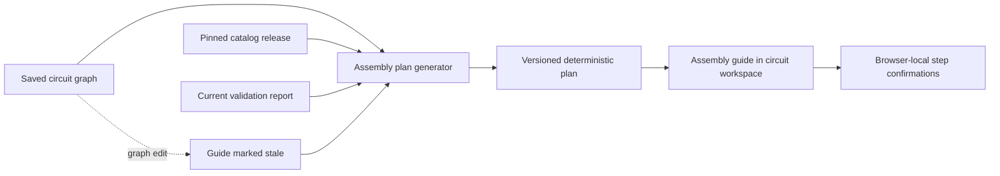
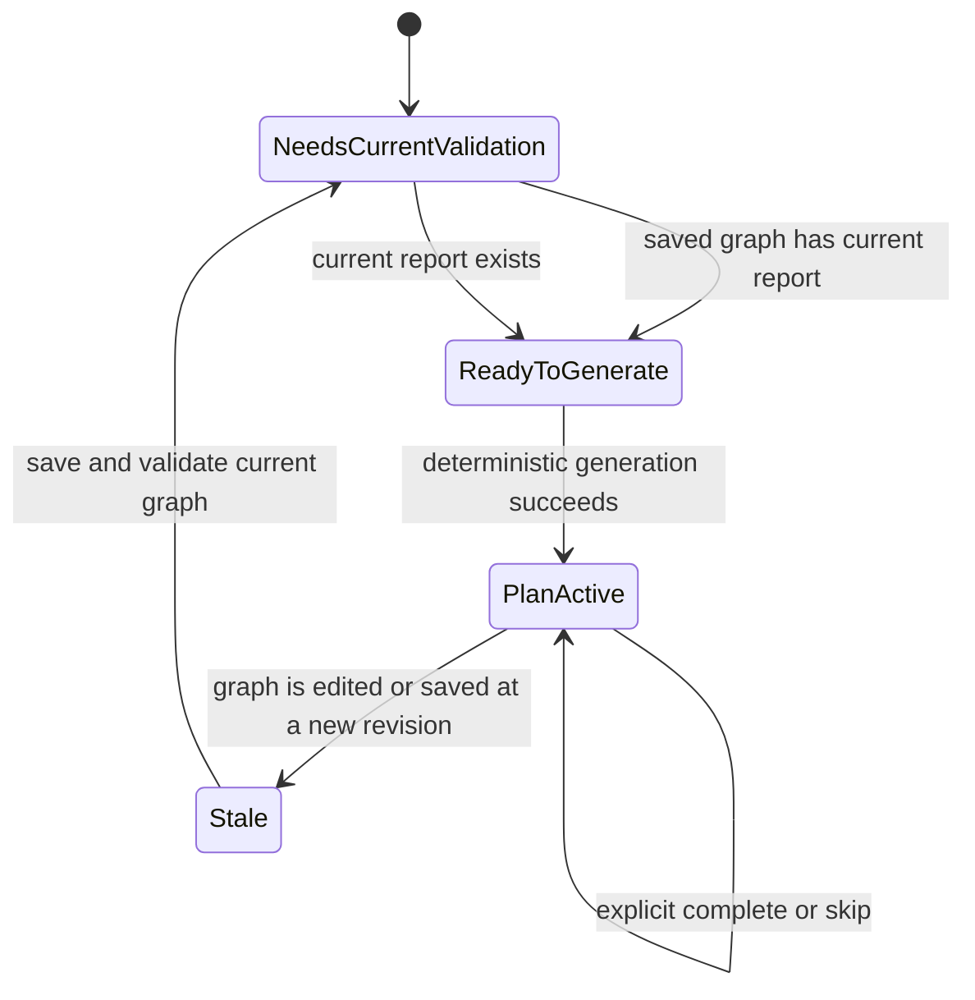

# Schemora Phase 4 — Automatic Assembly Generation

**Status:** In progress — deterministic plan generation and a guided checklist are available for the supported catalog profile; durable server-side plan history, scene camera focus/animation, and in-scene execution remain open.

**Product phase:** Phase 4 — Automatic assembly generation.

**Baseline:** Phase 1 conversation review, Phase 2 source-backed circuit graph and validation, and the current Phase 3 workbench run on `dev`.

**Scope authority:** The detailed roadmap and Phase 4 requirements in [`context.md`](context.md#phase-4---automatic-assembly-generation), interpreted alongside the PRD, TRD, Phase 2 contracts, and current workbench behavior.

## 1. Purpose and user outcome

Phase 4 turns a saved, structurally valid, currently checked circuit into an ordered set of instructions. The guide is a projection of the saved graph and pinned catalog. It must not create a connection, terminal placement, component identity, or physical dimension that the graph and catalog do not establish.

The current slice gives a user a repeatable guide for identifying exact catalog items, following known terminal-to-hole placements, following saved wire endpoints, reviewing the current findings, and performing a pre-power inspection. The guide tells the user when data is missing and retains the catalog's physical and electrical limitations.

The user's confirmation records that they say they performed a step. It is not sensor evidence, an electrical measurement, or proof that the physical assembly matches the virtual model.

## 2. Architecture and trust boundary



The generator runs on the API server. It parses the strict graph, catalog-release, and validation-report schemas, then checks that the report is current and describes the exact project, revision, graph identity, graph digest, and catalog release. It requires `GRAPH_INTEGRITY` to pass and refuses any report containing a failed or error finding. Unknown and warning findings are preserved in the generated guide.

The deterministic generator lives in [`packages/assembly-plan/src/index.ts`](../packages/assembly-plan/src/index.ts). The route in [`apps/api/src/app.ts`](../apps/api/src/app.ts) exposes `POST /v1/projects/:projectId/assembly-plan`. Generation is read-only and does not increment the project revision. The plan includes a schema version, planner ID/version, graph/report provenance, ordered steps, and a canonical SHA-256 digest.

Step progress is currently browser-local and keyed by project ID and plan digest. `Next` only changes the selected step. `Skip for now` records a distinct incomplete state. `I completed this step` records an explicit user confirmation and is enabled only after the plan's prerequisite steps are confirmed. Every graph edit, including undo and redo, marks the displayed plan stale; the user must regenerate from a current validation report. Server-side immutable plan history and append-only progress events are a later persistence increment.

## 3. Deterministic planner contract

### 3.1 Inputs

The planner accepts:

- One strict `CircuitGraph` snapshot.
- The exact `CatalogRelease` referenced by that graph.
- A strict `ValidationReport` whose `graphId`, `graphDigest`, project, revision, and catalog release match the graph.
- An explicit currentness flag obtained from the owner-scoped repository lookup.

The API is authoritative for currentness. A browser-provided “current” flag is never accepted as proof.

### 3.2 Plan identity

`planDigest` is SHA-256 of canonical JSON containing all plan fields except `planDigest` itself. Canonicalization sorts object keys recursively and preserves array order. Planner version is part of the hashed payload. Identical input snapshots and planner version therefore produce identical ordered steps and digest.

Stable step IDs are derived from the action and the stable graph entity ID, not from an array index or translated instruction text. This keeps IDs stable when unrelated steps are inserted into the plan. A changed graph identity may produce a new step identity even when its prose looks similar.

### 3.3 Ordering and prerequisites

The planner creates:

1. Exact component-identification steps, with the supported development board before other components and stable component-ID ordering within each group.
2. Terminal placement steps for only the terminal-to-hole assignments explicitly present in the graph.
3. Wire steps for only the edges explicitly present in the graph, ordered by stable wire ID.
4. A current-check review step after all graph construction steps.
5. A pre-power inspection after the check-review step.

Wire steps depend on endpoint component-identification steps and on any explicit placement step for those terminals. The planner topologically sorts the dependency graph and resolves ties by stable step ID. A cycle is rejected instead of silently producing a misleading sequence.

No terminal placement is invented. Where a terminal has no graph hole assignment, the guide references its exact component and catalog terminal only; it does not imply a breadboard coordinate. Presentation-only `visualLayout` coordinates are never interpreted as insertion locations or physical dimensions.

### 3.4 Executable step fields

Each strict step contains:

- Stable step ID and one-based order.
- Typed action, title, instruction, and explanation.
- Component instance IDs and exact component, terminal, or breadboard-hole anchors.
- Prerequisite step IDs.
- Camera target and highlight targets as semantic anchors, not guessed coordinates.
- A typed completion predicate and required validation rule IDs.
- Step-specific safety or catalog warnings and an optional animation key.

The current UI displays semantic anchors and focused text. It does not yet drive camera focus, play an animation, or mutate the graph by executing a step.

## 4. Validation gate and findings

The existing basic circuit ruleset deliberately returns `unknown` for electrical conditions outside its modeled scope. Therefore, a whole-report `pass` is not currently attainable for many otherwise structurally valid designs. The plan generator does not convert these unknown findings into a pass. It permits plan generation only when graph integrity passes and no finding is `fail` or `error`; all unknowns and warnings remain visible in the guide.

This gate allows assembly instructions to be generated for a graph whose modeled checks do not identify a conflict. It does not assert electrical completeness, component authenticity, safe operating margins, physical fit, or permission to energize hardware. The pre-power step is an inspection reminder only.

## 5. User flow and state model



The guide displays the active step, sequence position, exact target anchors, prerequisites, step warnings, completed count, and plan provenance. Users can select any step to revisit it. `Next` and `Previous` are navigation only. A skipped step stays incomplete. A later step cannot be confirmed while any prerequisite remains incomplete.

Progress is stored in browser local storage using the plan digest as its namespace. Invalid or obsolete local state is ignored. A new plan uses a new progress namespace. Progress is not synchronized across browsers or accounts in this slice and must not be described as durable project history.

## 6. API contract

`POST /v1/projects/:projectId/assembly-plan`

Request body:

```json
{
  "expectedRevision": 12
}
```

The route reads the owner-scoped current graph and report, checks `expectedRevision`, confirms the report belongs to the exact current graph, and runs the deterministic planner. It returns `{ "plan": AssemblyPlan, "current": true }` in the standard API envelope. No submitted graph, validation result, or plan is trusted from the browser. The endpoint accepts the existing idempotency header for uniform write-origin handling, but generation has no persistence side effect to replay.

Expected failures are a missing graph, revision conflict, missing/stale validation report, graph/report provenance mismatch, graph-integrity failure, or any failed/error circuit finding. Such failures do not return a partial plan.

## 7. Accessibility and interaction

- The plan is represented as an ordered semantic list and remains usable without the 3D canvas.
- Previous, next, skip, confirm, print, and direct step-selection controls are native buttons.
- The active instruction uses a polite live region; prerequisites and warnings remain visible text.
- Print view includes the guide and ordered steps without requiring canvas output.
- Confirmation and skip are separate actions with separate labels and status text.
- Progress count includes only explicitly confirmed steps.

## 8. Verification

The package tests verify deterministic output, stable plan digest, exact terminal labels, dependency ordering, current-report provenance, failure gating, and preservation of unknown-scope warnings. API integration coverage should verify that a failed report blocks generation and that a current valid report permits it. Browser coverage should verify guide generation, navigation without implicit completion, explicit confirmation, local progress reload, and stale-plan handling after graph edits.

## 9. Known limits and remaining Phase 4 work

- Current plan and progress are not immutable server-side artifacts. Add owner-scoped plan snapshots and append-only completion/skip events before claiming cross-device persistence or audit history.
- User confirmations are self-reported; no physical device, sensor, or image verifies the real assembly.
- The plan supports the current exact catalog release only. Unsupported or ambiguous part identity must block pin-specific instruction generation.
- Steps do not yet execute graph edits in the 3D scene. Current graph wire steps are instructions for reproducing the saved target circuit on physical hardware.
- The canvas remains illustrative and does not provide calibrated fit, insertion force, component clearance, or physical height.
- Camera movement, animated action demonstration, guided scene highlighting, repeat/play controls, and interactive wiring-step predicates remain open.
- Pre-power inspection is a user checklist and not electrical-safety certification.

## 10. Completion criteria

Phase 4 is complete only when identical versioned inputs produce a repeatable versioned plan; each action has exact structured targets, prerequisites, and machine-checkable completion conditions; users can follow, revisit, skip, and explicitly confirm steps; the guide verifies graph actions rather than treating navigation as completion; progress survives supported account/device workflows; graph changes invalidate current plan use; and the interaction clearly distinguishes unknown electrical facts from confirmed data. The supported hardware and every remaining physical limitation must be explicit in the release notes.
