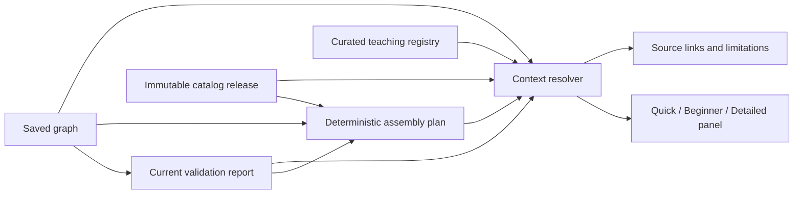

# Phase 5 — Beginner teaching engine implementation

**Status:** Initial deterministic teaching slice implemented; beginner study and completion criteria remain open.  
**Branch:** `dev`  
**Content release:** `2026.10.1`

## Purpose and boundaries

This phase adds a contextual teaching layer to the existing assembly guide. It is deliberately not a general chat interface. It selects reviewed teaching cards from the current assembly action, exact catalog components, graph endpoints, and current validation findings. Each card provides Quick, Beginner, and Detailed language, evidence links, and explicit limitations.

The first implementation uses curated, versioned TypeScript data and a deterministic resolver. It does not add a model provider, create circuit facts, alter the graph, change validation results, mark assembly steps complete, or infer firmware configuration. A missing match produces a visible no-card explanation instead of a speculative answer.

## Delivered behavior

### Curated knowledge package

`packages/teaching` provides strict lesson data, a version identifier, evidence validation against the selected immutable catalog release, source resolution, current-context checks, and a pure explanation resolver. The included concept set covers GPIO; input and output; ground as a circuit reference; voltage and current; LED polarity; a series resistor; breadboard internal connectivity and power rails; restricted pins and printed board labels; and pre-power review.

Exact hardware statements are conditional on an exact part ID in the active step’s component instances. GPIO19/J3 mapping, pin restrictions, LED datasheet conditions, the YAGEO resistor identity and rating, and BB400 connectivity point to the catalog’s own claim and locator. General concepts point to named educational or manufacturer documentation. At runtime, every claim is matched by subject, property, and source against the chosen catalog release; unresolved references fail closed.

### Contextual assembly-guide panel

The active guide step displays a “Why this step?” panel with Quick, Beginner, and Detailed controls. The panel resolves content from that exact step and graph. Current validation explanations appear where relevant, including deterministic interpretations for graph integrity, power-to-ground shorts, LED polarity, series-resistor paths, and electrical-scope limits. Source links and claim locators are shown with the lesson, and limitations remain visible at every explanation level.

When the report is not current, the plan is stale, or the graph and report identities do not agree, the teaching resolver does not present contextual content as current. The assembly guide continues to own instruction targets and progress. Teaching controls only change the explanation presentation.

### Source and scope discipline

General input/output language is backed by Espressif’s ESP-IDF GPIO documentation. The app currently has no firmware artifact or GPIO mode in its project graph, so the lesson states that the project’s actual pin mode is unknown. The example in the Phase 5 brief mentions GPIO18, but this exact release models GPIO19; this implementation does not invent GPIO18 support.

The LED lesson includes the manufacturer’s stated test condition for forward voltage and does not present a maximum-current rating as a recommended target. The resistor card says that an identified series resistor is not proof of suitability. Breadboard lessons are selected only for the exact modeled BB400 topology; rail continuity must still match the physical board. Ground is described as a circuit reference/return, not as building earth.

## Architecture and data flow

The resolver validates its inputs, confirms report project/graph/revision/catalog identity, resolves active step component IDs to exact catalog parts, selects only applicable cards, and limits validation help to rules associated with those cards or the review/pre-power step. It returns a view model; it has no persistence or mutation capability. It is deterministic for identical inputs and selected level.

## Evidence and validation

- Package unit tests check strict curated content, all three explanation levels, catalog source/claim resolution, exact model applicability, repeatable step selection, graph/report mismatch rejection, and deterministic validation explanations.
- The assembly-guide browser flow checks level switching, exact GPIO19 contextual detail, and its ESP32 guide link.
- Type checking, builds, unit tests, browser tests, formatting, and diff checks are run for this implementation before the phase commit.

These checks verify contracts and browser behavior. They do not establish that beginners understand the instructions or can reproduce a physical circuit.

## Remaining acceptance work

Phase 5 is not complete. The completion criterion requires genuine people with little or no electronics experience to use supported projects and reproduce the physical build. Run a consented usability study and record at least project completion, mistakes, hint requests, confusing terms, and physical reproduction accuracy. Use observed failures to revise the cards and interface. Do not substitute synthetic tests or model-generated summaries for participant evidence.

The guide now includes a validated visual-orientation hint based on the scene’s existing orbit and component-rotation controls. Invalid-wire guidance should be expanded only when the UI provides a current, specific endpoint or rule finding to explain. The exact current guide already lists step targets and prerequisite state; explanations must remain aligned to that state. A model-backed open-ended tutor is a separate future decision and would need authorized minimized context, source grounding, and an explicit distinction between guidance and project truth.

## Operational and product risks

| Risk                                           | Current control                                                                         | Follow-up                                                                        |
| ---------------------------------------------- | --------------------------------------------------------------------------------------- | -------------------------------------------------------------------------------- |
| Catalog claim or source changes                | Claim/source IDs are checked at resolution against the pinned release                   | Version and review lesson content with each catalog release                      |
| Similar hardware receives an exact fact        | Resolver checks exact catalog part IDs from graph instances                             | Add new exact models only after source review                                    |
| Unknown validation state appears to pass       | Status and original finding remain visible; explanation states the rule boundary        | Keep unknown distinct in all downstream readiness UI                             |
| Explanation is interpreted as safety approval  | Each hardware card has limitations; pre-power card disclaims certification              | Test language with novice participants                                           |
| Stale plan/report receives current explanation | Graph, project, revision, and catalog identities are checked; UI suppresses stale panel | Bind persisted teaching output to digests if future server-side caching is added |
| Data is mistaken for evidence of usability     | Study is explicitly open                                                                | Complete real beginner sessions before claiming Phase 5 acceptance               |

## Files

- `packages/teaching/src/index.ts` — curated knowledge and deterministic resolver.
- `packages/teaching/test/knowledge.test.ts` — teaching-content contract tests.
- `apps/web/src/components/circuit-workspace.tsx` — level controls and contextual lesson rendering.
- `apps/web/src/components/circuit-workspace.module.css` — panel and citation presentation.
- `apps/web/e2e/workspace.spec.ts` — assembly-guide teaching interaction.
