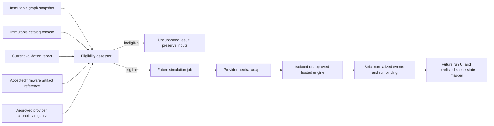

# Schemora Phase 6 — Firmware and Simulation

**Status:** Contract slice, graph-derived digital LED mapper, captured-trace replay, pinned-source host-callback harness, provider license/maintenance screening, private firmware source lifecycle, and durable simulation-run request lifecycle are implemented for an internal reference POC. The exact original-ESP32 reference firmware boots repeatably under the pinned PICSimLab QEMU fork, and a separately compiled worker receives GPIO19 and UART0 events through the fork's registered callback ABI. The harness proves firmware execution and host signal delivery only: it does not execute the user's uploaded artifact, drive a simulator LED device or product scene, model analog electrical behavior, or provide an end-to-end product run. Run requests currently settle as explicitly unsupported because no product simulator is approved or configured. The fork is not approved for commercial distribution or production hosting. Phase 6 remains open.

**Product phase:** Phase 6 — Firmware execution and circuit simulation.

**Branch:** `dev`.

**Scope authority:** [`context.md`](context.md#phase-6---firmware-execution-and-circuit-simulation), the TRD’s firmware and simulation boundary, and the current graph, catalog, validation, and worker contracts.

## 1. User outcome and delivery boundary

Phase 6 should eventually let a user run a versioned firmware artifact against a supported representation of the saved circuit, inspect serial output and selected simulated component states, and understand where the model stops. The expected state must come from a simulator run. A renderer animation, a successful compile, or a passing structural check is not simulation evidence.

This slice stores bounded UTF-8 firmware source as immutable private single-file or ESP-IDF bundle artifacts, records server-computed source and manifest digests plus board/catalog binding, requires an explicit append-only accept/reject review, and removes artifact bytes through project deletion. The firmware workspace includes a locally bundled Monaco source editor, immutable source and bundle uploads, per-file bundle readback, review decisions, graph association from an immutable project-revision snapshot, stored run history, serial output, durable run creation, and queued-run cancellation. There is no compiler, provider execution, or live simulator-driven scene update. The worker deliberately returns SIMULATOR_UNAVAILABLE. The UI must make this state explicit and must not suggest that a queued request compiles or executes firmware.

The distinction matters for the currently modeled circuit: its LED polarity, resistor path, and graph integrity findings can pass, while the report’s overall status remains `unknown` because the electrical-scope rule explicitly does not establish GPIO current budget, thermal margin, transient conditions, or other omitted behavior. Firmware simulation may be useful for program behavior, but it cannot turn this report into an electrical safety approval.

## 2. Provider research and decision

The provider review was based on primary project documentation, pinned source, repository history, and terms reviewed on 2026-10-14. These findings are engineering and license-risk screening, not legal advice or evidence of an executed commercial agreement.

| Candidate                             | Technical evidence                                                                                                                                                                                                              | Fit and gate                                                                                                                                                                                                                                                                                                                                                                                                                                                                                                                                                                                                                                                       |
| ------------------------------------- | ------------------------------------------------------------------------------------------------------------------------------------------------------------------------------------------------------------------------------- | ------------------------------------------------------------------------------------------------------------------------------------------------------------------------------------------------------------------------------------------------------------------------------------------------------------------------------------------------------------------------------------------------------------------------------------------------------------------------------------------------------------------------------------------------------------------------------------------------------------------------------------------------------------------ |
| Wokwi CI / CLI                        | Official documentation describes firmware execution through its CLI, serial output, timeouts, automated scenarios, and a cloud CI service. The cloud service receives the firmware binary and says it deletes it after the run. | **Do not integrate by default.** Wokwi’s terms limit ordinary service use to personal/non-commercial purposes, define open-source use as not commercialized directly or indirectly, require commercial licensing for commercial use, and prohibit using the service to develop a similar or competitive service. Schemora is building circuit simulation. Proceed only after explicit written terms that cover Schemora’s product use, hosting, customer content, and data handling. The current board match and normalized output mapping also need a technical proof.                                                                                            |
| Espressif QEMU fork                   | Official ESP-IDF docs describe running original ESP32 apps under `idf.py qemu`; UART and some peripherals are modeled. The official feature matrix marks GPIO matrix/IOMUX unsupported.                                         | **Best current POC candidate for firmware execution and serial output, not full circuit simulation.** A QEMU run can test a firmware binary for the catalog’s original ESP32, but the documented implementation does not expose general GPIO pin routing to the external LED. Any LED behavior inferred from firmware text or a hardcoded timer would be invalid. The fork is GPL-2.0-only in the IDF tool manifest; review executable distribution and service obligations before adoption.                                                                                                                                                                       |
| PICSimLab QEMU fork (`lcgamboa/qemu`) | The `picsimlab-esp32` branch models original ESP32 GPIO output/enable registers and IOMUX changes, forwarding output changes through QEMU GPIO signals. PICSimLab documents an ESP32-DevKitC board and attachable LED parts.    | **Leading technical candidate, not yet selected as a product provider.** At pinned source revision `e39508f79cb0681bbe15cfcebd40a3f45cdc3c48`, a separately compiled worker registered the fork's callback table before machine initialization and received the exact fixture's UART0 output and GPIO19 transitions on two runs. A graph mapper replays the captured callback trace into an ideal digital LED state. No external simulator LED device or product scene was driven. The fork has GPL-2.0/LGPL-2.1 components and a private, version-bound PICSimLab callback ABI; review distribution obligations and maintenance/build risk before production use. |
| Espressif `esp-emulator`              | Official project documentation lists ESP32-C3/C5/C6/H2/P4/S3 chips, GPIO and UART peripherals, CLI and WebAssembly usage, and a browser build that keeps firmware in the local tab.                                             | **Potential option for a separately cataloged board profile; not a match for this catalog release.** The current Schemora board is ESP32-DevKitC V4 with ESP32-WROOM-32E / original ESP32, which is not in the project’s documented chip list. The emulator reports SoC peripheral activity, but Schemora would still need a tested adapter that maps its GPIO signals and exact circuit nets to LED state. Review the pinned release’s software license and packaging before any hosted use.                                                                                                                                                                      |
| Renode                                | Official supported-board documentation has a broad, explicitly incomplete board list and supports custom platform descriptions.                                                                                                 | **Not selected for this reference circuit.** The inspected board documentation does not establish a ready-to-run model of the exact ESP32-DevKitC V4 / WROOM-32E configuration or the external LED circuit. A custom model would require a separate POC and additional verification.                                                                                                                                                                                                                                                                                                                                                                               |

The Wokwi review surfaced a material product-use restriction. Availability of a public web simulator or CLI does not imply permission to offer it as Schemora’s backend. The documented Wokwi CI flow uploads the built firmware to its cloud service. Consequently, no Wokwi service call, account, cloud upload, token, or dependency was introduced.

### License and maintenance screening decision (2026-10-14)

The pinned QEMU fork is approved only as an opt-in, internal engineering reference POC. It is not a selected production provider, and no license conclusion here authorizes shipment of the worker, shared library, container image, or a hosted customer-facing service.

The pinned QEMU repository's root `LICENSE` describes QEMU as a whole as GPL version 2 while allowing particular source files to carry compatible source-specific licenses. The tree also contains `COPYING` and `COPYING.LIB`; the presence of an LGPL text does not make the complete Xtensa shared library LGPL. The machine integration source `hw/xtensa/esp32_picsimlab.c` is GPL-2.0-or-later. The harness links a separately compiled worker to a broad QEMU system-emulator closure in `libqemu-xtensa.so`; using a shared library, `dlopen`, or a separate worker process is not treated as a license-separation strategy. Any distribution must be reviewed against the actual source closure, generated files, build configuration, notices, and corresponding-source obligations by qualified counsel.

This repository intentionally fetches the pinned source during the opt-in container build instead of checking in QEMU binaries. That limits checked-in binary provenance, but it does not settle obligations for distributing the harness, build outputs, or a hosted service. The build currently resolves Ubuntu Noble packages at build time and inherits a broad/custom QEMU link recipe; the fork's build script has conflicting slirp configure switches and is not a stable public library API. The worker depends on private callback struct layout from the pinned source. The current `ldd`/symbol checks and pinned source revision are useful reproducibility evidence, not a complete binary SBOM or license audit. A release candidate needs a complete source and binary inventory, exact dependency versions, notices, generated-code provenance, build recipe review, and legal sign-off.

Maintenance screening found that the `picsimlab-esp32` branch head matched the selected revision at review time and that PICSimLab itself had a recent release. The fork did not publish a corresponding stable library release or ABI promise. PICSimLab's broader activity is not a maintenance commitment for this fork. The exact implementation represents an original-ESP32 SoC GPIO callback path; it does not establish full ESP32-DevKitC V4 / WROOM-32E PCB fidelity, external resistor behavior, current/voltage, timing, or safety. Before production consideration, Schemora needs a named owner, an upstream change/CVE watch, a pinned and reproducible dependency inventory, a fork update policy, compatibility tests for every revision change, and a board-profile claim narrowed to the behavior actually verified.

**Provider disposition:** conditional go for the isolated internal GPIO reference POC; no-go for production provider selection, commercial distribution, and customer firmware hosting until legal review, complete dependency/provenance inventory, commercial rights, provider maintenance ownership, security isolation, and exact supported-board behavior are demonstrated. This screening is not a substitute for legal advice.

**Decision:** Official Espressif QEMU remains the UART-only baseline and is not approved as a circuit simulator because its published feature matrix excludes GPIO matrix/IOMUX. The PICSimLab QEMU fork is the leading technical candidate for an internal reference POC only. Its pinned build and host callback trace are reproducible, the captured trace is replayed through the strict graph mapper, and the scene now accepts only completed runs bound to current graph and firmware digests. The run API and worker currently return provider unavailability and never feed this fixture trace into a user's run, so the product does not display a simulated LED. Production provider selection remains blocked on counsel-reviewed license/dependency obligations, a complete inventory, maintenance ownership, commercial rights, and live end-to-end evidence. A digital LED indication must not be presented as electrical simulation or safety evidence.

### Official sources reviewed

- [Wokwi Terms of Service](https://wokwi.com/legal/terms) — permitted use, commercial licensing, and use restrictions.
- [Wokwi CI overview](https://docs.wokwi.com/wokwi-ci/getting-started) — cloud execution, firmware transfer, serial output, and limits.
- [Wokwi CLI usage](https://docs.wokwi.com/wokwi-ci/cli-usage) — execution controls, serial logs, timeout, scenario, and screenshot options.
- [Wokwi automation scenarios](https://docs.wokwi.com/wokwi-ci/automation-scenarios) — simulated control inputs and serial assertions; documentation labels scenarios alpha.
- [Espressif QEMU guide](https://docs.espressif.com/projects/esp-idf/en/stable/esp32/api-guides/tools/qemu.html) — ESP32 boot/run flow, UART monitor, and installation.
- [Espressif QEMU supported-feature matrix](https://github.com/espressif/esp-toolchain-docs/blob/main/qemu/README.md) — target/peripheral support, including missing GPIO matrix/IOMUX.
- [ESP-IDF QEMU tool manifest](https://docs.espressif.com/projects/esp-idf/en/v5.4/esp32/api-guides/tools/idf-tools.html) — recorded QEMU tool package license (`GPL-2.0-only`) for that IDF tool release.
- [PICSimLab QEMU fork, pinned `picsimlab-esp32` revision](https://github.com/lcgamboa/qemu/tree/e39508f79cb0681bbe15cfcebd40a3f45cdc3c48) and [ESP32 GPIO model source](https://github.com/lcgamboa/qemu/blob/e39508f79cb0681bbe15cfcebd40a3f45cdc3c48/hw/gpio/esp32_gpio.c) — original-ESP32 output/IOMUX implementation reviewed for the next POC; this is a community-maintained fork.
- [Pinned QEMU root license](https://github.com/lcgamboa/qemu/blob/e39508f79cb0681bbe15cfcebd40a3f45cdc3c48/LICENSE), [GPL text](https://github.com/lcgamboa/qemu/blob/e39508f79cb0681bbe15cfcebd40a3f45cdc3c48/COPYING), [LGPL text](https://github.com/lcgamboa/qemu/blob/e39508f79cb0681bbe15cfcebd40a3f45cdc3c48/COPYING.LIB), and [PICSimLab machine source](https://github.com/lcgamboa/qemu/blob/e39508f79cb0681bbe15cfcebd40a3f45cdc3c48/hw/xtensa/esp32_picsimlab.c) — licensing screening inputs; a file-level and binary-level distribution audit is still required.
- [PICSimLab project](https://github.com/lcgamboa/picsimlab) and [board documentation](https://lcgamboa.github.io/picsimlab_docs/stable/Boards.html) — documents the integration’s host callbacks and ESP32-DevKitC simulation board. This establishes a technical candidate only, not an assurance of exact WROOM-32E board fidelity.
- [Espressif esp-emulator](https://github.com/espressif/esp-emulator) — documented chips, modeled peripherals, CLI/WASM, and browser execution behavior.
- [Renode supported boards](https://renode.readthedocs.io/en/latest/introduction/supported-boards.html) — documented board coverage and custom platform capability.

## 3. Implemented contract package

`packages/simulation` defines the boundary before application routes or workers may invoke an engine.

The initial `mapEsp32Gpio19ToLedState` adapter derives electrical nets from the immutable graph and exact catalog release. It accepts only the exact DevKitC V4/WROOM-32E, WP7113ID, and 220-ohm resistor combination with GPIO19 connected through the resistor to the LED anode and the LED cathode connected to a documented board ground. It rejects invalid graphs, additional or missing parts, reversed polarity, path shorts, unmodeled terminal branches, unrelated wires, malformed GPIO records, and out-of-order observations. For accepted GPIO19 digital levels it emits instance-scoped `led_state` records. It models an ideal on/off indication only and does not estimate current, voltage, resistor power, or safety.

### Immutable firmware reference

`firmwareArtifactRefSchema` accepts only an immutable artifact reference: project/revision, SHA-256, bounded byte length, language, entry point, exact catalog board ID, and accepted review state. It carries no source text, URL, storage key, token, or executable payload. Artifact creation and persistence are handled by the API and persistence layers; `packages/simulation` validates only the immutable reference.

### Bound run identity

Every `SimulationBinding` records project/revision, graph ID and digest, catalog release and digest, firmware artifact and digest, adapter/version, and engine/version. A result cannot be treated as current merely because it is the latest run. The input assessor compares current report identity with the canonical graph and catalog digests and checks firmware ownership/revision/board binding.

### Normalized output and lifecycle

The contract defines run lifecycle states and bounded, schema-validated events for ordered serial text, LED on/off state, and numeric sensor readings. Event sequence must strictly increase and simulation time may not move backward. Failed, timed-out, and cancelled terminal results must carry an error; completed results cannot carry a failure. Component updates refer to a graph instance ID, never arbitrary HTML, JavaScript, CSS, or renderer commands. Consumers must still check that the component category is appropriate before applying a state.

Provider capabilities explicitly list exact board IDs, component IDs, topology IDs with topology versions, firmware language support, and provider/engine versions. An unknown board alias or an apparently similar model does not satisfy an exact catalog identity. The current assessor also requires exactly one development board and binds it to the accepted firmware target.

The contract assessor parses provider declarations at runtime, limits serialized output to 2 MB, recomputes graph integrity and the validation report, and carries the selected provider/engine versions directly into the successful run binding. A second result validator binds output events to the exact graph/catalog snapshot and rejects unknown component IDs, LED events targeting non-LED parts, and sensor readings for components that do not have a modeled sensor schema.

The `reviewStatus: accepted` and `reportIsCurrent` values in the pure package are assertions supplied by their caller. They are not proof that the current user accepted the stored firmware artifact or that the report is the repository’s current report. Any run route/worker must load these records under project ownership, verify stored firmware bytes against their digest and length, resolve the latest accepted review state from persistence, and establish report currentness against the selected graph snapshot before calling the assessor. Never accept these authority fields from an untrusted browser request. Firmware `projectRevision` records the project revision at which source was attached; the run binding independently identifies the exact graph revision/digest and firmware input digest. For legacy files that digest is the source SHA-256; for bundles it is the canonical bundle manifest digest, while the artifact reference separately retains the entrypoint SHA-256 and aggregate byte length. The runner request contract now supports a full bundle and verifies each file hash, manifest identity, and profile-approved build target. No transport, worker dispatch, or runner service constructs that request; bundle runs remain disabled and unavailable until the isolated execution path is deployed and evidenced. Non-graph project events therefore do not silently invalidate an otherwise eligible firmware artifact.

### Fail-closed eligibility

`assessSimulationEligibility` rejects malformed artifacts and mismatched project, revision, graph, catalog, or report identity. A stale report or any failed/error validation blocks execution. Unknown validation remains unknown and is not reclassified as pass or safe: once a provider exists, a current report with no failures may permit a behavioral run only if the provider declares full coverage for the exact design. The run and UI must preserve the report’s unknown findings and disclose electrical and physical limitations.

With no configured capability, the decision is `SIMULATOR_UNAVAILABLE`. `unavailableSimulationRun` returns an unsupported result with no events and an explicit statement that no firmware ran. This is intentionally different from an empty successful run.

## 4. Architecture and trust boundaries



The package is contract and eligibility logic only. It has no database, object storage, worker, HTTP endpoint, compiler, subprocess, provider SDK, or ability to mutate the circuit. The existing import worker’s child-process boundary is not an acceptable firmware sandbox; firmware execution must use a separately isolated runtime or an approved vendor-hosted service.

### Firmware source artifact lifecycle

The legacy single-file authoring route accepts UTF-8 source files only (`c`, `cpp`, `arduino-cpp`, or `esp-idf-c`) with a language-matched `.c`, `.cc`, or `.cpp` entrypoint, up to 2,000,000 bytes. The bundle route accepts up to 128 UTF-8 files, each up to 2,000,000 bytes and 8,000,000 bytes total, as one immutable source snapshot. Neither route accepts compiled images, archives, arbitrary binary data, or executable output. Both routes require an active owned project and the caller's expected project revision; the bundle route resolves the unique development board from the saved graph and pinned catalog. The client cannot authoritatively set project ownership, target board, catalog release, digest, byte length, storage key, or review status.

Compiler feasibility research confirms that a single source buffer cannot represent either supported project family. An Arduino sketch is a folder that can contain a primary `.ino`, additional translation units and headers, a recursive `src/` tree, and an optional `sketch.yaml` that pins board platforms and libraries. An ESP-IDF project uses a CMake project tree and target-specific build inputs. The versioned `firmwareProjectBundleSchema` captures a file tree, explicit Arduino FQBN or ESP-IDF target, entrypoint layout, deterministic path ordering, per-file SHA-256 digests, and canonical manifest digest. The authenticated API now accepts and persists validated bundle files at `POST /v1/projects/:projectId/firmware-artifacts/bundles`; it recomputes file hashes and the manifest from uploaded bytes. This first API mapping supports only ESP-IDF target `esp32` against the exact cataloged ESP32-DevKitC V4 / WROOM-32E board. Arduino bundle storage remains unavailable until a reviewed FQBN-to-catalog mapping exists. Research selected ESP-IDF v6.1 as a candidate fixed compiler release; the official `espressif/idf:v6.1` Linux/amd64 manifest observed on 2026-10-14 was `sha256:f81b6e077e6af93c312181cd7d4e7936cfbafc5c7f77cbacba8fdd34994f218a`. This image includes toolchains for multiple targets and is approximately 3.8 GB, so the digest is a researched candidate, not an approved production profile. Before builds can be enabled, profile ownership, image provenance and preload evidence, dependency contents, security review, and runtime controls must be established. The new compiler-profile/result schemas enforce the shape and source/profile digest binding of future results; they do not make a compiler available. See the [ESP-IDF v6.1 release](https://github.com/espressif/esp-idf/releases), [ESP-IDF build guide](https://docs.espressif.com/projects/esp-idf/en/stable/esp32/get-started/linux-macos-start-project.html), [official ESP-IDF Docker image guidance](https://github.com/espressif/esp-idf/blob/master/docs/en/api-guides/tools/idf-docker-image.rst), [official image tags](https://hub.docker.com/r/espressif/idf/tags), and [Arduino sketch specification](https://docs.arduino.cc/arduino-cli/sketch-specification).

Bytes are written to private storage under server-generated opaque UUIDs only after durable upload intents are recorded for every object. Legacy single-file artifacts keep `sha256` and `byte_length` as the entrypoint object's digest and length. Bundle artifacts add `bundle_digest`, aggregate `total_byte_length`, build system, and target; per-file rows retain exact path, digest, byte length, and entrypoint identity. The entrypoint's content is stored once under the legacy artifact object key and also has a file metadata row; all other files receive separate private object keys. A deferred database constraint checks the bundle's aggregate length and entrypoint metadata before commit. File metadata rejects updates and direct deletion; project purge removes rows through the artifact foreign-key cascade. PostgreSQL stores no source bytes or base64 content. Public metadata exposes paths and digests but never private object keys. Review is a separate append-only history; latest decision determines `pending`, `accepted`, or `rejected`. Acceptance means the owner explicitly selected this source version for future work. It is not a security audit, compilation result, provider compatibility claim, or safety approval. A later decision can supersede the prior decision without changing the source bytes.

Authorized endpoints list and retrieve artifact metadata, list bundle file metadata, download a selected exact file after digest and length verification, preserve legacy `/content` as entrypoint bytes, upload a new immutable single-file or bundle version, append an accept/reject decision, and read bounded review history. Public responses never include private object keys. Project archive retains artifacts read-only. Project deletion purges each private object, including bundle child objects and expired/in-flight upload intents, before removing artifact and review metadata. There is no per-artifact delete or automatic source TTL in this increment; source remains with the project until its deletion workflow runs. A failed object purge leaves the project deletion retryable and retains the metadata needed to retry.

```mermaid
sequenceDiagram
  actor User
  participant API as Authenticated API
  participant Graph as Project graph and catalog
  participant DB as PostgreSQL
  participant Store as Private object storage
  User->>API: Upload source or a multi-file bundle with expected revision
  API->>Graph: Resolve active project, current graph, exact board, catalog release
  API->>DB: Register one expiring intent per object
  loop Every bundle file
    API->>Store: Put bytes at generated opaque key
    Store-->>API: Verify SHA-256 digest
  end
  API->>DB: Commit artifact, file metadata, and project revision atomically
  API-->>User: Artifact metadata with pending review; no object key
  User->>API: Accept or reject artifact with expected revision
  API->>DB: Append review decision; preserve source and prior review history
  API-->>User: Current derived review status
```

## 5. Coverage matrix for the current catalog

| Current item                             | Exact catalog identity                            | Contract behavior now                                                                 | Required proof before support                                                                                                                                               |
| ---------------------------------------- | ------------------------------------------------- | ------------------------------------------------------------------------------------- | --------------------------------------------------------------------------------------------------------------------------------------------------------------------------- |
| ESP32-DevKitC V4, WROOM-32E, male header | `board.espressif.esp32-devkitc-v4.wroom-32e.male` | No configured provider claims support; assessment returns unavailable.                | Compile and execute a reference program against the exact MCU target, verify reset/start/stop and UART output, and prove the board GPIO model matches catalog pin mappings. |
| Kingbright WP7113ID LED                  | `led.kingbright.wp7113id`                         | Output schema permits only instance-scoped `on` / `off` events; no source emits them. | Connect simulator GPIO state through the saved graph and LED polarity model; compare known reference cases, including reversed/open circuit.                                |
| YAGEO CFR-25JB-52-220R resistor          | `resistor.yageo.cfr-25jb-52-220r`                 | Exact component identity must be declared by provider capability.                     | Establish whether the engine models the external resistor/circuit or only MCU execution; state omitted electrical behavior.                                                 |
| BusBoard BB400 topology                  | Catalog topology identity/version                 | Exact topology must be declared by provider capability.                               | Verify every graph terminal/wire maps to equivalent simulator nets, including split rails and variant.                                                                      |

The catalog currently has no simulator aliases, execution profiles, or supported firmware targets. Capability declarations must be sourced from reviewed provider/model evidence and bound to a particular adapter/model version before the run path is enabled.

## 6. Files and package surface

- `packages/simulation/src/index.ts` — schemas, provider interface, fail-closed eligibility, graph-bound output validation, and explicit unavailable result.
- `apps/api/src/app.ts`, `packages/persistence/migrations/0006_firmware_artifacts.sql`, and `packages/storage/src/index.ts` — authenticated, bounded source artifact upload/list/read/review API; immutable metadata and review history; private-byte integrity checks; and durable project-deletion cleanup.
- `packages/simulation/src/adapters/esp32-gpio19-led.ts` — strict graph-derived GPIO19-to-LED digital-state mapper for one exact catalog profile.
- `packages/simulation/test/contract.test.ts` — identity, coverage, output ordering, unsupported topologies, mapper polarity, malformed signal, and unavailable-result checks.
- `examples/phase6-qemu-uart/` — minimal ESP-IDF reference app that requests GPIO19 toggles and emits bounded UART markers for the official QEMU UART POC and the fork callback harness.
- `examples/phase6-qemu-gpio-probe/` — pinned-source container build, real-ABI host worker, golden GPIO callback trace, and two-run offline proof for the PICSimLab QEMU fork. It runs only as an opt-in engineering POC; it is not a product execution path.
- `apps/web/src/components/simulation-scene-state.ts` and `circuit-scene.tsx` — fail-closed scene consumer for LED events from completed runs whose project, graph, catalog, firmware digest, and current graph digest match. The workspace supplies a current graph digest only after validation; it has no current firmware digest or simulation run source, so no LED state appears in the product today.
- `apps/web/src/components/simulation-scene-state.test.ts` — cross-package reference proof that replays the pinned GPIO callback trace through the exact catalog graph mapper, validates the resulting completed-run contract against graph/catalog/firmware identities, and resolves the scene LED state. It exercises the state boundary without pretending a live provider API or browser scene is wired.
- `packages/simulation/package.json` — workspace package registration and package dependencies.
- `docs/Phase-6-Implementation.md` — Phase 6 status, provider research, current boundaries, and completion gates.

No user-submitted firmware is stored or executed by the product runtime in this change. The checked-in engineering fixture is built and executed only by the opt-in POC harness. No UI label implies that compilation or simulation is available.

## 7. Verification and evidence limits

The simulation contract package's focused suite passes eight tests for a current graph/catalog/report binding, missing provider, stale or forged report, failed report, unaccepted firmware, invalid provider capability, uncovered board/component IDs, output size and lifecycle invariants, graph-bound component events, explicit unsupported output, and the graph-derived LED mapper's supported/rejected cases. One test replays the checked-in GPIO19 trace produced by the host-callback harness. Five web unit tests cover current-run LED state application, graph/firmware/revision mismatch clearing, invalid event rejection, non-completed runs, and a cross-package trace-to-scene-state path. That path runs the actual pinned trace through the exact graph mapper, simulation-run validator, and renderer state resolver using consistent graph/catalog/firmware digests. The harness separately rebuilds the pinned engine and verifies both UART and GPIO transcripts on two network-disabled runs. These checks prove firmware execution, callback delivery, deterministic digital state mapping, run-contract validation, and fail-closed renderer state selection. They do not prove a live product API run, browser-rendered 3D update, external simulator LED device, physical electrical behavior, or safety.

The official Espressif QEMU POC is limited to original ESP32 execution and UART behavior. The reproducible fork harness below proves GPIO19 delivery to a registered host callback, but not connected-circuit simulation. Wokwi integration is blocked pending product-use rights and exact board/circuit mapping; Espressif `esp-emulator` currently does not list the catalog’s original ESP32 target; a Renode custom platform would itself require a separate build-and-validation project.

### 7.1 Original-ESP32 UART POC run record (2026-10-14)

The reference application in `examples/phase6-qemu-uart/` was built and run inside the official Espressif ESP-IDF container. The container is pinned by immutable image digest `espressif/idf@sha256:05cbfc42ed2e987b8026722c15bf1d8523d3e4fd1b4ac04d2e4056f5e0918b99`; it reports ESP-IDF `v5.5.2` and QEMU `9.2.2 (esp_develop_9.2.2_20250817)`. The current application image SHA-256 is `baaed9cc3a5101daaaaa91d63153571b70b5f101b928b8b2d8585a2ec1848a02`.

Build invocation from the mounted example directory:

```sh
idf.py build
```

Run invocation from the repository root on Windows (Docker Desktop with a Linux engine):

```sh
powershell -ExecutionPolicy Bypass -File examples/phase6-qemu-uart/run-poc.ps1
```

The harness rebuilds the reference app, runs it twice with Docker networking disabled, enforces a 12-second process bound, and compares the UART markers against the expected sequence. It expects the fixture’s five alternating `SCHEMORA_GPIO19_REQUESTED` values (`1, 0, 1, 0, 1` at ticks `0` through `4`) followed by `SCHEMORA_QEMU_REFERENCE_COMPLETE`. Each QEMU process then remains alive by design until the host timeout terminates it; timeout status `124` confirms bounded process stop and Docker `--rm` removes the container. The second fresh QEMU process exercises boot/reset-from-power-on and verifies repeatable transcript output. The harness reports the pinned image's IDF/QEMU versions and firmware digest. This is not a guest-issued reset, pin-level capture, or connected LED simulation. The API return/log marker records only the firmware’s GPIO request; it is not proof that QEMU changed a pin.

The pinned container and build logs make this UART run reproducible; the application binary hash should be refreshed whenever the fixture or toolchain changes. The QEMU feature matrix does not list GPIO matrix/IOMUX support. Therefore no LED state may be derived from these UART messages.

### 7.2 Reproducible GPIO and UART host-callback proof (2026-10-14)

The exact ESP-IDF fixture was built and executed twice using the pinned PICSimLab fork at `e39508f79cb0681bbe15cfcebd40a3f45cdc3c48` (QEMU `9.2.2`) inside `espressif/idf@sha256:05cbfc42ed2e987b8026722c15bf1d8523d3e4fd1b4ac04d2e4056f5e0918b99` (ESP-IDF `v5.5.2`). `examples/phase6-qemu-gpio-probe/run-poc.ps1` builds the image and runs it with Docker networking disabled. The container copies only fixture source and defaults, compiles the original-ESP32 Xtensa shared library and the Schemora host worker, generates the combined flash image, verifies the required exported QEMU symbols, and executes the worker twice. Each worker run has a 12-second supervisor timeout and the harness requires timeout status `124`; each transcript must exactly match the checked-in UART markers and `expected-gpio19.jsonl`.

The worker implements the private callback structure from `hw/xtensa/esp32_picsimlab.c` at the pinned source revision. It registers the callback table before calling `qemu_init`, because the machine only wires GPIO outputs during machine realization when a pin map is present. Its identity pin map binds callback slot 20 to GPIO19. The `picsimlab_write_pin` callback writes JSONL observations; the UART0 callback writes received serial bytes to the captured UART transcript. The worker links to `libqemu-xtensa.so`; the Docker build checks exports for `qemu_init`, `qemu_main_loop`, `qemu_cleanup`, and `qemu_picsimlab_register_callbacks`. The observed GPIO trace on each run is initialization low followed by the five firmware writes: `0, 1, 0, 1, 0, 1`. UART markers match the setup, five requested levels, and fixture completion. The fixture binary SHA-256 reported by the latest verified run was `a8c4ffeb8c08c91e7eb4e44f4721a9dda1e11667a5aaab1457f74953ce6619ea`; the harness reports this per-build digest but compares behavior transcripts rather than asserting a byte-identical build artifact.

The host callback ABI is private and version-bound; changing the QEMU revision requires rechecking its struct field order, callback semantics, and pin-map behavior. The callback delivers GPIO level and order, but no simulation timestamp; the replay test deliberately assigns all callback samples time `0` and makes no timing-accuracy claim. The trace is replayed through `mapEsp32Gpio19ToLedState` against the exact catalog graph, producing instance-bound LED off/on events. The integration proof then validates the run binding and resolves the last event through the same fail-closed scene state consumer. It is a contract-level integration fixture, not a live product run or browser-rendered update. There is no connected PICSimLab LED device, resistor/current model, or safety analysis. The build's OS packages are resolved from Ubuntu Noble repositories at build time; the pinned QEMU revision and IDF image are fixed, while package repository availability/version drift remains a build reproducibility risk.

The host now records GPIO19 level callbacks and UART0 bytes into one mutex-serialized JSONL callback stream (`examples/phase6-qemu-gpio-probe/expected-events.jsonl`). The mutex defines a total host-observation order for callbacks that may be delivered from different emulator execution contexts; it does not add a hardware timestamp or claim sub-callback physical timing. The harness removes variable QEMU boot diagnostics by retaining only complete UART lines beginning with `SCHEMORA_`, preserves those bytes' relative positions against GPIO callbacks, and renumbers this filtered stream from 1. It requires both fresh emulator runs to match the checked-in 327-event golden, as well as the separate exact GPIO and UART fixtures. This is stable ordering evidence for the fixture protocol and GPIO observations, not a general UART capture format. The filtered trace is ready as input to a narrow callback-result normalizer; it does not execute firmware through a product API, produce a live browser scene update, or qualify the provider for production.

## 8. Remaining work and phase exit criteria

Phase 6 remains open. Required work, in dependency order:

1. **Complete:** Build and run the pinned PICSimLab QEMU fork reproducibly; verify the exact ESP-IDF fixture emits GPIO19 changes through a separately compiled host worker registered to the fork's real callback ABI; record exact UART and GPIO traces. The official Espressif QEMU UART POC cannot satisfy this gate because its feature matrix excludes GPIO matrix/IOMUX output.
2. **Complete at the adapter/renderer boundary:** The narrow graph-derived adapter accepts only the exact DevKitC GPIO19 → 220-ohm resistor → WP7113ID anode/cathode → board-ground path. The captured GPIO trace replays to expected instance-bound LED on/off states, and reversed, open, branched, unrelated, and unsupported cases are rejected by focused tests. The scene consumer applies only allowlisted LED states from a completed, digest-bound run and clears them when graph or firmware identity is missing or stale. The run API now records current firmware identity, but its worker does not execute that firmware or supply fixture output; therefore the product still displays no simulated LED. Preserve the statement that the ideal digital LED model does not calculate current or certify electrical safety.
3. **Complete as screening; production gate remains open:** Review the pinned engine/source/dependency license signals and fork maintenance/build risks. Disposition: the PICSimLab fork is permitted only as an isolated internal reference POC; it is not approved as a production provider or for commercial distribution. Before any production decision, complete a source/binary SBOM and notices audit, obtain counsel's review of distribution/hosting obligations, establish commercial rights where applicable, assign a maintenance owner, and document an update/CVE/ABI compatibility policy. Reassess alternatives only against the exact catalog board and circuit requirements.
4. **Partial: contract-level trace-to-scene proof complete.** One immutable graph/catalog/firmware binding now carries the captured GPIO trace through mapping, run validation, and scene-state resolution. Still build and repeat a full reference POC in a clean environment that drives the actual browser scene from a real run source; record engine/adapter versions, expected serial transcript, observed GPIO trace, rendered external LED state, runtime limits, and tolerances. Do not call it complete if only the MCU ran or the scene resolver was tested without a live browser update.
5. **Complete for bounded source persistence, API, and current editor scope.** Authenticated owner-scoped upload/list/read and accept/reject endpoints; immutable single-file and bundle source versions; server-computed file and manifest digests; exact board/catalog capture; bounded UTF-8 file content; project revision provenance distinct from graph snapshot identity; append-only review history; retention until project deletion; deletion-purge integration; and a Monaco file editor that creates and reads ESP-IDF bundles. The bundle API and editor currently support only ESP-IDF target `esp32` for the exact cataloged ESP32-DevKitC V4 / WROOM-32E board; other targets fail closed. Legacy single-file artifacts are backfilled into the file metadata view. Bundle editing is text-only and each file must fit the editor's 2,000,000-byte limit. A versioned compiler-profile contract now pins the reviewed target, immutable Linux image digest, no-network/built-in-components-only policy, fixed `idf.py build` command, and resource caps; normalized diagnostic and binary-manifest contracts bind results to both the profile digest and source manifest digest. These are schemas and validation helpers only: no production profile is provisioned, dependency lock is resolved, compiler is invoked, diagnostic or binary is persisted, or binary is executed. Per-artifact deletion remains future work.
6. **Partial: callback-result normalization is implemented.** `normalizeQemuReferenceCallbacks` strictly validates the combined JSONL stream, preserves UART/GPIO observation order, maps GPIO19 only through the exact supported graph/catalog LED topology, rejects unsupported channels/values, and returns contract-shaped events with explicit no-clock and fixture-provenance limitations. It does not translate arbitrary graphs into a provider circuit model, compile the accepted uploaded artifact, execute a product run, or attest that this fixed fixture output came from the user's firmware. The full provider adapter still must bind the compiled artifact digest to the execution, account for every part/edge, and return unsupported results rather than silently omitting graph elements.
7. **Complete for durable request and lifecycle handling:** Simulation runs have project-scoped create/list/detail/queued-cancel endpoints; create requests are idempotent and atomically persist an immutable graph, validation, firmware, and accepted-review binding with an outbox job. Active-queue limits are bounded per project and globally. Project archive and deletion cancel queued runs, and deletion purges the simulation attempt ledger before run records and their referenced inputs. The worker currently returns a terminal `SIMULATOR_UNAVAILABLE` result without reading or executing uploaded firmware. Provider execution, live stale-result handling, output retention policy beyond the bounded run contract, and actual simulator-driven output remain open. Never execute provider calls inside a database transaction or web request process.
8. **Partial: deployment/runtime boundary specified; sandbox integration and evidence remain open.** A worker-side Docker launcher module encodes fail-closed host/image checks, fixed argv, resource limits, and cleanup behavior. Container output is streamed as a bounded binary tar archive and validated before application; unsupported tar entry types and unsafe paths fail closed. Cleanup is attempted even when container creation returns an ambiguous failure. The shared simulation package defines strict runner request/response schemas, frozen graph/catalog/validation/firmware binding, hash verification for legacy source and full bundles, administrator profile matching for exact build targets, response-to-request fencing, output manifests, cleanup receipts, and a run-state transition predicate. The request cap includes bundle base64 plus graph/catalog/validation data. A separate sandbox-runner package composes request/profile checks, source digest verification, Ed25519 request-capability verification, bounded expiry, and token-ID claiming behind one admission function; signed response verification has a pure cryptographic path that does not consume replay state. Migration `0009` adds a durable per-attempt ledger. Persistence APIs create and load lease-bound attempts and accept an already verified response under project/job/run/attempt locks, rechecking current attempt identity, binding, lifecycle transition, and lease while claiming the response JTI on the same transaction client. Terminal acceptance updates the run, attempt, and job lease together. A worker-side `acceptRunnerResponse` boundary loads the current lease-bound attempt, checks its trusted profile/image identity, verifies the signed response against the stored request/attempt digests and times, then delegates the JTI claim and lifecycle update to the same database transaction. This helper has no transport or worker-job caller and does not create execution requests. Runner response keys are not provisioned, and there is no authenticated transport, runner HTTP service, trusted profile configuration, or worker dispatch client. Execution remains disabled. A read-only copy from the local Docker Desktop daemon confirmed that `docker cp <container>:/tmp/. -` emits a `./` root-directory entry and two zero terminator blocks; this verifies parser compatibility with that archive shape, but the rootful Desktop daemon supplies no isolation evidence. Existing unit tests cover launcher and protocol contracts; mocks and this archive-shape check do not prove deployed runtime enforcement. The API runbook defines the required future boundary: a separate Linux runner using a rootless OCI runtime with verified cgroup v2 controls or a stronger microVM; administrator-approved immutable image digests preloaded offline; structured argument passing without shell interpolation; no credentials, egress, capabilities, or host paths; non-root execution; read-only root and bounded per-run input/output; seccomp and available LSM enforcement; hard CPU, memory, PID, disk, output, and wall-clock limits; forced cancellation and workspace/container removal; and strict output-schema and frozen-binding validation. Docker rootless mode is not a separate-kernel sandbox, rootful daemon control is host-privileged, and OCI containers share the host kernel. The current simulation worker remains deliberately unavailable and is not connected to the launcher, compiler, or simulator. Do not mark this step complete until the runner is deployed separately and each enforcement and cleanup control has evidence. See `apps/api/RUNBOOK.md` under “Firmware execution isolation gate (not integrated)” for the detailed contract and official Docker references.
9. **Partial: firmware authoring and stored run review are implemented.** The firmware workspace uses locally bundled Monaco assets, creates immutable single-file and ESP-IDF bundle versions, loads and integrity-checks bundle file content, records accept/reject review decisions, associates artifacts with the graph captured by their immutable project-revision snapshot, displays stored run history and serial events, creates durable run requests for supported single-file records, and cancels queued runs. The versioned runner request contract carries and validates complete bundle content against its artifact digest and profile target allowlist. Bundle submission remains disabled because no isolated compiler/execution service, worker dispatch, or transport is deployed. The simulation package defines a pinned compiler profile and normalized compile-result contracts, including source/profile digest binding, profile-specific time/output checks, and CPU/memory/process/workspace/log caps. Its dependency-injected compile boundary verifies source-file integrity before handoff and validates returned diagnostic paths, binary lengths, aggregate output, and SHA-256 values; no production-eligible compiler sandbox implementation or production caller is connected. Migration `0011` and persistence APIs store immutable profile/source-bound build results and output manifests, while owner-scoped read endpoints expose diagnostics and stream a requested binary only after integrity checks. A worker helper checks idempotency before compiling, stages verified outputs through upload intents, and atomically commits build metadata and manifests in PostgreSQL; object storage is separate, so ambiguous persistence failures leave staged objects tracked by intents for expiry cleanup, but no dispatcher or production caller invokes it. Project deletion includes binary outputs and build metadata. The endpoints therefore return empty history; the worker does not invoke a compiler or persist diagnostics/binaries. The UI explains that bundle execution is unavailable because no isolated compiler and execution service is connected to the worker. When build records exist, the workspace displays status, compiler diagnostics with source path and line/column, and binary download links; currently no production caller creates these records. Still required: deployed isolated compiler integration and result ingestion, source-linked diagnostic presentation, active start/stop/reset controls, and source-to-component links backed by compiler location metadata. Review acceptance is not evidence of compilation or simulation. A source edit creates a new immutable version; prior run bindings remain tied to their recorded input digest.
10. **Partial:** The scene clears LED state for missing or stale graph/firmware identities and accepts only allowlisted LED events from completed runs. Connect actual validated provider output to this consumer and prove the live end-to-end scene update; never use fixed/timer-driven animation as a simulation result. The current unavailable worker result cannot produce scene output.
11. **Complete for the current capability boundary:** The firmware workspace presents separate simulated, visual-only, unsupported, and unmodeled categories, explains that unavailable run records are not simulation evidence, and keeps coverage separate from circuit validation and electrical safety conclusions. Update this view whenever provider capabilities or modeled behavior change.

The Phase 6 completion criteria remain those in the roadmap: a reference firmware project executes repeatably in a selected simulator and drives the corresponding visual outputs; unsupported designs fail clearly instead of being reported as simulated. The contract slice, UART POC, reproducible mutex-serialized GPIO/UART callback harness, checked-in ordered callback golden, callback-result normalizer, captured-trace graph replay, trace-to-contract-to-scene-state integration proof, fail-closed renderer consumer, initial license/maintenance screening, private single-file and bundle persistence/API lifecycle, durable run request/persistence lifecycle, single-file and ESP-IDF bundle Monaco authoring/version/review workspace, and coverage/limitations view are implemented. A live browser scene update from an actual run source, production licensing decision and dependency audit, source compilation and diagnostics, production worker isolation, active run controls, source-to-component links, and a product-facing provider adapter remain unmet. The run API deliberately reports provider unavailability and is not simulation evidence. Do not advance to Phase 7 while these Phase 6 exit criteria are open.

## 9. Risks and controls

| Risk                                                                   | Control in this slice                                                      | Remaining control                                                                    |
| ---------------------------------------------------------------------- | -------------------------------------------------------------------------- | ------------------------------------------------------------------------------------ |
| Public simulator access is mistaken for a commercial integration right | No provider call or dependency; Wokwi terms reviewed and decision recorded | Obtain explicit written product/deployment rights or choose a compatible provider    |
| Firmware runs with arbitrary host capabilities                         | No execution path exists                                                   | Dedicated isolated sandbox/service with explicit resource and network limits         |
| Result attaches to a newer project state                               | Immutable digests and identity fields are mandatory                        | Persist snapshots and reject late results after revision change                      |
| Unsupported circuit is partially translated                            | Capability list uses exact part/topology IDs; coverage failure blocks      | Adapter must account for every graph element and explain omitted behavior            |
| Simulation appears to prove safety                                     | Validation remains a separate input; unknown status preserved              | UI and run artifacts must present explicit electrical/physical limitations           |
| Provider output injects UI or scene instructions                       | Strict event union contains no executable markup/commands                  | Runtime mapper must check component identity/category and ignore unknown event types |
