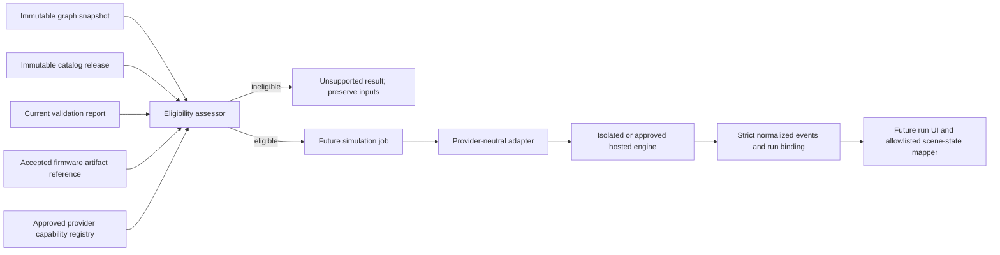

# Schemora Phase 6 — Firmware and Simulation

**Status:** Contract slice implemented; the original-ESP32 firmware now boots under both official Espressif QEMU and an exploratory build of the pinned PICSimLab QEMU fork. The fork emitted GPIO19 signal transitions for the exact reference firmware. A graph-derived digital LED mapper is being implemented, but the fork build/probe is not yet a checked-in reproducible harness, no attached LED callback has been observed, and no end-to-end product run exists. Phase 6 remains open.

**Product phase:** Phase 6 — Firmware execution and circuit simulation.

**Branch:** `dev`.

**Scope authority:** [`context.md`](context.md#phase-6---firmware-execution-and-circuit-simulation), the TRD’s firmware and simulation boundary, and the current graph, catalog, validation, and worker contracts.

## 1. User outcome and delivery boundary

Phase 6 should eventually let a user run a versioned firmware artifact against a supported representation of the saved circuit, inspect serial output and selected simulated component states, and understand where the model stops. The expected state must come from a simulator run. A renderer animation, a successful compile, or a passing structural check is not simulation evidence.

This initial slice provides strict, versioned data contracts, checks whether the exact graph/catalog/report/firmware tuple could be sent to a declared provider, and represents missing provider capability as an explicit unsupported result. It does not add firmware upload or storage, a compiler, a provider integration, a run queue/API, Monaco, or simulator-driven scene updates. The application must not expose a “Run simulation” action until those parts exist and a supported reference run has been verified.

The distinction matters for the currently modeled circuit: its LED polarity, resistor path, and graph integrity findings can pass, while the report’s overall status remains `unknown` because the electrical-scope rule explicitly does not establish GPIO current budget, thermal margin, transient conditions, or other omitted behavior. Firmware simulation may be useful for program behavior, but it cannot turn this report into an electrical safety approval.

## 2. Provider research and decision

The provider review was based on current official documentation and terms reviewed on 2026-10-14. These findings are screening results, not legal advice or evidence of an executed commercial agreement.

| Candidate                             | Technical evidence                                                                                                                                                                                                              | Fit and gate                                                                                                                                                                                                                                                                                                                                                                                                                                                                                                                                                                                     |
| ------------------------------------- | ------------------------------------------------------------------------------------------------------------------------------------------------------------------------------------------------------------------------------- | ------------------------------------------------------------------------------------------------------------------------------------------------------------------------------------------------------------------------------------------------------------------------------------------------------------------------------------------------------------------------------------------------------------------------------------------------------------------------------------------------------------------------------------------------------------------------------------------------ |
| Wokwi CI / CLI                        | Official documentation describes firmware execution through its CLI, serial output, timeouts, automated scenarios, and a cloud CI service. The cloud service receives the firmware binary and says it deletes it after the run. | **Do not integrate by default.** Wokwi’s terms limit ordinary service use to personal/non-commercial purposes, define open-source use as not commercialized directly or indirectly, require commercial licensing for commercial use, and prohibit using the service to develop a similar or competitive service. Schemora is building circuit simulation. Proceed only after explicit written terms that cover Schemora’s product use, hosting, customer content, and data handling. The current board match and normalized output mapping also need a technical proof.                          |
| Espressif QEMU fork                   | Official ESP-IDF docs describe running original ESP32 apps under `idf.py qemu`; UART and some peripherals are modeled. The official feature matrix marks GPIO matrix/IOMUX unsupported.                                         | **Best current POC candidate for firmware execution and serial output, not full circuit simulation.** A QEMU run can test a firmware binary for the catalog’s original ESP32, but the documented implementation does not expose general GPIO pin routing to the external LED. Any LED behavior inferred from firmware text or a hardcoded timer would be invalid. The fork is GPL-2.0-only in the IDF tool manifest; review executable distribution and service obligations before adoption.                                                                                                     |
| PICSimLab QEMU fork (`lcgamboa/qemu`) | The `picsimlab-esp32` branch models original ESP32 GPIO output/enable registers and IOMUX changes, forwarding output changes through QEMU GPIO signals. PICSimLab documents an ESP32-DevKitC board and attachable LED parts.    | **Leading candidate for a GPIO-to-circuit POC, not yet selected.** At pinned source revision `e39508f79cb0681bbe15cfcebd40a3f45cdc3c48`, an exploratory source build booted the exact ESP-IDF fixture and emitted GPIO19 output transitions. The source build and trace instrumentation are not yet a checked-in reproducible harness; no external callback or LED response was observed. The fork has GPL-2.0/LGPL-2.1 components and a PICSimLab-specific host callback surface, not a drop-in Schemora API. Review distribution obligations and maintenance/build risk before production use. |
| Espressif `esp-emulator`              | Official project documentation lists ESP32-C3/C5/C6/H2/P4/S3 chips, GPIO and UART peripherals, CLI and WebAssembly usage, and a browser build that keeps firmware in the local tab.                                             | **Potential option for a separately cataloged board profile; not a match for this catalog release.** The current Schemora board is ESP32-DevKitC V4 with ESP32-WROOM-32E / original ESP32, which is not in the project’s documented chip list. The emulator reports SoC peripheral activity, but Schemora would still need a tested adapter that maps its GPIO signals and exact circuit nets to LED state. Review the pinned release’s software license and packaging before any hosted use.                                                                                                    |
| Renode                                | Official supported-board documentation has a broad, explicitly incomplete board list and supports custom platform descriptions.                                                                                                 | **Not selected for this reference circuit.** The inspected board documentation does not establish a ready-to-run model of the exact ESP32-DevKitC V4 / WROOM-32E configuration or the external LED circuit. A custom model would require a separate POC and additional verification.                                                                                                                                                                                                                                                                                                             |

The Wokwi review surfaced a material product-use restriction. Availability of a public web simulator or CLI does not imply permission to offer it as Schemora’s backend. The documented Wokwi CI flow uploads the built firmware to its cloud service. Consequently, no Wokwi service call, account, cloud upload, token, or dependency was introduced.

**Decision:** Official Espressif QEMU remains the UART-only baseline and is not approved as a circuit simulator because its published feature matrix excludes GPIO matrix/IOMUX. The PICSimLab QEMU fork is the leading technical candidate. The exact fixture boot and GPIO19 signal path have now been observed at its pinned revision, but the exploratory build must be made reproducible, the host callback and graph adapter must be validated end to end, and licensing/dependency review must finish before a provider decision. A digital LED indication must not be presented as electrical simulation or safety evidence.

### Official sources reviewed

- [Wokwi Terms of Service](https://wokwi.com/legal/terms) — permitted use, commercial licensing, and use restrictions.
- [Wokwi CI overview](https://docs.wokwi.com/wokwi-ci/getting-started) — cloud execution, firmware transfer, serial output, and limits.
- [Wokwi CLI usage](https://docs.wokwi.com/wokwi-ci/cli-usage) — execution controls, serial logs, timeout, scenario, and screenshot options.
- [Wokwi automation scenarios](https://docs.wokwi.com/wokwi-ci/automation-scenarios) — simulated control inputs and serial assertions; documentation labels scenarios alpha.
- [Espressif QEMU guide](https://docs.espressif.com/projects/esp-idf/en/stable/esp32/api-guides/tools/qemu.html) — ESP32 boot/run flow, UART monitor, and installation.
- [Espressif QEMU supported-feature matrix](https://github.com/espressif/esp-toolchain-docs/blob/main/qemu/README.md) — target/peripheral support, including missing GPIO matrix/IOMUX.
- [ESP-IDF QEMU tool manifest](https://docs.espressif.com/projects/esp-idf/en/v5.4/esp32/api-guides/tools/idf-tools.html) — recorded QEMU tool package license (`GPL-2.0-only`) for that IDF tool release.
- [PICSimLab QEMU fork, pinned `picsimlab-esp32` revision](https://github.com/lcgamboa/qemu/tree/e39508f79cb0681bbe15cfcebd40a3f45cdc3c48) and [ESP32 GPIO model source](https://github.com/lcgamboa/qemu/blob/e39508f79cb0681bbe15cfcebd40a3f45cdc3c48/hw/gpio/esp32_gpio.c) — original-ESP32 output/IOMUX implementation reviewed for the next POC; this is a community-maintained fork.
- [PICSimLab project](https://github.com/lcgamboa/picsimlab) and [board documentation](https://lcgamboa.github.io/picsimlab_docs/stable/Boards.html) — documents the integration’s host callbacks and ESP32-DevKitC simulation board. This establishes a technical candidate only, not an assurance of exact WROOM-32E board fidelity.
- [Espressif esp-emulator](https://github.com/espressif/esp-emulator) — documented chips, modeled peripherals, CLI/WASM, and browser execution behavior.
- [Renode supported boards](https://renode.readthedocs.io/en/latest/introduction/supported-boards.html) — documented board coverage and custom platform capability.

## 3. Implemented contract package

`packages/simulation` defines the boundary before application routes or workers may invoke an engine.

The initial `mapEsp32Gpio19ToLedState` adapter derives electrical nets from the immutable graph and exact catalog release. It accepts only the exact DevKitC V4/WROOM-32E, WP7113ID, and 220-ohm resistor combination with GPIO19 connected through the resistor to the LED anode and the LED cathode connected to a documented board ground. It rejects invalid graphs, additional or missing parts, reversed polarity, path shorts, unmodeled terminal branches, unrelated wires, malformed GPIO records, and out-of-order observations. For accepted GPIO19 digital levels it emits instance-scoped `led_state` records. It models an ideal on/off indication only and does not estimate current, voltage, resistor power, or safety.

### Immutable firmware reference

`firmwareArtifactRefSchema` accepts only an immutable artifact reference: project/revision, SHA-256, bounded byte length, language, entry point, exact catalog board ID, and accepted review state. It carries no source text, URL, storage key, token, or executable payload. The package does not create or store such artifacts; that remains follow-up work.

### Bound run identity

Every `SimulationBinding` records project/revision, graph ID and digest, catalog release and digest, firmware artifact and digest, adapter/version, and engine/version. A result cannot be treated as current merely because it is the latest run. The input assessor compares current report identity with the canonical graph and catalog digests and checks firmware ownership/revision/board binding.

### Normalized output and lifecycle

The contract defines run lifecycle states and bounded, schema-validated events for ordered serial text, LED on/off state, and numeric sensor readings. Event sequence must strictly increase and simulation time may not move backward. Failed, timed-out, and cancelled terminal results must carry an error; completed results cannot carry a failure. Component updates refer to a graph instance ID, never arbitrary HTML, JavaScript, CSS, or renderer commands. Consumers must still check that the component category is appropriate before applying a state.

Provider capabilities explicitly list exact board IDs, component IDs, topology IDs with topology versions, firmware language support, and provider/engine versions. An unknown board alias or an apparently similar model does not satisfy an exact catalog identity. The current assessor also requires exactly one development board and binds it to the accepted firmware target.

The contract assessor parses provider declarations at runtime, limits serialized output to 2 MB, recomputes graph integrity and the validation report, and carries the selected provider/engine versions directly into the successful run binding. A second result validator binds output events to the exact graph/catalog snapshot and rejects unknown component IDs, LED events targeting non-LED parts, and sensor readings for components that do not have a modeled sensor schema.

The `reviewStatus: accepted` and `reportIsCurrent` values in the pure package are assertions supplied by its caller. They are not proof that the current user accepted the stored firmware artifact or that the report is the repository’s current report. Any future route/worker must load those records under project ownership, verify the stored firmware bytes against the SHA-256, resolve the accepted review state from persistence, and establish currentness against the canonical current revision before calling the assessor. Never accept these authority fields from an untrusted browser request.

### Fail-closed eligibility

`assessSimulationEligibility` rejects malformed artifacts and mismatched project, revision, graph, catalog, or report identity. A stale report or any failed/error validation blocks execution. Unknown validation remains unknown and is not reclassified as pass or safe: once a provider exists, a current report with no failures may permit a behavioral run only if the provider declares full coverage for the exact design. The run and UI must preserve the report’s unknown findings and disclose electrical and physical limitations.

With no configured capability, the decision is `SIMULATOR_UNAVAILABLE`. `unavailableSimulationRun` returns an unsupported result with no events and an explicit statement that no firmware ran. This is intentionally different from an empty successful run.

## 4. Architecture and trust boundaries



The package is contract and eligibility logic only. It has no database, object storage, worker, HTTP endpoint, compiler, subprocess, provider SDK, or ability to mutate the circuit. The existing import worker’s child-process boundary is not an acceptable firmware sandbox; firmware execution must use a separately isolated runtime or an approved vendor-hosted service.

## 5. Coverage matrix for the current catalog

| Current item                             | Exact catalog identity                            | Contract behavior now                                                                 | Required proof before support                                                                                                                                               |
| ---------------------------------------- | ------------------------------------------------- | ------------------------------------------------------------------------------------- | --------------------------------------------------------------------------------------------------------------------------------------------------------------------------- |
| ESP32-DevKitC V4, WROOM-32E, male header | `board.espressif.esp32-devkitc-v4.wroom-32e.male` | No configured provider claims support; assessment returns unavailable.                | Compile and execute a reference program against the exact MCU target, verify reset/start/stop and UART output, and prove the board GPIO model matches catalog pin mappings. |
| Kingbright WP7113ID LED                  | `led.kingbright.wp7113id`                         | Output schema permits only instance-scoped `on` / `off` events; no source emits them. | Connect simulator GPIO state through the saved graph and LED polarity model; compare known reference cases, including reversed/open circuit.                                |
| YAGEO CFR-25JB-52-220R resistor          | `resistor.yageo.cfr-25jb-52-220r`                 | Exact component identity must be declared by provider capability.                     | Establish whether the engine models the external resistor/circuit or only MCU execution; state omitted electrical behavior.                                                 |
| BusBoard BB400 topology                  | Catalog topology identity/version                 | Exact topology must be declared by provider capability.                               | Verify every graph terminal/wire maps to equivalent simulator nets, including split rails and variant.                                                                      |

The catalog currently has no simulator aliases, execution profiles, or supported firmware targets. Capability declarations must be sourced from reviewed provider/model evidence and bound to a particular adapter/model version before the run path is enabled.

## 6. Files and package surface

- `packages/simulation/src/index.ts` — schemas, provider interface, fail-closed eligibility, graph-bound output validation, and explicit unavailable result.
- `packages/simulation/src/adapters/esp32-gpio19-led.ts` — strict graph-derived GPIO19-to-LED digital-state mapper for one exact catalog profile.
- `packages/simulation/test/contract.test.ts` — identity, coverage, output ordering, unsupported topologies, mapper polarity, malformed signal, and unavailable-result checks.
- `examples/phase6-qemu-uart/` — minimal ESP-IDF reference app that requests GPIO19 toggles and emits bounded UART markers for the official QEMU UART POC. `run-poc.ps1` runs two bounded, network-isolated executions in the pinned ESP-IDF container and compares their marker transcripts. The exploratory PICSimLab fork probe is recorded separately below; it is not yet reproducible from the repository.
- `packages/simulation/package.json` — workspace package registration and package dependencies.
- `docs/Phase-6-Implementation.md` — Phase 6 status, provider research, current boundaries, and completion gates.

No user-submitted firmware is stored or executed by the product runtime in this change. The checked-in engineering fixture is built and executed only by the opt-in POC harness. No UI label implies that compilation or simulation is available.

## 7. Verification and evidence limits

The contract package is type-checked and its focused suite passes eight tests for a current graph/catalog/report binding, missing provider, stale or forged report, failed report, unaccepted firmware, invalid provider capability, uncovered board/component IDs, output size and lifecycle invariants, graph-bound component events, explicit unsupported output, and the graph-derived LED mapper's supported/rejected cases. These checks prove contract and deterministic mapping behavior only. They do not prove that an engine's host callback receives the GPIO signal, that an external LED model changes state, or that any physical behavior is safe.

The official Espressif QEMU POC is limited to original ESP32 execution and UART behavior. The exploratory fork probe below observed GPIO19 signal emission, but it did not attach a host consumer or demonstrate connected-circuit simulation. Wokwi integration is blocked pending product-use rights and exact board/circuit mapping; Espressif `esp-emulator` currently does not list the catalog’s original ESP32 target; a Renode custom platform would itself require a separate build-and-validation project.

### 7.1 Original-ESP32 UART POC run record (2026-10-14)

The reference application in `examples/phase6-qemu-uart/` was built and run inside the official Espressif ESP-IDF container. The container is pinned by immutable image digest `espressif/idf@sha256:05cbfc42ed2e987b8026722c15bf1d8523d3e4fd1b4ac04d2e4056f5e0918b99`; it reports ESP-IDF `v5.5.2` and QEMU `9.2.2 (esp_develop_9.2.2_20250817)`. The current application image SHA-256 is `baaed9cc3a5101daaaaa91d63153571b70b5f101b928b8b2d8585a2ec1848a02`.

Build invocation from the mounted example directory:

```sh
idf.py build
```

Run invocation from the repository root on Windows (Docker Desktop with a Linux engine):

```sh
powershell -ExecutionPolicy Bypass -File examples/phase6-qemu-uart/run-poc.ps1
```

The harness rebuilds the reference app, runs it twice with Docker networking disabled, enforces a 12-second process bound, and compares the UART markers against the expected sequence. It expects the fixture’s five alternating `SCHEMORA_GPIO19_REQUESTED` values (`1, 0, 1, 0, 1` at ticks `0` through `4`) followed by `SCHEMORA_QEMU_REFERENCE_COMPLETE`. Each QEMU process then remains alive by design until the host timeout terminates it; timeout status `124` confirms bounded process stop and Docker `--rm` removes the container. The second fresh QEMU process exercises boot/reset-from-power-on and verifies repeatable transcript output. The harness reports the pinned image's IDF/QEMU versions and firmware digest. This is not a guest-issued reset, pin-level capture, or connected LED simulation. The API return/log marker records only the firmware’s GPIO request; it is not proof that QEMU changed a pin.

The pinned container and build logs make this UART run reproducible; the application binary hash should be refreshed whenever the fixture or toolchain changes. The QEMU feature matrix does not list GPIO matrix/IOMUX support. Therefore no LED state may be derived from these UART messages.

### 7.2 Exploratory GPIO fork probe (2026-10-14)

The exact fixture image above was also run from `qemu_flash.bin` under the `esp32-picsimlab` machine built from `lcgamboa/qemu` revision `e39508f79cb0681bbe15cfcebd40a3f45cdc3c48`. The build ran in the pinned ESP-IDF 5.5.2 container, targeting `xtensa-softmmu`; the runtime used `-M esp32-picsimlab`, the fixture flash as an MTD drive, `-nic none`, and a 12-second host timeout. Temporary instrumentation was added immediately before the model's `qemu_set_irq()` call for enabled GPIO output changes. The observed GPIO19 sequence was initialization low followed by the firmware's requested levels: `0, 1, 0, 1, 0, 1`. The process remained alive until the timeout (`124`), consistent with the fixture's intentional run loop.

This shows that the firmware's GPIO register writes reach the fork's GPIO signal-emission call for GPIO19. It does not show that a PICSimLab host callback received the signal, that an LED device changed state, or that the resistor/current path was modeled. The instrumentation, build command, dependency setup, and complete trace are not yet checked into a reproducible harness. Treat this as exploratory evidence only; do not mark the provider or circuit simulation approved from it.

## 8. Remaining work and phase exit criteria

Phase 6 remains open. Required work, in dependency order:

1. Turn the exploratory PICSimLab QEMU fork probe (`e39508f79cb0681bbe15cfcebd40a3f45cdc3c48`) into a reproducible source-build and run harness. Verify the exact ESP-IDF 5.5 fixture emits GPIO19 changes and that a real host callback receives them; record build dependencies and complete trace. The exploratory build has confirmed firmware boot and reached the model's `qemu_set_irq()` call, but has not verified callback receipt. The official Espressif QEMU UART POC cannot satisfy this gate because its feature matrix excludes GPIO matrix/IOMUX output.
2. Complete and verify the narrow graph-derived adapter for the exact DevKitC GPIO19 to 220-ohm resistor to WP7113ID anode/cathode to board-ground path. Prove expected on/off states from captured QEMU levels and circuit polarity, reject reversed/open/branched/unsupported topologies, and connect only allowlisted LED events to the scene. State that an ideal digital LED model does not calculate current or certify electrical safety.
3. Review pinned engine/source/dependency licenses and the fork’s maintenance/build risks before making a provider decision. Choose whether to maintain the fork, extend official QEMU, or use another exact-board simulator/provider with permitted product use and deployment.
4. Build a full POC for one immutable reference graph and firmware artifact. Repeat it in a clean environment; record engine/adapter versions, expected serial transcript, observed GPIO trace, external LED state, runtime limits, and tolerances. Do not call it a success if only the MCU ran but the circuit did not.
5. Define approved firmware upload/authoring, immutable artifact storage, content hash, accepted/rejected review state, project revision association, size limits, retention, and deletion behavior.
6. Implement a provider adapter conforming to the contract; map the normalized graph to the provider’s circuit model and report unsupported parts/edges rather than omitting them.
7. Add simulation run persistence, project-scoped create/read/cancel endpoints, idempotency, input snapshots, stale-run handling, bounded queue capacity, and output retention. Never execute provider calls inside a database transaction or web request process.
8. Implement the dedicated sandbox or approved hosted runtime. Isolate tenant data; use non-root execution, no general network egress, read-only base files, ephemeral bounded workspaces, hard CPU/memory/process/disk/output/time limits, cancellation and cleanup, and no database credentials in the runtime.
9. Add the Monaco firmware view/editor, compile/simulation diagnostics, serial monitor, start/stop/reset controls, firmware/graph revision binding, and code-to-component links. A firmware edit creates a new immutable version and invalidates results bound to an earlier digest.
10. Feed only validated, allowlisted simulator events into the scene. On graph or firmware change, mark prior runs stale and clear their visual states. Never use fixed/timer-driven LED animation as a simulation result.
11. Publish a coverage and limitations view distinguishing simulated, visual-only, unsupported, and unmodeled behavior. Keep simulation output separate from validation and safety conclusions.

The Phase 6 completion criteria remain those in the roadmap: a reference firmware project executes repeatably in a selected simulator and drives the corresponding visual outputs; unsupported designs fail clearly instead of being reported as simulated. The contract slice and UART POC are implemented, the fork's GPIO signal-emission path has exploratory evidence, and the digital graph mapper is in progress. The reproducible provider harness, host callback proof, upload/storage, worker isolation, run persistence, UI, and end-to-end scene integration remain unmet.

## 9. Risks and controls

| Risk                                                                   | Control in this slice                                                      | Remaining control                                                                    |
| ---------------------------------------------------------------------- | -------------------------------------------------------------------------- | ------------------------------------------------------------------------------------ |
| Public simulator access is mistaken for a commercial integration right | No provider call or dependency; Wokwi terms reviewed and decision recorded | Obtain explicit written product/deployment rights or choose a compatible provider    |
| Firmware runs with arbitrary host capabilities                         | No execution path exists                                                   | Dedicated isolated sandbox/service with explicit resource and network limits         |
| Result attaches to a newer project state                               | Immutable digests and identity fields are mandatory                        | Persist snapshots and reject late results after revision change                      |
| Unsupported circuit is partially translated                            | Capability list uses exact part/topology IDs; coverage failure blocks      | Adapter must account for every graph element and explain omitted behavior            |
| Simulation appears to prove safety                                     | Validation remains a separate input; unknown status preserved              | UI and run artifacts must present explicit electrical/physical limitations           |
| Provider output injects UI or scene instructions                       | Strict event union contains no executable markup/commands                  | Runtime mapper must check component identity/category and ignore unknown event types |
