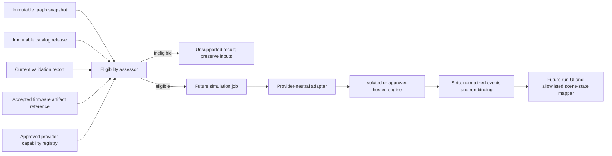

# Schemora Phase 6 — Firmware and Simulation

**Status:** Initial contract and provider-eligibility slice implemented. No firmware is compiled or executed; the simulator selection and reference execution gates remain open.

**Product phase:** Phase 6 — Firmware execution and circuit simulation.

**Branch:** `dev`.

**Scope authority:** [`context.md`](context.md#phase-6---firmware-execution-and-circuit-simulation), the TRD’s firmware and simulation boundary, and the current graph, catalog, validation, and worker contracts.

## 1. User outcome and delivery boundary

Phase 6 should eventually let a user run a versioned firmware artifact against a supported representation of the saved circuit, inspect serial output and selected simulated component states, and understand where the model stops. The expected state must come from a simulator run. A renderer animation, a successful compile, or a passing structural check is not simulation evidence.

This initial slice provides strict, versioned data contracts, checks whether the exact graph/catalog/report/firmware tuple could be sent to a declared provider, and represents missing provider capability as an explicit unsupported result. It does not add firmware upload or storage, a compiler, a provider integration, a run queue/API, Monaco, or simulator-driven scene updates. The application must not expose a “Run simulation” action until those parts exist and a supported reference run has been verified.

The distinction matters for the currently modeled circuit: its LED polarity, resistor path, and graph integrity findings can pass, while the report’s overall status remains `unknown` because the electrical-scope rule explicitly does not establish GPIO current budget, thermal margin, transient conditions, or other omitted behavior. Firmware simulation may be useful for program behavior, but it cannot turn this report into an electrical safety approval.

## 2. Provider research and decision

The provider review was based on current official documentation and terms reviewed on 2026-10-13. These findings are screening results, not legal advice or evidence of an executed commercial agreement.

| Candidate                | Technical evidence                                                                                                                                                                                                              | Fit and gate                                                                                                                                                                                                                                                                                                                                                                                                                                                                                                                                                            |
| ------------------------ | ------------------------------------------------------------------------------------------------------------------------------------------------------------------------------------------------------------------------------- | ----------------------------------------------------------------------------------------------------------------------------------------------------------------------------------------------------------------------------------------------------------------------------------------------------------------------------------------------------------------------------------------------------------------------------------------------------------------------------------------------------------------------------------------------------------------------- |
| Wokwi CI / CLI           | Official documentation describes firmware execution through its CLI, serial output, timeouts, automated scenarios, and a cloud CI service. The cloud service receives the firmware binary and says it deletes it after the run. | **Do not integrate by default.** Wokwi’s terms limit ordinary service use to personal/non-commercial purposes, define open-source use as not commercialized directly or indirectly, require commercial licensing for commercial use, and prohibit using the service to develop a similar or competitive service. Schemora is building circuit simulation. Proceed only after explicit written terms that cover Schemora’s product use, hosting, customer content, and data handling. The current board match and normalized output mapping also need a technical proof. |
| Espressif `esp-emulator` | Official project documentation lists ESP32-C3/C5/C6/H2/P4/S3 chips, GPIO and UART peripherals, CLI and WebAssembly usage, and a browser build that keeps firmware in the local tab.                                             | **Promising for a later different board profile; not a match for this catalog release.** The current Schemora board is ESP32-DevKitC V4 with ESP32-WROOM-32E / original ESP32, which is not in the project’s documented chip list. The emulator reports SoC peripheral activity, but Schemora would still need a tested adapter that maps its GPIO signals and exact circuit nets to LED state. Review the pinned release’s software license and packaging before any hosted use.                                                                                       |
| Renode                   | Official supported-board documentation has a broad, explicitly incomplete board list and supports custom platform descriptions.                                                                                                 | **Not selected for this reference circuit.** The inspected board documentation does not establish a ready-to-run model of the exact ESP32-DevKitC V4 / WROOM-32E configuration or the external LED circuit. A custom model would require a separate POC and additional verification.                                                                                                                                                                                                                                                                                    |

The Wokwi review surfaced a material product-use restriction. Availability of a public web simulator or CLI does not imply permission to offer it as Schemora’s backend. The documented Wokwi CI flow uploads the built firmware to its cloud service. Consequently, no Wokwi service call, account, cloud upload, token, or dependency was introduced.

**Decision:** No provider is approved for this release. The reference implementation remains blocked until one candidate covers the exact MCU/board target and required external GPIO behavior, permits the intended product and deployment model, passes a repeatability POC, and meets the isolation and privacy gates in §8. The current research is an option-screening exercise, not the Phase 6 technical proof of concept required for completion.

### Official sources reviewed

- [Wokwi Terms of Service](https://wokwi.com/legal/terms) — permitted use, commercial licensing, and use restrictions.
- [Wokwi CI overview](https://docs.wokwi.com/wokwi-ci/getting-started) — cloud execution, firmware transfer, serial output, and limits.
- [Wokwi CLI usage](https://docs.wokwi.com/wokwi-ci/cli-usage) — execution controls, serial logs, timeout, scenario, and screenshot options.
- [Wokwi automation scenarios](https://docs.wokwi.com/wokwi-ci/automation-scenarios) — simulated control inputs and serial assertions; documentation labels scenarios alpha.
- [Espressif esp-emulator](https://github.com/espressif/esp-emulator) — documented chips, modeled peripherals, CLI/WASM, and browser execution behavior.
- [Renode supported boards](https://renode.readthedocs.io/en/latest/introduction/supported-boards.html) — documented board coverage and custom platform capability.

## 3. Implemented contract package

`packages/simulation` defines the boundary before application routes or workers may invoke an engine.

### Immutable firmware reference

`firmwareArtifactRefSchema` accepts only an immutable artifact reference: project/revision, SHA-256, bounded byte length, language, entry point, exact catalog board ID, and accepted review state. It carries no source text, URL, storage key, token, or executable payload. The package does not create or store such artifacts; that remains follow-up work.

### Bound run identity

Every `SimulationBinding` records project/revision, graph ID and digest, catalog release and digest, firmware artifact and digest, adapter/version, and engine/version. A result cannot be treated as current merely because it is the latest run. The input assessor compares current report identity with the canonical graph and catalog digests and checks firmware ownership/revision/board binding.

### Normalized output and lifecycle

The contract defines run lifecycle states and bounded, schema-validated events for ordered serial text, LED on/off state, and numeric sensor readings. Event sequence must strictly increase and simulation time may not move backward. Failed, timed-out, and cancelled terminal results must carry an error; completed results cannot carry a failure. Component updates refer to a graph instance ID, never arbitrary HTML, JavaScript, CSS, or renderer commands. Consumers must still check that the component category is appropriate before applying a state.

Provider capabilities explicitly list exact board IDs, component IDs, topology IDs, firmware language support, and provider/engine versions. An unknown board alias or an apparently similar model does not satisfy an exact catalog ID.

### Fail-closed eligibility

`assessSimulationEligibility` rejects malformed artifacts and mismatched project, revision, graph, catalog, or report identity. A stale report or any failed/error validation blocks execution. Unknown validation remains unknown and is not reclassified as pass or safe: once a provider exists, a current report with no failures may permit a behavioral run only if the provider declares full coverage for the exact design. The run and UI must preserve the report’s unknown findings and disclose electrical and physical limitations.

With no configured capability, the decision is `SIMULATOR_UNAVAILABLE`. `unavailableSimulationRun` returns an unsupported result with no events and an explicit statement that no firmware ran. This is intentionally different from an empty successful run.

## 4. Architecture and trust boundaries

The package is contract and eligibility logic only. It has no database, object storage, worker, HTTP endpoint, compiler, subprocess, provider SDK, or ability to mutate the circuit. The existing import worker’s child-process boundary is not an acceptable firmware sandbox; firmware execution must use a separately isolated runtime or an approved vendor-hosted service.

## 5. Coverage matrix for the current catalog

| Current item                             | Exact catalog identity                            | Contract behavior now                                                                 | Required proof before support                                                                                                                                               |
| ---------------------------------------- | ------------------------------------------------- | ------------------------------------------------------------------------------------- | --------------------------------------------------------------------------------------------------------------------------------------------------------------------------- |
| ESP32-DevKitC V4, WROOM-32E, male header | `board.espressif.esp32-devkitc-v4.wroom-32e.male` | No configured provider claims support; assessment returns unavailable.                | Compile and execute a reference program against the exact MCU target, verify reset/start/stop and UART output, and prove the board GPIO model matches catalog pin mappings. |
| Kingbright WP7113ID LED                  | `led.kingbright.wp7113id`                         | Output schema permits only instance-scoped `on` / `off` events; no source emits them. | Connect simulator GPIO state through the saved graph and LED polarity model; compare known reference cases, including reversed/open circuit.                                |
| YAGEO CFR-25JB-52-220R resistor          | `resistor.yageo.cfr-25jb-52-220r`                 | Exact component identity must be declared by provider capability.                     | Establish whether the engine models the external resistor/circuit or only MCU execution; state omitted electrical behavior.                                                 |
| BusBoard BB400 topology                  | Catalog topology identity/version                 | Exact topology must be declared by provider capability.                               | Verify every graph terminal/wire maps to equivalent simulator nets, including split rails and variant.                                                                      |

The catalog currently has no simulator aliases, execution profiles, or supported firmware targets. Capability declarations must be sourced from reviewed provider/model evidence and bound to a particular adapter/model version before the run path is enabled.

## 6. Files and package surface

- `packages/simulation/src/index.ts` — schemas, provider interface, fail-closed eligibility, and explicit unavailable result.
- `packages/simulation/test/contract.test.ts` — identity, coverage, output ordering, and unavailable-result checks.
- `packages/simulation/package.json` — workspace package registration and package dependencies.
- `docs/Phase-6-Implementation.md` — Phase 6 status, provider research, current boundaries, and completion gates.

No firmware is stored or executed by this change. No UI label implies that compilation or simulation is available.

## 7. Verification and evidence limits

The contract package is type-checked and has focused tests for a current graph/catalog/report binding, missing provider, stale report, failed report, unaccepted firmware, uncovered parts, output monotonicity, and explicit unsupported output. These checks prove data-boundary behavior only. They do not prove that an engine executes ESP32 firmware, that an external LED is modeled, or that any physical behavior is safe.

No provider POC is claimed: Wokwi integration is blocked pending product-use rights and its exact board/circuit mapping; Espressif’s currently documented chip list does not include the catalog’s original ESP32 target; a Renode custom platform would itself require a technical build-and-validation project.

## 8. Remaining work and phase exit criteria

Phase 6 remains open. Required work, in dependency order:

1. Select a candidate with permitted product use and deployment, data-handling terms, and exact board/peripheral coverage. Pin and review the engine license/version and any model licenses.
2. Build a real POC for one immutable reference graph and one immutable reference firmware artifact. Repeat it in a clean environment; record engine/adapter versions, expected serial transcript, GPIO trace, external LED state, runtime limits, and tolerances. Do not call a mapping a success if only the MCU ran but the circuit did not.
3. Define approved firmware upload/authoring, immutable artifact storage, content hash, accepted/rejected review state, project revision association, size limits, retention, and deletion behavior.
4. Implement a provider adapter conforming to the contract; map the normalized graph to the provider’s circuit model and report unsupported parts/edges rather than omitting them.
5. Add simulation run persistence, project-scoped create/read/cancel endpoints, idempotency, input snapshots, stale-run handling, bounded queue capacity, and output retention. Never execute provider calls inside a database transaction or web request process.
6. Implement the dedicated sandbox or approved hosted runtime. Isolate tenant data; use non-root execution, no general network egress, read-only base files, ephemeral bounded workspaces, hard CPU/memory/process/disk/output/time limits, cancellation and cleanup, and no database credentials in the runtime.
7. Add the Monaco firmware view/editor, compile/simulation diagnostics, serial monitor, start/stop/reset controls, firmware/graph revision binding, and code-to-component links. A firmware edit creates a new immutable version and invalidates results bound to an earlier digest.
8. Feed only validated, allowlisted simulator events into the scene. On graph or firmware change, mark prior runs stale and clear their visual states. Never use fixed/timer-driven LED animation as a simulation result.
9. Publish a coverage and limitations view distinguishing simulated, visual-only, unsupported, and unmodeled behavior. Keep simulation output separate from validation and safety conclusions.

The Phase 6 completion criteria remain those in the roadmap: a reference firmware project executes repeatably in a selected simulator and drives the corresponding visual outputs; unsupported designs fail clearly instead of being reported as simulated. The provider, POC, upload/storage, worker isolation, run persistence, UI, and scene integration criteria remain unmet.

## 9. Risks and controls

| Risk                                                                   | Control in this slice                                                      | Remaining control                                                                    |
| ---------------------------------------------------------------------- | -------------------------------------------------------------------------- | ------------------------------------------------------------------------------------ |
| Public simulator access is mistaken for a commercial integration right | No provider call or dependency; Wokwi terms reviewed and decision recorded | Obtain explicit written product/deployment rights or choose a compatible provider    |
| Firmware runs with arbitrary host capabilities                         | No execution path exists                                                   | Dedicated isolated sandbox/service with explicit resource and network limits         |
| Result attaches to a newer project state                               | Immutable digests and identity fields are mandatory                        | Persist snapshots and reject late results after revision change                      |
| Unsupported circuit is partially translated                            | Capability list uses exact part/topology IDs; coverage failure blocks      | Adapter must account for every graph element and explain omitted behavior            |
| Simulation appears to prove safety                                     | Validation remains a separate input; unknown status preserved              | UI and run artifacts must present explicit electrical/physical limitations           |
| Provider output injects UI or scene instructions                       | Strict event union contains no executable markup/commands                  | Runtime mapper must check component identity/category and ignore unknown event types |
