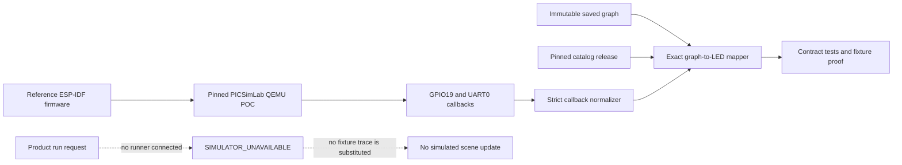

# Phase 6 — Reference Firmware and Circuit Contract

**Status:** Internal engineering reference profile; no production simulator or compiler provider selected.  
**Reviewed:** 14 November 2026  
**Contract version:** 1  
**Scope:** One digital GPIO-to-LED reference path for the original ESP32 catalog profile.

## 1. Purpose and claim boundary

This contract freezes what the existing Phase 6 proof of concept may claim. It is a narrow reference for validating graph-to-signal mapping and UART/GPIO event handling. It is not a production firmware service, a full-board emulator profile, an analog circuit model, physical-fit evidence, or a safety assessment.

There are three distinct facts in the current POC:

1. A test firmware image runs in the pinned PICSimLab QEMU fork and emits GPIO19 and UART0 callbacks through a private host callback ABI.
2. A deterministic adapter maps GPIO19 digital levels to `on`/`off` events only when the saved graph has the exact supported topology below.
3. The product's worker does not execute user firmware or provide this fixture trace to a project run. The normal product run therefore remains unavailable; the POC trace is never a user's simulation result.

The normalizer sets `simulationTimeMs` to zero because the callback stream has no emulator timestamp. The ordered host observations establish callback order only. They do not establish device timing, voltage/current, brightness, resistor dissipation, electrical reliability, or physical LED state.

## 2. Exact supported graph profile

| Field                      | Required identity or behavior                                                                                                                           |
| -------------------------- | ------------------------------------------------------------------------------------------------------------------------------------------------------- |
| Catalog release            | `schemora-hw-2026.10.1`                                                                                                                                 |
| Board                      | `board.espressif.esp32-devkitc-v4.wroom-32e.male` — ESP32-DevKitC V4, ESP32-WROOM-32E, male headers                                                     |
| Firmware chip/build target | Original ESP32 / ESP-IDF target `esp32`; this is not an Arduino FQBN                                                                                    |
| GPIO output                | Board catalog terminal `gpio19`, function GPIO19                                                                                                        |
| Series resistor            | Exactly one `resistor.yageo.cfr-25jb-52-220r`, catalog value 220 Ω                                                                                      |
| LED                        | Exactly one `led.kingbright.wp7113id`, catalog anode/cathode terminal IDs `anode` / `cathode`                                                           |
| Return                     | The LED cathode net contains board ground terminal `gnd-j3-1` or `gnd-j3-7`                                                                             |
| Conductive path            | GPIO19 → one resistor lead → other resistor lead → LED anode → LED cathode → board ground                                                               |
| Scope exclusions           | No extra components, extra wired nets, extra terminals on the three modeled path nets, or unsupported branch. A graph that does not match fails closed. |

The adapter derives connectivity from the immutable graph and pinned catalog; the contract does not authorize inferring a physical breadboard location from the image or scene. The exact implementation and rejection behavior are tested in `packages/simulation/test/contract.test.ts` and implemented by `mapEsp32Gpio19ToLedState`.

## 3. Reference firmware behavior

The checked-in [fixture firmware](../examples/phase6-qemu-uart/main/main.c) is a harness probe, not a user example or a production firmware sample:

1. Call the ESP-IDF GPIO API to configure GPIO19 as output and print a setup result to UART0.
2. Print a start marker.
3. For five loop iterations, request GPIO19 levels `1, 0, 1, 0, 1`; print each requested level, API return status, and loop index to UART0; delay 100 ms between iterations.
4. Print a completion marker and remain in the firmware loop.

The 100 ms delay is a firmware request, not a verified simulated-time measurement. The host harness records six GPIO callbacks (`0, 1, 0, 1, 0, 1`) as observed by the emulator callback ABI; the first level is a boot/configuration observation. It separately records the five explicit GPIO API requests in the UART transcript. Those are related but distinct observables.

The expected stable UART fixture, after removing non-application QEMU diagnostics, is:

```text
SCHEMORA_GPIO19_SETUP=OK
SCHEMORA_QEMU_REFERENCE_START
SCHEMORA_GPIO19_REQUESTED=1,RESULT=OK,TICK=0
SCHEMORA_GPIO19_REQUESTED=0,RESULT=OK,TICK=1
SCHEMORA_GPIO19_REQUESTED=1,RESULT=OK,TICK=2
SCHEMORA_GPIO19_REQUESTED=0,RESULT=OK,TICK=3
SCHEMORA_GPIO19_REQUESTED=1,RESULT=OK,TICK=4
SCHEMORA_QEMU_REFERENCE_COMPLETE
```

This transcript is pinned in the POC shell harness and checked across two runs. It is not the same as the callback output and does not establish LED behavior by itself.

| Observable   | Expected fixture evidence                                                     | What it establishes                                                                                                   |
| ------------ | ----------------------------------------------------------------------------- | --------------------------------------------------------------------------------------------------------------------- |
| Build target | ESP-IDF `esp32`; fixture builds the flash image in the pinned POC container   | The reference fixture compiled in that controlled POC build. It does not establish arbitrary user-source compilation. |
| UART         | Setup result, start marker, five request/result/tick lines, completion marker | Ordered UART0 bytes emitted by this fixture in the POC.                                                               |
| GPIO         | Six ordered GPIO19 binary-level callbacks                                     | The pinned fork delivered output-level callbacks to the host harness.                                                 |
| LED mapping  | Six ideal `off/on` events bound to the exact LED instance in the exact graph  | Deterministic polarity/topology mapping from digital level; not a simulated LED device or analog response.            |
| Time         | Every normalized event has `simulationTimeMs = 0`                             | No timing claim is made by the product adapter.                                                                       |

## 4. Architecture and evidence flow



The POC path is deliberately separate from the product run path. A later integration must supply a verified run binding and provider output through the durable runner lifecycle. It must not import the fixture trace into a live product run or treat the existing mapping tests as runtime evidence.

## 5. Unsupported behavior

The profile does not support or infer:

- Other ESP32 variants, boards, modules, GPIO pins, LED identities, resistor values, multiple LEDs, or arbitrary circuit graphs.
- General ESP32-DevKitC PCB behavior, board-specific pin routing beyond the callback observation, analog peripherals, input circuits, sensors, PWM duty/brightness, current, voltage, resistor power, transients, heat, component tolerance, or timing accuracy.
- Breadboard contact quality, physical placement, wiring correctness, actual component identity, LED illumination, or hardware safety.
- Arduino projects, external ESP-IDF components, arbitrary dependency resolution, network access, or user firmware execution through the application.
- Production availability, commercial distribution, vendor-hosted execution, source retention terms, or a legal determination about any emulator dependency.

Any unsupported identity, malformed callback, stale binding, or graph mismatch must remain unavailable/unsupported. It must not produce a partial green result or scene event.

## 6. Provider and release decision

**Disposition: defer provider selection and keep live simulation unavailable.** This is the Phase 6 plan's specified fallback when no candidate has passed technical, operational, and product-use approval. It is not a claim that the phase is complete.

Research rechecked on 14 November 2026:

- Espressif's current ESP-IDF QEMU guide describes CPU, memory, and several peripheral emulation, including QEMU-based application execution. It does not, by itself, establish the GPIO-to-external-LED behavior required by this profile. The exact release and GPIO feature matrix must be assessed before considering it as a provider. [ESP-IDF QEMU guide](https://docs.espressif.com/projects/esp-idf/en/stable/esp32/api-guides/tools/qemu.html)
- The catalog profile is the original ESP32. Espressif's current `esp-emulator` repository lists C3, C5, C6, H2, P4, S31, and S3 chip targets, not the original ESP32; it is therefore not an exact target match for this profile at this review. [Espressif esp-emulator](https://github.com/espressif/esp-emulator)
- The pinned PICSimLab QEMU source identifies QEMU as GPL-2.0 overall and requires source-file-level license review for exceptions. The private callback ABI, mixed dependency closure, source/binary obligations, and commercial hosting implications have not received qualified legal approval. [Pinned QEMU license file](https://github.com/lcgamboa/qemu/blob/e39508f79cb0681bbe15cfcebd40a3f45cdc3c48/LICENSE)

The internal POC build pins the QEMU source commit `e39508f79cb0681bbe15cfcebd40a3f45cdc3c48` and the ESP-IDF container image digest recorded in `examples/phase6-qemu-gpio-probe/Dockerfile`. Its system packages are resolved from Ubuntu repositories during image build and are not fully version-locked; this is not a complete reproducible-build claim or binary SBOM. The [Espressif QEMU feature matrix](https://github.com/espressif/esp-toolchain-docs/blob/main/qemu/README.md) currently lists GPIO matrix/IOMUX as unsupported for the official QEMU targets, so official QEMU's GPIO setup and UART are insufficient to prove this profile's output path.

These sources narrow the technical options; they are not legal advice, an executed commercial license, or a provider approval. No provider is selected, no customer code is sent to a third party, and the opt-in POC is not to be exposed as a user-facing execution option.

## 7. Conditions to reopen provider selection

Before enabling a product compiler or simulator, the product owner and responsible legal/security reviewers must record:

1. Exact supported board profile and firmware target, including source and catalog release.
2. Provider version, immutable runtime/image digest, source provenance, complete source and binary SBOM, and compatibility owner.
3. Written product-use and distribution/hosting rights, source/binary obligations, user-data handling, retention, region, pricing, and operational limits.
4. Dedicated isolated execution deployment and measured proof that required no-egress, privilege, filesystem, resource, timeout, cancellation, and cleanup controls are enforced.
5. End-to-end evidence that user-owned accepted firmware—not only a checked-in fixture—builds/runs, produces validated output bound to immutable inputs, and updates the browser scene only for a current completed run.
6. User-visible behavior for provider failure, unsupported input, stale result, cancellation, cleanup failure, and electrical/physical limitations.

Until all conditions pass, Phase 6 remains open and run requests must keep the explicit unavailable result.
