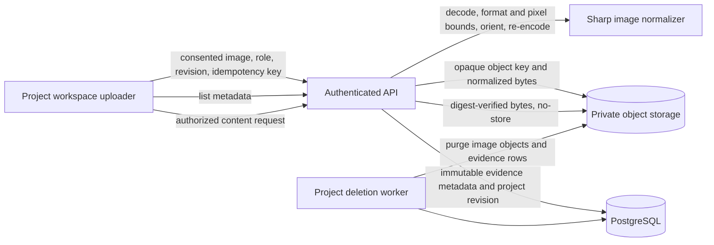

# Phase 7 — Photo Evidence and Hardware Recognition

## 1. Purpose and status

Phase 7 is intended to help a user identify physical hardware, match it to an exact supported catalog model, confirm that identity, and use the confirmed model in the virtual workbench. A photograph can provide visual evidence; it cannot establish hidden electrical properties, pin compatibility, physical safety, or the wiring inside an assembled circuit.

**Status: in progress.** The repository now contains private photo evidence, separately consented remote recognition, an asynchronous provider adapter and worker flow, unconfirmed catalog proposals, and explicit user confirmation into a private hardware inventory. It does not yet satisfy the phase exit criterion: there is no hardware-specific labeled benchmark, proven exact-model accuracy, live-provider acceptance evidence, or deployment evidence. Recognition remains disabled by default, and uploaded photos remain in manual review until a user explicitly submits them under the separate remote-processing consent.

Phase 6 remains open for its runner, provider, compiler, licensing, and live-scene gates. Work on Phase 7 evidence intake was explicitly directed to proceed without treating Phase 6 as complete. Phase 8 work should not be represented as complete until Phase 7's recognition and confirmation exit criteria are met.

## 2. Product behavior delivered

An editor can attach one or more JPEG, PNG, or WebP still images to a project. The uploader labels the selected set with one capture role: board top, board back, pin labels, module top, markings, or other. Uploads are sent sequentially. Each request records the current expected project revision, explicit storage consent, a per-photo idempotency key, and the selected role.

Before submission, the interface checks the browser-reported image type and the 5 MiB per-file limit. The server independently decodes the image, checks the actual format and dimensions, rejects animated or oversized images, applies EXIF orientation, re-encodes the pixels, and strips source metadata. It keeps the normalized image in private object storage and records only bounded metadata in PostgreSQL. A reader with project share access can list the metadata and request the private image through an owner- and project-scoped endpoint. Saved photos remain evidence awaiting manual review unless the owner explicitly requests remote recognition with separate consent. A proposal still requires confirmation and does not verify pinout, electrical behavior, or safety.

## 3. Scope boundaries

### Included

- One image per API request and a multi-select browser workflow that submits files sequentially.
- JPEG, PNG, and WebP still images only.
- A 5 MiB limit on both original and normalized image bytes.
- A 25-megapixel decoded-image limit and single-frame restriction.
- Private storage, project authorization, revisioned metadata, idempotent writes, integrity checking, per-photo removal, and project-deletion cleanup.
- Explicit consent version `photo-evidence-v1` recorded with each accepted image.
- Private photo evidence remains distinct from the recognition request, unconfirmed proposal, and user-confirmed inventory lifecycle.

### Not included

- Automatic OCR or image-quality scoring that claims verified image readability.
- Automatic workbench changes from a recognition proposal.
- An automatic image-retention scheduler.
- Any inference that visually similar boards share electrical behavior.
- Phase 6 simulation execution or Phase 8 diagnosis.

## 4. Architecture

The browser does not receive object keys or storage credentials. The API does not trust the browser MIME type. The content route chooses a fixed media type from persisted server-decoded metadata and returns `Cache-Control: private, no-store`, `X-Content-Type-Options: nosniff`, and a restrictive content security policy. `PrivateStorage.read` verifies the stored byte digest before the response is sent.

## 5. Persistence model

Migration `0015_hardware_photos.sql` creates `hardware_photos` with a composite `(project_id, id)` primary key. Each record contains the project revision, actor, opaque storage key, SHA-256 digest, byte count, normalized format and dimensions, capture role, consent version, fixed status, and creation timestamp. Constraints bound the format, dimensions, role, consent version, digest, and normalized byte length. The project/revision foreign key ties each image to an immutable revision. A database trigger rejects metadata updates; explicit user and project deletion remove the row.

The public projection deliberately omits `actor_id` and `object_key`. Photo records are tied to a project revision but are not copied into immutable revision snapshots; this allows a user's removal request to erase the image metadata instead of leaving historical image hashes and capture details behind. Per-photo removal deletes the current evidence row and its upload idempotency response, then writes a durable `delete_hardware_photo` outbox job in the same project-revision transaction. A worker removes the private object and then clears the job payload. Project deletion enumerates both current photo rows and queued photo-deletion objects before purging records and job payloads. Expired upload-intent cleanup treats a photo object as accepted while its metadata row exists.

## 6. API contract

All routes are authenticated and scoped to the requested project. `GET` requires project share access; `POST` requires edit access through the revision mutation path. Missing, foreign-project, and inaccessible photo records use the repository's existing not-found/authorization behavior.

### List

`GET /v1/projects/{projectId}/hardware-photos`

Returns the newest 100 public records as `{ items: [...] }`. Each item contains `id`, `projectRevision`, `sha256`, `byteLength`, `format`, `width`, `height`, `shotRole`, `consentVersion`, `status`, and `createdAt`.

### Upload

`POST /v1/projects/{projectId}/hardware-photos`

Requires a UUID `Idempotency-Key` header and a strict body with `expectedRevision`, `shotRole`, `consentVersion: "photo-evidence-v1"`, and canonical base64 `contentBase64`. Unknown body properties, invalid base64, empty input, unsupported image formats, corrupted image bytes, animation, and images exceeding configured limits are rejected. A project may contain at most 100 photos. A successful new upload returns HTTP 201; an idempotent replay returns HTTP 200.

The idempotency fingerprint excludes the mutable `expectedRevision` precondition but includes the photo digest, role, and consent version. A retry with the same key and same image/role/consent returns the original result even if the client refreshed the project revision after an ambiguous network outcome. Reusing the key for different evidence returns the repository's idempotency conflict.

The API registers an upload intent before storage writes. It commits the photo metadata, project revision, audit event, and idempotency response in the normal revision transaction. On failure it attempts object deletion before discarding the intent; if cleanup itself fails, the durable intent remains for expiry cleanup.

### Read image content

`GET /v1/projects/{projectId}/hardware-photos/{photoId}/content`

Returns only normalized bytes after owner/project lookup and digest verification. It never redirects to a public bucket or exposes a signed storage URL.

### Delete photo evidence

`DELETE /v1/projects/{projectId}/hardware-photos/{photoId}`

Requires edit access, a UUID `Idempotency-Key`, and a strict `{ expectedRevision }` body. It removes the photo from the current project evidence list and creates a durable private-object deletion job atomically with the new project revision. An identical retry replays the prior response. The worker deletion is safe to retry. Project deletion also captures object keys from pending photo-deletion jobs to avoid orphaned bytes when project cleanup races with photo cleanup.

## 7. Browser workflow and accessibility

The project workspace presents a dedicated hardware-photo evidence panel. It provides a multiple-file picker, capture-role selection, required consent, per-file upload progress, error and retry feedback, a saved-image list, authenticated previews, and an explicit per-photo delete action. The panel is disabled for users without edit access while existing records remain viewable to project readers. Labels and status messages are programmatically associated with their controls, and live progress/errors use status/alert semantics.

One selected role currently applies to all files in a submission. Users should upload different capture roles in separate selections. The saved record remains evidence only; it does not auto-add a catalog part or change the circuit graph.

## 8. Privacy and security controls

- Images are stored only in the configured private storage driver. Production configuration already requires private S3 storage; development uses restricted local filesystem storage.
- Consent is required in the UI and a versioned consent marker is required by the API. The API records the actor and timestamp.
- Image data is not written to application logs, analytics, revision snapshots, or idempotency request bodies. The idempotency digest stores a hash of the normalized request representation, not the raw image body.
- Accepted formats are verified by Sharp decoding and then normalized. The browser's `accept` attribute and `File.type` check are convenience checks only.
- Image pixels are decoded under a pixel limit. Animated inputs are rejected. Re-encoding applies orientation and removes source metadata such as EXIF GPS information.
- Object keys are random UUIDs and never appear in public record projections.
- Content is returned through an authorization-checking API with no-store and nosniff headers. No direct public object access is introduced.
- Project deletion enumerates and purges photo objects and records.
- Users can remove an individual photo; its object removal is durable and retried by the worker. Photos otherwise remain until the user removes them or deletes the project; there is no automatic expiry policy.
- The Vultr adapter is present but disabled by default. A successful local request-adapter test is not evidence that an uploaded photo has been transmitted or that the provider identifies hardware accurately.

## 9. Failure behavior and recovery

Invalid input is rejected before storage where possible. A storage failure or a failed revision mutation triggers best-effort object cleanup while retaining an upload intent if cleanup cannot be confirmed. A repeated request with the same idempotency key and identical evidence is safe to retry. A revision conflict is surfaced to the user and the workspace refreshes the latest revision before retrying remaining files. An image-read failure, list failure, or unavailable content object is shown as an error; the UI must not claim the image was recognized.

## 10. Operational and scale notes

The implementation uses the existing stateless API, PostgreSQL repository, private object storage, and worker lifecycle, with an optional fixed-endpoint remote vision call performed only by a worker. The application queue is durable; it does not add a model service to the Schemora deployment. Per-project volume is capped at 100 photos and normalized images at 5 MiB each. The API's current JSON body limit is sufficient for one maximum-size image encoded as base64. The list is bounded to 100 items and sorted newest-first. At higher upload rates, replace base64 JSON transport with a short-lived, narrowly scoped upload intent and private object-store multipart flow only after preserving server-side validation and finalization checks.

The database migration must be applied before the new API version receives traffic. Rollout should deploy the migration first, then API/worker, then web. Rollback must preserve the additive table and private objects until the compatible application version is restored or a controlled purge is performed.

## 11. Verification and release gates

The repository has unit tests for provider request construction and validation, typechecking, the full workspace unit/database integration suite, and browser workflows. The current automated suite does not exercise the photo upload or full recognition API/worker/confirmation lifecycle, nor a live provider request. Local tests do not demonstrate recognition accuracy or safe production provider operation. Do not enable remote requests in production until the gates below are closed.

Before enabling recognition, complete all of the following:

1. Define supported board/component identities and a labeled, rights-reviewed benchmark covering lighting, angles, board revisions, clones, and unknown hardware.
2. Review provider terms, processing region, retention, licensing, latency, cost, request limits, and owner-set spend ceilings. Provider access remains disabled by default until approved.
3. Measure per-class precision/recall, unknown detection, and false exact-model identification on a held-out set. A broad family guess must not be promoted to an exact board revision.
4. Review candidate evidence and confirmation with hardware owners; keep exact catalog release and part ID behind explicit user confirmation.
5. Review the explicit retention policy (photos remain until user or project deletion) against launch requirements and add scheduled expiry only if policy requires it.
6. Apply migrations and exercise the consented provider flow only with an approved account, a rotated credential, and an explicitly consented test photo.
7. Add isolated API, worker-race, and browser-consent tests for the photo/recognition lifecycle before treating the recognition feature as regression-covered.

Phase 7 is complete only when the recognition, candidate comparison, exact-model confirmation, and confirmed inventory behavior meet the completion criterion in `context.md`: a defined supported hardware set can be identified accurately enough for the user to confirm the exact board-specific pin mapping. Upload and storage alone do not meet that criterion.

## 12. Research references

- OWASP, [File Upload Cheat Sheet](https://cheatsheetseries.owasp.org/cheatsheets/File_Upload_Cheat_Sheet.html): allowlisted types, server-side content validation, upload limits, safe storage, and defense in depth.
- Sharp, [constructor API](https://sharp.pixelplumbing.com/api-constructor/): decoder options including pixel limits and animation handling.
- Sharp, [output API](https://sharp.pixelplumbing.com/api-output/): output encoding behavior and metadata retention controls.
- Hugging Face, [Florence-2-base model card](https://huggingface.co/microsoft/Florence-2-base): MIT-licensed 0.23B model with OCR, OCR-region, caption, and object-detection tasks. Its published general benchmarks do not establish exact development-board identification quality.
- Hugging Face, [SmolVLM2-2.2B model card](https://huggingface.co/HuggingFaceTB/SmolVLM2-2.2B-Instruct): Apache-2.0 image/text model with general OCR and visual-question-answering results. The model card warns that outputs can be inaccurate and describes it as unsuitable for critical automated decisions; its reported OCR benchmark is not a hardware-specific benchmark.
- Do Nguyen, [IoTKITs dataset](https://data.mendeley.com/datasets/x5thzmkxhy/1): CC BY 4.0 annotated images of educational embedded-board categories, including ESP32. Its metadata says images come from Google Image Search, Kaggle, Roboflow Universe, and author photographs. It is useful to investigate for broad-category pretraining, but it does not establish exact ESP32 board revisions, and image-level redistribution/training rights need review before use.

### Recognition design decision: remote provider, explicitly gated

The selected service is Vultr Serverless Inference at `https://api.vultrinference.com/v1`, using its documented OpenAI-compatible chat completions route. The initial model target is `qwen3.8-27b`: Vultr's live catalog documents PNG/JPEG/WebP image inputs and JSON-schema structured outputs for this model. This is a configuration target, not an accuracy approval; the model must remain disabled until the hardware benchmark and operational gates below pass. The existing `photo-evidence-v1` consent authorizes private project storage only. It cannot authorize a third-party image-processing request.

The first implementation must be provider-neutral at the job and result boundary, with one separately configured provider adapter. Provider configuration is absent by default and startup must fail closed if an adapter is requested without an explicit operator approval flag, server-side credential, HTTPS endpoint, fixed model, and bounded request/response limits. No browser credential, user-controlled URL, automatic fallback provider, or raw image logging is allowed. A recognition job is asynchronous: the API records the request and enqueues work; a worker loads exactly the selected photo, verifies its digest, calls the configured provider, validates the bounded response, and persists an unconfirmed proposal. Provider output can only refer to catalog IDs supplied in the request vocabulary. Provider output cannot mutate the circuit graph, pin assignments, or confirmed inventory.

Before a user submits a photo for remote recognition, the interface and API must require a separate versioned consent naming the provider, purpose, and applicable data-handling notice. The consent record is attached to that recognition job, with actor and timestamp. Consent is scoped to the specific processing request and does not silently cover other images, future providers, training, or unrelated purposes. The user can decline and keep the image in manual-review storage. Deleting a photo must cancel or invalidate queued work and suppress late provider results; deletion of a project must purge recognition jobs, proposals, and provider-derived image references under the same retention policy.

Candidate results must keep visible text/markings and image-region references separate from provider-supplied interpretation. They include `unknown` and `unsupported` outcomes, and may expose calibrated confidence only after measurement on a hardware-specific held-out benchmark. Before calibration, scores are advisory and must not be called probabilities or accuracy. A family-level hint must never be elevated to an exact board revision. A human must explicitly confirm the exact catalog release and part ID before creating a confirmed hardware inventory item. Linking that item to a circuit graph remains a separate user action.

### Provider and model evaluation record

The Vultr API reference documents bearer-token authentication, the OpenAI-compatible `/v1/chat/completions` route, image content parts, structured JSON Schema output, and HTTP errors including 400, 401, 429, 502, and 504. Vultr's model catalog describes `qwen3.8-27b` as a vision-language model and lists PNG, JPEG, and WebP image inputs. These documented capabilities fit the adapter contract. They do not show that the model can recognize this product's exact board revisions.

Vultr's security support page states that inference data is processed in memory and is not persistently stored by default, and that transport uses TLS. Treat this as a vendor-level statement, not proof of the account's actual configuration, contractual terms, provider-side operational logs, or end-to-end deletion. Before enabling production traffic, review current applicable service terms and privacy terms with the account owner, confirm region and retention behavior, and record the review date. The user-submitted API key must be treated as compromised because it was shared in chat; revoke/rotate it and install the replacement only in the worker's secret environment. Never put it in this repository, browser configuration, logs, or a commit.

`qwen3.8-27b` is pinned as the initial model ID, with model changes treated as reviewed configuration changes. An administrator-set spend ceiling, request rate limit, and worker concurrency cap are release requirements. A successful HTTP response or schema-valid JSON is not an accuracy result. Provider output remains an untrusted suggestion and exact identification remains behind user confirmation.

The current catalog contains only a very small set of curated exact parts and no approved board-photo corpus or exact-revision alias index. The Florence-2 and SmolVLM2 model cards cited above do not provide a hardware-specific benchmark, so those self-hosted models are not the chosen execution path and are not accuracy evidence for a remote provider. A consented, rights-reviewed image set must cover supported identities, front/back angles, markings, lighting, clones, board revisions, and out-of-catalog hardware. Keep a held-out evaluation split. Report per-identity precision/recall, unknown detection, and false exact-match rate; reject launch if the latter cannot meet a threshold defined before evaluation. Human confirmation remains required even after the benchmark passes.

Provider documentation reviewed:

- Vultr, [Inference API overview](https://api.vultrinference.com/docs), [chat completions reference](https://api.vultrinference.com/docs/reference/create-chat-completion), and [model catalog entry for qwen3.8-27b](https://api.vultrinference.com/docs/models/qwen3.8-27b).
- Vultr, [Serverless Inference data security](https://docs.vultr.com/support/products/serverless/how-secure-is-my-data-using-vultr-serverless-inference).

### Current delivery status

The repository now contains a fixed-endpoint Vultr adapter, strict consent/proposal contracts, a durable recognition request and confirmed-inventory schema, revisioned request/confirmation API routes, an asynchronous worker, and per-photo consent and review controls. API and worker flags default to disabled. No photo has been transmitted during implementation. Photos can be submitted only by an explicit per-photo action once both services are configured and approved. The exact-part inventory is a separate user confirmation and can be removed independently.

Phase 7 remains incomplete. The rights-reviewed, labeled hardware benchmark has not been built or run; provider/account terms, region, retention and budget controls still need owner review; and a consented live-provider flow has not been exercised. Local migrations and automated tests cannot replace these external accuracy and operational gates. Keep remote recognition disabled in production until these gates are closed.
