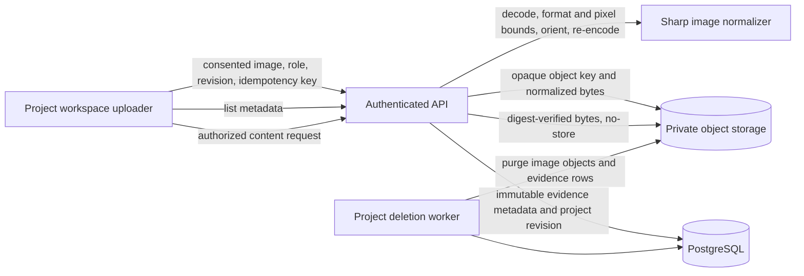

# Phase 7 — Photo Evidence and Hardware Recognition

## 1. Purpose and status

Phase 7 is intended to help a user identify physical hardware, match it to an exact supported catalog model, confirm that identity, and use the confirmed model in the virtual workbench. A photograph can provide visual evidence; it cannot establish hidden electrical properties, pin compatibility, physical safety, or the wiring inside an assembled circuit.

**Status: in progress.** This implementation delivers the private photo-evidence foundation and manual-review UI. It does not yet recognize hardware, rank catalog candidates, request clearer images based on image quality, create a confirmed inventory, or add the recognized item to the workbench. Every stored item has the fixed status `manual_review`. No image leaves the application for a model or third-party service.

Phase 6 remains open for its runner, provider, compiler, licensing, and live-scene gates. Work on Phase 7 evidence intake was explicitly directed to proceed without treating Phase 6 as complete. Phase 8 work should not be represented as complete until Phase 7's recognition and confirmation exit criteria are met.

## 2. Product behavior delivered

An editor can attach one or more JPEG, PNG, or WebP still images to a project. The uploader labels the selected set with one capture role: board top, board back, pin labels, module top, markings, or other. Uploads are sent sequentially. Each request records the current expected project revision, explicit storage consent, a per-photo idempotency key, and the selected role.

Before submission, the interface checks the browser-reported image type and the 5 MiB per-file limit. The server independently decodes the image, checks the actual format and dimensions, rejects animated or oversized images, applies EXIF orientation, re-encodes the pixels, and strips source metadata. It keeps the normalized image in private object storage and records only bounded metadata in PostgreSQL. A reader with project share access can list the metadata and request the private image through an owner- and project-scoped endpoint. The interface labels each saved image as pending manual review and explains that no recognition, model-provider call, pinout verification, or safety check occurs.

## 3. Scope boundaries

### Included

- One image per API request and a multi-select browser workflow that submits files sequentially.
- JPEG, PNG, and WebP still images only.
- A 5 MiB limit on both original and normalized image bytes.
- A 25-megapixel decoded-image limit and single-frame restriction.
- Private storage, project authorization, revisioned metadata, idempotent writes, integrity checking, and project-deletion cleanup.
- Explicit consent version `photo-evidence-v1` recorded with each accepted image.
- `manual_review` as the only server-side status.

### Not included

- Computer-vision, OCR, image-quality scoring, model-provider calls, or candidate ranking.
- A catalog candidate/confirmation workflow, a confirmed hardware inventory, or automatic workbench changes.
- Individual photo deletion or an image-retention scheduler.
- Any inference that visually similar boards share electrical behavior.
- Phase 6 simulation execution or Phase 8 diagnosis.

## 4. Architecture

The browser does not receive object keys or storage credentials. The API does not trust the browser MIME type. The content route chooses a fixed media type from persisted server-decoded metadata and returns `Cache-Control: private, no-store`, `X-Content-Type-Options: nosniff`, and a restrictive content security policy. `PrivateStorage.read` verifies the stored byte digest before the response is sent.

## 5. Persistence model

Migration `0015_hardware_photos.sql` creates `hardware_photos` with a composite `(project_id, id)` primary key. Each record contains the project revision, actor, opaque storage key, SHA-256 digest, byte count, normalized format and dimensions, capture role, consent version, fixed status, and creation timestamp. Constraints bound the format, dimensions, role, consent version, digest, and normalized byte length. The project/revision foreign key ties each image to an immutable revision. A database trigger rejects metadata updates; deletion is available to the project purge lifecycle.

The public projection deliberately omits `actor_id` and `object_key`. Revision snapshots include the evidence metadata needed to describe the revision, never the object key. Project deletion enumerates photo keys, removes photo rows, and purges private object versions through the existing worker lifecycle. Expired upload-intent cleanup treats a photo object as accepted while its metadata row exists.

## 6. API contract

All routes are authenticated and scoped to the requested project. `GET` requires project share access; `POST` requires edit access through the revision mutation path. Missing, foreign-project, and inaccessible photo records use the repository's existing not-found/authorization behavior.

### List

`GET /v1/projects/{projectId}/hardware-photos`

Returns the newest 100 public records as `{ items: [...] }`. Each item contains `id`, `projectRevision`, `sha256`, `byteLength`, `format`, `width`, `height`, `shotRole`, `consentVersion`, `status`, and `createdAt`.

### Upload

`POST /v1/projects/{projectId}/hardware-photos`

Requires a UUID `Idempotency-Key` header and a strict body with `expectedRevision`, `shotRole`, `consentVersion: "photo-evidence-v1"`, and canonical base64 `contentBase64`. Unknown body properties, invalid base64, empty input, unsupported image formats, corrupted image bytes, animation, and images exceeding configured limits are rejected. A project may contain at most 100 photos. A successful new upload returns HTTP 201; an idempotent replay returns HTTP 200.

The idempotency fingerprint excludes the mutable `expectedRevision` precondition but includes the photo digest, role, and consent version. A retry with the same key and same image/role/consent returns the original result even if the client refreshed the project revision after an ambiguous network outcome. Reusing the key for different evidence returns the repository's idempotency conflict.

The API registers an upload intent before storage writes. It commits the photo metadata, project revision, audit event, and idempotency response in the normal revision transaction. On failure it attempts object deletion before discarding the intent; if cleanup itself fails, the durable intent remains for expiry cleanup.

### Read image content

`GET /v1/projects/{projectId}/hardware-photos/{photoId}/content`

Returns only normalized bytes after owner/project lookup and digest verification. It never redirects to a public bucket or exposes a signed storage URL.

## 7. Browser workflow and accessibility

The project workspace presents a dedicated hardware-photo evidence panel. It provides a multiple-file picker, capture-role selection, required consent, per-file upload progress, error and retry feedback, a saved-image list, and authenticated previews. The panel is disabled for users without edit access while existing records remain viewable to project readers. Labels and status messages are programmatically associated with their controls, and live progress/errors use status/alert semantics.

One selected role currently applies to all files in a submission. Users should upload different capture roles in separate selections. The saved record remains evidence only; it does not auto-add a catalog part or change the circuit graph.

## 8. Privacy and security controls

- Images are stored only in the configured private storage driver. Production configuration already requires private S3 storage; development uses restricted local filesystem storage.
- Consent is required in the UI and a versioned consent marker is required by the API. The API records the actor and timestamp.
- Image data is not written to application logs, analytics, revision snapshots, or idempotency request bodies. The idempotency digest stores a hash of the normalized request representation, not the raw image body.
- Accepted formats are verified by Sharp decoding and then normalized. The browser's `accept` attribute and `File.type` check are convenience checks only.
- Image pixels are decoded under a pixel limit. Animated inputs are rejected. Re-encoding applies orientation and removes source metadata such as EXIF GPS information.
- Object keys are random UUIDs and never appear in public record projections.
- Content is returned through an authorization-checking API with no-store and nosniff headers. No direct public object access is introduced.
- Project deletion enumerates and purges photo objects and records.
- No vision provider is configured, and the application does not transmit uploaded photos to one.

## 9. Failure behavior and recovery

Invalid input is rejected before storage where possible. A storage failure or a failed revision mutation triggers best-effort object cleanup while retaining an upload intent if cleanup cannot be confirmed. A repeated request with the same idempotency key and identical evidence is safe to retry. A revision conflict is surfaced to the user and the workspace refreshes the latest revision before retrying remaining files. An image-read failure, list failure, or unavailable content object is shown as an error; the UI must not claim the image was recognized.

## 10. Operational and scale notes

The implementation uses the existing stateless API, PostgreSQL repository, private object storage, and worker deletion lifecycle. It introduces no long-running vision process, queue, model service, or provider dependency. Per-project volume is capped at 100 records and normalized images at 5 MiB each. The API's current JSON body limit is sufficient for one maximum-size image encoded as base64. The list is bounded to 100 items and sorted newest-first. At higher upload rates, replace base64 JSON transport with a short-lived, narrowly scoped upload intent and private object-store multipart flow only after preserving server-side validation and finalization checks.

The database migration must be applied before the new API version receives traffic. Rollout should deploy the migration first, then API/worker, then web. Rollback must preserve the additive table and private objects until the compatible application version is restored or a controlled purge is performed.

## 11. Verification and release gates

The implementation agents report that targeted API, persistence, worker, and web TypeScript checks pass. `git diff --check` passes. No test suites were run in this slice.

Before enabling recognition, complete all of the following:

1. Define supported board/component identities and a labeled, consented benchmark covering lighting, angles, board revisions, clones, and unknown hardware.
2. Select a vision/OCR execution and data-processing model only after privacy, retention, licensing, latency, and cost review. Provider access must remain disabled by default until approved.
3. Measure per-class precision/recall and false exact-model identification. A broad family guess must not be promoted to an exact board revision.
4. Add candidate evidence with source images/regions and calibrated uncertainty, clear unknown/unsupported states, and a user confirmation step.
5. Bind a confirmed inventory entry to an exact catalog release and exact part identifier. Never alter the graph or pin mapping from an unconfirmed prediction.
6. Add user-visible per-photo deletion and a documented retention/deletion policy before treating consented image storage as production-ready.
7. Exercise authorization boundaries, malformed/hostile image inputs, idempotent retry behavior, project purge, and operational cleanup using the repository's approved verification process.

Phase 7 is complete only when the recognition, candidate comparison, exact-model confirmation, and confirmed inventory behavior meet the completion criterion in `context.md`: a defined supported hardware set can be identified accurately enough for the user to confirm the exact board-specific pin mapping. Upload and storage alone do not meet that criterion.

## 12. Research references

- OWASP, [File Upload Cheat Sheet](https://cheatsheetseries.owasp.org/cheatsheets/File_Upload_Cheat_Sheet.html): allowlisted types, server-side content validation, upload limits, safe storage, and defense in depth.
- Sharp, [constructor API](https://sharp.pixelplumbing.com/api-constructor/): decoder options including pixel limits and animation handling.
- Sharp, [output API](https://sharp.pixelplumbing.com/api-output/): output encoding behavior and metadata retention controls.
