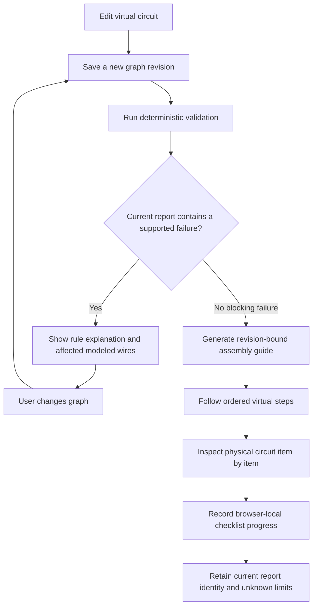

# Phase 8 — Debugging and physical verification

**Branch:** `dev`  
**Status:** In progress; the current slice improves rule-linked correction guidance and adds a revision-bound, itemized physical inspection checklist. It does not establish that a physical circuit matches the virtual design.

## 1. Purpose

Phase 8 helps a learner understand supported digital findings, correct a modeled fault, and inspect a real assembly before connecting power. The saved circuit graph remains the digital design under review. A software report can reason only about facts represented by that graph, the selected catalog release, and the named validator rules.

The product must keep three states distinct:

1. **Virtual design:** the user-authored, saved circuit graph.
2. **Digital rule result:** an immutable report for one graph and catalog identity.
3. **Physical inspection:** user-reported checks against physical parts and wires; the application cannot observe or certify the assembly.

## 2. User workflow

The checklist uses the exact graph and report already bound to the assembly plan. Editing the circuit makes the plan stale; a new saved revision and validation are required before a current checklist can be generated.

## 3. Supported correction behavior

| Rule                  | Proven observation                                                                   | Current correction guidance                                                                                                                       | Boundary                                                                       |
| --------------------- | ------------------------------------------------------------------------------------ | ------------------------------------------------------------------------------------------------------------------------------------------------- | ------------------------------------------------------------------------------ |
| `POWER_GROUND_SHORT`  | A catalog-modeled supply and ground share a conductive net                           | The report identifies affected modeled wire endpoints; the user keeps power disconnected, checks that bridge, corrects the graph, and revalidates | Does not detect every physical short or an unmodeled path                      |
| `LED_POLARITY`        | The modeled LED has reversed source/ground orientation or both terminals share a net | The report identifies wires on the LED terminal nets and asks the user to compare named anode/cathode endpoints with the physical marking         | Does not infer physical LED polarity from an image or prove operation          |
| `LED_SERIES_RESISTOR` | A modeled source-to-ground path through the LED bypasses all modeled resistors       | The report names affected component instances and adjacent modeled wires; the user inspects the path and revalidates                              | Does not prove a resistor value, current limit, GPIO budget, or thermal margin |
| `GRAPH_INTEGRITY`     | A graph reference or topology invariant is invalid                                   | The finding reports the failing graph path and message; the user corrects the saved graph                                                         | The rule cannot infer a user's unstated intended design                        |

Corrections are instructions, not automatic graph edits. The UI never marks a fault repaired until the user saves the changed graph and obtains a current new report. Failed digital checks block assembly-plan generation. Unknown results remain visible and are never converted to pass by checklist acknowledgement.

## 4. Physical inspection checklist

The pre-power step is generated from the current graph, catalog, and report. It includes:

- Keep the physical assembly disconnected from USB, batteries, and external power while inspecting it.
- Match every physical component to the exact catalog model/configuration in the graph.
- Check the board supply requirements and polarity against the manufacturer documentation.
- Inspect every modeled wire using its graph endpoint labels.
- Inspect each modeled terminal-to-breadboard-hole placement.
- Verify the selected breadboard topology, split rails, and physical labels.
- For a modeled LED, compare the physical marking to its graph anode/cathode endpoints.
- Read and account for failed or unknown report findings when present.

The UI requires every displayed item to be checked before the user can mark the pre-power assembly step complete. Completion means only that the user recorded those acknowledgements. It is not a safety approval, sensor measurement, or proof of physical correctness. Checklist progress is stored in the current browser under the assembly-plan digest; it is not a server-side audit record and does not synchronize across devices.

## 5. Data and implementation boundaries

- Validation reports are stored by the existing persistence layer and carry graph digest, graph revision, catalog release/digest, ruleset version, and validator version.
- Fault findings include stable affected component identities. Wire IDs are added to the affected set only when the rule can derive those wires from the modeled conductive net.
- The browser resolves those IDs to human-readable catalog terminal labels from the current saved graph.
- The assembly plan already includes review and pre-power actions. The current UI adds itemized checks and stores them with local assembly progress.
- No vision model, free-form language model, or simulation output is used to invent a correction.
- No physical connection is inferred from the user checking an item or from a saved virtual wire.

## 6. Known coverage gaps

The current data model has one saved circuit graph, not separate intended-design and as-built graphs. Validation therefore evaluates supported electrical and topology rules over the saved virtual design; it cannot compare a virtual target with a distinct observed circuit. It does not provide detection coverage for every missing source pin, wrong destination pin, breadboard row, jumper placement, supply condition, or physical fault. A reference design comparison requires an independently authored/confirmed intent representation before it can be added without guessing.

Correction support is intentionally bounded to findings with deterministic rule evidence. The current checklist is browser-local, has not undergone novice usability validation, and is not an auditable physical-verification record. More complex circuits must remain unsupported until their catalog facts and rules have reviewed coverage.

## 7. Verification and exit criteria

This implementation slice has passed TypeScript checks for the validation and web packages and `git diff --check`. The focused test suites, browser flow, accessibility review, and physical usability study have not been run for this slice.

Phase 8 remains open until all of the following are evidenced:

1. A separately represented, user-confirmed intended design can be compared with the current virtual/as-built graph without treating guesses as requirements.
2. A versioned fault fixture set demonstrates detection and exact affected endpoints for supported missing/wrong connections, topology errors, polarity, and modeled shorts.
3. Every supported blocking finding has source-grounded corrective guidance and current-report revalidation behavior.
4. The pre-power checklist is reviewed by hardware safety/product owners, including unsupported and unknown cases.
5. Usability sessions show beginners can identify and correct supported faults while understanding that the virtual result does not verify physical safety.
6. Checklist persistence and audit semantics are selected and documented for the product's account/project model.

Phase 8 must not be declared complete based on a green digital report or completed checklist alone.
