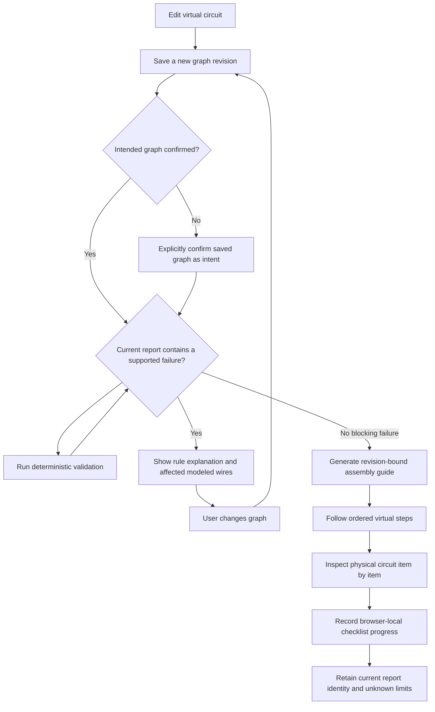

# Phase 8 — Debugging and physical verification

**Branch:** `dev`  
**Status:** Engineering implementation delivered for saved-virtual-graph comparison, bounded rule guidance, and the pre-power checklist. Product completion remains pending Phase 7 exit criteria, hardware/product review, and beginner usability evidence.

## 1. Purpose

Phase 8 helps a learner understand supported digital findings, correct a modeled fault, and inspect a real assembly before connecting power. The saved circuit graph remains the digital design under review. A software report can reason only about facts represented by that graph, the selected catalog release, and the named validator rules.

The product must keep three states distinct:

1. **Intended virtual design:** an immutable saved graph snapshot explicitly confirmed by a project user.
2. **Working virtual design:** the current immutable saved graph snapshot.
3. **Digital rule result:** an immutable report for one graph and catalog identity.
4. **Physical inspection:** user-reported checks against physical parts and wires; the application cannot observe or certify the assembly.

## 2. User workflow

The checklist uses the exact graph and report already bound to the assembly plan. Editing the circuit makes the plan stale; a new saved revision and validation are required before a current checklist can be generated. The pre-power step cannot be skipped; each generated checklist item must be acknowledged before the step can be marked complete. Browser storage failures leave progress in page memory and display a warning.

## 3. Supported correction behavior

| Rule                  | Proven observation                                                                   | Current correction guidance                                                                                                                       | Boundary                                                                       |
| --------------------- | ------------------------------------------------------------------------------------ | ------------------------------------------------------------------------------------------------------------------------------------------------- | ------------------------------------------------------------------------------ |
| `POWER_GROUND_SHORT`  | A catalog-modeled supply and ground share a conductive net                           | The report identifies affected modeled wire endpoints; the user keeps power disconnected, checks that bridge, corrects the graph, and revalidates | Does not detect every physical short or an unmodeled path                      |
| `LED_POLARITY`        | The modeled LED has reversed source/ground orientation or both terminals share a net | The report identifies wires on the LED terminal nets and asks the user to compare named anode/cathode endpoints with the physical marking         | Does not infer physical LED polarity from an image or prove operation          |
| `LED_SERIES_RESISTOR` | A modeled source-to-ground path through the LED bypasses all modeled resistors       | The report names affected component instances and adjacent modeled wires; the user inspects the path and revalidates                              | Does not prove a resistor value, current limit, GPIO budget, or thermal margin |
| `GRAPH_INTEGRITY`     | A graph reference or topology invariant is invalid                                   | The finding reports the failing graph path and message; the user corrects the saved graph                                                         | The rule cannot infer a user's unstated intended design                        |

Corrections are instructions, not automatic graph edits. The UI never marks a fault repaired until the user saves the changed graph and obtains a current new report. Failed digital checks block assembly-plan generation. Unknown results remain visible and are never converted to pass by checklist acknowledgement.

## 4. Physical inspection checklist

The pre-power step is generated from the current graph, catalog, and report. It includes:

- Keep the physical assembly disconnected from USB, batteries, and external power while inspecting it.
- Match every physical component to the exact catalog model/configuration in the graph.
- Check the board supply requirements and polarity against the manufacturer documentation.
- Inspect every modeled wire using its graph endpoint labels.
- Inspect each modeled terminal-to-breadboard-hole placement.
- Verify the selected breadboard topology, split rails, and physical labels.
- For a modeled LED, compare the physical marking to its graph anode/cathode endpoints.
- Read and account for failed or unknown report findings when present.

The UI requires every displayed item to be checked before the user can mark the pre-power assembly step complete. Completion means only that the user recorded those acknowledgements. It is not a safety approval, sensor measurement, or proof of physical correctness. Checklist progress is stored in the current browser under the assembly-plan digest; it is not a server-side audit record and does not synchronize across devices.

## 5. Data and implementation boundaries

- Validation reports are stored by the existing persistence layer and carry graph digest, graph revision, catalog release/digest, ruleset version, and validator version.
- Fault findings include stable affected component identities. Wire IDs are added to the affected set only when the rule can derive those wires from the modeled conductive net.
- The browser resolves those IDs to human-readable catalog terminal labels from the current saved graph.
- The assembly plan already includes review and pre-power actions. The current UI adds itemized checks and stores them with local assembly progress.
- No vision model, free-form language model, or simulation output is used to invent a correction.
- No physical connection is inferred from the user checking an item or from a saved virtual wire.

## 6. Known coverage gaps

The data model has a separate, user-confirmed intended graph pointer backed by append-only intent versions referencing immutable graph snapshots. Comparison reports component, breadboard topology, terminal placement, and wire deltas between that target and the current saved virtual graph. Wire identity is based on its unordered endpoint pair, so renaming or reversing an edge does not create a false delta. Comparisons stop when catalog release identities differ. This representation is **not** a physical as-built graph and the UI says so. It does not provide detection coverage for every missing source pin, wrong destination pin, breadboard row, jumper placement, supply condition, or physical fault.

Correction support is intentionally bounded to findings with deterministic rule evidence. Checklist progress remains browser-local, does not synchronize, and is not an auditable physical-verification record. More complex circuits must remain unsupported until their catalog facts and rules have reviewed coverage.

## 7. Verification and exit criteria

The versioned Phase 8 fixture manifest pins the catalog, ruleset, and validator versions and asserts exact affected IDs for a direct modeled short, reversed/same-net LED, an unknown missing return, and an invalid topology. Its graph-comparison fixtures assert exact records for a missing wire and wrong destination. Circuit-model tests also cover component changes, placements, breadboard changes, duplicate edges, order stability, and catalog mismatch. The API integration test covers intent confirmation and a later graph delta; workspace TypeScript checks pass, and the full test command applied migration `0018_circuit_design_intent.sql`. Browser flow and accessibility review have not been performed; hardware-owner review and beginner usability evidence require external participants.

Phase 8 remains open until all of the following are evidenced:

1. **Implemented:** a separately represented, explicitly confirmed intended graph compares with the current saved virtual graph. Physical state is not claimed.
2. **Implemented for the current supported set:** a versioned, catalog/ruleset/validator-pinned fixture corpus checks exact affected IDs for supported short/polarity/topology findings and exact graph records for missing/wrong connections. It does not claim comprehensive coverage of every physical fault or unsupported circuit family.
3. **Implemented for current supported blocking rules:** the UI provides rule-specific corrective guidance and requires a newly saved graph and current report to establish updated digital results. Coverage remains limited to the listed deterministic rules.
4. **Pending external evidence:** hardware safety/product owners must review the checklist, including unsupported and unknown cases.
5. **Pending external evidence:** beginner sessions must establish that users can identify/correct supported faults and understand physical uncertainty.
6. **Decision documented:** checklist state is browser-local progress, not a project audit record. The product must decide whether to add authenticated server-side audit and cross-device persistence.

Phase 8 remains open because Phase 7's documented exit criteria and the human review/usability evidence are outstanding. A green digital report or completed checklist alone does not complete the phase. All code-completable Phase 8 work for the current supported circuit profile is implemented; remaining phase work depends on those named gates.
