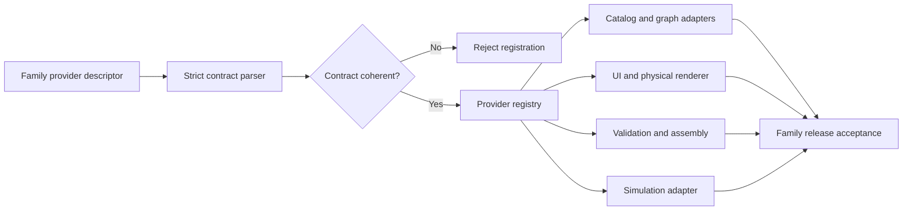
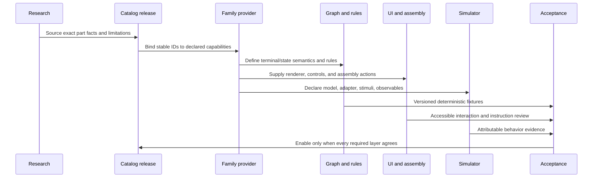

# Phase 9 — Hardware family expansion

**Branch:** `dev`  
**Status:** In progress — capability contract foundation added; no new hardware family is yet enabled end to end.  
**Roadmap source:** [Phase 9 in context.md](./context.md#phase-9---expand-beyond-basic-electronics)

## 1. Phase intent and completion rule

Phase 9 expands supported hardware in increasing engineering complexity. A part is not considered supported merely because it appears in a catalog response or has a decorative 3D mesh. Each family must have consistent catalog facts, terminal semantics, graph behavior, validation, assembly behavior, UI rendering and interaction, and appropriately scoped simulation. The published model must state which of these capabilities are absent.

The roadmap's completion rule is per newly supported family: verified models and documented limitations, with existing reference circuits continuing to pass their regression corpus. This document tracks product capability, not just code merged. A future family that has been researched but is not integrated end to end remains unsupported.

## 2. Current repository baseline

The current pinned catalog release is immutable `schemora-hw-2026.10`. It contains one exact ESP32-DevKitC V4 / ESP32-WROOM-32E / male-header configuration, one Kingbright WP7113ID red LED, one YAGEO CFR-25JB-52-220R resistor, and one BusBoard BB400/BB400T topology. The catalog's category schema and physical/UI mappings are intentionally specific to these records.

The saved component instance currently carries only an instance ID and catalog part ID. Net derivation models wires, terminal placements, and breadboard topology; it has no dynamic internal-contact state. The circuit editor and scene renderer contain explicit starter-circuit assumptions. The current firmware simulation adapter only handles the reference LED circuit and does not provide a general input-stimulus contract. The assembly planner handles identification, terminal placement, wires, validation review, and pre-power inspection; it does not model mounts, clearance, motion, collisions, or cable routing.

These constraints are important compatibility boundaries. Existing graph snapshots pin a catalog release ID. Changing the current release in place would change catalog digests for old graphs and would violate the existing immutable-release policy. Adding a new release requires release lookup/history support across API, browser, worker, validation, and graph-write paths before projects can safely pin it.

## 3. Capability contract delivered in this increment

`packages/hardware-catalog/src/family-contract.ts` defines a strict, versioned Zod contract for a hardware-family provider. It makes the following independently reviewable capabilities explicit:

| Contract area       | Declared information                                                          | Enforcement in this increment                                                                      |
| ------------------- | ----------------------------------------------------------------------------- | -------------------------------------------------------------------------------------------------- |
| Family identity     | Stable family ID, contract version, category, exact supported part IDs, owner | Required and schema-validated                                                                      |
| Terminals           | Catalog terminal source, internal connectivity support, terminal state model  | Required; state model is explicit                                                                  |
| Physical model      | Representation level, coordinate frame, source requirement, clearance model   | Required; 3D requires a coordinate frame                                                           |
| Electrical behavior | Model identity, domain, state inputs, explicit unknowns                       | Required; unknowns cannot be omitted                                                               |
| Assembly            | Action identifiers, dependency capability, instruction provider               | Required                                                                                           |
| Simulation          | Support mode, adapter, observables, stimuli, limitations                      | Required; supported modes require adapters, firmware simulation requires attributable observations |
| Validation          | Rule IDs, version, regression-fixture requirement                             | Required                                                                                           |

The contract prevents a common class of accidental overclaim: an unsupported simulator cannot name an adapter; supported simulation must name an adapter; an interactive state cannot be represented while leaving simulation unsupported; and 3D geometry cannot omit its coordinate frame. The schema is exported from `@schemora/catalog` for future provider implementations.

### Registration boundary

This increment defines the machine-readable boundary and validation invariants. It does **not** yet implement provider discovery, runtime registration, or replace existing hardcoded handlers. Consumers must not infer that a family is supported just because it can construct a descriptor.

## 4. Family introduction workflow

Every family addition must be delivered as a vertical slice in this order:

1. **Evidence and identity:** choose exact orderable model/configuration; cite manufacturer documentation per claimed property; record access date, revision, locator, and uncertainties. Do not generalize one model's facts to visual look-alikes.
2. **Immutable release:** create a new catalog release; preserve resolvability and digests for all graph-pinned historical releases. Add release index/history behavior before enabling graphs to reference the new release.
3. **Family provider:** implement and parse the family contract. A provider must bind exact part identities to terminal semantics, physical limitations, electrical model, assembly behavior, simulation mode, validation rules, and regression fixtures.
4. **Graph semantics:** add state/configuration only through a versioned graph migration/compatibility strategy. Define whether the state is persisted design intent or transient simulation input. Transient interaction must not mutate the saved graph or its digest.
5. **Validation:** add deterministic rules only for facts present in the catalog and graph. Return `unknown` when limits or paths cannot be established. Pin rule and provider versions in reports and fixtures.
6. **Assembly and physical UI:** render usable terminals and controls, identify the exact part, show orientation/fit limits, and produce dependency-ordered instructions. 3D geometry needs a declared coordinate frame and source/review evidence; otherwise use an explicit schematic or non-fit-guaranteeing fallback.
7. **Simulation:** use an appropriate circuit-level or firmware-level model. Firmware input simulation must deliver deterministic input events to the actual execution environment and attribute outputs to that run. A UI toggle alone is not firmware execution.
8. **Regression and acceptance:** add exact fixture cases for supported behaviors and existing reference circuits. Review accessibility, interaction, failure states, performance, and user-facing limitations before marking the family enabled.

## 5. Expansion sequence and acceptance gates

### Tier 1 — Basic electronics

| Family                  | Current status                            | Gate before support                                                                                                                                                                        |
| ----------------------- | ----------------------------------------- | ------------------------------------------------------------------------------------------------------------------------------------------------------------------------------------------ |
| ESP32 development board | Existing exact configuration only         | Preserve current reference graph and release compatibility                                                                                                                                 |
| LED                     | Existing exact Kingbright model only      | Preserve polarity/current-rating limitations and exact regression fixtures                                                                                                                 |
| Resistor                | Existing exact YAGEO 220 Ω model only     | Preserve value/tolerance/power limitations and series-path checks                                                                                                                          |
| Breadboard              | Existing exact BB400/BB400T topology only | Add reviewed geometry separately before claiming fit accuracy                                                                                                                              |
| Jumper wires            | Represented as graph edges                | Physical wire identity, routing, length, and fit are not modeled                                                                                                                           |
| Pushbutton              | Not supported                             | Requires sourced internal terminal pairs, open/closed state semantics, usable renderer/control, circuit evaluation, assembly guidance, and explicit treatment of debounce/contact behavior |

The first candidate for a new component family is a precisely identified through-hole normally-open tactile switch. No catalog entry should be published until its four-terminal pin connectivity is visually confirmed against the manufacturer's drawing and terminal IDs have a stable orientation convention. Its first digital abstraction could be an ideal discrete switch for circuit-level interaction; this would not establish firmware input handling, electrical bounce, contact resistance, mechanical life, or physical fit.

### Tier 2 — Sensors and actuators

Ultrasonic sensors, servos, motor drivers, DC motors, and compatible sensors remain unsupported. Each will need an exact module/revision contract, voltage and interface facts, stimulus/observation semantics, assembly constraints, and a family-specific simulation plan. A catalog-only record is insufficient.

### Tier 3 — Robotics and mechanical assembly

Multi-board systems, power distribution, chassis, mounts, screws, brackets, orientation, clearances, moving parts, collisions, and cable routing remain unsupported. A mesh is visualization only unless its coordinate frame and geometry are reviewed for the stated fit/clearance use. Mechanical constraints require separate validation and dependency rules; they cannot be inferred from electrical net connectivity.

### Tier 4 — Advanced engineering

Custom PCBs, complex power electronics, thermal behavior, and magnetic behavior remain unsupported. Dedicated models/solvers and independent validation evidence are required. No generic 3D or circuit-level approximation should be represented as predictive evidence for these domains.

## 6. Release compatibility requirements

Before publishing a second hardware release, the catalog system must support a release registry rather than a single `getCatalogRelease()` result. The registry must:

- Preserve `schemora-hw-2026.10` byte-for-byte as the historical snapshot.
- Resolve a requested release ID deterministically and return a stable digest.
- Return an ordered release index with an explicit current release.
- Use the graph's pinned release for graph validation, assembly, simulation, and reports.
- Reject unknown releases without silently substituting the current release.
- Ensure a release's source references and claims are self-contained.
- Retain compatible endpoints for existing clients and old graph snapshots.

Any persistent graph or validation schema changes require a separately reviewed migration and fixtures proving old snapshots remain readable. This increment makes no data migration and changes no existing catalog release.

## 7. Reliability and non-goals

This contract is descriptive and structurally validated; it is not a security sandbox for arbitrary executable plugins. Future providers should be statically registered or loaded only from trusted, version-pinned code. Provider code must not be downloaded and executed from a catalog record.

No new hardware model, mechanical-fit guarantee, sensor/actuator simulation, firmware input injection, or new-family validation is claimed by this increment. Current supported circuit boundaries remain unchanged. A provider claiming a capability must include that capability's own fixtures and evidence rather than inheriting confidence from the existing ESP32 LED reference circuit.

## 8. Verification and current completion state

The schema enforces strict object shapes and the cross-field invariants described above. Package typechecking has not yet been run for this increment. No tests have been run. The existing reference fixtures have not been re-executed in this turn.

Phase 9 remains **open**. The contract foundation is implemented, while the following roadmap work is outstanding:

1. Integrate provider registration and capability dispatch into catalog, graph, validation, assembly, simulation, API, and UI paths.
2. Implement a complete Tier 1 new-family vertical slice, including immutable multi-release resolution and end-to-end representation.
3. Add deterministic family-specific validation and simulation fixtures; retain existing reference regressions.
4. Add verified physical/assembly models and limitations for each family claimed as supported.
5. Implement or explicitly scope the roadmap's mechanical assembly support; do not claim Tier 3 until the supported mechanical behavior is validated.
6. Add further family slices for applicable Tier 2–4 capabilities; retain unsupported status for any family without a verified model and documented limitations.

The phase may be closed only when every family the product claims as newly supported passes those gates and all existing reference circuits remain compatible. Human hardware/product review is still required for physical fit and safety claims.
