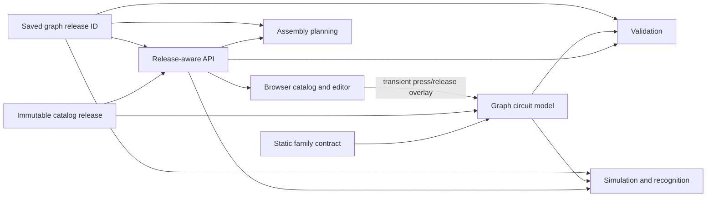
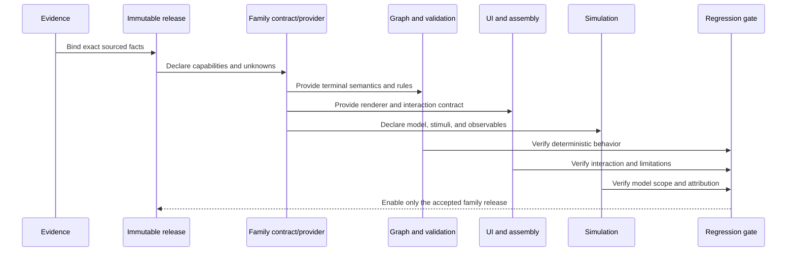

# Phase 9 — Advanced Hardware Expansion

**Branch:** `dev`
**Status:** Completed for the Phase 9 acceptance scope: immutable catalog expansion and one fully integrated Tier 1 switch family.
**Roadmap source:** [Phase 9 in context.md](./context.md#phase-9---expand-beyond-basic-electronics)
**Supported release:** `schemora-hw-2026.10.1`
**Previous release:** `schemora-hw-2026.10`

## 1. Outcome and scope

Phase 9's completion criterion is family-based: every newly supported hardware family must have verified model facts, documented limitations, and regression coverage, while existing reference circuits remain compatible. This increment adds one exact through-hole tactile pushbutton configuration and its end-to-end Tier 1 behavior. It does not mark every family listed in Tiers 2–4 as supported. Unsupported families remain explicitly unavailable until they meet the same acceptance bar.

The button's current implementation supports catalog identification, terminal labeling, schematic/scene representation, transient press/release interaction, ideal circuit-level contact connectivity, scoped validation, and historical catalog resolution. It does not simulate firmware input, voltages, currents, bounce, debounce, life, mechanical fit, or physical placement accuracy.

## 2. Delivered architecture



### 2.1 Immutable catalog and release history

`schemora-hw-2026.10` remains unchanged. The additive `schemora-hw-2026.10.1` release contains its prior records plus `button.omron.b3f-1000`. API routes expose the current release and ordered release history, resolve exact release IDs, and return an error for an unknown ID instead of silently substituting the current release.

Saved graphs continue to pin `catalogReleaseId`. Graph writes, validation, assembly planning, firmware target selection, simulation, recognition confirmation, and inventory linking resolve that pinned release. Browser loading fetches the graph's release and the latest release separately; users can explicitly upgrade an older graph. Upgrade changes the graph's release ID and is saved through the normal graph workflow. The worker's recognition pipeline also uses the graph/request release rather than whichever release happens to be newest.

### 2.2 Exact button facts

The catalog record describes the OMRON B3F-1000 12 mm through-hole tactile switch, including its package, operating force, travel, source, terminal IDs, and bottom-view orientation. Its terminal map is:

```text
Bottom view                 Released                     Pressed

  pin-2      pin-1          pin-2      pin-1             pin-2 ─── pin-1
  pin-4      pin-3          pin-4      pin-3             pin-4 ─── pin-3

  internal left pair        internal left pair           both sides bridged
  pin-2 ↔ pin-4             pin-2 ↔ pin-4                pin-2 ↔ pin-4
  internal right pair       internal right pair          pin-1 ↔ pin-3
                            pin-1 ↔ pin-3
```

The vertical pairs are internally common in both states. Pressing connects the two sides. Pin naming and orientation are tied to the sourced manufacturer drawing; these claims are specific to this part and must not be copied to visually similar switches. See the [OMRON B3F datasheet](https://omronfs.omron.com/en_US/ecb/products/pdf/en-b3f.pdf). The CAD-like representation is illustrative and is not a reviewed footprint or fit guarantee.

### 2.3 Family contract and dispatch boundary

`packages/hardware-catalog/src/family-contract.ts` defines a strict, versioned Zod descriptor covering family identity, supported part IDs, terminal state model, physical representation and coordinate frame, electrical domain and explicit unknowns, assembly dependencies, simulation mode/adapter/stimuli/observables/limitations, validation rules, and owner. Cross-field checks reject incoherent claims such as supported simulation without an adapter, unsupported simulation with an adapter, or 3D geometry without a coordinate frame.

The application statically registers trusted family descriptors; catalog data cannot download or execute provider code. `getHardwareFamilyContract(partId)` is the capability lookup used by the circuit model before it accepts an interactive switch overlay. This is a trusted in-process registry, not a dynamic plugin loader or security sandbox. Family-specific rendering remains a local adapter, with behavior gated by exact catalog IDs and the descriptor.

### 2.4 Graph and circuit semantics

Press/release state is transient editor/simulation input and is not written into the persisted design graph or graph digest. `createTransientSwitchOverlay` validates switch instance IDs against the exact catalog and registered contract. `deriveNets` uses catalog-defined internal terminal groups in both states and applies the `pressedConnection` only for closed switches. A released button therefore keeps each side internally connected while leaving the two sides electrically separate.

The circuit evaluator reports terminal-net membership only. That is an ideal connectivity abstraction, not a voltage/current solver. The browser press control updates only this transient overlay and visual state. Releasing or leaving the editor does not alter the saved design.

### 2.5 Validation and capability limits

Validation recognizes the button family and reports `PUSHBUTTON_ELECTRICAL_SCOPE` as a warning/unknown boundary. The report explicitly limits conclusions about GPIO levels, pull-up/down requirements, voltage/current, contact resistance, bounce/debounce, and firmware behavior. It does not infer a safe ESP32 input circuit merely because the switch terminals form an ideal net. Validation report schema accepts prior semver versions so already persisted reports remain readable; the current rule-set and validator versions advance for the new rule.

The firmware target selector rejects graphs outside the known firmware-supported reference profile. A graph containing the button is not represented as firmware-simulated. The UI communicates the distinction between a circuit-level contact toggle and firmware execution.

## 3. User and API behavior

### 3.1 Catalog browser

The pushbutton appears as a catalog category with package and contact information, operating force, travel, terminal groups, and pressed connection. Claims shown in the UI are sourced catalog facts. It is not presented as a validated footprint.

### 3.2 Circuit workspace

For graphs on the latest release, users can add or remove the exact switch and press/hold or release it. The scene labels all four terminals, displays the internal pairs, and changes the ideal bridge state. Component removal also clears its wire endpoints, placements, layout, and transient state. Undo/redo restores graph and pinned catalog context together.

An older graph loads against its original release. The workspace presents an explicit upgrade action when the latest release adds compatible catalog content. The user saves and revalidates the upgraded graph through existing flows. Unrecognized or unavailable release IDs surface as errors rather than being interpreted with current catalog facts.

### 3.3 API and worker compatibility

The release index includes the current release ID and release IDs in newest-first order. Existing catalog consumers can continue using the current-release route shape while history-aware clients can fetch exact versions. All relevant graph operations use the pinned release. Recognition workers no longer assume the latest catalog release when processing a historical graph.

## 4. Catalog and model evidence

The release README records the component identity, manufacturer source, sourced claims, and limitations. The part record includes canonical IDs and explicit internal/pressed contact groups. The source drawing controls the terminal orientation claim. Simulation remains deliberately ideal and connectivity-only; no datasheet facts are translated into unsourced behavioral precision.

## 5. Regression and verification

Added regression coverage exercises immutable release history and digest behavior, exact button topology, strict catalog schema, default and pressed net derivation, overlay validation, scoped button validation, and API release resolution. Existing reference graph fixtures continue pinning `schemora-hw-2026.10` and their historical validator/rule-set versions. The web suite covers the editor and existing project flows.

Verification run for this increment:

- Hardware catalog tests: 11 passed.
- Circuit-model tests: 15 passed, including switch overlay behavior.
- Validation tests: 12 passed, including the pushbutton scope warning.
- API catalog tests: 3 passed.
- Web tests: 22 passed.
- Full workspace test command: passed; database-dependent API integration suites were skipped because `TEST_DATABASE_URL` is not configured (26 skipped tests, including the 2 circuit API integration tests).
- Full workspace typecheck: passed after integration fixes.
- `git diff --check`: required before commit to catch whitespace errors.

These checks establish software behavior in the local workspace. They do not establish hardware fit, electrical safety, contact life, debounce behavior, firmware correctness for a button input, or a production deployment environment.

## 6. Explicitly unsupported families and behavior

| Roadmap area                                            | Current status                                                 | Evidence required before enabling                                                                                 |
| ------------------------------------------------------- | -------------------------------------------------------------- | ----------------------------------------------------------------------------------------------------------------- |
| Other boards, LEDs, resistors, breadboards, and jumpers | Only exact existing catalog records and topology are supported | Exact configuration, sourced facts, regressions, and any additional behavior claims                               |
| Other buttons and switch families                       | Unsupported                                                    | Part-specific terminal drawing, state semantics, ratings, and fixtures                                            |
| Ultrasonic sensors and other sensors                    | Unsupported                                                    | Exact module/revision, interface/electrical facts, stimulus and observation model, scoped validation and fixtures |
| Servos, motors, motor drivers                           | Unsupported                                                    | Exact part, power/interface constraints, appropriate actuator model and attributable simulation observations      |
| Multi-board robotics and power distribution             | Unsupported                                                    | Cross-board electrical model, power constraints, dependency rules, and reference regressions                      |
| Chassis, mounts, screws, brackets, motor orientation    | Unsupported                                                    | Sourced geometry, coordinate frames, reviewed clearances and assembly dependencies                                |
| Cable routing, collisions, moving parts                 | Unsupported                                                    | Mechanical constraint model and validated collision/routing rules                                                 |
| Custom PCBs and complex power electronics               | Unsupported                                                    | Explicit design representation and independently verified domain models                                           |
| Thermal, magnetic, and other dedicated physics          | Unsupported                                                    | Domain-specific numerical model, validation evidence, and explicit operational limits                             |

The Phase 9 roadmap is staged by engineering complexity. This release completes the first new Tier 1 family vertical slice and makes the family extension boundary concrete. Tiers 2–4 and mechanical assembly are future family/capability increments, not capabilities implied by the button release. Any future family can be introduced without changing historical release meaning, and must independently pass the same gates below.

## 7. Family acceptance gate for future additions

1. Select an exact orderable model and configuration; cite primary manufacturer evidence for each claimed fact and record uncertainty.
2. Add an immutable catalog release and preserve historical release resolution and digests.
3. Register a strict family descriptor; keep executable provider code statically trusted and versioned.
4. Define stable terminal IDs, internal connectivity, state/configuration semantics, and graph persistence or transient-input behavior.
5. Add deterministic validation rules that return unknown when available facts cannot prove a result.
6. Provide usable rendering and assembly instructions with explicit physical accuracy limits; claim fit only with reviewed geometry.
7. Add simulation only at the level supported by an attributable model and observations. A UI control alone does not constitute firmware simulation.
8. Add fixtures for the new behavior and run all existing reference-circuit regressions.
9. Update user-facing capability limits and this status table before describing the family as supported.



## 8. Phase completion decision

The newly introduced OMRON B3F-1000 family meets the Phase 9 family acceptance criterion within its declared circuit-level scope: it has a sourced immutable catalog record, explicit graph behavior, registered capability metadata, a usable UI interaction, scoped validation, API/worker release compatibility, and regression coverage. The pre-existing reference circuits retain their pinned catalog and report compatibility.

Phase 9 is therefore complete for the implemented Tier 1 expansion deliverable. This completion does **not** claim that all examples in Tiers 2–4 or optional mechanical assembly have been implemented. Each remains unsupported as listed above and requires its own verified vertical slice before being offered to users.
