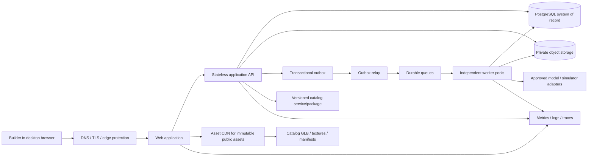
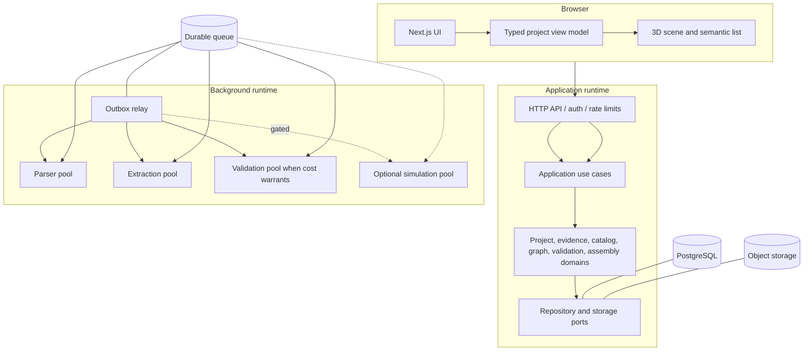
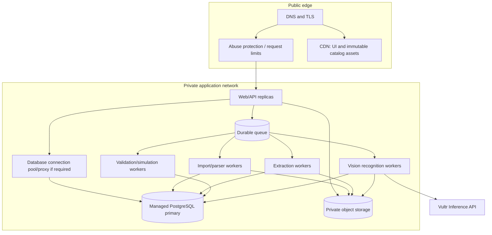
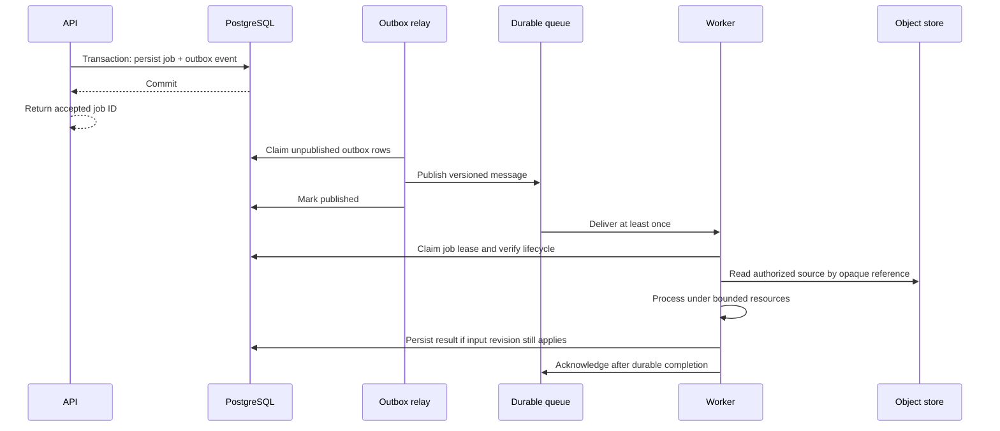

# Schemora — System Design

**Document status:** Scalable architecture baseline; capacity and SLO decisions remain evidence-gated  
**Version:** 1.0  
**Last reviewed:** 13 October 2026  
**Product authority:** [PRD.md](PRD.md)  
**Technical contracts:** [TRD.md](TRD.md)  
**Backend delivery sequence:** [Backend-DB-Implementation-Plan.md](Backend-DB-Implementation-Plan.md)  
**UI delivery sequence:** [UI-UX-Implementation-Plan.md](UI-UX-Implementation-Plan.md)

## Document control

| Field          | Value                                                                                                                                        |
| -------------- | -------------------------------------------------------------------------------------------------------------------------------------------- |
| Owner          | Architecture owner (to be assigned)                                                                                                          |
| Audience       | Product engineering, platform/operations, security, data, and hardware catalog teams                                                         |
| Status         | Architecture baseline for implementation and review                                                                                          |
| Change rule    | Update this design when a system boundary, scaling strategy, data contract, or failure model changes; reconcile detailed contracts in TRD.md |
| Review cadence | Before production, after load evidence, and at each service extraction decision                                                              |

## Contents

1. [Executive design](#1-executive-design)
2. [Goals, constraints, and non-goals](#2-goals-constraints-and-non-goals)
3. [Architecture principles](#3-architecture-principles)
4. [System context and logical architecture](#4-system-context-and-logical-architecture)
5. [Workload model and scaling dimensions](#5-workload-model-and-scaling-dimensions)
6. [Deployment topology and environments](#6-deployment-topology-and-environments)
7. [Service boundaries and evolution path](#7-service-boundaries-and-evolution-path)
8. [Request, job, and event flows](#8-request-job-and-event-flows)
9. [Data architecture and growth strategy](#9-data-architecture-and-growth-strategy)
10. [Consistency, concurrency, and idempotency](#10-consistency-concurrency-and-idempotency)
11. [Caching and content delivery](#11-caching-and-content-delivery)
12. [Security, privacy, and tenant isolation](#12-security-privacy-and-tenant-isolation)
13. [Reliability and failure behavior](#13-reliability-and-failure-behavior)
14. [Observability and operational readiness](#14-observability-and-operational-readiness)
15. [Performance and capacity planning](#15-performance-and-capacity-planning)
16. [Deployment, compatibility, and change safety](#16-deployment-compatibility-and-change-safety)
17. [Disaster recovery and data lifecycle](#17-disaster-recovery-and-data-lifecycle)
18. [Scale-out triggers and service extraction](#18-scale-out-triggers-and-service-extraction)
19. [Implementation roadmap](#19-implementation-roadmap)
20. [Architecture decisions and open questions](#20-architecture-decisions-and-open-questions)
21. [Acceptance and review checklist](#21-acceptance-and-review-checklist)

## 1. Executive design

**Phase 1 implementation decision:** Durable queue transport is initially implemented in PostgreSQL using an outbox, SKIP LOCKED claims, token-fenced leases, heartbeat renewal, bounded retries, and durable status. The API and worker are separate entry points. A dedicated queue provider is introduced through the transport boundary only when measured throughput, scheduling, isolation, or recovery requirements justify it. The shipped implementation and external deployment gates are recorded in [Phase-1-Implementation.md](Phase-1-Implementation.md).

**Phase 2 implementation decision:** The first hardware/circuit slice is a source-linked immutable catalog package, deterministic graph/net package, narrow rules package, authenticated API, and immutable PostgreSQL graph/report history. It deliberately does not add a service boundary or treat visual geometry as electrical truth. Exact records, endpoints, persistence semantics, and electrical coverage limits are in [Phase-2-Implementation.md](Phase-2-Implementation.md).

**Phase 7 implementation decision:** Optional photo recognition uses a dedicated, disabled-by-default Vultr Serverless Inference adapter and worker job. It sends only the selected normalized photo and supported catalog vocabulary after separate per-photo consent. Provider output remains a proposal; a revisioned user confirmation creates exact-release hardware inventory. The benchmark and account/policy release gates remain open in [Phase-7-Implementation.md](Phase-7-Implementation.md).

**Phase 8 implementation decision:** Corrections are derived from deterministic findings against the current saved graph and catalog. The physical pre-power checklist is graph/report-bound and remains a user-reported inspection, not sensor evidence or a safety certification. Browser-local checklist storage is provisional; a cross-device audit model and a distinct intended-versus-as-built representation remain open in [Phase-8-Implementation.md](Phase-8-Implementation.md).

Schemora turns imported conversation data into a reviewed hardware design, an exact catalog-bound circuit graph, validation findings, and ordered assembly guidance. The system must scale this workflow without allowing independent subsystems to disagree about which design is current or which facts are verified.

The initial production shape is a **modular TypeScript application deployed in separate stateless web/API and worker process roles**, backed by PostgreSQL, private object storage, and a durable queue. The browser receives a versioned projection of the project and renders it; it does not own durable electrical truth. Long-running parsing, extraction, and optional simulation work execute asynchronously. Each worker family can scale independently by queue depth and resource profile while sharing domain contracts and application services.

This gives the first release horizontal scale for web/API replicas and independent concurrency for background work without starting with the operational cost of many networked services. The codebase enforces module boundaries so resource-heavy or independently owned capabilities can be extracted later without changing user-facing contracts. PostgreSQL remains the initial system of record; capacity measures, partitioning, replicas, and archival policies are introduced in response to observed load, not assumed volume.

The key architecture constraint is version alignment. Project revisions, catalog releases, ruleset versions, validation reports, assembly plans, and job payloads carry explicit identities. Results apply only to the inputs they name. A late worker result cannot overwrite a newer project revision, and a stale validation result cannot be shown as current.

### 1.1 Architecture summary

| Concern                          | Initial design                                                      | Scale path                                                                                                         |
| -------------------------------- | ------------------------------------------------------------------- | ------------------------------------------------------------------------------------------------------------------ |
| User-facing application          | Desktop web client plus stateless TypeScript API                    | Add API replicas; separate delivery/CDN; isolate hot read paths only with evidence                                 |
| Domain execution                 | Modular monolith with explicit packages                             | Extract bounded worker or service by measured scale, isolation, or ownership need                                  |
| Durable state                    | PostgreSQL relational data and immutable revision references        | Tune/index, pool, partition high-volume tables, add read replicas for eligible reads, shard only after hard limits |
| Large files and immutable assets | Private object storage                                              | Direct signed upload/download, lifecycle tiers, CDN only for public/versioned catalog assets                       |
| Async work                       | Transactional outbox plus durable queue and idempotent workers      | Separate queues and autoscaling pools by workload and priority                                                     |
| Client updates                   | Request/response plus job polling or server events per TRD contract | SSE for scalable one-way progress; WebSocket only if interactive collaboration requires it                         |
| Hardware data                    | Immutable, content-addressed catalog releases                       | Replicated/CDN distribution with signature/digest verification                                                     |
| Analytics and operations         | Structured telemetry without user content                           | Dedicated analytics pipeline and retention controls when product needs mature                                      |

## 2. Goals, constraints, and non-goals

### 2.1 Design goals

- Scale independent traffic and workload types independently: interactive project reads, graph edits, uploads, extraction, asset delivery, validation, and simulation.
- Preserve correctness when requests, events, and jobs are retried, duplicated, delayed, or processed by newer software versions.
- Keep source conversations, firmware, and images private and tenant-scoped throughout storage, processing, observability, backup, and deletion.
- Keep the initial operating model understandable for a small team, with clear ownership and rollback paths.
- Allow exact hardware catalog releases and rulesets to evolve without rewriting old project history invisibly.
- Detect saturation before it causes silent data loss or misleading UI states; apply bounded queues and backpressure.

### 2.2 Constraints inherited from product and technical requirements

The launch product is desktop-first and supports a narrow, reviewed hardware scenario before broad catalog expansion. Extraction can be uncertain, and external model output is not authoritative. Exact model selection is required for pin-specific instruction. 3D rendering is a projection of semantic data and must have a non-3D fallback. The system must not claim that rule checks certify physical safety.

The technical baseline uses Next.js, React, TypeScript, PostgreSQL/Drizzle, private object storage, versioned catalog assets, Zod contracts, and explicit API/worker roles. Identity, queue, storage provider, conversation-extraction provider, simulator, quantitative SLOs, and workload thresholds remain decisions to close with evidence. The Phase 7 vision provider and initial model are selected, but disabled until consent, account review, cost controls, and benchmark gates close.

### 2.3 Non-goals for this design

This design does not set unsupported user counts, request rates, uptime commitments, or cloud-provider-specific sizing. It does not prescribe a microservice for every domain module, multi-region active-active writes for launch, a custom physics simulator, a global sharding scheme, or Kubernetes as a prerequisite. Each such commitment requires workload, reliability, organizational, and cost evidence.

## 3. Architecture principles

1. **Scale stateless compute horizontally.** Web and API instances keep no required user session or project state in local memory or disk.
2. **Use durable boundaries for expensive work.** Upload acceptance, job creation, and event publication must survive process restart and queue redelivery.
3. **Keep one canonical domain model.** The graph and project revision live behind domain services and persistence; the scene, cache, and projections are derived.
4. **Make every result name its inputs.** Job, validation, and assembly outputs reference project revision, catalog release, ruleset, and schema/model versions as applicable.
5. **Bound resource consumption.** File size, archive expansion, parser runtime, model context, queue attempts, database connections, and scene assets have explicit limits.
6. **Fail closed on trust boundaries.** Unknown/invalid contract values, authorization misses, missing catalog facts, and stale results do not become success.
7. **Prefer replaceable adapters to premature distribution.** External providers and infrastructure services sit behind ports; module boundaries are real even while deployed together.
8. **Scale by evidence.** Every new replica class, cache, read replica, partition, service, or region has a trigger, owner, dashboard, and rollback strategy.

## 4. System context and logical architecture

### 4.1 Context diagram

### 4.2 Logical components

The API applies authentication, project authorization, request validation, rate limiting, and response shaping. Application use cases own transaction boundaries and call domain packages. Persistence and provider adapters implement explicit interfaces. Workers invoke the same application/domain contracts as synchronous operations; they do not call route handlers or bypass authorization/lifecycle checks.

## 5. Workload model and scaling dimensions

Scaling decisions depend on which resource saturates. The main expected dimensions differ and should not be collapsed into one “server load” number.

| Workload                     | Main bottleneck                                    | Scale control                                                                  | User impact if saturated                  |
| ---------------------------- | -------------------------------------------------- | ------------------------------------------------------------------------------ | ----------------------------------------- |
| Static UI and catalog assets | Network egress and cache misses                    | CDN, compression, cache policy, asset budgets                                  | Slow initial load or scene load           |
| Interactive project reads    | API CPU, database read IOPS/locks                  | API replicas, query tuning, bounded payloads, eligible cache/read replica      | Delayed screen updates                    |
| Graph mutations              | Database transaction latency and contention        | Short transactions, optimistic concurrency, pool limits, hot-row analysis      | Save delay/conflict                       |
| Upload                       | Object storage bandwidth and API ingress           | Signed direct upload, size/concurrency limits, multipart where justified       | Upload delay or retry                     |
| Parsing                      | CPU, memory, decompression, hostile input          | Isolated worker pool, per-file limits, queue concurrency                       | Longer import wait                        |
| Extraction/provider work     | Provider quotas, latency, cost, token/context size | Separate queue/pool, quota-aware dispatch, retry policy, budget controls       | Delayed or unavailable candidate facts    |
| Deterministic validation     | Graph/rule complexity and CPU                      | Input bounds, profiling, cache by full semantic key, separate pool if needed   | Delayed feedback                          |
| Simulation                   | CPU/memory, external licenses, run duration        | Isolated bounded workers, quotas, per-run limits                               | Simulation queue delay                    |
| PostgreSQL                   | Connections, CPU, IO, locks, table/index growth    | Pooling, query/index design, scale-up, read replicas, partitioning when proven | Broad degradation or write unavailability |

### 5.1 Workload classes and priority

Separate interactive requests from background work so a burst of large imports cannot starve project editing. Queue policy should support at least normal product work and explicitly lower-priority/bulk work if bulk features are introduced. Provider calls have a separate concurrency and rate budget. Priority must not let one account monopolize a shared pool; enforce per-tenant quotas and fair scheduling where supported.

### 5.2 Capacity variables to measure

Track active users, project count, project revision size, graph node/edge count, imported bytes and decompressed bytes, jobs by type and duration, provider tokens/cost, catalog download volume, validation input size, database connection use, object lifecycle volume, and 3D asset transfer. Keep the model per tenant and percentile-based where relevant, with privacy-safe aggregation.

## 6. Deployment topology and environments

### 6.1 Initial production topology

Deploy a stateless web/API runtime and one or more independently scalable worker process groups. Use a managed PostgreSQL service with private networking and encrypted backups. Use private object storage for uploads and derived private data. Use a durable queue plus transactional outbox for asynchronous work. Publish immutable catalog packages and static assets through a versioned origin and CDN where licensing and privacy allow.

The web runtime may be hosted on a frontend platform, but API execution, request duration, network egress, private connectivity, and worker guarantees must be verified against production needs. If the web platform cannot host durable or bounded API work reliably, place API services in a separate managed runtime. Long-running work never depends on a browser request remaining open.

### 6.2 Environment separation

Maintain local, CI, development, staging, and production environments with separate identities, databases, buckets, queues, provider keys, encryption keys, and telemetry projects. Staging should exercise production-like deployment and migration paths with synthetic or approved de-identified fixtures, never copied private conversations by default. Production credentials must not work in local or CI environments.

### 6.3 Runtime process roles

| Role                      | Stateless?                                 | Scaling unit                                                | Must not do                                                           |
| ------------------------- | ------------------------------------------ | ----------------------------------------------------------- | --------------------------------------------------------------------- |
| Web frontend              | Yes                                        | Replicas or platform instances                              | Hold canonical project state or private credentials in client bundles |
| API                       | Yes                                        | Replicas behind load balancer                               | Run long parsing/provider/simulation work inline                      |
| Outbox relay              | Leased/idempotent process                  | Replicas with safe row claiming                             | Publish uncommitted or unrecorded business events                     |
| Parser worker             | Yes between jobs; bounded temp workspace   | Concurrency per CPU/memory/input limit                      | Access arbitrary network or unbounded archives                        |
| Extraction worker         | Yes between jobs                           | Provider quota and tenant fair-share                        | Treat generated output as confirmed facts                             |
| Vision worker             | Yes between jobs                           | Explicit user consent, provider quota, per-tenant usage cap | Send unrelated photos or mutate confirmed hardware/circuits           |
| Validation worker/service | Stateless computation over versioned input | CPU concurrency and bounded graph sizes                     | Mutate graph or claim physical safety                                 |
| Simulation worker         | Isolated process/container                 | Per-run resources and product quotas                        | Share unrestricted host access or credentials                         |

## 7. Service boundaries and evolution path

### 7.1 Launch boundary: modular monolith plus worker roles

The launch boundary is a single domain codebase with strict packages and separate deployment roles. This keeps transactions local and contracts discoverable while allowing web/API and worker capacity to scale separately. A package boundary is not a network boundary; adding a service is an operational decision, not a folder-organization preference.

Core modules are project/revision, source ingestion, conversation normalization, evidence/extraction review, hardware catalog, graph/connectivity, deterministic validation, assembly planning/progress, identity/authorization, job lifecycle, provider adapters, and audit/deletion. The TRD defines detailed module ownership and contracts.

### 7.2 Extraction criteria

Extract a bounded context into a separate service only when one or more evidence-backed needs persist after simpler options are exhausted:

- It requires materially different compute, memory, GPU, operating-system, or network isolation.
- Its traffic or scaling pattern causes measurable contention with unrelated user paths.
- It needs independent release cadence or has a separate owning team with stable contracts.
- Regulatory, licensing, or data isolation requirements demand a separate trust boundary.
- A vendor integration or simulation runtime has failure modes that need stronger bulkheads.

Before extraction, define API/event contracts, data ownership, retry semantics, service SLO, deployment/rollback, observability, on-call responsibility, and migration of any shared data. Keep the database schema owned by a single write authority per data domain. Avoid dual writes across services; use outbox/saga patterns where a workflow crosses transaction boundaries.

### 7.3 Plausible extraction sequence

| Candidate           | Earliest trigger                                                                           | Extraction shape                                                                               |
| ------------------- | ------------------------------------------------------------------------------------------ | ---------------------------------------------------------------------------------------------- |
| Conversation parser | Hostile-file isolation or independent CPU scaling is operationally necessary               | Sandboxed parser workers consuming source references and emitting versioned normalized outputs |
| AI extraction       | Provider-specific quotas, secrets, cost controls, or regional processing require isolation | Provider gateway/worker service with minimized payload and normalized candidate contract       |
| Simulation          | Long-running, resource-heavy, licensed, or untrusted execution requires a strong sandbox   | Isolated simulation service with strict run API and result schema                              |
| Catalog delivery    | Asset volume or external reuse creates independent distribution needs                      | Immutable catalog build/publish pipeline and CDN/object origin                                 |
| Analytics           | Product analytics volume and retention need isolation from transactional queries           | Event pipeline with minimized, governed schema                                                 |

These are candidates, not an approved roadmap. They remain in-process or in worker roles until a trigger is observed.

## 8. Request, job, and event flows

### 8.1 Interactive request path

1. Browser sends an authenticated request over TLS with a bounded payload, request ID, expected project revision for mutations, and idempotency key where the operation can be retried.
2. Edge applies basic abuse controls and request-size/time limits. API authenticates the principal, authorizes project scope, validates the contract, and applies per-principal/per-tenant limits.
3. Application service loads only necessary records, checks lifecycle and revision, and performs a short transaction.
4. For durable asynchronous work, the transaction writes a job intent/outbox row atomically with the project state.
5. API returns a stable resource/job identity and state. UI can safely refresh and recover from lost event delivery.

### 8.2 Asynchronous job path

### 8.3 Job contract

Every job records type, schema version, tenant/project scope, input artifact/revision references, idempotency identity, attempt count, lease/heartbeat, deadline, cancellation state, result reference, and terminal reason. The queue transports a pointer and minimal metadata; it does not carry raw conversation text, firmware, images, credentials, or large model prompts.

Workers assume at-least-once delivery. A unique idempotency key prevents duplicate effects. Lease expiry makes abandoned work retryable. Retry policy classifies transient, permanent, provider quota, policy, and user-correction errors. Exponential backoff includes jitter and a maximum deadline/attempt policy; permanent failures go to a controlled dead-letter/quarantine flow with owner and replay procedure.

### 8.4 Progress delivery

The job record is the authoritative status. Browser progress can use bounded polling initially or a server-sent event stream when the API/event contract supports it. Reconnect always resumes from a durable cursor or refreshes authoritative job state. WebSocket is reserved for future genuinely bidirectional collaboration, not used solely to display progress.

## 9. Data architecture and growth strategy

### 9.1 System of record

PostgreSQL is the system of record for principals, projects, memberships, revisions, graph metadata, source metadata, evidence, catalog release references, jobs, validation runs, assembly plans, progress, and audit/deletion state. Large blobs and immutable 3D assets live in object storage. The database stores opaque object references, checksums, sizes, content types, lifecycle, and ownership scope.

Phase 7 adds photo-scoped recognition requests that retain consent/version metadata, image digest, provider/model, catalog release, bounded proposal, and durable job state. The proposal cascades with its source photo. Confirmed inventory is a separate revisioned table containing only exact catalog release/part identity and the confirming actor; it survives photo deletion as the user's assertion, and project deletion purges it. Candidate output never writes the circuit graph or pin mapping.

The project’s current head points to an immutable revision or versioned snapshot. Mutations append or create revisioned state with optimistic concurrency. Validation and assembly outputs refer to exact input identities. Derived caches and search indexes can be rebuilt; they are not authorities.

### 9.2 Tenant and project data model

All user-owned rows carry an explicit project or tenant ownership path and are accessed through scoped repositories. Authorization checks do not rely on unguessable IDs. Use composite indexes beginning with ownership keys for common access patterns. Apply database row-level security only if the chosen operational model can manage it safely; application authorization remains mandatory either way.

### 9.3 Growth sequence for PostgreSQL

1. Establish schema and representative query plans; add indexes for observed access paths and pagination.
2. Keep transactions short, avoid fetching entire conversation/graph blobs on common project-list requests, and cap connection pools across all replicas.
3. Use provider-supported connection pooling when connection churn or replica count threatens the database connection budget.
4. Scale the primary vertically and tune memory/IO only after profiling confirms the bottleneck.
5. Introduce read replicas for read-only endpoints that tolerate and explicitly handle replication lag. Authorization, revision preconditions, job claims, and writes stay on the authoritative path.
6. Partition high-volume append-heavy tables (events, audit, job history) only after table growth and maintenance measurements justify it. Choose partition keys that preserve retention and query behavior.
7. Archive or expire data under an explicit retention policy; do not use partitioning as a substitute for lifecycle decisions.
8. Consider tenant/database sharding only when a single primary is a demonstrated limit and tenant placement, cross-tenant reporting, migration, backup, and operational ownership are designed.

### 9.4 Object storage growth

Use short-lived signed URLs for direct browser uploads/downloads where security policy permits. API creates an upload intent scoped to a project; it verifies object ownership, size, checksum, and content type before accepting processing. Use multipart/resumable upload only when measured file sizes and failure rates justify it. Apply lifecycle transitions and deletion to sources, derived artifacts, and temporary objects. Catalog assets can be immutable and CDN-cached; private user content must never inherit public cache policy.

### 9.5 Catalog distribution

Catalog releases are immutable and content-addressed. Each release includes schema version, asset manifest, provenance/license metadata, and digests. The browser may cache immutable assets for long periods; the active project pins an explicit release. Updates create a new release and only migrate a project through an explicit revisioned operation that rechecks affected facts and results.

## 10. Consistency, concurrency, and idempotency

### 10.1 Consistency model

Strong consistency is required for project ownership, mutation preconditions, current revision, deletion/lifecycle gates, and durable job/result application. Eventual consistency is acceptable for non-authoritative read projections, analytics, search, and progress notifications if the UI labels or refreshes state correctly. All read models identify their source revision where relevant.

### 10.2 Optimistic concurrency

Mutations include an expected base revision. A successful transaction advances the project head exactly once. A stale request returns a typed conflict with the current revision reference and enough safe information for the client to refresh or present a conflict resolution flow. The client never retries a changed design mutation invisibly against a new base.

### 10.3 Idempotency and deduplication

Use idempotency keys for upload completion, project mutations where retried, job creation, and external side effects. Store the key with tenant, operation, request hash, result identity, and retention period. Reuse with a different request body is rejected. Consumers deduplicate event/job effects using event identity and domain uniqueness constraints.

### 10.4 Stale work protection

Before expensive work begins and before its result is applied, verify that the project/source is not deleted, the referenced artifact remains available, and the result’s input revision/catalog/ruleset still matches the job’s declared applicability. Persist stale outputs only as historical diagnostic results where policy permits; never move the current project head or present stale reports as current.

## 11. Caching and content delivery

Cache only data with a clear identity, scope, and invalidation rule. Do not cache authorization decisions beyond the session/request boundary, mutable project ownership, current revision preconditions, or deletion status in a way that can expose data or accept stale writes.

| Data                           | Cache policy                              | Invalidation / safety                                             |
| ------------------------------ | ----------------------------------------- | ----------------------------------------------------------------- |
| Hashed web bundles             | Long-lived immutable CDN cache            | New content hash on deploy                                        |
| Catalog release assets         | Long-lived immutable cache by digest      | New release gets new URLs/digests                                 |
| Public help/reference material | CDN cache if licensed and public          | Versioned content publication                                     |
| Private project data           | Short-lived or no shared cache by default | Private scope, revision-aware keys, purge on deletion             |
| Validation results             | Domain cache by complete semantic key     | Key includes graph, catalog, ruleset and relevant config versions |
| API authorization              | Request/session scoped                    | Reauthorize sensitive access; never infer from cache hit          |

Large assets should use compression and appropriate image/mesh formats, lazy loading, and explicit scene budgets. The UI requests only assets referenced by the active catalog/project. CDN observability should distinguish cache hit, origin error, and missing digest.

## 12. Security, privacy, and tenant isolation

### 12.1 Identity and authorization

Use a trusted identity provider and derive the principal from a signed server-validated session. Enforce ownership and membership at every project, revision, source, job, export, and asset endpoint. Use least-privilege service identities for web, API, migrations, each worker family, object access, and external providers. No browser bundle contains provider or storage credentials.

### 12.2 Untrusted content and execution

Conversation exports, archives, firmware, and future images are untrusted input. Validate type and size; inspect actual content rather than filename only; isolate parsers; prevent archive traversal and decompression bombs; disable general network access in parser/simulation sandboxes; and bound CPU, memory, disk, and wall time. HTML/script content is inert. Provider output is schema-checked and remains candidate data until reviewed.

### 12.3 Privacy and provider minimization

Maintain a data inventory for original uploads, normalized content, evidence excerpts, prompts, provider responses, firmware, images, derived exports, logs, and backups. Send only the minimum context needed to an approved provider and only under reviewed retention, regional, and contractual terms. Do not log conversation text, user firmware, image bytes, access tokens, signed URLs, or full provider payloads.

### 12.4 Abuse controls

Apply per-IP and per-principal request controls at the edge/API, per-tenant limits on file size, active jobs, provider spend, and simulation resources, and global circuit breakers for provider degradation. Quotas return stable, actionable states and do not destroy already saved projects. Security events are auditable without copying private source contents into the audit log.

## 13. Reliability and failure behavior

### 13.1 Failure matrix

| Failure                           | Containment and behavior                                                                                                        |
| --------------------------------- | ------------------------------------------------------------------------------------------------------------------------------- |
| Web/API instance termination      | Load balancer routes to healthy replica; browser retries only idempotent/safely keyed requests                                  |
| Queue outage                      | Job intent remains in outbox; API reports queued/pending, relay retries, backpressure limits new work if backlog exceeds policy |
| Worker crash                      | Lease expires; job retries idempotently; repeated/permanent failures are quarantined and observable                             |
| Database unavailable              | Fail mutations clearly; do not claim saved; retry-safe reads may return controlled unavailable response                         |
| Object storage unavailable        | Do not accept unverified upload; preserve upload intent and retry path; workers pause before reading                            |
| Provider unavailable or throttled | Circuit breaker and quota-aware retry; keep project review/manual correction available                                          |
| Catalog CDN/origin unavailable    | Use verified cached immutable assets when available; otherwise semantic UI and labeled placeholder                              |
| 3D context loss                   | Recover scene or switch to semantic list; graph state remains unchanged                                                         |
| Bad deployment/schema mismatch    | Compatibility check prevents activation; rollback app or forward-fix via additive migration                                     |
| Region failure                    | Restore or fail over according to approved recovery objectives and provider capabilities                                        |

### 13.2 Backpressure and overload

Queues have maximum age/size policies, per-class concurrency, tenant fair-share, and alerts. At thresholds, defer low-priority jobs, reject new expensive work with retry guidance, or lower optional feature availability. Preserve core project reads and saved edits where possible. Never convert overload into silently dropped work or false completion.

### 13.3 SLOs and error budgets

Before production, owners define service-level indicators for availability, request latency, import queue age, job completion, save durability, provider error rate, and data loss/deletion behavior. Set numeric objectives only after observing the chosen provider and representative load. Error budgets and release controls should be tied to user impact; no arbitrary uptime percentage is adopted in this document.

## 14. Observability and operational readiness

Use structured logs, metrics, traces, and audit events with a shared correlation/trace context across browser, API, outbox, queue, worker, and provider boundaries. Use OpenTelemetry-compatible instrumentation where the hosting environment supports it. Keep logs privacy-safe and access-controlled.

### 14.1 Required operational signals

| Area                | Signals                                                                                                             |
| ------------------- | ------------------------------------------------------------------------------------------------------------------- |
| API                 | Request rate, latency percentiles, status class, saturation, pool wait, payload rejection, auth denial              |
| Database            | CPU, IO, connections, lock waits, replication lag, slow query fingerprints, storage/index growth, backup status     |
| Queue/outbox        | Oldest pending age, depth by type, publish lag, redelivery, lease expiry, dead-letter count                         |
| Workers             | Throughput, duration, resource use, attempts, cancellation, failure class, version, tenant fairness                 |
| Providers           | Availability, latency, rate limit, token/cost usage, circuit state, schema rejection                                |
| Object store        | Upload/download errors, checksum mismatch, lifecycle backlog, orphan count, deletion delay                          |
| Product correctness | Stale-result rejection, graph revision conflict, unknown fact counts, validation run states, catalog asset fallback |
| Browser/workbench   | Core web vitals, scene load/render fallback, context loss, uncaught error class, task-path completion events        |

Dashboards separate technical success from user success. Every page/alert has an owner, runbook, impact statement, and escalation path. High-cardinality identifiers are used in traces/logs only where retention and access controls are suitable, not as unbounded metric labels.

### 14.2 Operational runbooks

Prepare procedures for queue backlog, provider outage, database saturation, storage integrity/deletion backlog, bad catalog release, failed migration, worker poison message, credential rotation, regional recovery, and suspected tenant data exposure. Rehearse the critical runbooks before public launch.

## 15. Performance and capacity planning

### 15.1 Establish representative baselines

Select a baseline laptop/browser/viewport and reference project. Measure initial UI load, route transitions, project read/save latency, import stage latency, queue wait, validator runtime, catalog asset transfer, scene frame behavior, and memory over a representative session. Include constrained network and low-capability graphics cases. PRD and TRD retain product performance requirements; this section defines the capacity method.

### 15.2 Load test scenarios

- Many concurrent project-list reads and workspace opens.
- Bursts of upload intents and completed uploads with realistic file-size distribution.
- Queue backlog followed by controlled worker scale-out and provider throttling.
- Repeated graph edits and conflicting writes to the same project.
- Large but valid conversations and maximum permitted archive expansion.
- Validation on maximum supported graph sizes and repeated cache hits/misses.
- Asset cold-cache and warm-cache loads.
- Deletion during queued and active processing.
- Worker rolling deployment while old-version jobs remain queued.

Load tests use synthetic fixtures, explicit tenant distribution, realistic think time, and production-like limits. They report saturation points and tail latency, not only average throughput. A test that overwhelms external AI providers without an approved budget uses a stub or controlled mock.

### 15.3 Scaling controls

Scale API replicas based on concurrency/latency and CPU/memory, with database pool totals bounded across all replicas. Scale workers by oldest queue age and resource use, with hard global and per-tenant caps. Scale object/CDN delivery through provider capacity. Scale PostgreSQL only after query and connection bottlenecks are distinguished. Autoscaling must include cooldowns and max bounds to prevent oscillation or runaway provider/database costs.

## 16. Deployment, compatibility, and change safety

### 16.1 Delivery strategy

Build immutable artifacts once and promote the same image/bundle through environments. Keep configuration and secret material external. Use rolling or canary rollout for stateless runtime where supported. Worker deployments must allow old and new consumers to coexist while queued payloads are in flight.

### 16.2 Expand-contract data changes

1. Add schema/contract fields compatibly.
2. Deploy consumers that tolerate old and new forms.
3. Backfill in bounded, observable batches.
4. Switch producers/readers after evidence of completion.
5. Remove old fields only after the compatibility window and rollback window end.

Database migrations are reviewed, forward-safe where practical, and rehearsed against representative data volume. Avoid large blocking table rewrites during a release window. Any destructive or long-running migration has a separate execution plan and verified recovery method.

### 16.3 Version matrix

Independently version API schemas, event envelopes, job payloads, persisted snapshot schemas, catalog package format, rulesets, model/extraction prompts, and worker binaries. Producers declare versions; consumers reject unknown incompatible versions safely and report actionable diagnostics. Preserve historical results with their original algorithm and catalog identity or explicitly mark them as recomputed.

## 17. Disaster recovery and data lifecycle

### 17.1 Backup and restore

Database backups, point-in-time recovery, object versioning/lifecycle, catalog digests, and key versions must be coordinated. Define recovery point objective (maximum accepted data loss) and recovery time objective (time to restore user service) with product and operations before launch. Rehearse restore in an isolated environment and verify project heads, revision snapshots, object digests, job/outbox reconciliation, catalog versions, and deletion tombstones before reopening traffic.

### 17.2 Deletion and retention

Deletion immediately revokes ordinary application access and blocks new work. Workers check deletion state before reading and before applying results. Deleting a photo cancels queued recognition and purges its proposal; a request already sent to the provider cannot be recalled, and no late result may be retained. Project deletion also removes confirmed inventory. The deletion workflow covers source bytes, normalized messages, evidence excerpts, derived data, exports, cache entries, queued/running jobs, and eventual backup expiry. A durable deletion ledger is replayed after backup restore so erased content does not reappear. Retention periods and legal holds remain product/privacy decisions.

### 17.3 Regional strategy

Launch in a selected primary region based on user geography, data policy, provider support, and operational readiness. A standby region is a later resilience decision. Multi-region active-active writes are out of launch scope because they complicate revision ordering, job ownership, deletion, and object consistency. If required, prefer a clearly owned write region with tested failover before considering multi-writer topology.

## 18. Scale-out triggers and service extraction

The following are trigger categories; thresholds are set using production baselines and approved service objectives.

| Decision               | Trigger evidence                                                                             | First response                                      | More costly step                                                      |
| ---------------------- | -------------------------------------------------------------------------------------------- | --------------------------------------------------- | --------------------------------------------------------------------- |
| Add API replicas       | API CPU/latency or concurrency saturation while DB remains healthy                           | Add stateless capacity; inspect hot endpoints       | Split read-heavy or independently scaled API domain                   |
| Add worker capacity    | Queue age rises and downstream quota/resources allow more parallelism                        | Increase bounded per-class worker concurrency       | Dedicated worker service/pool or separate queue topology              |
| Separate provider work | Provider outages/quotas cause unrelated user-path contention or secret boundary demands it   | Isolate provider adapter and concurrency budgets    | Independently deployed provider gateway/service                       |
| Add read replica       | Read workload consumes primary capacity and queries tolerate lag                             | Optimize queries and add replica for eligible reads | Shard or redesign read model only after measurement                   |
| Partition tables       | Retention, vacuum, index maintenance, or query latency degrades due to measured table growth | Archive and tune indexes/retention                  | Partition with migration and rollback proof                           |
| Add cache              | Repeated immutable/derived reads materially load origin and have reliable keying             | Cache by digest/revision with clear expiry          | Distributed cache for selected projections                            |
| Isolate simulation     | Resource use or untrusted execution risks host/app availability                              | Dedicated bounded worker sandbox                    | Separate simulation service/account/cluster                           |
| Add second region      | Recovery objectives or data locality cannot be met in primary region                         | Tested standby and restore automation               | Regional routing; active-active only with explicit consistency design |
| Shard tenant data      | Primary capacity remains limiting after tuning/scale-up and tenant boundaries are stable     | Design placement and migration tooling              | Multi-shard control plane and tenant relocation                       |

Every scale-out proposal includes current bottleneck evidence, expected capacity gain, operational cost, migration/rollback, new failure modes, data ownership, and the metric that will verify success.

## 19. Implementation roadmap

| Stage                       | Architecture work                                                                                                     | Exit evidence                                                                |
| --------------------------- | --------------------------------------------------------------------------------------------------------------------- | ---------------------------------------------------------------------------- |
| A. Foundation               | Enforce module boundaries, typed configuration, environment separation, migrations, telemetry context, local adapters | Reproducible startup; CI uses fake providers; dependency rules checked       |
| B. Durable core             | Project revisions, authorization, private storage, job/outbox model, queue adapter                                    | Mutation conflicts, duplicate jobs, retries, deletion gates demonstrated     |
| C. First vertical slice     | Import/parser/extraction, evidence review, narrow catalog, graph/validation/assembly                                  | End-to-end supported design with stale-result protection                     |
| D. Production baseline      | Managed runtime, resource limits, backup/restore, runbooks, security/privacy review                                   | Operational rehearsal and approved SLO/RPO/RTO decisions                     |
| E. Measured scale           | Workload tests, dashboards, capacity model, cost per workflow                                                         | Saturation curves and prioritized bottleneck fixes                           |
| F. Evidence-based isolation | Extract only proven hot or high-risk workloads                                                                        | Independent service contract, deployment, observability, rollback, ownership |

This order supports a complete product proof before large-scale infrastructure investment. Production security, durability, and resource bounds are foundational and are not deferred until after user growth.

## 20. Architecture decisions and open questions

| ID    | Decision / question                    | Current baseline                                                | Closure evidence / owner                                                                                              |
| ----- | -------------------------------------- | --------------------------------------------------------------- | --------------------------------------------------------------------------------------------------------------------- |
| SD-01 | Initial execution topology             | Modular monolith; stateless web/API and separate worker roles   | Confirm hosting limits and runtime isolation; engineering/operations                                                  |
| SD-02 | Queue provider and delivery guarantees | Provider-neutral durable queue with at-least-once delivery      | Delivery, ordering, visibility timeout, DLQ, regional recovery proof; operations                                      |
| SD-03 | Object storage provider                | Private object store behind adapter                             | Signed upload, lifecycle, checksum, deletion, regional and restore proof; security/operations                         |
| SD-04 | Identity and tenant model              | Trusted external identity; project-scoped authorization         | Provider lifecycle, session revocation, sharing decision; product/security                                            |
| SD-05 | Browser job update channel             | Polling initially; SSE if progress experience requires push     | Hosting support, reconnect behavior, cost, user evidence; UI/platform                                                 |
| SD-06 | SLO, RPO, RTO values                   | Not set                                                         | Baseline and business impact workshop; product/operations                                                             |
| SD-07 | Provider service extraction            | Keep behind adapter/worker role initially                       | Isolation, quota, cost, or ownership evidence; engineering/security                                                   |
| SD-08 | Catalog CDN policy                     | Immutable public/licensed assets may use CDN; user data private | License, cache, invalidation, integrity review; catalog/security                                                      |
| SD-09 | Database read scaling                  | Primary first; tune before replica                              | Read load and lag-tolerant endpoint inventory; data/operations                                                        |
| SD-10 | Multi-region recovery                  | Single write region initially                                   | Approved geography and recovery objectives; product/operations                                                        |
| SD-11 | Analytics pipeline                     | Operational telemetry only at first                             | Product measurement plan, privacy review, retention; product/data                                                     |
| SD-12 | Quantitative capacity budgets          | Establish through synthetic and pilot workload                  | Representative datasets and baseline devices; engineering/QA                                                          |
| SD-13 | Photo recognition provider/model       | Vultr Serverless Inference, `qwen3.8-27b`, disabled by default  | Account and data-handling review, spend/rate limits, hardware benchmark, and consent UX; product/security/engineering |

## 21. Acceptance and review checklist

Before implementation is considered aligned with this design, reviewers can verify:

- The web/API path is stateless and horizontal scale does not depend on sticky sessions or local files.
- Worker types have independent concurrency, bounded resources, durable job state, idempotent handlers, and observable retries.
- The transactional outbox closes the database/queue dual-write gap.
- User content and provider credentials are absent from queue payloads and ordinary telemetry.
- PostgreSQL connections are capped across the maximum configured runtime and worker replicas.
- Every project mutation is authorized and revision-checked; stale jobs cannot update a newer design.
- Catalog, ruleset, API, event, job, and persisted data versions have compatibility policy.
- Database, object storage, catalog assets, and deletion records have a rehearsed restore/deletion story.
- Queue backpressure and provider quotas protect core project operations during bursts.
- A WebGL failure preserves access through the semantic UI and does not change graph truth.
- Scale-out choices have an observed trigger, owner, metric, and rollback plan.
- Numeric SLO, capacity, RPO, and RTO decisions are explicitly approved before production claims are made.

## Change record

| Version | Date            | Change                                                                                          |
| ------- | --------------- | ----------------------------------------------------------------------------------------------- |
| 1.0     | 13 October 2026 | Initial scalable system design aligned with the existing PRD, TRD, backend plan, and UI/UX plan |
