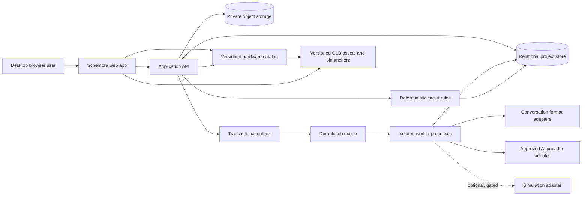
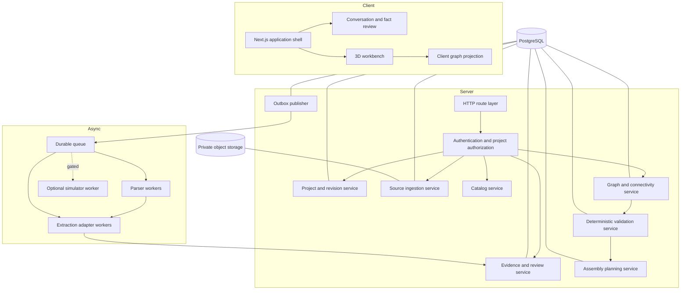
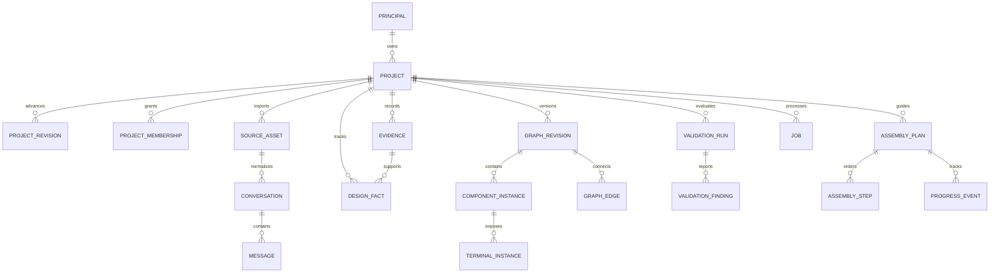
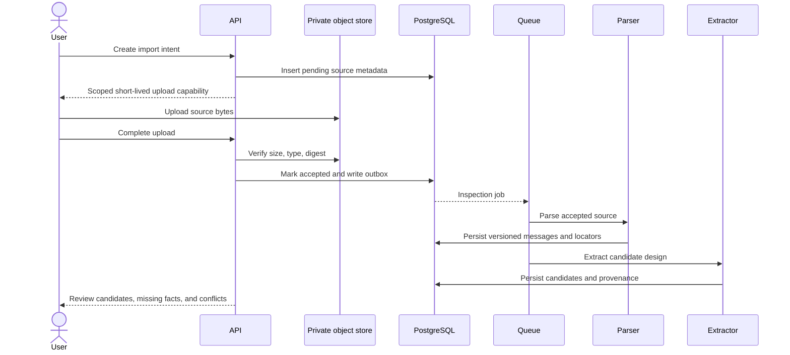

# Schemora — Technical Requirements Document

**Document status:** Working technical baseline; decisions marked “gate” require evidence before commitment  
**Version:** 1.0  
**Last reviewed:** 13 October 2026  
**Product authority:** PRD.md  
**Delivery plan:** Backend-DB-Implementation-Plan.md
**System design:** System-Design.md

## Document control

| Field                                               | Value                                                            |
| --------------------------------------------------- | ---------------------------------------------------------------- |
| Owner                                               | Engineering architecture owner (to be assigned)                  |
| Status                                              | Working technical baseline; named gates are unresolved decisions |
| Review cadence                                      | At architecture changes and before production release            |
| Source of product scope                             | PRD.md                                                           |
| Source of system-wide deployment and scale strategy | System-Design.md                                                 |
| Source of implementation sequence                   | Backend-DB-Implementation-Plan.md                                |
| Change rule                                         | Update the owning contract and record compatibility impact       |

## Contents

1. [Purpose and technical scope](#1-purpose-and-technical-scope)
2. [System context](#2-system-context)
3. [Architecture decisions and technology baseline](#3-architecture-decisions-and-technology-baseline)
4. [Logical architecture](#4-logical-architecture)
5. [Domain and versioning contracts](#5-domain-and-versioning-contracts)
6. [Persistence and object-storage design](#6-persistence-and-object-storage-design)
7. [Conversation ingestion and extraction](#7-conversation-ingestion-and-extraction)
8. [Catalog, graph, and deterministic validation](#8-catalog-graph-and-deterministic-validation)
9. [Assembly, teaching, firmware, and simulation](#9-assembly-teaching-firmware-and-simulation)
10. [API and event contracts](#10-api-and-event-contracts)
11. [Security, privacy, and data lifecycle](#11-security-privacy-and-data-lifecycle)
12. [Reliability and operations](#12-reliability-and-operations)
13. [Performance and compatibility](#13-performance-and-compatibility)
14. [Verification strategy](#14-verification-strategy)
15. [Technical acceptance requirements](#15-technical-acceptance-requirements)
16. [Repository and implementation boundaries](#16-repository-and-implementation-boundaries)
17. [Delivery sequence](#17-delivery-sequence)
18. [Open technical decisions](#18-open-technical-decisions)
19. [Change control](#19-change-control)

## 1. Purpose and technical scope

**Phase 1 execution note:** The repository now implements the conversation ingestion/review slice using a separate Fastify API, a worker entry point, PostgreSQL outbox plus leased job transport, private storage ports, and GitHub OAuth with PKCE/state. Local mode uses a visibly labeled development identity and conservative rule extraction. Production hosting, credentials, sandboxing, private S3 policy, and live provider quality remain evidence gates. [Phase-1-Implementation.md](Phase-1-Implementation.md) records the concrete delivery and limitations; this document continues to define the wider product contracts.

**Phase 2 implementation note:** The repository now includes the first source-backed catalog release, strict circuit graph and BB400 topology contracts, deterministic net derivation, immutable PostgreSQL graph/report snapshots, authenticated catalog/circuit API routes, and a ruleset limited to graph integrity, direct modeled power/ground shorts, LED orientation, and modeled resistor-path checks. Electrical unknowns remain unknown. Exact shipped scope, evidence, payloads, and limitations are recorded in [Phase-2-Implementation.md](Phase-2-Implementation.md); broader catalog, 3D workbench, assembly, and simulation requirements below are not implied to be implemented.

**Phase 4 implementation note:** The first assembly-generation slice adds a server-side deterministic planner gated on a current report for the exact saved graph, and a browser guide with explicit complete, skip, and navigation states. Plan provenance and unknown findings remain visible. Browser-local progress is not a durable project record. Exact implementation and remaining criteria are in [Phase-4-Implementation.md](Phase-4-Implementation.md).

This document defines the system boundaries and technical contracts required to deliver the product described in PRD.md. It explains how conversation content becomes a reviewable hardware design and how that design is represented, validated, rendered, and converted into assembly steps. It also sets the security, persistence, deployment, and verification constraints that the implementation must honor.

The product’s central technical risk is semantic correctness across boundaries. Conversation extraction, catalog facts, circuit connectivity, rendering, validation, and assembly guidance must all refer to the same versioned design. A 3D scene cannot be an independent source of connectivity; a model response cannot be treated as verified hardware data; and a simulator’s output cannot prove a physical circuit safe. The architecture is therefore contract-first and version-aware.

This is a technical baseline, not a claim that every vendor decision is closed. The initial stack follows context.md unless a concrete proof disproves a choice. Simulation provider, identity provider, object-storage service, queue service, and any commercial AI provider remain gated decisions.

## 2. System context

### 2.1 System context diagram



### 2.2 Trust boundaries

The browser is an untrusted client. It may submit typed commands, but it cannot assign authoritative project ownership, validation findings, catalog verification, or assembly completion.

The API is the authorization boundary for project data. It derives the principal from a trusted session, checks project scope, validates request schemas, and delegates domain operations. It does not expose database keys or private storage paths.

Workers process untrusted conversation files and provider output. Parser workers are isolated and resource-bounded. Provider adapters receive only policy-approved, task-relevant context. Worker output remains untrusted until schema, reference, and lifecycle checks pass.

The catalog is a reviewed source of hardware facts. Published releases are immutable and content-addressed. The renderer consumes semantic component and terminal identities plus asset anchors; it does not infer electrical meaning from geometry.

## 3. Architecture decisions and technology baseline

### 3.1 Initial deployment shape

Start with a TypeScript modular monolith and separate stateless web/API and worker process roles. Scale API replicas and worker pools independently, with durable queue/outbox delivery, bounded concurrency, and explicit resource limits. Keep domain modules and adapter interfaces explicit so that parsing, extraction, vision, or simulation can be isolated later if workload, security, or ownership evidence justifies it. System-Design.md is authoritative for workload dimensions, deployment topology, capacity strategy, failure behavior, and service extraction triggers. Do not begin with independently deployed microservices before evidence justifies their operational and distributed transaction costs.

### 3.2 Stack baseline

| Concern                    | Baseline                                                                       | Responsibility / boundary                                             |
| -------------------------- | ------------------------------------------------------------------------------ | --------------------------------------------------------------------- |
| Desktop web application    | Next.js, React, TypeScript                                                     | Routing, authenticated screens, project review, workbench shell       |
| UI primitives              | Tailwind CSS and shadcn/ui                                                     | Consistent accessible controls and panels                             |
| 3D view                    | Three.js, React Three Fiber, Drei                                              | Scene, camera, meshes, interaction hit targets, wire presentation     |
| Client state               | Zustand                                                                        | Ephemeral selection, camera, active step, draft interaction state     |
| Shared data contracts      | Zod schemas and TypeScript domain types                                        | Runtime request, response, event, job, and project validation         |
| Backend runtime            | Node.js and TypeScript                                                         | API and application services                                          |
| Relational persistence     | PostgreSQL with Drizzle                                                        | Ownership, project revisions, graph records, jobs, reports, audit     |
| File storage               | S3-compatible private object storage                                           | Conversations, photos, firmware, exports, and large immutable assets  |
| Editor                     | Monaco Editor                                                                  | Firmware viewing and editing where supported                          |
| Test tooling               | Vitest and Playwright                                                          | Domain, integration, and browser workflows                            |
| Workspace tooling          | pnpm workspaces                                                                | Shared packages and dependency control                                |
| Deployment                 | Vercel for web where suitable; separately hosted API/worker if needed          | Deployment choice must support worker isolation and production limits |
| Document/vision processing | TypeScript adapters first; Python/FastAPI only when measured workload warrants | Avoid introducing a second service runtime without a specific need    |
| Desktop packaging          | Tauri only after a validated native/offline need                               | Not part of initial product                                           |

Zod validates shape; it does not determine electrical correctness. The custom TypeScript rules engine handles domain validation. Zustand state is a client interaction model, not the durable circuit source of truth. A provider adapter isolates external API formats and lets the product benchmark alternatives.

### 3.3 Decisions that remain gated

| Decision                                      | Evidence required                                                                        | Until closure                                                 |
| --------------------------------------------- | ---------------------------------------------------------------------------------------- | ------------------------------------------------------------- |
| Exact ESP32 development board and first parts | Catalog source review, physical dimensions, pin map, and scenario acceptance             | No pin-accurate MVP claim                                     |
| Simulator integration                         | Supported peripheral proof, API or engine access, licensing, commercial terms, isolation | Simulation is unavailable or explicitly unsupported           |
| Identity provider                             | Stable subject IDs, session revocation, lifecycle, privacy, and recovery                 | Keep auth behind an interface; do not ship shared access      |
| Queue and object store provider               | Delivery, private access, lifecycle, integrity, restore, and regional requirements       | Use local/test adapters and provider-neutral ports            |
| Live AI/vision provider                       | Accuracy benchmark, retention terms, data region, cost, and privacy review               | Use fake adapters in tests; do not transmit real user content |
| Quantitative SLOs and performance budgets     | Baseline user/device/load measurements                                                   | Report measurements without unsupported claims                |

## 4. Logical architecture



### 4.1 Module ownership

| Module             | Canonical responsibility                                   | Explicitly does not own            |
| ------------------ | ---------------------------------------------------------- | ---------------------------------- |
| Project            | Ownership, membership, lifecycle, revision head            | Source bytes, hardware definitions |
| Source             | Upload intents, object metadata, parser lifecycle          | Confirmed design facts             |
| Conversation       | Normalized messages and source locators                    | Electrical truth                   |
| Evidence/design    | Candidates, confirmed facts, conflicts, review actions     | Catalog publication                |
| Catalog            | Reviewed versioned board/component/pin/package/asset facts | User placement or project graph    |
| Graph              | Component instances, terminals, edges, graph revisions     | Validation findings                |
| Validator          | Versioned rules, immutable run and findings                | Graph mutation                     |
| Planner            | Immutable ordered operations and server-evaluated progress | Independent redesign of circuit    |
| Tutor adapter      | Minimized context and explanatory response metadata        | Canonical project truth            |
| Simulation adapter | Run identity, normalized outputs, capability mapping       | Physical safety certification      |
| Job platform       | Job lifecycle, attempts, leases, outbox and retries        | Business acceptance of output      |

## 5. Domain and versioning contracts

### 5.1 Identity model

Public identifiers are opaque, server-generated values. An identifier is never authorization by itself. Every project-owned record is queried with project scope, even if its ID appears globally unique. Catalog IDs remain stable across releases; a project pins a specific release or digest so that its pin map and component facts do not silently change.

All timestamps are UTC instants. Physical measurements carry units. Unknown, conflicting, unsupported, and not-applicable are distinct states. SQL null is reserved for fields whose schema explicitly defines absence semantics.

### 5.2 Project revision

A project revision is an immutable snapshot envelope with a parent reference, project-local sequence, schema version, content digest, actor, timestamp, and references to immutable artifacts. The project row points to the current accepted revision. Updating the project and advancing that pointer occurs in one transaction.

Canonical serialization defines field order, numeric normalization, unit representation, and omitted-versus-null behavior before a digest is calculated. A no-op command may return the existing revision only if canonical content is unchanged and the API communicates that no new revision was created. A stale expected revision returns conflict; graph and evidence changes are never resolved through silent last-write-wins.

### 5.3 Core state distinctions

| State            | Stored meaning                                             | Permitted transition                                        |
| ---------------- | ---------------------------------------------------------- | ----------------------------------------------------------- |
| Candidate        | Proposed by parser, model, import, or user draft           | Accept, reject, correct, or retain unresolved               |
| Confirmed        | Accepted by user or approved deterministic process         | Supersede only through a new recorded action                |
| Catalog-verified | Supported by the pinned reviewed catalog release           | Changes only through a catalog release or project migration |
| Unknown          | Required value is absent or not sufficiently evidenced     | Resolve with evidence or explicit user assertion            |
| Conflicting      | Multiple incompatible candidates remain                    | Resolve through an explicit review action                   |
| Unsupported      | Outside current catalog, rule, or simulator coverage       | Remain blocked or use an explicitly weaker workflow         |
| Stale            | A derived output's input digest differs from current state | Recompute; never mutate the historical artifact             |

### 5.4 Version binding

| Artifact                | Required version references                                                          |
| ----------------------- | ------------------------------------------------------------------------------------ |
| Normalized conversation | Source digest, parser version, normalization schema                                  |
| Extracted candidate set | Conversation ID, provider/model policy, extraction schema, prompt/task version       |
| Catalog package         | Release, schema, content digest, source/review record                                |
| Graph revision          | Project revision, graph schema, catalog release and digest                           |
| Validation report       | Graph digest, catalog digest, ruleset version, validator build, profile              |
| Assembly plan           | Graph revision, validation run, catalog release, procedure version, plan schema      |
| Simulation result       | Graph digest, firmware artifact digest, catalog release, engine and adapter versions |

No consumer may treat “latest” as an adequate version reference for a historical artifact.

## 6. Persistence and object-storage design

### 6.1 Storage boundary

PostgreSQL holds identity mappings, project ownership, revisions, typed facts, graph records, lifecycle state, jobs, validation findings, plan progress, audit events, and object metadata. Object storage holds large source files, photos, firmware bytes, exports, and immutable binary assets. Object keys are opaque and private; access is mediated by authorized metadata records and short-lived, action-scoped capabilities.

Small relationally queried facts belong in normalized columns and tables. JSON is appropriate for bounded, schema-versioned snapshots and typed payloads whose inner structure is versioned as a domain document. Frequently filtered state must not be hidden in an unindexed blob.

### 6.2 Logical entity relationship



### 6.3 Relational entities

| Entity                        | Key fields                                                                  | Integrity and lifecycle                                                   |
| ----------------------------- | --------------------------------------------------------------------------- | ------------------------------------------------------------------------- |
| Principal                     | application ID, issuer, provider subject, lifecycle                         | Unique issuer/subject; credential material remains with identity provider |
| Project                       | owner, title, lifecycle, current revision, catalog release                  | Owner required while active; project scope is included in child access    |
| Project revision              | project, sequence, parent, schema, digest, snapshot                         | Immutable; project and sequence unique                                    |
| Source asset                  | project, uploader, object key, detected type, size, digest, retention state | Parser can read only accepted objects                                     |
| Conversation/message          | parser/schema versions, ordered messages, source locator                    | Immutable normalized output; source text follows retention policy         |
| Evidence/fact/issue           | origin, typed value, knowledge state, evidence reference, review history    | Candidates never overwrite confirmed facts implicitly                     |
| Catalog release/component/pin | release digest, stable identity, physical pin, capabilities, sources        | Published release is immutable and reviewed                               |
| Graph revision/entity/edge    | project, semantic endpoints, placement, graph digest                        | Endpoints must resolve within project and pinned catalog                  |
| Validation run/finding        | exact input digests, ruleset, build, result, evidence                       | Report is immutable; unknown differs from fail and pass                   |
| Assembly plan/step/progress   | input versions, prerequisite graph, predicate, progress event               | Predicate evaluated server-side; projection is rebuildable                |
| Job/attempt/outbox            | type, payload version, idempotency, lease, outcome                          | Domain write and outbox intent share a transaction                        |
| Audit event                   | actor, action, target, time, correlation, digests                           | Append-only to application roles; no source body                          |

### 6.4 Required constraints and indexes

The database enforces project/revision uniqueness, same-project parentage, membership uniqueness, stable message order, idempotency scope, and job attempt order. Where a composite foreign key cannot express the invariant, the repository validates it inside the transaction and tests it explicitly.

Initial index candidates include project owner and update time; membership principal and project; revision project and sequence; source project and lifecycle; message conversation and sequence; issue project and state; graph project and revision; validation input digest; job state and availability; and unpublished outbox time. Indexes are accepted only after the query they serve and their write/storage cost are reviewed.

### 6.5 Transactions

A project mutation validates the caller and expected revision, loads canonical state, applies a domain command, writes the immutable revision, advances the current pointer, and inserts audit/outbox records in one bounded transaction. No remote call occurs while that transaction is open.

An object upload uses a staged lifecycle because object storage cannot share a database transaction: create intent, upload to a private key, verify actual bytes and digest, mark accepted, then enqueue inspection through an outbox record. Orphaned pending objects are reconciled conservatively.

### 6.6 Relational field and constraint baseline

The following field map is the first migration baseline. Physical SQL types may be adjusted to the selected PostgreSQL version, but the semantics and constraints are required. Primary identifiers are opaque application-generated IDs; internal sequence values may be used for ordering but are not exposed as authorization tokens.

| Table               | Required fields                                                                                                                                   | Constraints and indexes                                                          |
| ------------------- | ------------------------------------------------------------------------------------------------------------------------------------------------- | -------------------------------------------------------------------------------- |
| principals          | principal_id, issuer, provider_subject, lifecycle_state, created_at, updated_at                                                                   | Unique issuer/provider_subject; lifecycle index for cleanup                      |
| projects            | project_id, owner_principal_id, title, lifecycle_state, current_revision_id, catalog_release_id, created_at, updated_at                           | Owner required for active state; owner/lifecycle/updated index                   |
| project_memberships | project_id, principal_id, role, membership_state, invited_by, created_at, revoked_at                                                              | Unique project/principal; revoked membership is not an authorization grant       |
| project_revisions   | revision_id, project_id, revision_number, parent_revision_id, schema_version, content_digest, snapshot_payload, change_kind, actor_id, created_at | Unique project/revision_number; parent and current revision must share project   |
| source_assets       | source_asset_id, project_id, object_key, declared_type, detected_type, byte_size, digest, upload_state, retention_class, created_at               | Unique object key; index project/state/created; parser reads only accepted state |
| conversations       | conversation_id, project_id, source_asset_id, parser_version, schema_version, content_digest, parse_state, created_at                             | Source and project scope validated; immutable per parser output                  |
| messages            | message_id, conversation_id, project_id, sequence_number, speaker_kind, source_locator, body_text, body_digest, ingested_at                       | Unique conversation/sequence; no default full-text index                         |
| evidence_records    | evidence_id, project_id, origin_kind, source/message reference, source_span, evidence_digest, review_state, created_at                            | Source references must resolve in same project                                   |
| design_facts        | fact_id, project_id, fact_key, value_type, value_payload, knowledge_state, evidence_id, supersedes_id, created_at                                 | Runtime schema per type; candidate cannot overwrite confirmed fact implicitly    |
| graph_revisions     | graph_revision_id, project_id, project_revision_id, graph_sequence, catalog_release_id, graph_digest, schema_version, created_at                  | Unique project/graph_sequence; immutable after commit                            |
| graph_edges         | edge_id, project_id, graph_revision_id, edge_kind, source_terminal_id, target_terminal_id, attributes                                             | Endpoints resolve in same project and revision                                   |
| validation_runs     | run_id, project_id, graph_revision_id, input_digest, catalog_release_id, ruleset_release_id, validator_build, run_state, created_at               | Immutable semantic inputs; index project/created and input digest                |
| validation_findings | finding_id, run_id, rule_id, result_state, severity, affected_refs, evidence_refs, finding_digest                                                 | Rule must exist in bound ruleset; immutable after completion                     |
| assembly_plans      | plan_id, project_id, graph_revision_id, validation_run_id, procedure_version, plan_digest, payload, created_at                                    | Immutable and version-bound                                                      |
| jobs                | job_id, project_id, job_type, payload_version, payload, idempotency_key, request_digest, state, attempts, available_at, lease_expires_at          | Unique scoped idempotency; claim index on state/available_at                     |
| outbox_events       | event_id, aggregate_type, aggregate_id, event_type, event_version, payload, dedupe_key, created_at, published_at                                  | Unique dedupe key; index unpublished rows                                        |
| audit_events        | audit_event_id, actor, project_id, action, target, before_digest, after_digest, correlation_id, created_at                                        | Append-only to application role; payload excludes source body                    |

### 6.7 Canonical serialization example

The snapshot below is illustrative. The schema must be versioned, and every catalog identity must resolve against the project’s pinned release. Display labels are not keys. A missing voltage is represented with an explicit knowledge state rather than an invented numeric value.

```json
{
  "schemaVersion": 1,
  "projectId": "prj_example",
  "catalogRelease": {
    "releaseId": "cat_2026_01",
    "digest": "sha256:example"
  },
  "facts": [
    {
      "factId": "fact_board",
      "kind": "board.model",
      "state": "confirmed",
      "value": { "catalogComponentId": "board_exact_model" },
      "evidenceIds": ["evidence_42"]
    },
    {
      "factId": "fact_supply",
      "kind": "supply.voltage",
      "state": "unknown",
      "reason": "not_stated"
    }
  ],
  "graphRevisionId": "graph_7",
  "firmwareArtifactId": null
}
```

## 7. Conversation ingestion and extraction

### 7.1 Ingestion pipeline



### 7.2 Parser behavior

Each accepted file format has a specific adapter and fixture set. Initial candidates are HTML, Markdown, plain text, PDF, and supported structured JSON exports; archives are accepted only with bounded extraction and a safe file allowlist. A parser records message order, speaker where recoverable, timestamps where trustworthy, code blocks, attachment references, and source locators. If only partial text is recoverable, the system preserves a partial result with warnings rather than implying complete import.

Archive handling rejects path traversal, symlink escape, excessive nesting, excessive entry count, and decompression beyond configured limits. HTML is parsed as inert content; scripts are not executed. Parser workers have bounded memory, CPU, disk, and time, and no general network egress.

### 7.3 Extraction contract

The extraction model proposes structured data: project summary, board candidates, component instances, quantities, pin-level connections, firmware references, dependencies, missing facts, and conflicts. Each candidate field carries its source message and span where possible, extraction run, and review state. A server-side validator rejects unknown message IDs, malformed terminal references, unsupported units, and unbounded output.

Conversation history may include superseded designs. The extraction process must identify the apparent final proposal while retaining earlier alternatives as provenance. If the final choice is ambiguous, it asks the user to resolve it. The model may rank interpretations but cannot invent board revisions, resistor values, pin capabilities, or validation outcomes.

### 7.4 Provider boundary

Provider requests are created server-side from the smallest relevant message set. Imported conversation content is untrusted data and is clearly separated from system instructions. The model has no ability to mutate the project, retrieve arbitrary resources, or choose a network destination. Provider terms, retention, region, model version, cost ceilings, and privacy review are release gates. Test and benchmark workflows use synthetic fixtures and fake adapters by default.

### 7.5 Extraction output contract

Each candidate item carries a typed value and a provenance locator. The service rejects a candidate whose source message is absent, whose terminal cannot be resolved, or whose value violates the schema. Candidate confidence is optional diagnostic metadata; it cannot set confirmation or verification state.

```json
{
  "schemaVersion": 1,
  "sourceConversationId": "conv_example",
  "components": [
    {
      "candidateId": "cand_board",
      "catalogQuery": "ESP32 development board",
      "exactCatalogId": null,
      "quantity": 1,
      "source": { "messageId": "msg_8", "span": { "start": 12, "end": 40 } },
      "reviewState": "candidate"
    }
  ],
  "connections": [
    {
      "candidateId": "cand_wire_1",
      "from": { "componentRef": "board_1", "terminalRef": "GPIO18" },
      "to": { "componentRef": "led_1", "terminalRef": "anode" },
      "sourceMessageIds": ["msg_12"],
      "state": "candidate"
    }
  ],
  "unresolved": [{ "kind": "exact_board_model", "sourceMessageIds": ["msg_8"] }]
}
```

## 8. Catalog, graph, and deterministic validation

### 8.1 Catalog package

Each catalog release contains stable component identities, versioned facts, board pins, terminals, package geometry, breadboard topology, asset references, anchor coordinates, aliases, citations, and license metadata. Facts use explicit units and distinguish absolute maximum ratings from recommended operating conditions. Unknown values remain unknown. A publication pipeline validates schema, links, units, ranges, duplicate physical pin indexes, asset digests, coordinate frames, source citations, and required human approvals.

Projects pin a release. A catalog update does not change an existing project silently. Migration creates a new project revision, maps identities explicitly, reports unsupported mappings, and re-runs affected validation.

### 8.2 Circuit graph

The graph is the canonical electrical state. A component instance refers to a stable catalog component version and exposes semantic terminal instances. A graph edge connects two terminals or represents an explicitly modeled relation. Placement, camera state, mesh geometry, and wire appearance are presentation data and cannot alter electrical identity.

Breadboard connectivity is defined by a versioned topology: hole coordinates map to internal nodes, including segmented rails and disconnected regions. Net membership is derived deterministically from graph edges and catalog topology. The client may receive derived net data, but cannot submit it as authoritative truth.

### 8.3 Graph command lifecycle

A typed command such as place, move, connect, disconnect, or remove includes expected project and graph revisions plus an idempotency key. The server verifies each referenced component and terminal belongs to the project and pinned catalog. It applies the command to a canonical graph model, computes a stable graph digest, creates a new immutable graph revision, advances the project revision, and emits invalidation events in one transaction. A stale command returns conflict without partial changes.

Undo is a new inverse command with preconditions; it never deletes prior graph history. Redo is permitted only while the original preconditions remain valid.

### 8.4 Validation interface

A ruleset is a reviewed immutable release. A validation run binds the graph digest, catalog digest, ruleset version, validator build, and selected profile. Findings have stable rule IDs, result state, severity, affected entities, and supporting evidence. The minimum result vocabulary is pass, fail, unknown, not applicable, and execution error. Execution error is not an electrical finding.

Rules can cover invalid pins, missing required connections, shorts established by the model, polarity, voltage incompatibility, GPIO capability, and known LED/resistor constraints. A rule may only assert what its inputs support. Readiness aggregation is policy-versioned and cannot convert unknown into pass. A report remains immutable when the graph changes; it is marked stale against current state.

## 9. Assembly, teaching, firmware, and simulation

### 9.1 Assembly plan

The planner consumes a verified graph, catalog topology, required design facts, and applicable validation report. It produces typed operations with stable step IDs, target component and terminal references, prerequisites, camera targets, highlights, safety notes, and completion predicates. Ordering is deterministic for the same versioned inputs. Independent actions may be presented flexibly when prerequisites permit.

Progress is recorded as user actions plus server-evaluated predicate results. “Next” does not mark a step complete. A graph change invalidates only predicates that depend on changed inputs; prior progress history remains available.

### 9.2 Teaching behavior

The initial teaching layer uses curated explanations for component and electrical concepts. A quick instruction shows the action; a beginner explanation states why it matters; an expert detail view exposes documented capabilities and source references. Common validation findings should have deterministic explanations. A tutor model may explain open-ended questions only from minimized, authorized context containing the current step, confirmed facts, relevant findings, and approved documentation. Tutor responses are guidance, not project truth.

**Phase 5 implementation note:** The first slice adds a pure deterministic teaching package and Quick/Beginner/Detailed panel to the assembly guide. It validates lesson sources and claim tuples against the exact catalog release and withholds stale or mismatched graph/report context. Firmware behavior remains unknown because no firmware is modeled. No tutor model is integrated. Beginner study remains a required acceptance gate. See [Phase-5-Implementation.md](Phase-5-Implementation.md).

### 9.3 Firmware and simulation

Firmware artifacts are immutable versions stored in private object storage and associated with a project revision. The web server never executes uploaded firmware. Static analysis, compilation, or simulation runs in bounded isolated workers.

A simulator adapter is provider-neutral and maps our normalized circuit representation to a supported engine. It reports exact engine and model versions, normalized output, unsupported component coverage, limits, and errors. Simulation is enabled only after commercial rights, API access, supported board/peripheral coverage, isolation, and repeatable reference results are demonstrated. Simulated behavior is not represented as proof of real-world safety.

**Phase 6 implementation note:** `packages/simulation` provides versioned firmware/run/event contracts, digest binding, fail-closed provider coverage checks, graph-bound event validation, output quotas, an explicit unavailable run, and a narrow graph-derived mapper for an exact ESP32 GPIO19/resistor/LED/ground path. It now also defines a versioned multi-file Arduino CLI/ESP-IDF bundle contract with strict project paths, target identity, deterministic manifest digest, and per-file source digest verification; the existing API, persistence, and editor still store one file per artifact. The official Espressif QEMU POC remains UART-only. A reproducible harness builds the pinned PICSimLab QEMU fork and verifies UART plus GPIO19 events delivered through the fork's registered host-callback ABI; a cross-package integration proof replays the captured trace through graph mapping, run-contract validation, and fail-closed scene-state resolution. The API now stores immutable UTF-8 firmware source versions in private storage, derives SHA-256 and board/catalog binding server-side, records append-only accept/reject decisions, verifies authorized source downloads, and includes firmware bytes in project deletion. Artifact `projectRevision` records source provenance; run binding independently captures the exact graph and firmware digests. The 3D scene has a fail-closed LED consumer. A durable run API now captures immutable inputs, but the worker still returns SIMULATOR_UNAVAILABLE and supplies no run output to the scene, so this is not a live browser update. The firmware workspace provides locally bundled Monaco authoring, immutable version/review flow, graph association from revision snapshots, stored run history and serial events, run creation, queued-run cancellation, and a coverage/limitations view. Migration `0009` and persistence APIs now provide durable attempt fencing and same-transaction replay claim plus run/job update for a caller-verified signed response. The worker package now exposes an `acceptRunnerResponse` boundary that verifies a signed response against a current lease-bound attempt and trusted profile/image identity before calling persistence; it is not connected to an HTTP transport or job path, and there is no dispatch path. Initial license/maintenance screening permits the fork only for an isolated internal reference POC; production distribution/hosting remains blocked pending a complete source and binary inventory, legal review, commercial rights where needed, and a named maintenance owner. Source compilation and diagnostics, multi-file project persistence/editor support, active-run controls, code-to-component links, production worker isolation, provider execution through the run API, and live end-to-end scene verification remain incomplete. No full circuit simulator is approved or enabled. See [Phase-6-Implementation.md](Phase-6-Implementation.md).

## 10. API and event contracts

### 10.1 API conventions

All project resources require authenticated server-side authorization. Mutations validate runtime schemas and use expected revision and idempotency behavior where applicable. Timestamps are UTC. Responses include request ID, resource version, data, and typed warnings. Errors include stable code, retryability, correlation ID, and safe field errors. The API never returns object keys, stack traces, provider payloads, or database diagnostics.

| Resource            | Read operations                            | Mutation / command operations                 |
| ------------------- | ------------------------------------------ | --------------------------------------------- |
| Projects            | List, summary, revisions                   | Create, metadata update, archive, delete      |
| Imports             | Status, normalized message page            | Create intent, complete upload, retry, cancel |
| Design              | Facts, evidence summary, issues            | Accept/reject/correct fact, resolve issue     |
| Catalog             | Release list, search, component/pin detail | Draft, validate, review, publish (admin only) |
| Graph               | Snapshot and derived connectivity          | Typed graph command, undo                     |
| Validation          | Run status, report, finding page           | Request validation                            |
| Assembly            | Plan, progress, plan diff                  | Generate plan, submit progress action         |
| Firmware/simulation | Artifact and run status/output             | Upload artifact, request/cancel supported run |
| Export              | Export status/download                     | Request export with explicit data scope       |

### 10.2 Events and jobs

Jobs and events are versioned and contain references, not source bytes or credentials. The project mutation and outbox intent commit together. Queue delivery is treated as at least once. Workers validate payload versions, claim a bounded lease, recheck project lifecycle and source retention, perform bounded work, and persist output idempotently. Cancellation prevents unapplied stale results from mutating current state. Unsupported payload versions are quarantined and observable.

### 10.3 Request and response envelope

Every mutation includes a request identifier, expected project revision when the operation changes canonical state, and an idempotency key when the caller may retry after a timeout. The key is scoped to principal, project, and operation; reusing it with a different canonical request digest returns conflict. A response reports the committed resource version. It does not imply that asynchronous work has completed.

```json
{
  "requestId": "req_example",
  "expectedRevision": "rev_17",
  "idempotencyKey": "idem_example",
  "command": {
    "kind": "connect_terminals",
    "sourceTerminalId": "terminal_a",
    "targetTerminalId": "terminal_b"
  }
}
```

```json
{
  "requestId": "req_example",
  "resourceVersion": "rev_18",
  "data": {
    "graphRevisionId": "graph_9",
    "graphDigest": "sha256:example",
    "derivedState": "validation_stale"
  },
  "warnings": []
}
```

Errors use stable machine-readable codes. A revision conflict returns no partial mutation and provides only the caller’s authorized current revision reference. A transient provider outage is retryable; malformed input, unsupported hardware, and authorization denial are not retried automatically.

## 11. Security, privacy, and data lifecycle

The application derives principal identity from a trusted session. Project authorization is checked before loading nested resources. Storage access is issued only after checking the source metadata under the same project scope. Catalog administration uses a distinct permission. Support access to private content is disabled by default; any break-glass access is time-bounded, justified, and audited.

Source conversations, firmware, and photos are private user data. Provider requests are minimized and governed by a documented retention and processing review. Secrets are held in a secret manager and never serialized to browser state, job payloads, logs, or build artifacts. TLS protects service communication; database, object, and backup encryption is required.

Deletion first revokes ordinary access and prevents new work. Workers recheck source lifecycle before reading or applying output. Cleanup covers source bytes, normalized text, evidence excerpts, derived exports, caches, and queued work according to retention policy. Backups expire on a separate schedule; restoration reapplies deletion records before the recovered project is exposed.

## 12. Reliability and operations

| Dependency failure | Required product behavior                                                               |
| ------------------ | --------------------------------------------------------------------------------------- |
| AI provider        | Preserve source and project; allow manual review; show retryable unavailable state      |
| Catalog package    | Permit conversation review; block pin-accurate assembly and validation that requires it |
| Validator          | Permit graph inspection; do not claim readiness                                         |
| 3D renderer        | Provide semantic list or schematic path without changing graph                          |
| Simulator          | Preserve design and firmware; mark simulation unavailable or unsupported                |
| Object storage     | Do not report upload accepted until bytes are verified                                  |
| Database           | Do not report a mutation saved until transaction commits                                |
| Queue              | Persist job intent through outbox; expose pending status and apply backpressure         |

### 12.1 Observability

Logs contain timestamp, service, version, operation, result code, duration, correlation ID, and safe job identifiers. Ordinary logs and metrics exclude conversation text, firmware, images, tokens, storage keys, and full provider payloads. Metrics cover import outcomes, queue age, provider errors, validation duration and state counts, revision conflicts, object-integrity errors, deletion backlog, and 3D fallback. Alerts have an owner and runbook.

### 12.2 Recovery

Recovery point and recovery time objectives must be approved before production and measured in rehearsal. Backups include database schema version, object inventory or version references, catalog package digests, and key-version information. Restore occurs in isolation, verifies project revision and object digests, rebuilds projections, reconciles jobs and outbox, reapplies deletion records, and records the observed data gap before traffic is restored.

## 13. Performance and compatibility

The team will define numeric budgets using an agreed baseline laptop, browser, viewport, graphics capability, representative project, and network. The renderer loads only assets used by the current project, limits pixel ratio and expensive effects, disposes resources on route exit, and supports context-loss recovery. The application remains usable through a semantic non-3D path.

API responses and jobs are bounded and paginated. Provider work and large file processing are asynchronous. Database connection and worker concurrency are capped across replicas. Queue backpressure prevents unlimited accumulation. Read replicas, if introduced, cannot serve stale authorization decisions or mutation preconditions without an explicit freshness guarantee.

Browser, API, job, event, JSON payload, catalog, and ruleset versions are independent. Rolling deployments test compatibility between active producers and consumers. Breaking contracts require a migration and deprecation window; unknown security-critical values fail closed.

## 14. Verification strategy

| Layer             | What it proves                                                                           |
| ----------------- | ---------------------------------------------------------------------------------------- |
| Domain unit tests | State transitions, graph operations, digest stability, breadboard mapping, rule outcomes |
| Repository tests  | Constraints, scoped queries, concurrency, transactions, pagination, retention            |
| Contract tests    | API schemas, events, job payloads, provider and storage adapters                         |
| Integration tests | Database, queue, object storage, outbox, and worker behavior                             |
| End-to-end tests  | Conversation upload through reviewed design, workbench, validation, and deletion         |
| Visual tests      | Pin hit targets, anchors, wire overlays, camera focus, fallback rendering                |
| Security tests    | Cross-project access, hostile files, archive limits, prompt injection, secret redaction  |
| Usability tests   | Beginner comprehension, completion, errors, and physical reproduction                    |
| Recovery tests    | Migration, backup restore, deletion replay, duplicate job delivery, dependency outage    |

Fixtures are synthetic or explicitly authorized. Every validation fixture pins catalog and ruleset versions. The benchmark reports results by format, fact type, and fault class; aggregate accuracy must not conceal an unsafe class-specific failure.

## 15. Technical acceptance requirements

| ID     | Requirement                                                              | Verification evidence                           |
| ------ | ------------------------------------------------------------------------ | ----------------------------------------------- |
| TR-001 | Browser state is not canonical project state                             | Reload and concurrent-session tests             |
| TR-002 | Every project mutation is authorized and revision-aware                  | Route-level cross-project and stale-write tests |
| TR-003 | Every extracted candidate retains provenance and review state            | Extraction fixture audit                        |
| TR-004 | Exact assembly requires exact supported catalog identity                 | Unknown-board and ambiguous-model tests         |
| TR-005 | Graph connectivity is deterministic for versioned inputs                 | Permutation and golden fixture tests            |
| TR-006 | Unknown and execution failure are distinct from pass/fail                | Rule and API contract tests                     |
| TR-007 | Validation and plan artifacts are immutable and version-bound            | Input digest and stale-result tests             |
| TR-008 | Worker retry and duplicate delivery are safe                             | Crash and replay integration tests              |
| TR-009 | Source content is excluded from routine telemetry                        | Log and trace inspection                        |
| TR-010 | Deletion blocks reads before asynchronous purge                          | End-to-end deletion tests                       |
| TR-011 | Simulation is gated by licensing, coverage, and isolation evidence       | Decision record and reference run               |
| TR-012 | 3D interaction has a semantic fallback                                   | Browser capability and keyboard test            |
| TR-013 | Production migration and restore procedures are rehearsed                | Signed operational evidence                     |
| TR-014 | Every release identifies artifact, schema, catalog, and ruleset versions | Release record audit                            |

## 16. Repository and implementation boundaries

The proposed monorepo contains the web application, API entry point, worker entry point, domain package, shared contracts, persistence adapter, object-storage adapter, catalog package, graph engine, validator, provider adapters, test fixtures, migrations, and runbooks. Domain code does not import route frameworks or ORM models. Route handlers do not call provider SDKs directly. ORM models are not serialized as public API responses.

| Package / process    | Owns                                                     | Must not depend on                                   |
| -------------------- | -------------------------------------------------------- | ---------------------------------------------------- |
| Web client           | Screen state, scene projection, user commands            | Database, provider secrets, authoritative validation |
| API routes           | HTTP parsing, authentication middleware, serialization   | Direct provider SDK calls or unscoped ORM access     |
| Application services | Use-case policy, transaction boundary, authorization     | UI framework details                                 |
| Domain packages      | State transitions, graph semantics, validation contracts | HTTP framework and database model classes            |
| Persistence package  | Repositories, migrations, transaction helpers            | Browser-facing response contracts as ORM entities    |
| Worker process       | Durable job handlers and bounded async operations        | Public route internals or unrestricted network       |
| Provider adapters    | External protocol and normalization                      | Project authorization decisions                      |
| Catalog package      | Immutable hardware facts and validation                  | Renderer-specific naming as canonical identity       |

The modular monolith remains the initial code and domain ownership choice; it is deployed as independently scalable stateless web/API and worker roles. A new network service boundary is justified only when isolation, scaling, or ownership evidence outweighs operational complexity. See System-Design.md for explicit triggers and migration requirements. Python is introduced only if document or vision workloads demonstrate a clear benefit and the service contract remains language-neutral.

## 17. Delivery sequence

| Stage                   | Technical exit                                                                                 |
| ----------------------- | ---------------------------------------------------------------------------------------------- |
| Foundation              | Repository, schemas, local bootstrap, relational platform, migration and dependency decisions  |
| Project and source      | Authorization, revisions, private upload, parser isolation, normalized messages, outbox        |
| Evidence                | Candidate extraction, provenance, conflict handling, review actions, deletion semantics        |
| Catalog and graph       | Reviewed first catalog release, exact pin anchors, graph commands, deterministic connectivity  |
| Validation and assembly | Immutable findings, unknown states, plan predicates, progress invalidation                     |
| Optional capabilities   | Tutor, simulation, and vision individually enabled only after their gates pass                 |
| Production              | Performance, security, backup/restore, deletion, monitoring, deployment, and support rehearsal |

This is a dependency order, not a mandate to complete every optional feature before proving the core experience. The first vertical slice integrates conversation import, review, the narrow catalog, pin-level wiring, an assembly sequence, and fault feedback.

## 18. Open technical decisions

| ID    | Decision                                       | Required owner / evidence                                               |
| ----- | ---------------------------------------------- | ----------------------------------------------------------------------- |
| TD-01 | Exact first board and supported LED circuit    | Product and hardware reviewer; datasheet and physical fixture           |
| TD-02 | Identity provider and sharing model            | Product/security; lifecycle and revocation proof                        |
| TD-03 | Production object storage and queue            | Operations; privacy, integrity, lifecycle, recovery, and delivery proof |
| TD-04 | Extraction provider and retention terms        | Product/security; benchmark and contract review                         |
| TD-05 | Simulation integration                         | Engineering/legal; commercial rights, API proof, supported behavior     |
| TD-06 | Numeric performance and reliability objectives | Product/operations; baseline measurements                               |
| TD-07 | Initial supported import formats               | Product/engineering; user demand and parser cost                        |
| TD-08 | Project retention and deletion periods         | Product/privacy; data inventory and policy approval                     |

## 19. Change control

The PRD owns user outcomes and product scope. This document owns system behavior and technical contracts. The Backend & DB Implementation Plan owns implementation order, schema execution, and operational work. A change that crosses these boundaries updates the owning document and relevant traceability references.

Technical requirements use identifiers TR-001 through TR-014. Open decisions use TD-01 onward. A requirement is verified only when evidence names the tested artifact, environment, and relevant schema/catalog/ruleset versions. The documents intentionally do not claim that a proposed provider, safety model, or performance target is approved until its decision gate is closed.
