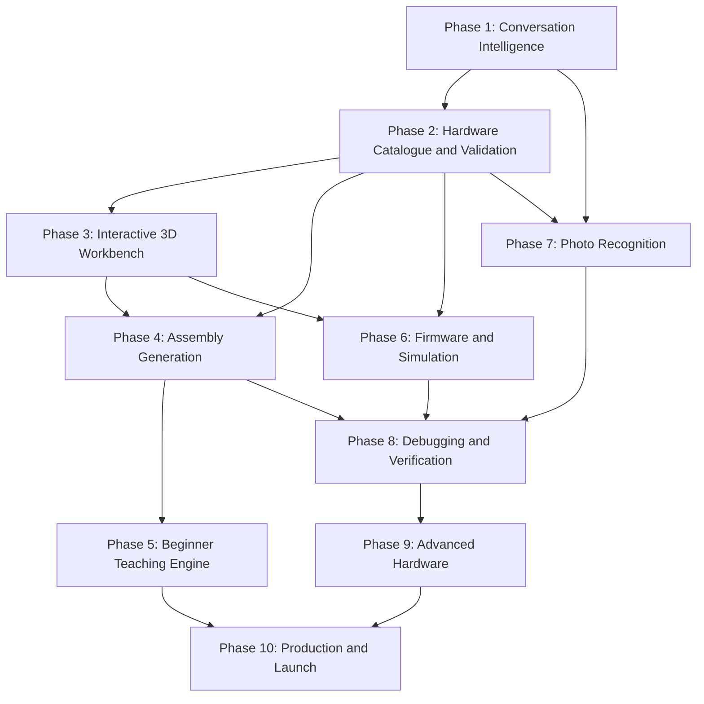

# Virtual Hardware Lab

**User:** Anonymous  
**Created:** 10/13/2026 12:24:36  
**Updated:** 10/13/2026 14:02:47  
**Exported:** 10/13/2026 14:03:58  
**Link:** [https://chatgpt.com/c/6acdd5aa-3ea8-83ee-aa33-8bd0739ac640](https://chatgpt.com/c/6acdd5aa-3ea8-83ee-aa33-8bd0739ac640)  

## Prompt:
10/13/2026, 12:24:57 PM

broooo seee i have a idea like i went in the robofest hackathon finals but i had 0 fuckin knowledge abt the hardware studf and alll like i knew nothing so like i wanna build a virtual environment where i can upload the photo of my hardware and like i can actuallly  make the connections and join wires and alll like properly virtuallll it should be demonstrated ....something like that

## Response:
10/13/2026, 12:25:00 PM · gpt-6

> **Searched 4 websites**
>
> 
>
> Worked for 10s

BROOOOO 😭🔥 Wait, this is actually a genuinely useful product idea — especially because you experienced the exact problem at Robofest finals.

You knew how to build software, but when the project required physical hardware, wiring, components, and troubleshooting, there was a whole different skill set you needed. Imagine building a platform that lets you learn and experiment with hardware **before you ever touch the real components.**

The key is to make it more than a 3D electronics viewer. It should be an interactive hardware lab where you can build, connect, simulate, break things, and learn.

# The idea: a virtual hardware engineering lab

Working concept: **WireForge** — an interactive 3D environment for building and testing hardware projects virtually.

image_group{"query":["interactive 3D electronics workbench breadboard Arduino ESP32 jumper wires components realistic","3D electronics circuit simulator virtual breadboard wires components desktop interface","realistic electronics engineering virtual laboratory 3D workbench microcontroller"],"aspect_ratio":"5:4","layout":"bento"}

Imagine opening the platform and doing this\:

1. Upload a photo of your ESP32, breadboard, sensors, motors, or other components.
2. The AI identifies the components and asks you to confirm anything it cannot recognize.
3. Your components appear on a virtual workbench.
4. You drag them around, rotate them, and place them on a breadboard.
5. You grab a jumper wire, click a pin, and physically drag the other end to another pin.
6. The system checks whether the connection is correct.
7. You power on the circuit and run a simulation.
8. If something is wrong, the system explains the fault and teaches you how to fix it.

You would essentially have a **virtual electronics workbench + circuit simulator + AI hardware tutor** in one application.

## What would make this product special?

The individual capabilities already exist in different tools. The opportunity is to combine them into one workflow that starts with the hardware a person actually owns.

image_group{"query":["Tinkercad Circuits virtual Arduino breadboard circuit simulator screenshot"],"aspect_ratio":"4:3","layout":"carousel","num_per_query":1}

**1\. Circuit building and simulation**

Place components, connect pins, write firmware, and test circuits virtually.

Reference: entity["software","Tinkercad Circuits"]

---

image_group{"query":["Wokwi ESP32 Arduino online simulator breadboard virtual electronics"],"aspect_ratio":"4:3","layout":"carousel","num_per_query":1}

**2\. Microcontroller simulation**

Simulate ESP32 and Arduino projects with code and supported electronic components.

Reference: entity["software","Wokwi"]

---

image_group{"query":["Fritzing breadboard view electronics wiring diagram Arduino"],"aspect_ratio":"4:3","layout":"carousel","num_per_query":1}

**3\. Wiring diagrams**

Create visual breadboard layouts and understandable connection diagrams.

Reference: entity["software","Fritzing"]

Your differentiation should be **photo-to-workbench, beginner-friendly physical wiring, and guided debugging**, rather than claiming to invent circuit simulation itself.

## The user experience I'd build

**Step 1 — Scan your hardware**

Upload photos and confirm detected components, board models, and visible pin labels.

---

**Step 2 — Build in 3D**

Move boards, insert components, rotate them, and connect individual pins with animated wires.

---

**Step 3 — Validate the circuit**

Check pin mappings, power, ground, shorts, polarity, and electrical limits where the simulator supports them.

---

**Step 4 — Run the experiment**

Execute supported firmware, animate LEDs and motors, inspect sensor readings, and diagnose errors.

## The most important technical decision

Do not start by trying to turn every photograph into a fully accurate 3D model. That is one of the hardest parts of the entire product.

A photograph may hide pin labels, show components from an unknown angle, or fail to reveal the precise board revision. Even a visually accurate model can have an electrically incorrect pin mapping.

Instead, separate the system into three layers\:

- **Visual layer\:** 3D representations of the components.
- **Electrical layer\:** a structured circuit graph describing pins, wires, voltages, and component constraints.
- **Simulation layer\:** code execution and electrical behavior for the supported hardware.

AI can identify likely components and suggest connections, but a deterministic validation engine should decide whether a circuit passes its checks. A rendered wire alone must never count as proof that a circuit is electrically valid.

## How I'd build the first version

Don't attempt a universal hardware simulator on day one. Build a convincing, working vertical slice.

image_group{"query":["ESP32 development board breadboard LED resistor jumper wires electronics beginner project"],"aspect_ratio":"4:3","layout":"carousel","num_per_query":1}

**MVP: ESP32 Virtual Lab**

(Start here)

ESP32 + breadboard + LEDs + resistors + jumper wires

---

Required features

### Suggested technology stack

| Layer | Technology |
|--------|--------|
| Frontend | Next.js, React, TypeScript |
| 3D workbench | Three.js + React Three Fiber |
| Component interactions | React state + custom pin/wire graph |
| Circuit validation | TypeScript electrical rules engine |
| Firmware simulation | Integrate or adapt an existing simulator such as Wokwi, subject to its integration and licensing terms |
| Photo recognition | Vision model + component catalogue + user confirmation |
| Backend | Node.js + PostgreSQL |
| AI tutor | An LLM grounded in component datasheets and validated circuit rules |

Wokwi already supports many ESP32 boards and firmware workflows, so reuse where practical rather than attempting to recreate a microcontroller emulator from scratch. Its simulation coverage varies by peripheral. citeturn706227search5turn706227search6

## The roadmap

1. **Phase 1 — Interactive workbench**
   
   Build the 3D scene, component models, pin selection, wire dragging and saved circuit state. No AI required yet.
2. **Phase 2 — Make circuits meaningful**
   
   Implement a circuit graph, breadboard connectivity, pin rules, short-circuit checks and a working LED experiment.
3. **Phase 3 — Add real simulation**
   
   Connect the workbench to a compatible firmware simulator and show actual supported outputs, such as LED states and serial logs.
4. **Phase 4 — Photo to virtual hardware**
   
   Recognize components from photos, identify likely board variants and let users correct uncertain detections before creating the workbench.
5. **Phase 5 — AI hardware mentor**
   
   Explain each connection, guide beginners through assembly and diagnose faults using the circuit graph and simulator results.

One important limitation: a working electronic circuit simulator will not automatically simulate arbitrary mechanical systems, motors under realistic loads, magnetic levitation, thermal effects or every physical failure. Those need dedicated models. The platform should clearly distinguish simulated behavior from behavior it has not modeled.

## One decision before we go deeper

There are two substantially different products hiding inside your idea, and choosing the right starting point will determine the architecture.

1\. What should the first version prioritize?

A complete virtual simulator — build and test circuits without needing real hardware

Photo-to-hardware — upload my actual components and recreate them virtually

Both — a virtual simulator with photo-based hardware import

---

2\. How should the workbench look?

2D breadboard view — practical and easier to develop

Full 3D — rotate boards and components and physically route wires

Hybrid — 3D assembly with a 2D circuit schematic

---

3\. What should it support eventually?

Beginner electronics — ESP32, Arduino, sensors, LEDs and motors

Robotics — motor drivers, servos, batteries, actuators and sensors

Advanced hardware — robotics, power electronics, custom circuits and mechanical systems

[Build the product plan]

My recommendation is to aim for the **hybrid experience with photo import**, but prove pin-level wiring and one genuinely working simulation first. That gives you something demonstrable without spending months trying to solve computer vision, 3D modelling, circuit physics and firmware emulation simultaneously.

## Prompt:
10/13/2026, 12:30:03 PM

yeah exactly like the whole thinng should be shown virutallly like which connection to make on whihc pin and everything proerly ! so that a person who has 0 knowledge can also use it easily ! like even if i dk that what exactly GPIO pins does then also i should be able to assemble the whole hardware easily !

## Response:
10/13/2026, 12:30:07 PM · gpt-6

BROOOO, now I understand the actual vision. 🔥

You don't just want a circuit simulator. You want a **virtual hardware assembly platform that teaches someone to build a real physical project even if they know absolutely nothing about electronics.**

Imagine a beginner gets an ESP32, a breadboard, jumper wires, a motor and a few sensors. They have no idea what GPIO means, which pin to use, where each wire goes, or how to power anything.

Your platform should take them from that state to a fully assembled, tested project — with every physical action demonstrated virtually first.

## The core experience

image_group{"query":["ESP32 development board close up GPIO pin labels USB connector electronics"],"aspect_ratio":"3:4","layout":"carousel","num_per_query":1}

**1\. Identify every component**

The user uploads photos of their actual hardware. The system identifies the board, components and visible labels, then asks for confirmation when the exact model is uncertain.

---

image_group{"query":["3D rendered ESP32 development board breadboard jumper wires electronics assembly workbench"],"aspect_ratio":"4:3","layout":"carousel","num_per_query":1}

**2\. Recreate the hardware virtually**

The actual board model appears on a 3D workbench. The user can rotate it, zoom in, inspect pins and position the breadboard and components.

---

image_group{"query":["ESP32 breadboard LED resistor jumper wire connected GPIO circuit close up"],"aspect_ratio":"4:3","layout":"carousel","num_per_query":1}

**3\. Demonstrate every wire**

The platform highlights the exact source pin and destination hole, animates the wire being inserted, and explains why that connection is needed.

---

image_group{"query":["electronics breadboard circuit tutorial numbered wiring diagram ESP32 LED"],"aspect_ratio":"4:3","layout":"carousel","num_per_query":1}

**4\. Guide the real-world assembly**

The user follows the virtual demonstration with their real components. Each step has a visual reference, a plain-language explanation and a verification checkpoint.

## The killer feature: “Show me exactly what to do”

The user shouldn't need to know electronics terminology before starting. They should be able to say\:

> “I want to build a robot that detects obstacles.”

The platform then handles the learning and assembly process.

**Example: Build an obstacle-detecting robot**

A guided assembly session

---

**Step 1: Place your controller**

Put the ESP32 on the virtual breadboard. The platform highlights its USB connector and explains how to orient the board.

**Step 2: Find the correct pins**

The platform highlights the exact GPIO pin, shows its printed label, and explains: “This pin sends a control signal to your sensor.”

**Step 3: Connect the sensor**

An animated wire travels from the selected controller pin to the correct sensor pin. The user selects a wire and repeats the action virtually.

**Step 4: Check the power connections**

Verify the sensor's supply voltage, ground and signal connections against its datasheet before powering the circuit.

**Step 5: Generate and test the code**

The platform prepares compatible firmware, runs the supported simulation and explains how the sensor reading controls the motors.

## How we make this genuinely beginner-friendly

There are four things I would treat as non-negotiable\:

- **No unexplained jargon.** GPIO, GND, VIN, PWM and other terms get contextual explanations, diagrams and examples.
- **Exact physical placement.** “Connect to GPIO 18” isn't enough. Show the precise pin on the selected board, the exact breadboard row and both ends of the wire.
- **Mistake detection.** If the user selects the wrong pin, show why the connection is wrong and what to change.
- **Real-world verification.** Provide a final wiring checklist before the user powers on their actual hardware. A visual simulation alone cannot guarantee physical safety.

One technical constraint matters enormously: GPIO numbers, pin capabilities and power limits differ across board models. The platform must identify the specific board and validate its connections instead of assuming every ESP32 or Arduino is wired identically.

## The product architecture I'd target

**Natural-language project request**

“Build me a robot that avoids obstacles.”

**AI project planner**

Required components, compatible boards and assembly steps

**3D workbench**

Components, pin highlights, wire routing and assembly animations

**Circuit engine**

Pin mappings, electrical rules and connection validation

**Guided assembly + simulation**

Follow each step, test the circuit and prepare the real hardware

My strongest recommendation: **build the interactive 3D assembly and step-by-step wiring engine first.** Start with one precisely modelled ESP32 board, a breadboard, LEDs, resistors and jumper wires. Make one complete project work from start to finish before expanding to robotics and more complex hardware.

That gives you a credible foundation for the larger vision: a platform where beginners don't need to understand electronics *before* they start building; they learn what they need as they build.

## Prompt:
10/13/2026, 12:33:46 PM

likke see the user must have already had the conversation like he must have did eveyrhting with chatgpt or claude like he had already done the converstaion and alll so he just hve to upload that conversation so like we can demonstrate the whole thing to the user that yeah in this componennt this connection is to be made like this .....are u gettingn me wht i am tellingu ?

## Response:
10/13/2026, 12:33:47 PM · gpt-6

BROOOOO YESSS 😭🔥 NOW I GET IT. The key difference is that **your platform doesn't need to figure out what the user wants to build. The user has ALREADY figured that out with ChatGPT, Claude, or another AI.**

Your platform takes that existing conversation and turns it into a **fully interactive, visual, step-by-step hardware assembly experience.**

## The actual product you want to build

**1\. The user already has a conversation**

They discussed the project, selected components, generated code and asked an AI for wiring instructions.

ChatGPT

Claude

Other AI

Upload the conversation

Exported chat, PDF, Markdown, text, screenshots or supported attachments

**2\. Our platform understands the conversation**

It extracts the component list, board model, pin-to-pin connections, assembly instructions, firmware and dependencies. It flags missing or contradictory information instead of inventing wiring.

**3\. The conversation becomes a virtual build**

image_group{"query":["realistic 3D ESP32 electronics breadboard workbench jumper wires LED resistor interactive circuit assembly visualization"],"aspect_ratio":"16:9","layout":"carousel","num_per_query":1}

The user sees their actual project recreated as a virtual workbench, with the relevant components, pins, and wire connections highlighted.

---

**Step 1 of 12**
Connect the LED's anode to the specified resistor.

The virtual scene highlights the exact component legs and animates the connection.

**Next step**
Connect the resistor to the correct GPIO pin on the identified board.

The user can rotate the board, zoom in and inspect the pin label before proceeding.

## The distinction that makes this interesting

You're not building another AI chatbot that tells people how to connect wires.

You're building a **conversation-to-hardware visualisation engine**\.

| Existing AI conversation | Your platform |
|--------|--------|
| “Connect GPIO 18 to the LED through a resistor.” | Shows exactly where GPIO 18 is on the actual board. |
| “Connect GND to ground.” | Highlights the correct ground pin and destination rail. |
| “Upload this firmware.” | Explains what the code does and runs it in a compatible simulator, where supported. |
| A list of 15 wiring instructions | A navigable 3D assembly with 15 individually demonstrated steps. |
| A project that exists in text and code | A visual, inspectable representation of the proposed physical build. |

## The hardest part is not the 3D graphics

It's converting unstructured conversations into a reliable, machine-readable hardware design.

For example, the system needs to turn instructions into a structured representation containing\:

- Exact component identities and board revisions.
- Source and destination pins for every wire.
- Breadboard coordinates and component orientation.
- Power requirements and electrical constraints.
- Assembly dependencies and ordered instructions.
- Firmware, simulation requirements and validation status.

If the conversation says “connect the sensor to GPIO 18” but never specifies which sensor pin, the platform must resolve that ambiguity using reliable documentation or ask the user. It must not silently guess.

**My recommendation\:** make uploading an existing AI conversation the primary entry point of the product. Photo upload should complement it by helping the platform identify the actual hardware the user owns.

One conversation goes in; a validated, interactive, step-by-step virtual hardware build comes out. That's the product.

## Prompt:
10/13/2026, 12:36:41 PM

okkkay so is this actuallly possible or not ...and also like is there any our competitior or not

## Response:
10/13/2026, 12:36:43 PM · gpt-6

> **Searched 7 websites**
>
> 
>
> Worked for 10s

Bro, **yes — this is technically possible, and there is a real product opportunity here.** But there's an important distinction: building a system that converts an AI conversation into a visual wiring guide is feasible; building one that reliably reconstructs, simulates and validates *any* hardware project from *any* conversation is a much harder problem.

Your idea is not simply a 3D electronics simulator. It's a pipeline that turns existing AI-generated engineering instructions into a visual, interactive build experience.

## 1\. Is it actually possible?

**Import an existing conversation**

(Feasible)

Parse exported ChatGPT/Claude conversations, PDFs, Markdown, text and supported attachments. Extract component lists, wiring instructions, code and assembly steps.

---

**Reconstruct the circuit visually**

(Feasible with a component library)

Map extracted instructions to known boards, component models, pin positions and breadboard coordinates. Show individual wires and animate the assembly.

---

**Guide a complete beginner**

(Feasible)

Explain unfamiliar terms, demonstrate each connection, detect incorrect actions and require verification before advancing.

---

**Automatically handle every hardware project**

(Not reliably out of the box)

Unknown boards, incomplete instructions, custom PCBs, mechanical assemblies, power electronics and contradictory AI answers require different models, additional data or human clarification.

The most realistic approach is to start with supported electronic components and expand the catalogue over time. You don't need to train your own foundation model to make the first version work.

## 2\. Who are your competitors?

**Yes, you have competitors.** Several already solve important parts of your idea. The good news is that they don't all target exactly the workflow you're describing.

Here are the most relevant products I found.

image_group{"query":["Wokwi online electronics simulator ESP32 breadboard code editor screenshot"],"aspect_ratio":"4:3","layout":"carousel","num_per_query":1}

**entity["software","Wokwi"]**

(Closest simulation competitor)

Simulates ESP32, Arduino, Raspberry Pi Pico and supported electronic components. It can execute compatible firmware and visualize circuit behavior. citeturn551315search4turn551315search1

Gap relative to your vision: your primary workflow starts with importing an existing AI conversation and turns it into a guided assembly experience.

urlWebsitehttps://wokwi.com/

---

image_group{"query":["Autodesk Tinkercad Circuits Arduino breadboard components simulation interface"],"aspect_ratio":"4:3","layout":"carousel","num_per_query":1}

**entity["software","Tinkercad Circuits"]**

A beginner-friendly environment for building, programming and simulating Arduino and breadboard circuits. citeturn961954search2turn961954search6

Gap relative to your vision: it isn't primarily a conversation-to-guided-physical-assembly pipeline.

urlWebsitehttps://www.tinkercad.com/circuits

---

image_group{"query":["Flux AI hardware design editor schematic PCB component library interface"],"aspect_ratio":"4:3","layout":"carousel","num_per_query":1}

**entity["software","Flux.ai"]**

An AI-assisted hardware design platform that can help turn requirements into schematics, select components, check designs and create PCB layouts. citeturn961954search0turn961954search7

This is an important strategic competitor because it already addresses AI-assisted hardware design. Your differentiation needs to focus on reconstructing existing conversations and teaching the user to physically assemble the project.

urlWebsitehttps://www.flux.ai/

---

image_group{"query":["Fritzing breadboard wiring view Arduino components jumper wires software screenshot"],"aspect_ratio":"4:3","layout":"carousel","num_per_query":1}

**entity["software","Fritzing"]**

Creates breadboard wiring layouts, circuit schematics and PCB designs. citeturn551315search5

Gap relative to your vision: your product would add automatic conversation interpretation, interactive assembly steps and beginner-focused guidance.

urlWebsitehttps://fritzing.org/

## 3\. Is anyone already doing your exact idea?

I searched for products combining AI conversation import, automatic circuit reconstruction, pin-level 3D wiring demonstrations and guided physical assembly.

I did **not** find a clearly established product in the results that combines all four in the exact workflow you described. That is not proof that nobody is building it; smaller startups, research projects or new products may exist that these searches missed.

The competitive landscape looks like this\:

| Capability | Existing tools | Your proposed product |
|--------|--------|--------|
| Import an existing AI conversation | Not the core workflow of the tools reviewed | Core feature |
| Extract wiring instructions and code | Some overlapping design capabilities | Core feature |
| Show interactive circuit connections | Yes, in established simulators | Yes |
| Demonstrate exact physical assembly step by step | Partial overlap through circuit diagrams and tutorials | Core feature |
| Explain electronics to a complete beginner | Tutorials and AI assistance exist | Contextual, project-specific guidance |
| Validate connections and simulate supported firmware | Yes, depending on tool | Integrated into the workflow |

The strongest competitive threat is not necessarily a new startup. It is an established platform adding conversation import and guided assembly to its existing simulator.

## 4\. Where your actual opportunity lies

I'd position the product around this specific promise\:

> **Turn any supported AI-generated hardware project into a visual, step-by-step guide that shows you exactly how to assemble it in real life.**

The important distinction is that you're converting *existing work* into an actionable experience. Users shouldn't have to redesign their project inside your application or explain the whole project again.

Your initial product could accept a conversation export, extract and validate the design, match it against a supported component library, and generate a guided 3D wiring sequence. If critical details are missing, it asks targeted questions.

## 5\. My verdict

## Technically feasible

The first version is achievable using existing simulation technology, a curated component library and a structured instruction-generation pipeline.

---

## Potentially differentiated

Conversation-to-assembly is a more focused proposition than competing directly with general-purpose circuit simulators. The differentiation must be demonstrated in practice.

---

## Not yet a proven business

You still need to test whether users prefer this over existing simulators and wiring tutorials, and whether automated reconstruction is reliable enough to save them time.

**The first proof of concept I'd build\:** upload a ChatGPT conversation describing an ESP32 LED project, automatically extract the components and connections, and generate an interactive virtual assembly where every wire has a verified source pin and destination.

If that works reliably for several different projects, you'll have evidence that the central idea works—not just a compelling 3D interface.

## Prompt:
10/13/2026, 12:38:33 PM

yeah ikk that we have to divide the whole thing in phases and alll

## Response:
10/13/2026, 12:38:34 PM · gpt-6

> **Personalizing**
>
>
> ****
>
> 
>
> **Personalized virtual assembly MVP implementation plan**
>
> 
>
> Worked for 6s

BROOOO exactly. 🔥 We need to treat this as a proper product engineering project, not just start coding random features.

The biggest mistake would be building the 3D interface first and discovering later that we cannot reliably convert conversations into correct, physically meaningful wiring instructions.

I'd divide the entire product into **10 phases**, with a working deliverable and a clear completion criterion for each.

# Conversation-to-Hardware Platform — Master Roadmap

PRODUCT DEVELOPMENT LIFECYCLE

**Phase 1 — Conversation Intelligence**

Import chats and extract the actual hardware design.

(Foundation)

---

**Phase 2 — Hardware Knowledge &amp; Validation**

Verify components, pin mappings and electrical constraints.

---

**Phase 3 — Interactive 3D Workbench**

Build the virtual boards, components, pins and wires.

---

**Phase 4 — Automatic Assembly Generation**

Turn verified connections into ordered visual instructions.

---

**Phase 5 — Beginner Teaching Engine**

Explain every action without requiring prior electronics knowledge.

---

**Phase 6 — Firmware &amp; Simulation**

Run supported code and observe simulated behavior.

---

**Phase 7 — Real Hardware Recognition**

Match uploaded photos to actual supported component models.

---

**Phase 8 — Debugging &amp; Verification**

Detect mistakes and verify the build before physical assembly.

---

**Phase 9 — Advanced Hardware Expansion**

Expand into robotics, motors, sensors and more complex systems.

---

**Phase 10 — Production &amp; Launch**

Reliability, security, performance, deployment and product readiness.

## Detailed phase breakdown

### Phase 1 — Conversation Intelligence

**Objective\:** Upload an existing ChatGPT, Claude or other supported AI conversation and convert it into a structured project specification.

Features\:

- Import HTML, Markdown, PDF, TXT and supported conversation exports.
- Extract component names, board models, wiring instructions, firmware and dependencies.
- Identify the final decisions in a conversation rather than blindly combining contradictory earlier suggestions.
- Detect missing pin assignments and conflicting instructions.
- Show the extracted project to the user for confirmation.

**Deliverable\:** A structured project specification that the rest of the platform can consume.

**Exit criterion\:** Test against a collection of different hardware conversations. Every extracted connection must retain its source context and uncertainty; missing information must not be silently invented.

### Phase 2 — Hardware Knowledge &amp; Validation

**Objective\:** Establish a reliable source of truth for the physical hardware.

Features\:

- Component catalogue with manufacturer, model and revision.
- Board-specific pin coordinates and capabilities.
- Breadboard electrical connectivity.
- Voltage, current, polarity and power-supply constraints.
- Datasheet references and validation rules.
- Explicit handling of unsupported or ambiguous hardware.

**Deliverable\:** A machine-readable hardware database and deterministic validation engine.

**Exit criterion\:** Known-good and deliberately faulty test circuits produce the expected results.

### Phase 3 — Interactive 3D Workbench

**Objective\:** Make physical assembly possible in the virtual environment.

Features\:

- Realistic, interactive 3D workbench.
- Drag, rotate, zoom and reposition components.
- Inspect board pins and printed labels.
- Connect wires by selecting actual pins and breadboard holes.
- Animate wire insertion and removal.
- Display connection status and allow undo/redo.

**Deliverable\:** A working workbench containing an ESP32, breadboard, LEDs, resistors and jumper wires.

**Exit criterion\:** A user can recreate a complete supported circuit without manually editing the underlying circuit data.

### Phase 4 — Automatic Assembly Generation

**Objective\:** Convert the verified project into an ordered physical assembly procedure.

Features\:

- Determine which connections depend on earlier assembly steps.
- Highlight one wire or component action at a time.
- Show exact source and destination locations.
- Animate the required action and update the circuit state.
- Track progress and allow users to revisit previous steps.
- Generate a corresponding printable wiring checklist.

**Deliverable\:** An automatically generated, navigable assembly session.

**Exit criterion\:** The user can follow the generated sequence and reproduce the intended circuit without having to interpret raw wiring prose.

### Phase 5 — Beginner Teaching Engine

**Objective\:** Enable someone with zero electronics knowledge to follow the build.

Features\:

- Explain GPIO, ground, voltage, PWM and other terminology in context.
- Show why each connection is necessary.
- Provide zoomed-in views of difficult connections.
- Explain common mistakes in plain language.
- Offer hints and more detailed explanations on demand.
- Test understanding without blocking users who simply want to follow instructions.

**Deliverable\:** A beginner-focused assembly tutorial generated from the project.

**Exit criterion\:** Test with actual beginners and measure successful completion, mistakes and the amount of outside help required.

### Phase 6 — Firmware &amp; Simulation

**Objective\:** Demonstrate what the assembled hardware is supposed to do.

Features\:

- Import firmware from the conversation.
- Display code and explain relevant sections.
- Integrate a compatible simulator for supported boards and peripherals.
- Show supported outputs such as LED states, sensor readings and serial logs.
- Connect simulated behavior to the virtual hardware.
- Clearly identify unsupported peripherals or physical effects.

**Deliverable\:** A working end-to-end simulated project.

**Exit criterion\:** The same verified wiring specification and firmware produce expected results in repeatable test cases.

### Phase 7 — Real Hardware Recognition

**Objective\:** Recreate the user's actual hardware from photographs.

Features\:

- Upload multiple photos from different angles.
- Identify board variants and component models.
- Detect visible pin labels and component orientation.
- Compare the recognized parts with the supported catalogue.
- Ask users to confirm uncertain matches.
- Distinguish a visually similar component from a verified model.

**Deliverable\:** A photo-assisted hardware inventory that maps to virtual components.

**Exit criterion\:** Supported components are identified reliably enough for their exact models to be confirmed before generating wiring instructions.

### Phase 8 — Debugging &amp; Verification

**Objective\:** Help users identify and correct mistakes before powering their real circuit.

Features\:

- Compare intended connections against the user's virtual connections.
- Identify missing wires, incorrect pins, shorts and polarity errors.
- Provide targeted corrective instructions.
- Verify supported electrical constraints.
- Generate a pre-power checklist.
- Distinguish validated conditions from checks the system cannot perform.

**Deliverable\:** An interactive circuit debugging workflow.

**Exit criterion\:** A test suite of deliberately introduced wiring faults is detected with acceptable accuracy, without falsely claiming that every physical fault can be detected.

### Phase 9 — Advanced Hardware Expansion

**Objective\:** Expand beyond beginner electronics.

Features\:

- Motors, motor drivers, servos and additional sensors.
- Multi-board systems and communication protocols.
- Robotics assembly and supported mechanical components.
- More sophisticated electrical simulation.
- Custom PCBs and additional component families.
- Dedicated models for mechanical, thermal or magnetic behavior where required.

**Deliverable\:** An extensible platform with clearly defined support for additional hardware families.

**Exit criterion\:** Each newly supported family has verified component models, assembly rules and appropriate simulation coverage.

### Phase 10 — Production &amp; Launch

**Objective\:** Turn the working engineering prototype into a reliable product.

Features\:

- User accounts, project saving and sharing.
- Versioned designs and reproducible assembly sessions.
- Secure handling of uploaded conversations and code.
- Performance optimization and error reporting.
- Deployment, backups, monitoring and documentation.
- Usage analytics and structured user testing.

**Deliverable\:** A deployable product with documented limitations and a tested core workflow.

---

## What we should actually build first

Although the roadmap has ten phases, we should not finish every phase before demonstrating anything. Some workstreams can overlap once their dependencies are stable.

The first milestone should combine small, complete parts of Phases 1–5\:

**Input**

A conversation containing ESP32 LED wiring instructions and firmware.

**Processing**

Extract and verify the component list, board model, pins and connections.

**Output**

A 3D workbench that demonstrates each wire and explains each action.

**Acceptance test**

A beginner can assemble the circuit virtually, pass validation and follow the resulting real-world checklist.

## Recommended engineering stack

| Component | Initial choice |
|--------|--------|
| Frontend | Next.js + React + TypeScript |
| 3D rendering | Three.js + React Three Fiber |
| Circuit representation | Structured, versioned JSON graph |
| Validation | Deterministic TypeScript rules engine |
| Backend | Node.js |
| Database | PostgreSQL |
| AI extraction | Model-assisted structured extraction with schema validation |
| Simulation | Existing compatible simulator integration |
| Hardware documentation | Versioned component catalogue and datasheet references |

We should keep the circuit specification independent of the 3D renderer and AI provider. That way, changing the visual engine or language model won't require rebuilding the entire platform.

**The governing principle\:** AI interprets the conversation; verified hardware data establishes what is possible; the circuit engine validates the connections; and the 3D environment demonstrates the resulting assembly.

That's the architecture I'd build around.

## Prompt:
10/13/2026, 12:56:10 PM

okkkay so what exactly willl we make ...like a website or a app or what like see its for just laptops annd desktops only ....also the main thing is that what exact tech stack willl we use !

## Response:
10/13/2026, 12:56:17 PM · gpt-6

> **Choosing the architecture**
>
> I’m recommending a TypeScript-first monorepo: Next.js, React Three Fiber, Three.js, Zustand, Zod, PostgreSQL, and Drizzle. I’ll keep extraction modular, use background jobs later, and avoid promising unsupported simulator integrations.
>
> **Chose the architecture**
>
> 
>
> Worked for 11s

BROOOO, since this is **strictly for laptops and desktops**, I'd build it as a **desktop-first web application**, not a native Windows application and definitely not a mobile app.

The product needs a large interactive workspace, precise mouse controls, a 3D workbench, code panels, and step-by-step assembly instructions. A browser-based application gives us all of that without forcing users to install software.

# 1\. What exactly are we building?

image_group{"query":["professional dark desktop web application electronics CAD 3D workspace side panel component library engineering software UI"],"aspect_ratio":"4:3","layout":"carousel","num_per_query":1}

**A desktop-first web application**

(Recommended)

Users open a website, upload an existing AI conversation, and enter an interactive hardware assembly workspace. The core experience runs in the browser.

---

image_group{"query":["interactive 3D electronics breadboard ESP32 jumper wire assembly simulation workbench"],"aspect_ratio":"4:3","layout":"carousel","num_per_query":1}

**A complete virtual hardware lab**

Users inspect components, connect wires to specific pins, follow animated assembly instructions, and simulate supported circuits.

---

image_group{"query":["desktop engineering application electronics circuit schematic and code editor split screen"],"aspect_ratio":"4:3","layout":"carousel","num_per_query":1}

**An optional desktop wrapper later**

If browser limitations become a problem, we can package the same application with Tauri for native desktop distribution. We don't need to maintain two separate products from day one.

The user journey will be\:

**Website → Upload conversation → Review extracted design → Open virtual workbench → Follow each wire connection → Validate → Simulate.**

## 2\. The exact tech stack I'd choose

This is the stack I'd commit to for the initial product, with a clean path to expand it later.

image_group{"query":["Next.js framework logo black white"],"aspect_ratio":"1:1","layout":"carousel","num_per_query":1}

**Frontend — Next.js + React + TypeScript**

Application shell, dashboard, uploads, project workspace, routing and API endpoints where appropriate.

UI: Tailwind CSS + shadcn/ui

---

image_group{"query":["Three.js JavaScript 3D library logo"],"aspect_ratio":"1:1","layout":"carousel","num_per_query":1}

**3D engine — Three.js + React Three Fiber**

3D boards, component models, camera controls, pin highlights, wire geometry, snap-to-grid interactions and assembly animations.

Helpers: Drei

---

image_group{"query":["TypeScript programming language logo"],"aspect_ratio":"1:1","layout":"carousel","num_per_query":1}

**Application state — Zustand**

Manage selected components, circuit state, active assembly step, undo/redo and interactive wire creation.

---

image_group{"query":["PostgreSQL database elephant logo"],"aspect_ratio":"1:1","layout":"carousel","num_per_query":1}

**Database — PostgreSQL + Drizzle ORM**

Store projects, imported conversations, normalized components, circuit graphs, assembly instructions and validation reports.

---

image_group{"query":["Python programming language logo"],"aspect_ratio":"1:1","layout":"carousel","num_per_query":1}

**AI processing — Python + FastAPI, introduced when needed**

Conversation extraction, structured design generation, vision-based component recognition and document processing. Start with one extraction service rather than a large collection of microservices.

---

image_group{"query":["Zod TypeScript schema validation library logo"],"aspect_ratio":"1:1","layout":"carousel","num_per_query":1}

**Validation — Zod + custom electrical rules engine**

Validate imported project schemas, required pin mappings, supported voltage limits, connectivity and assembly-step references. Zod validates data structures; our own engine validates circuit rules.

### The remaining infrastructure

| Purpose | Technology |
|--------|--------|
| Code editor | Monaco Editor |
| Component asset format | glTF / GLB 3D models |
| File storage | S3-compatible object storage |
| Authentication | Auth.js, when accounts are introduced |
| Testing | Vitest + Playwright |
| Package management | pnpm workspaces |
| Deployment | Vercel for the web app; separate service hosting if needed |
| Desktop packaging, later | Tauri |

**Why TypeScript for the circuit engine?** The 3D environment, pin interactions, circuit graph and validation interface can share the same typed data structures. We can build the core wiring logic without introducing another language into the critical path.

Python becomes useful for document processing and vision workloads, but it is not a prerequisite for rendering the workbench.

## 3\. How the technologies fit together

**Next.js desktop web interface**

Project dashboard · conversation upload · assembly workspace

**3D workspace**

React Three Fiber · Three.js · Drei

**Circuit engine**

Zustand · TypeScript · electrical rules

**Backend and project data**

Node.js · PostgreSQL · Drizzle ORM · object storage

**AI extraction**

Conversation → structured design

**Simulation adapter**

Connect to compatible external simulators

One architectural rule is especially important: **the AI must never directly control the 3D scene using arbitrary generated code.**

Instead, the AI produces a validated project specification. The circuit engine checks it, and the renderer displays that specification. This makes the system easier to test, safer to operate and independent of whichever AI provider we use.

## 4\. What we build in each development stage

| Stage | What we implement | Main technologies |
|--------|--------|--------|
| 1 | Upload conversations and extract hardware instructions | Next.js, TypeScript, LLM integration, Zod |
| 2 | Component catalogue and circuit validation | PostgreSQL, Drizzle, TypeScript |
| 3 | Interactive 3D boards, pins and wires | Three.js, React Three Fiber, Zustand |
| 4 | Automatic, ordered assembly demonstrations | Circuit graph, assembly planner, 3D animations |
| 5 | Beginner explanations and contextual help | LLM integration, verified hardware documentation |
| 6 | Firmware execution and supported circuit simulation | Simulator integration, code editor, simulation adapter |
| 7 | Photo recognition and hardware matching | Vision model, Python/FastAPI, component catalogue |
| 8–10 | Debugging, additional hardware families and production hardening | Expanded validation, dedicated simulation models, testing and deployment |

We can develop the extraction and 3D workbench in parallel once the structured project format is agreed upon.

## 5\. Two decisions that will save us a lot of trouble

**First: don't build a complete physics simulator ourselves.** Use existing simulation technology wherever it supports the hardware, and build custom models only when needed. Access to a simulator's internal engine or APIs must be verified before we commit to a particular integration.

**Second: don't make photorealistic 3D models the initial bottleneck.** Start with dimensionally accurate, clearly labelled models of supported components. Precise pin locations and correct electrical connectivity matter more than beautiful textures.

The same principle applies to performance: the workbench should use optimized models, lazy loading and efficient rendering so that ordinary laptops can run it comfortably.

## My final recommendation

Build a **desktop-first web application using Next.js, TypeScript, React Three Fiber, Three.js, Zustand and PostgreSQL**\. Keep the AI extraction service and simulation integrations modular, and introduce Python when the document-processing or vision workload justifies it.

That is the stack I would use for the initial engineering project. It supports the core experience without prematurely committing us to a native app, a custom AI model or a homegrown electronics simulator.

The next engineering artifact should be the **technical architecture specification**\: the repository structure, exact data schemas, circuit graph format, component model format, API contracts and the interfaces between the AI, validator, assembly planner and 3D renderer. We should settle those interfaces before implementing the full workbench.

## Prompt:
10/13/2026, 2:01:40 PM

okkkkay so like can u give me a prope detailed explaination on like in which phase what e2xactly is to be done and how exacrtly willl we do it ...like for all the phases make sure its properly detailed 1

## Response:
10/13/2026, 2:02:34 PM · gpt-6

BROOOO. Let's turn this into the actual engineering blueprint for the product. 🔥

We're not going to build ten disconnected features. We're going to build one system in which every phase produces something the next phase can use.

The central workflow stays the same throughout the project\:

**Existing AI conversation → structured hardware design → verified connections → interactive 3D assembly → guided real-world construction → simulation and debugging.**

I'll explain all 10 phases in terms of what we need to build, exactly how we'll build it, which technologies we'll use, what data flows between components, and how we'll know each phase is complete.

# Master engineering blueprint

THE PRODUCT WE ARE BUILDING

# Conversation-to-Hardware Platform

A desktop-first web application that transforms an existing AI hardware conversation into an interactive, verified, step-by-step virtual assembly experience.

---

**Input**

ChatGPT/Claude conversation exports, code, wiring instructions, datasheets and component photographs.

**Processing**

Conversation parsing, hardware identification, connection extraction, deterministic validation and assembly planning.

**Output**

Interactive 3D hardware, exact pin-to-pin wires, animated instructions, beginner explanations and supported simulation.

## Before Phase 1: lock the technical foundation

These are the initial technology choices I recommend. We should only change them if a concrete engineering test reveals a reason to do so.

| Layer | Technology | Responsibility |
|--------|--------|--------|
| Web application | Next.js, React, TypeScript | Dashboard, uploads, project pages and workspace |
| UI | Tailwind CSS, shadcn/ui | Interface, panels, dialogs and controls |
| 3D engine | Three.js, React Three Fiber, Drei | Component rendering, cameras, wires and animations |
| State management | Zustand | Selected pins, wires, assembly progress, undo/redo |
| Data validation | Zod + custom rules engine | Data schemas and hardware-specific validation |
| Backend | Node.js + TypeScript | Projects, processing jobs and API endpoints |
| Database | PostgreSQL + Drizzle ORM | Projects, components, connections and assembly steps |
| File storage | S3-compatible storage | Conversation uploads, images and other large files |
| AI processing | Provider-independent LLM adapter | Extract structured information from conversations |
| Vision processing | Vision model, optionally Python/FastAPI | Identify and match photographed hardware |
| Firmware simulation | Existing compatible simulator integration | Execute supported code and model supported peripherals |
| Testing | Vitest + Playwright | Unit, integration and end-to-end tests |
| Repository | pnpm workspaces | Manage the frontend, backend and shared packages |

The initial version should be a modular monolith, not a collection of microservices. We can separate computationally intensive vision or simulation workloads into services later.

One key architectural decision: **the 3D renderer, circuit engine and AI must all share a common, versioned project specification.** That is the backbone of the product.

# Phase 1 - Conversation ingestion and intelligence

(First implementation phase)

## Objective

Accept the user's existing AI conversation and convert it into a structured representation of the hardware project they discussed.

This phase is successful when the platform understands the proposed design well enough to show the user what it extracted, without yet needing to display the circuit in 3D.

### 1.1 Build the conversation upload system

The user should be able to upload supported files from their computer.

Initial formats\:

- `.html` - exported conversation pages.
- `.md` and `.txt` - Markdown and plain-text conversations.
- `.pdf` - exported or printed conversations.
- `.json` - supported structured conversation exports.
- `.zip` - supported export bundles, with safe extraction and file limits.

We should not assume that every ChatGPT or Claude export has the same structure. Each supported format needs a parser or adapter.

**Implementation\:**

1. Build an upload screen in Next.js.
2. Accept only allowed file types and enforce size limits.
3. Upload files to private object storage.
4. Create a processing job in PostgreSQL.
5. Extract the text and preserve message order, roles, timestamps where available, and attachment references.
6. Display the conversation to the user for confirmation.

For PDFs, we can extract text and inspect embedded images when necessary. For archives, we must defend against path traversal, oversized extraction, malicious files and decompression bombs.

### 1.2 Reconstruct the actual conversation history

This is more complicated than sending the entire file to an LLM.

Imagine the user discussed these instructions\:

- Message 1: connect an LED to GPIO 18.
- Message 2: change the LED to GPIO 19.
- Message 3: use a different ESP32 board.
- Message 4: provide the final wiring diagram.

We cannot blindly combine every instruction. We need to preserve the history and identify which decisions were superseded.

Build a conversation-normalization layer that records\:

- Message ID and sequence.
- Speaker or role.
- Message content.
- Referenced attachments and code blocks.
- Decisions, revisions and explicit corrections.
- Links between a final answer and the preceding requirements.

The LLM can propose which decisions are final, but the application should show the extracted result to the user when important details are ambiguous.

### 1.3 Extract a structured hardware specification

The LLM must return structured data rather than an unstructured explanation.

For example, an extracted design could contain\:

```json

{
  "project": {
    "name": "ESP32 LED Controller",
    "status": "needs_review"
  },
  "board": {
    "manufacturer": "Espressif",
    "family": "ESP32",
    "exact_model": null
  },
  "components": [
    {
      "id": "led_1",
      "type": "led",
      "quantity": 1
    },
    {
      "id": "resistor_1",
      "type": "resistor",
      "resistance_ohms": null,
      "quantity": 1
    }
  ],
  "connections": [
    {
      "source": "board.gpio_18",
      "destination": "resistor_1.terminal_a",
      "status": "unverified",
      "source_message_id": "message_42"
    }
  ],
  "missing_information": [
    "Exact ESP32 board model",
    "Resistor value",
    "LED polarity and connection details"
  ]
}
```

This is illustrative, not a complete circuit specification. Notice that unknown values remain unknown. The platform must not invent a resistor value or assume a board revision just to complete the JSON.

Use Zod to validate the returned structure and reject invalid references, unsupported fields and malformed connections.

### 1.4 Preserve evidence and uncertainty

Every extracted instruction should have a traceable source.

For each connection, retain\:

- The source message.
- The original instruction.
- The normalized interpretation.
- Confidence or uncertainty information.
- Whether the connection has been verified against hardware documentation.
- Whether it has passed electrical validation.

Confidence scores from an LLM are not proof of correctness. They are signals for deciding what requires review.

### 1.5 Build the project review screen

Before the 3D workbench opens, show the user\:

- Detected board and components.
- Extracted wiring instructions.
- Firmware and code blocks.
- Missing component specifications.
- Contradictory instructions.
- Questions that must be resolved.

The user should be able to correct the component model or mark an instruction as obsolete.

### Deliverables

- Conversation upload interface.
- Format-specific import adapters.
- Normalized conversation representation.
- Structured hardware specification.
- Source-message traceability.
- Extraction review screen.

### Completion criteria

Test at least 20-30 varied conversations, including conversations with revised instructions, incomplete wiring, code changes and multiple board models.

Measure whether the system correctly extracts components, final decisions and connections. Do not proceed as if the extraction is reliable merely because it produces valid JSON.

---

# Phase 2 - Hardware catalogue and circuit validation

## Objective

Create the authoritative hardware database and electrical rules that prevent the platform from generating convincing-looking but incorrect circuits.

This phase is critical because an AI can produce plausible but electrically invalid wiring instructions.

### 2.1 Build the component catalogue

Start with a tightly defined set of supported hardware.

image_group{"query":["ESP32 DevKit development board top view labelled GPIO pins"],"aspect_ratio":"4:3","layout":"carousel","num_per_query":1}

**Microcontrollers**

A specific ESP32 development board and one well-documented Arduino board.

image_group{"query":["solderless breadboard electronics prototyping board close up"],"aspect_ratio":"4:3","layout":"carousel","num_per_query":1}

**Prototyping hardware**

Breadboards, jumper wires and terminal connections.

image_group{"query":["LED resistor assortment electronic components close up"],"aspect_ratio":"4:3","layout":"carousel","num_per_query":1}

**Basic components**

LEDs, resistors, push buttons and supported passive components.

image_group{"query":["HC-SR04 ultrasonic distance sensor module front view"],"aspect_ratio":"4:3","layout":"carousel","num_per_query":1}

**Sensors**

A small number of precisely identified sensor modules with documented electrical requirements.

The exact board model matters. “ESP32” is a family, not a sufficient hardware specification for pin-level assembly.

### 2.2 Define a component schema

Each supported component needs both an electrical model and a physical model.

For example\:

- Component ID and manufacturer part number.
- Board revision and supported variants.
- Physical dimensions and orientation.
- Pin names and physical pin coordinates.
- Pin functions and electrical constraints.
- Power requirements.
- Datasheet URL and revision.
- 3D model reference.
- Simulation support status.

A GPIO pin should not be represented only by its name. We also need to know where that pin appears on the physical board and which functions and constraints apply to it.

### 2.3 Model breadboard connectivity

A breadboard is not just a rectangular surface with holes.

Its holes are internally connected in specific groups, often with separate power rails and variations between board designs.

We should represent\:

- Physical hole coordinates.
- Internal electrical nodes.
- Power rail segments.
- Gaps and disconnected rail sections.
- Component lead placement.
- Wire endpoints.

If two wires are inserted into holes that share an electrical node, the circuit engine must understand that they are electrically connected even if the wires do not touch visually.

### 2.4 Implement the circuit graph

Represent the circuit as a graph\:

- **Nodes\:** pins, breadboard connection groups, terminals and electrical nets.
- **Edges\:** wires and electrical relationships.
- **Components\:** devices connecting their terminals according to their electrical models.

This graph becomes the single source of truth for the renderer, validator, assembly planner and simulator adapter.

### 2.5 Implement deterministic electrical rules

The first rule engine should cover\:

1. Invalid or nonexistent pin references.
2. Missing required connections.
3. Unconnected required terminals.
4. Power-to-ground shorts where the model establishes a fault.
5. Incorrect polarity for supported components.
6. Voltage incompatibilities.
7. GPIO capability restrictions.
8. Basic resistor and LED connection checks.
9. Unsupported or unmodelled electrical conditions.

Do not claim that a circuit is electrically safe just because these checks pass. The engine can validate only the constraints it actually models.

### 2.6 Create a known-good test suite

Build reference circuits and deliberately broken versions.

Examples\:

- Correct LED circuit.
- LED connected backwards.
- Missing resistor.
- Signal connected to the wrong pin.
- Sensor powered above its permitted voltage.
- Ground wire missing.
- Power and ground accidentally bridged.

Each case should have an expected result. Store these as regression tests so that new features cannot silently break existing validation.

### Deliverables

A versioned component database, breadboard connectivity model, electrical graph, deterministic validation engine and regression-test suite.

### Completion criteria

Every supported reference circuit should pass the expected tests, and each deliberately introduced fault should be detected when the relevant rule is implemented. Unknown cases should be marked unsupported or unverified, not incorrectly passed.

---

# Phase 3 - Interactive 3D workbench

## Objective

Build the actual virtual electronics workspace where users can see their hardware, inspect pins, position components and physically connect virtual wires.

This is where the product starts to become visually compelling.

### 3.1 Build the workspace layout

Use React for the application panels and React Three Fiber for the 3D scene.

**Hardware workbench**

3D assembly environment

Components

image_group{"query":["ESP32 development board isolated top view"],"aspect_ratio":"4:3","layout":"carousel","num_per_query":1}

ESP32 board

image_group{"query":["white solderless breadboard isolated top view"],"aspect_ratio":"4:3","layout":"carousel","num_per_query":1}

Breadboard

image_group{"query":["colored male male jumper wires isolated"],"aspect_ratio":"4:3","layout":"carousel","num_per_query":1}

Jumper wires

3D scene

image_group{"query":["realistic 3D rendered ESP32 development board breadboard electronic components jumper wires top angled view on neutral workbench"],"aspect_ratio":"4:3","layout":"carousel","num_per_query":1}

Rotate · Zoom · Select pin · Connect wire

---

Selected connection

Source: GPIO 18

Destination: Resistor terminal A

(Unverified)

Assembly progress 0 / 5 connections

Conceptual layout only - not a functional interface or a verified wiring diagram.

The actual application should include\:

- Component catalogue.
- Central 3D canvas.
- Assembly instructions.
- Selected-pin information.
- Connection status.
- Undo/redo and project controls.
- Optional code and validation panels.

The exact arrangement can evolve after the first usability test.

### 3.2 Create dimensionally accurate 3D models

For each supported component, create or obtain a model that has\:

- Correct overall dimensions.
- Correct orientation.
- Correct pin positions.
- Correct pin names and identifiers.
- Accurate component terminals.
- A stable coordinate system.

Use GLB/glTF models where appropriate.

A model can look realistic without being accurate enough for wiring. Therefore, physical pin coordinates must be maintained as explicit data, not inferred from the visible texture.

For example, a board model might expose a named anchor for every physical pin\:

- `gpio_18`
- `gpio_19`
- `gnd_1`
- `3v3`

These anchors map to precise 3D coordinates.

### 3.3 Implement pin selection

When the user hovers over a pin\:

1. Detect the pointer intersection with the pin's 3D hitbox.
2. Resolve the hitbox to the component ID and pin ID.
3. Highlight the pin.
4. Display its printed label and electrical description.
5. Allow the user to select it as a connection endpoint.

Use explicit interaction hitboxes rather than requiring the pointer to land on a tiny piece of geometry.

For accessibility and usability, also offer a searchable pin list and a zoom-to-pin command.

### 3.4 Implement wire creation

A wire should be a real circuit object, not merely a coloured line.

The interaction should work as follows\:

1. Select the source pin.
2. Enter wire-placement mode.
3. Move the cursor to a valid destination.
4. Show a live wire preview.
5. Snap to valid pins or breadboard holes.
6. Confirm the connection.
7. Update the circuit graph.
8. Run the relevant validation rules.
9. Render the result and display its status.

Use Three.js curves or segmented geometry to render wires. For routing, begin with simple, deterministic paths that avoid unnecessary intersections.

### 3.5 Implement component placement

Users should be able to\:

- Drag components onto the workbench.
- Rotate them.
- Snap them to valid positions.
- Place component leads into breadboard holes.
- Select, move and remove wires.
- Undo and redo edits.

The circuit engine must be updated whenever an operation changes electrical connectivity.

### 3.6 Implement performance controls

We want the workbench to run on ordinary laptops, not just high-end gaming machines.

Use\:

- Instanced rendering where suitable.
- Efficient geometries and textures.
- Lazy loading of component assets.
- Limited real-time shadows.
- Demand-driven rendering when the scene is idle.
- Appropriate pixel-ratio limits.
- Web Workers for CPU-heavy tasks when justified.

Your RTX-equipped laptop can be useful for development, but we should profile the app on integrated graphics as well.

### Deliverables

A functioning 3D workbench with accurate component models, pin-level interaction, wire placement, breadboard snapping, undo/redo and circuit-state synchronization.

### Completion criteria

A user can build a complete basic circuit by interacting with the 3D scene. Every visible connection corresponds to a real edge in the circuit graph, and moving or removing a wire updates the graph correctly.

---

# Phase 4 - Automatic assembly generation

## Objective

Turn a verified circuit into a sequence of visual instructions that a beginner can follow in the correct order.

This phase converts the structured design into a tutorial.

### 4.1 Build an assembly planner

The assembly planner receives\:

- Component specifications.
- Circuit graph.
- Component physical constraints.
- Required connection list.
- User's selected board and available components.
- Assembly rules.

It produces an ordered sequence of operations.

For example\:

1. Place the ESP32 in the specified orientation.
2. Place the LED in the selected breadboard holes.
3. Insert the resistor.
4. Connect the LED to the resistor.
5. Connect the resistor to the verified GPIO pin.
6. Connect the LED return path to ground.
7. Run the connection checks.
8. Complete the pre-power checklist.

The precise instructions must be derived from the validated circuit, not generated independently by an LLM.

### 4.2 Represent every instruction as an executable step

Each assembly step should contain\:

- A stable step ID.
- A human-readable explanation.
- The action to perform.
- Component IDs.
- Source and destination anchors.
- A camera target.
- Highlight targets.
- Completion conditions.
- Required validation checks.
- Safety warnings where applicable.

The instruction should reference structured component and pin IDs rather than embedding coordinates in generated text.

### 4.3 Build the assembly player

The user interface needs\:

- Previous and next controls.
- Play/pause for animations.
- Repeat animation.
- Step counter.
- Camera focus.
- Connection highlighting.
- A list of completed and remaining steps.
- A way to inspect the entire circuit.

When a step starts, the camera moves to the relevant region, the selected pins light up and the animation demonstrates the required action.

The user should be able to perform the same operation in the virtual scene rather than merely watching an animation.

### 4.4 Support step verification

After the user places a wire, check whether the resulting graph matches the intended connection.

If correct, mark the step complete.

If incorrect, show\:

- What the user connected.
- What the intended connection is.
- Why the difference matters.
- How to correct it.

Do not advance simply because the user clicked “Next.” Allow an explicitly labelled skip for exploration, but preserve the incomplete status.

### 4.5 Generate the assembly sequence deterministically

An LLM may help explain the steps, but it should not determine arbitrary electrical connections or decide that a circuit is valid.

The planner should use component placement rules, dependency ordering and validated connection data.

Some instructions can be performed in different orders. For example, independent component placement may not require a strict sequence. The planner should permit safe flexibility where dependencies allow it.

### Deliverables

A deterministic assembly planner, step schema, animation controller, interactive tutorial and completion tracker.

### Completion criteria

Given the same verified circuit and the same assembly configuration, the planner produces a repeatable sequence that builds the intended circuit. Every step has a defined completion condition.

---

# Phase 5 - Beginner teaching engine

## Objective

Make the platform usable by someone who has never built an electronic circuit.

The goal is not to turn the application into another general-purpose chatbot. It is to provide contextual explanations that correspond to what the user is physically doing.

### 5.1 Create a hardware knowledge base

Start with curated explanations for supported components and concepts\:

- What a GPIO pin is.
- Difference between input and output.
- What ground means.
- Why a resistor is required in an LED circuit.
- What voltage and current mean.
- How a breadboard connects its holes internally.
- What power rails do.
- Why some pins have restrictions.
- How to read a board's pin labels.

Use manufacturer datasheets and trusted technical documentation as the source of truth for board-specific details.

### 5.2 Provide explanations at multiple levels

Every instruction should support three levels\:

- **Quick\:** “Connect this wire to the highlighted pin.”
- **Beginner\:** “GPIO 18 is a pin the controller can use to send a signal. The code determines what signal it sends.”
- **Detailed\:** Show the pin's documented capabilities, electrical constraints and how the firmware uses it.

This lets a beginner progress without overwhelming someone who already knows electronics.

### 5.3 Ground explanations in the current project

The tutor should receive the current assembly step, component details, validated circuit graph and relevant documentation.

If the user asks, “Why am I connecting this here?”, the system should explain that specific connection.

It should not guess which wire the user means or provide generic instructions unrelated to the circuit.

### 5.4 Implement contextual hints

The tutor should be able to explain\:

- Where to find a pin.
- How to rotate the virtual board.
- Why a wire is invalid.
- What the next step does.
- How to interpret a validation error.
- What to check before powering the real circuit.

Use deterministic explanations for common validation errors and AI-generated explanations for more open-ended questions, grounded in verified sources.

### 5.5 Test with genuine beginners

Recruit people who have little or no electronics experience.

Measure\:

- Whether they complete the project.
- How many mistakes they make.
- How often they request hints.
- Which terms confuse them.
- Whether they can reproduce the physical circuit from the instructions.

### Deliverables

A contextual hardware tutor, a curated knowledge base, progressive explanations and a beginner usability test suite.

### Completion criteria

Test users can complete a supported project without needing to understand all the terminology beforehand. If they cannot, we improve the interface and instructions rather than simply adding more AI text.

---

# Phase 6 - Firmware execution and circuit simulation

## Objective

Demonstrate what the hardware is expected to do after the user assembles it.

The 3D workbench alone does not simulate electricity or execute microcontroller code. We need an actual simulation backend for supported circuits.

### 6.1 Inspect simulator options

Evaluate existing tools such as entity["software","Wokwi"] and other compatible simulation engines against\:

- Supported boards.
- Supported peripherals.
- Firmware execution.
- Serial output.
- Sensor and actuator models.
- Automated execution.
- API availability.
- Licensing and commercial-use conditions.
- Integration and hosting restrictions.

We should run a small technical proof of concept before choosing the integration. Do not assume a public simulator website provides an API or embeddable engine that we can use commercially.

### 6.2 Create a simulator adapter

Build a provider-independent interface so the rest of the application does not depend on one simulator.

Conceptually, it should support operations such as\:

- Prepare a simulation from a supported circuit.
- Supply the relevant firmware.
- Start, stop and reset execution.
- Retrieve serial output.
- Retrieve supported component states.
- Return errors and unsupported-feature information.

The adapter translates our normalized circuit representation into the simulator's required format.

### 6.3 Map simulation output to the 3D scene

For a supported LED circuit, the simulator reports whether the LED is on or off. The renderer uses that state to animate the LED.

For a supported sensor, the simulator may provide readings that can be shown in a panel and used by the simulated firmware.

The important distinction is that the visual state must be driven by simulator output, not by a hardcoded animation pretending that the circuit works.

### 6.4 Build the code interface

Use Monaco Editor to provide\:

- Firmware viewing.
- Syntax highlighting.
- Code editing where supported.
- Compiler or simulator errors.
- Serial monitor output.
- Links between relevant code and hardware components.

If a user uploads a modified firmware file, retain its version and associate the simulation results with that exact code version.

### 6.5 Establish simulation boundaries

Not all electrical or physical behavior will be modeled.

We must clearly identify\:

- Components that are simulated.
- Components represented only visually.
- Unsupported peripherals.
- Approximations in sensor or motor models.
- Real-world effects that are not included.

A simulated motor turning does not prove that the physical motor, driver, battery and wiring are correctly sized.

### Deliverables

A simulator adapter, supported firmware workflow, code panel, simulation controls and synchronized component-state rendering.

### Completion criteria

A reference firmware project can execute in the selected simulator, produce repeatable results and drive the corresponding visual outputs. Unsupported circuits fail clearly instead of being reported as successfully simulated.

---

# Phase 7 - Photo-based hardware recognition

## Objective

Allow the user to show the system which physical components they actually own, then match those components to the correct virtual models.

Conversation import remains the primary input. Photo recognition complements it.

### 7.1 Build the photo-upload workflow

Ask the user to photograph their hardware from useful angles.

For example\:

- Board from above.
- Board from the back, if the model is unclear.
- Close-up of pin labels.
- Sensor module from above.
- Component markings where relevant.

The system should tell the user when an image is too blurry or a required label is not visible.

### 7.2 Recognize and match components

The vision system identifies likely component categories and compares them with the supported catalogue.

A useful process is\:

1. Detect the component.
2. Read visible markings where possible.
3. Retrieve catalogue candidates.
4. Compare visual and textual evidence.
5. Ask the user to confirm the exact model when necessary.
6. Create an inventory linked to the selected catalogue entries.

A vision model should not decide that two similar-looking boards are electrically interchangeable without sufficient evidence.

### 7.3 Handle unknown hardware

If the system cannot confidently identify a board, it should offer\:

- A list of possible matches.
- A request for a clearer photograph.
- A manual model-selection option.
- An explicit unsupported status.

We can expand the catalogue over time without making the entire product dependent on perfect computer vision.

### 7.4 Match real hardware to the virtual workbench

Once the user confirms the board model, map it to the corresponding 3D asset and pin definitions.

If the virtual board is dimensionally accurate, we can also make the visual layout easier to reproduce physically.

However, a photograph of the board does not automatically tell us which internal electrical connections are present in the user's real assembly. That requires additional evidence or user verification.

### Deliverables

A photo-upload flow, vision recognition service, component-matching interface and confirmed hardware inventory.

### Completion criteria

The system identifies a defined set of supported hardware accurately enough for the user to confirm its identity and select the correct board-specific pin mapping.

---

# Phase 8 - Debugging and real-world verification

## Objective

Help users identify mistakes and safely prepare the physical circuit before powering it.

This phase builds on the validation engine from Phase 2 rather than creating an unrelated diagnostic system.

### 8.1 Detect virtual wiring mistakes

Compare the current circuit graph with the intended graph.

Detect\:

- Missing connections.
- Wrong source or destination pins.
- Incorrect breadboard rows.
- Reversed supported polarised components.
- Missing ground connections.
- Incorrect power connections.
- Duplicate or conflicting connections.
- Violations of supported electrical constraints.

The system should explain the actual discrepancy, not merely display a red warning.

### 8.2 Generate corrective instructions

For each detected issue, provide\:

1. What is wrong.
2. What the intended connection is.
3. Why the connection matters.
4. Which physical pins or holes to inspect.
5. An animated correction.
6. A revalidation result after the correction.

The correction should be derived from the intended circuit and the validation rule that failed.

### 8.3 Add a pre-power verification workflow

Before a user powers on the real circuit, guide them through a checklist appropriate to that project.

This may include\:

- Verify the exact board model.
- Check the supply voltage and polarity.
- Inspect the wiring against the generated design.
- Confirm current-limiting components are present where required.
- Check for possible shorts.
- Verify external power requirements.
- Disconnect power before changing wiring where appropriate.

For more demanding circuits, the platform should require additional checks or mark the project as unsupported until the necessary information is available.

### 8.4 Handle physical-state uncertainty honestly

The application can verify a virtual circuit, but it cannot automatically know that the user connected the physical wires correctly just because they followed the tutorial.

Physical verification may later use uploaded photos, visual comparison or measurements supplied by the user. Even then, some electrical faults cannot be established from a photograph.

### Deliverables

Circuit discrepancy detection, corrective guidance, pre-power checklists and a traceable validation report.

### Completion criteria

The system detects a defined set of known faults, guides users toward corrections and clearly distinguishes virtual validation from actual physical verification.

---

# Phase 9 - Expand beyond basic electronics

## Objective

Extend the platform to additional hardware categories without breaking the reliability of existing supported projects.

We should expand according to engineering complexity, not simply add as many components as possible.

### 9.1 Expand the component catalogue

A sensible progression is\:

image_group{"query":["Arduino ESP32 breadboard LEDs resistors push buttons simple electronics kit"],"aspect_ratio":"4:3","layout":"carousel","num_per_query":1}

**Tier 1 - Basic electronics**

(First)

Boards, LEDs, resistors, buttons, breadboards and jumper wires.

---

image_group{"query":["ultrasonic sensor module servo motor DC motor driver electronics robotics components"],"aspect_ratio":"4:3","layout":"carousel","num_per_query":1}

**Tier 2 - Sensors and actuators**

Ultrasonic sensors, servos, motor drivers, DC motors and compatible sensors.

---

image_group{"query":["robotics electronics assembly chassis wheels motors sensors microcontroller"],"aspect_ratio":"4:3","layout":"carousel","num_per_query":1}

**Tier 3 - Robotics**

Multi-board systems, power distribution, chassis assembly and supported mechanical components.

---

image_group{"query":["electronic PCB circuit board power converter engineering prototype"],"aspect_ratio":"4:3","layout":"carousel","num_per_query":1}

**Tier 4 - Advanced engineering**

Custom PCBs, complex power electronics and dedicated models for thermal, mechanical or magnetic behavior.

### 9.2 Add mechanical assembly support

Robotics projects introduce problems that cannot be represented by electrical connections alone.

The platform may need to model\:

- Component mounting.
- Screw and bracket placement.
- Motor orientation.
- Mechanical clearances.
- Cable routing.
- Moving parts and collisions.
- Chassis assembly dependencies.

These require a mechanical model and their own validation rules. A 3D representation of a motor does not automatically provide a physically accurate model of its torque, load or movement.

### 9.3 Expand simulation capabilities selectively

Add dedicated models for new hardware families when their behavior is important to the user experience.

For example\:

- Servo position and control signals.
- DC motor and driver behavior.
- Sensor readings.
- Communication between boards.
- Power consumption under modeled operating conditions.

For highly specialized projects such as magnetic levitation, we may eventually need custom physics models and numerical solvers.

### 9.4 Build an extensible plugin architecture

Every component family should implement a documented contract covering\:

- Component metadata.
- Pin definitions.
- Physical model.
- Electrical constraints.
- Assembly behavior.
- Simulation capabilities.
- Validation rules.
- Tests.

This allows new components to be introduced without hardcoding their behavior throughout the frontend.

### Deliverables

An extensible component system, additional hardware libraries, expanded simulation coverage and optional mechanical assembly support.

### Completion criteria

Each newly supported hardware family has verified models and documented limitations. Existing reference circuits continue to pass their regression tests.

---

# Phase 10 - Production readiness and launch

## Objective

Turn the engineering prototype into a reliable, maintainable product that people can actually use for real projects.

### 10.1 Implement accounts and project persistence

Users should be able to\:

- Save projects.
- Resume incomplete assembly sessions.
- Store multiple versions.
- Duplicate and modify designs.
- Export project specifications and wiring checklists.
- Share projects where permissions allow it.

PostgreSQL stores structured project data. Large uploads, photos and 3D assets should live in object storage, with access controlled through the backend.

### 10.2 Secure conversation and code uploads

Conversations may contain API keys, credentials, private code and other sensitive material.

Implement\:

- Strict upload validation.
- Private storage by default.
- Access control and authorization checks.
- File-size and processing limits.
- Malware scanning where appropriate.
- Secrets detection and redaction options.
- Retention and deletion policies.
- Safe parsing of HTML, archives and code.
- Sandboxing for untrusted firmware or executable content.

Do not execute uploaded code directly inside the main application server.

### 10.3 Test the complete product

The testing strategy should have several layers.

| Test layer | What it checks |
|--------|--------|
| Unit tests | Parsing, graph operations, component rules and validation |
| Integration tests | Database, upload processing, AI extraction and simulator adapters |
| End-to-end tests | Upload conversation → generate design → assemble circuit |
| Visual tests | Component placement, pin highlights and animation behavior |
| Performance tests | Scene rendering, asset loading and large projects |
| Security tests | Upload handling, permissions, sandboxing and data exposure |
| Usability tests | Whether beginners can complete a project successfully |

We should maintain a fixed set of reference projects and run them whenever we change the circuit engine, component models or extraction logic.

### 10.4 Optimize for ordinary computers

The product should remain usable on typical laptops and desktops.

Implement\:

- Asset compression.
- Progressive loading.
- Low-detail models when appropriate.
- Limited concurrent background work.
- Efficient rendering and interaction.
- Graceful fallback for unsupported graphics features.
- Clear feedback when a simulation requires more resources.

Measure performance on a baseline machine rather than optimizing exclusively for the developer's hardware.

### 10.5 Deploy and monitor

Use\:

- Vercel or another suitable host for the Next.js application.
- A managed PostgreSQL service.
- Private object storage.
- A separately deployed backend or processing worker where needed.
- Error tracking, structured logs and monitoring.
- Automated backups and recovery tests.
- CI checks for builds, tests and migrations.

We can introduce a Tauri desktop wrapper later if we identify a concrete need for native file access, local hardware integration or offline functionality.

### Deliverables

A secure deployment, accounts and project saving, operational monitoring, automated tests, documentation and a release process.

### Completion criteria

Users can complete the entire supported workflow reliably, projects persist correctly, security checks pass and the team can diagnose failures and recover from operational problems.

---

# How the 10 phases fit together

The phases are not completely sequential. Some can overlap, but there are important dependencies.



## What we should prioritize

I would divide development into four major milestones.

**Milestone 1 - Prove the data pipeline**

Phases 1-2

Upload a conversation, extract a project, resolve ambiguities and validate the supported circuit specification.

---

**Milestone 2 - Make it visually real**

Phases 3-5

Build the 3D workbench, connect wires, generate the assembly steps and explain each action.

---

**Milestone 3 - Make it demonstrably work**

Phases 6-8

Integrate supported simulation, recognize real components from photos and diagnose wiring mistakes.

---

**Milestone 4 - Make it a product**

Phases 9-10

Expand hardware coverage, harden security, optimize performance and deploy.

## The first end-to-end demo we must achieve

Before expanding into advanced hardware, the first demo should work like this\:

1. The user uploads a real ChatGPT or Claude conversation describing an ESP32 LED project.
2. The platform extracts the final wiring instructions and identifies missing details.
3. The user confirms the exact board and components.
4. The platform generates the circuit graph and validates its supported electrical constraints.
5. The 3D workbench displays the board, breadboard, LED, resistor and wires.
6. The assembly player highlights and demonstrates each individual connection.
7. The user can deliberately make a mistake and receive a meaningful correction.
8. The supported circuit runs in a compatible simulator, and the user receives a physical assembly checklist.

If we can demonstrate that complete loop, we have proved the central product concept. We do not need hundreds of components, perfect photo recognition or advanced physics to reach that milestone.

## Three rules I would enforce throughout development

1. **Correctness before visual polish.** Every wire must correspond to a real connection in the circuit graph.
2. **Explicit uncertainty.** If the conversation does not establish a pin, component model or electrical requirement, resolve it or ask the user.
3. **Incremental end-to-end development.** Every milestone must integrate with the previous one and produce a working application, not just a collection of unfinished modules.

My recommendation is to start with the shared project schema and a small set of reference hardware circuits. Those decisions will determine how all ten phases fit together and prevent expensive architectural rewrites later.


---
Powered by [ChatGPT Exporter](https://www.chatgptexporter.com)